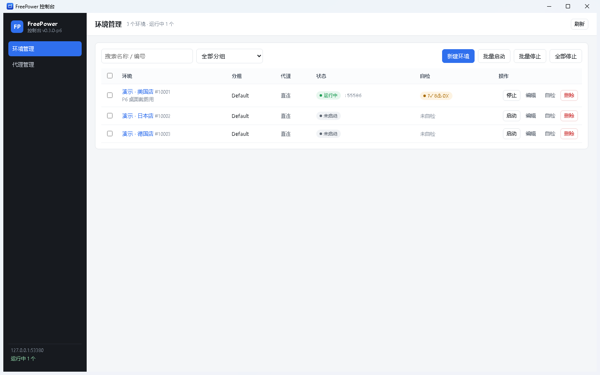

# FreePower

独立实现的指纹浏览器（AdsPower 同类产品）：**多环境隔离 + 代理绑定 + 指纹一致 + 本地 API**。

内核用官方 Chrome for Testing（独立进程），指纹通过 CDP 注入与启动参数实现，不搬运 AdsPower 的私有代码、二进制、资源与商标。

> 当前阶段：**P9 完成**（媒体设备改成「真实枚举 + 只改 label」、语音按环境语言投影；字体只做探测与 `none` 标注，不写注入）。之前：P1 存储/校验/启停、P3 前置代理 fail-closed、P2 自检与四维确定性噪声、P4 本地 API 完整化 + 批量启停、P5 Web 管理控制台、P6 桌面壳、P8 外部检测对照。
> 阶段细节见 [P1](docs/02-P1-交付.md)、[P3 前置](docs/03-P3前置-代理与启动参数.md)、[P2](docs/04-P2-自检与注入补全.md)、[P4](docs/05-P4-本地API完整化.md)（附 [curl 实测记录](docs/05-P4-curl实测.md)）、[P5](docs/06-P5-Web控制台.md)、[P6](docs/07-P6-桌面壳.md)，技术路线见 [技术方案](docs/00-技术方案.md)。

## 一、范围（先看这个，避免后面被要求补）

### 做

- 环境（profile）增删改查、分组、指纹重生成；**运行中改配置可一键重启**（`POST /api/v1/browser/restart`，stop → 落库 → start 一个请求内完成，控制台里运行态保存按钮变「保存并重启」）
- 启动/关闭浏览器实例：独立 `--user-data-dir`、独立进程、随机 CDP 端口、进程树回收
- 指纹：UA / UA-CH / 语言 / 时区 / 屏幕与 DPR / WebGL vendor+renderer / Canvas 种子化噪声 / Audio 噪声 / WebGL 图像噪声 / client rects 噪声 / hardwareConcurrency / deviceMemory / media devices（**真实枚举 + 只改名字**）/ 语音（按环境语言投影 `getVoices()`）/ platform / 字体声明（只声明，不注入）/ WebRTC 策略
- **隐私开关四项有真行为**（2026-11-12 第一批）：`disable_image` 内核层不请求图片、`disable_video` 按 `Media` 资源类型拦截、`blacklist` / `whitelist` 按域名（含子域、URL 通配、host:port）拦放行 —— 都有开/关对照判据，见第八节「隐私开关」
- **回收站**（2026-11-12 第一批 ②）：删除改成**软删除**（只置 `deleted_at`、**不删 user-data**），`list`/`detail`/`start`/`update` 一律看不到已删项；`recycle-bin/list`、`recycle-bin/restore` 两条路由按逆向切片的形状落地（item 严格 6 字段、恢复要显式选 `group_id`），见第八节「回收站」
- 自检：每个环境启动后自动跑一次真实页面探针，输出 19 项可读报告（覆盖度对齐字段表 full/partial/none），含「页面直接创建的三类 worker + 嵌套 worker」双 Realm 断言与 AudioWorklet 明确 `none`，支持 API 与本地 HTML 页。**worker 不是全覆盖**（OOPIF 子帧、启动前已在跑的 SW 仍是盲区），边界见已知限制第 6 条
- 代理：HTTP/HTTPS/SOCKS5 绑定、账号密码认证（HTTP 代理）、**fail-closed**；PAC 明确拒绝（不支持就报错，不静默降级）；代理管理页**单条 / 批量健康检查**（出口 IP / 国家 / 延迟 / 时间，失败区分超时、认证失败、代理拒绝 CONNECT、连接被拒、DNS、TLS；批量限并发 3、单条 10s 上限，超 24h 的结果标「结果过期」）
- **批量菜单 11 项 + 归档 + 视图密度**（0.4.3 ③）：批量改代理 / UA 内核 / 备注 / 环境信息、批量归档·恢复·删除、显示窗口、检查代理、还原 Cookie（覆盖）· 合并 Cookie（并集）；**归档 ≠ 删除**（只写 `archived_at`，不碰 `deleted_at` 与 user-data，和 `/recycle-bin/*` 是两套语义）；检查代理限并发、成功/失败/超时/直连四态分开报且超时给秒数；两种 Cookie 操作都**先预览再确认**；视图密度三档**只存 localStorage**。九条路由 `/api/v2/browser-profile/batch/*` 见第五节
- 本地 API：`/status`、环境 CRUD、分组、标签、代理列表、浏览器启停、**批量启停（并发上限 + 失败清单 + 可中断）**、自检报告；返回值形状对齐 AdsPower（`ws.puppeteer` / `ws.selenium` / `debug_port` / `status: Active|Inactive` / `cookies` / `kernels`）
- **Web 管理控制台**（`node:http` 直接托管，浏览器打开 `127.0.0.1:<端口>/` 即用）：环境列表（启动/停止/自检状态/批量操作）、环境编辑（11 组分栏表单，值域与必填来自后端注册表）、代理管理、自检报告、**AI Agent 面板**（一句话目标 → 动作清单 → 逐条批准 → 运行 → 每步结果）。五个页面全部只调自己的 Local API，没有私有通道
- **AI Agent（0.4.0）**：`browser_task` 7 个动作、HITL 每步审批 + digest 绑定、工作流落盘与本地 CDP 执行、**模型真调用**（OpenAI 兼容，key 用户自填、不带内置 key）、控制台面板与截图票据取图 —— 细节见第十节
- 未实现的云端透传接口（分享、成员体系…）**明确报「不支持」**（`code:-1` + `data.supported:false`），不假成功、不留未知码。**现在这条清单实际是 14 条**（`src/api/routes.js` 的 `placeholders` 数组，2026-11-13 逐个数过）：原来这类有 46 条，回收站两条已本地实现（2026-11-12），**内核下载已本地实现**（2026-11-13，走 Chrome for Testing，见第十一节），其余云端依赖的同类项合并后剩 14 条 —— 数字按实际数组算，不按历史回执抄（旧回执里写过的 44 / 17 / 15 都不再作为当前值）。
- **桌面版**：Electron 壳（单实例 / 托盘 / 关窗不退出 / 开机自启开关 / 退出前必清残留内核）+ NSIS 安装包，不需要 VS 编译链
- **侧栏底部账号菜单 + 设置 + 网络诊断**（0.4.3 ④）：设置（窗口同步默认设置存库并真的用在「开始同步」上、全局快捷键、外观=视图密度、本地 API 摘要，**没做的项逐条写明**）、网络诊断（**只读**：服务 / 监听端口 / 内核 / 绑在环境上的代理探测，不写库、不起停内核、探测不落盘），见第五节

### 不做（已和 CEO 确认，写进范围外）

- **云手机模块**：不做，不留 UI、路由、依赖、占位。**AI Agent** 早期（0.3.x）列为范围外，0.4.0 起按 CEO 拍板追加，范围锁死为「1 会话 + 1 环境 + `browser_task` + `adspower_cli` + HITL 审批 + 自带 LLM」（见第十节）—— 不加并发池、不做技能市场、不引对手 Agent Core。本地 API 的「脚本驱动浏览器」仍是基础能力。
- 账号 / 计费 / 团队协作 / 云端同步：不做。
- AdsPower 54 条路由里 46 条是往它自己云端透传的，我们没有云，这 46 条照做没有意义：只做本地能自洽的那部分。
- 自编译 Chromium 内核（见下面「已知限制」第 1 条）。

## 二、技术栈

| 层 | 选型 | 说明 |
|---|---|---|
| 运行时 | Node.js ≥ 22.5（ESM） | 当前验证于 v24.14.1 |
| 存储 | `node:sqlite`（内置） | 零原生依赖，单文件 `data/freepower.db` |
| 本地 API | `node:http` + 自写路由/限流/鉴权 | 零第三方依赖 |
| CDP 客户端 | 自写 WebSocket（`src/kernel/cdp.js`） | 只实现需要的帧类型，无 `ws` 依赖 |
| 内核 | 官方 Chrome for Testing | P0 用系统 Chrome 验链路，P1 接 CfT 版本矩阵 |
| 主程序 UI | 原生 JS + 自写极简视图层，`node:http` 托管静态页 | 不引前端框架、不建构建链 |
| 桌面壳 | Electron（主进程内起同一个服务，窗口 loadURL 到它） + electron-builder | 只做窗口/托盘/单实例/自启，**不重写服务**；无 native 模块，不需要 VS 编译链 |

刻意保持 **零运行时依赖**：一开始就装一堆包，后面每次改内核启动参数都要跟着升级，收益不抵成本。

## 三、快速开始

```powershell
cd C:\Users\1\.dsh\bot\workspace\freepower
npm start
```

启动后：

- API：`http://127.0.0.1:53380`（53380 起，被占用就往后找，最多 20 个端口）
- 发现文件：`data/local_api`，里面有实际地址和 `api_key`
- 数据目录：`data/`（库、每个环境的 user-data-dir、日志）

> 端口用 53380 起是为了避开本机已装的 AdsPower（50325）。

指定内核：

```powershell
$env:FREEPOWER_CHROME='C:\path\to\chrome.exe'; npm start
```

桌面版（Electron 壳，见第六节）：

```powershell
npm install            # 首次：装 electron / electron-builder（约 150MB，可用 ELECTRON_MIRROR 加速）
npm run desktop        # 开发态起桌面壳
npm run dist:win       # 打 Windows 安装包 → release\FreePower-<ver>-setup.exe
```

## 四、本地 API

鉴权：`api-key` 头（对齐对手）、`api_key` 查询参数 / 头、`Authorization: Bearer`。**本地校验，离线可用**（对手是远端校验，离线不可用，这是我们有意做的差异）。

限流：**四档**阈值 —— 默认 **1/s**、`x-freepower-client: mcp` **30/s**、控制台 `ui` **60/s**、`/api/v1/fbbird/user/list` 单独一桶 **10/s**（`src/config.js:21` DEFAULT / `:22` MCP / `:29` FBBIRD / `:35` UI，分别可用 `FREEPOWER_RATE_LIMIT` / `FREEPOWER_RATE_LIMIT_MCP` / `FREEPOWER_RATE_LIMIT_FBBIRD` / `FREEPOWER_RATE_LIMIT_UI` 覆写）。令牌桶在 `src/api/server.js:14-25`，**桶键是 `apiKey|<std|mcp|ui|fbbird>`**（`server.js:151-158`）—— 即「**一个 key × 一种档位 = 一个桶**」，**不是每端点一个桶**：同一把 key 下 `/user/list` 与 `/user/create` 共用 std 那份配额；`fbbird` 那条路由自己一桶（打 10 发不占 std 的额度，对手也是分开的两个桶）。档位判定：`mcp` / `ui` 头优先（升档照旧生效，带 mcp 头打 fbbird 走 30/s），否则看路由自己声明的 `rateTier`（`src/api/routes.js:234` 那条 fbbird 标了 `fbbird`），再否则 std。`/status` **完全不限流**：`src/api/routes.js:132` 把它标成 `{ auth: false }`，而 `server.js:139` 的 `if (route.auth !== false)` 把鉴权与限流整块跳过。

**超限不会返回 429**，一律 **HTTP 200 + `{"code":-1,"msg":"Too many request per second, please check"}`**（`server.js:161` 是 `send(res, 200, ...)`，报文逐字对齐对手，取自 `src/api/contract.js:41` 的 `TOO_MANY_MSG`）。所以调用方**必须看 `code` 字段**，只看 HTTP 状态会把「被限流」当成「成功」。

实测（2026-11-12 13:14，对本机 `127.0.0.1:53380` 的**只读**端点 `GET /api/v1/group/list`，原始响应）：

```
不带 mcp 头，1 秒内连发 3 次（三次共 22 ms）：
  #1  t=3..18 ms   HTTP=200  {"code":0,"msg":"success","data":{"list":[{"group_id":"0","group_name":"Default","sort":0}]}}
  #2  t=21..21 ms  HTTP=200  {"code":-1,"msg":"Too many request per second, please check"}
  #3  t=21..22 ms  HTTP=200  {"code":-1,"msg":"Too many request per second, please check"}
隔 2 秒再发 1 次：
  #4  HTTP=200  code=0 / msg=success，data.list 1 条
带 x-freepower-client: mcp，连发 10 次：成功 10 / 被限 0
带 x-adspower-client: mcp，连发 5 次：成功 5 / 被限 0
不带 key 连发 5 次 GET /status：5 次全 HTTP 200 {"code":0,"msg":"success"}（免鉴权 + 不限流）
```

**已对齐（2026-11-12，原先列在这里的 backlog 已做掉）**：`/api/v1/fbbird/user/list` 对手是 **10 次/秒**（对手侧读数，见 `docs/reverse/07-LocalAPI路由全量清单.md` 的限流分桶：54 条路由除 `/status` 外全 1/s，只有这一条 10/s）。我们原来走默认档 1/s，现在给它**单独一桶 10/s**（`RATE_LIMIT_FBBIRD`，桶键 `apiKey|fbbird`），**默认档仍是 1/s**，没有顺手把全局限流抬上去。判据（`test/api.test.mjs`）：同一把 key 一次性打 10 发全过、第 11 发被限，紧接两发 std 路由第二发必被限 —— 两条对照缺一就是假绿。

**档位只由本地决定，不拉远端配置（有意差异，明确不做）**：对手的限流档位可以被远端 `SHELL_CONFIG` 覆盖（`client/shell-config/get?key=SHELL_CONFIG`，键名形如 `"10_1"` = 10 次/1 秒，见 `docs/reverse/01-架构与LocalAPI.md:62`）。我们**不实现这条路**。理由一句话：**那要我们的产品向对手的服务器发请求** —— 一个本地单机产品，为了「档位可远程调」去连 adspower 的域名，等于把「这台机器上跑着什么」上报给对手；收益是零（档位我们发版就能改），代价是隐私和可用性（对方关站就没人能启动）。**档位只由 `FREEPOWER_RATE_LIMIT*` 这几个本地环境变量决定。**

CORS：只放行 `127.0.0.1` / `localhost` 的 Origin，其他返回 `403` + 纯文本 `CORS ERROR`。

### API 验证开关（0.4.2）

控制台「API & MCP」页有一个 **API 验证**开关，对齐对手同名开关的语义：**关掉 = 不校验 `api_key`**。

- 存在 `meta.api_verify`，**只有明确写 `'0'` 才算关**；键不存在 / 写坏了 / 空串一律按「开」处理（`src/api/info.js` 的 `apiVerifyEnabled()`）。别做成「配错就放行」。
- **关掉之后本机任何进程都能调 API** —— 包括改环境、重置 key。这是开关本身的语义，不是缺陷；页面上有一行警告，README 也写在这里。
- **限流照旧生效**：这个开关管「认不认人」，不管「能不能打爆本机」。关掉验证后匿名请求共用同一把桶（桶键是**服务自己的 key**，不是请求带来的 key）。
- 判据（`test/api-mcp.test.mjs`）：关掉 → 不带 key 返回 `200 + code 0`；开回来 → 不带 key 又回到 `401`。**两个方向都测**，只测一边等于没测。
- 免验放行的请求单独计数（`stats.open`），用户能看出开关是不是真的生效了。

### key 重置（0.4.2）

`POST /api/v2/api/key/reset` 换一把新 key，**三件事必须同时做**，少一件都会留下「旧 key 还能用」或者「脚本拿旧 key 撞 401 但没人知道为什么」：

1. 库里换（`meta.api_key`）；
2. `data/local_api` 发现文件一起换（脚本、MCP server、CLI 都靠它）；
3. **本进程立刻按新 key 校验** —— 所以 `server.js` 里的 key 是可变引用 `auth.key`，不是常量。做成常量的话，重置完只有重启才生效，那是安全缺陷。

判据：重置后旧 key 立刻 401、新 key 立刻可用、发现文件同步、计数归零（换 key 等于换了一个使用阶段）。

### MCP server（0.4.2）

`mcp/server.mjs` —— **stdio 上的 JSON-RPC，零依赖**。没有引 `@modelcontextprotocol/sdk`：官方 SDK 不在我们的依赖里，为一个「把本地 API 包成 tools」的薄壳引一整套（含 zod 等传递依赖）不划算，而 MCP 的 stdio 传输就是一行一条 JSON-RPC 消息，`initialize` / `tools/list` / `tools/call` 三个方法手写比读 SDK 文档还短。

- **只连 `127.0.0.1` 的本地 API**，不向外发任何请求。key 从 `FREEPOWER_API_KEY` 或 `data/local_api` 读。
- 十个工具：`list_profiles` / `get_profile` / `start_profile` / `stop_profile` / `create_profile` / `update_profile` / `new_fingerprint` / `list_proxies` / `list_running` / `server_status`。
- 工具失败走 `result.isError`（协议这么定），不占 JSON-RPC 的 `error` 通道 —— 客户端才能把「工具报错」和「协议坏了」分开处理。
- **stdout 是协议通道**，一行日志混进去就废；所有诊断信息走 stderr。
- 客户端配置（控制台里能直接复制，端口与 key 自动填当前值）：Claude Desktop `claude_desktop_config.json`、Cursor `.cursor/mcp.json`、Codex `~/.codex/config.toml`（TOML 段，反斜杠已转义）。

判据（`test/api-mcp.test.mjs`，真起子进程、真走 stdio）：`initialize` 回协议版本与 serverInfo、`tools/list` 拿到十个工具、`tools/call list_profiles` 拿到**真实环境数据**（不是空壳）、未知工具回 `isError`、未知方法回 `-32601`。

### CLI `fp`（0.4.2）

`bin/fp.mjs`，`package.json` 的 `bin` 字段挂了 `fp`：

```
fp list                  列出环境
fp start <id> [id...]    启动
fp stop  <id> [id...]    停止
fp status                服务状态 + 运行中的环境
```

- 选项：`-k/--key`、`-p/--port`、`--json`。key/端口优先级：命令行 > 环境变量 > `data/local_api` > 默认 `53380`。
- 默认档位是 1 req/s，而一次操作可能连发几个请求（`fp stop a b c`）—— 撞到限流按报文提示退一步重试，**最多 3 次**，仍失败就如实报错。
- 没读到 key 时**退出码非 0 并提示怎么给 key**，不静默成功。

### 端点清单从路由表派生（0.4.2）

「API & MCP」页要展示「方法 + 路径 + 一句话说明」。这份清单**不是手写的**：`src/api/catalog.js` 的 `routeCatalog(buildRoutes())` 直接遍历路由表，只维护一份**词表**（名词/动作 → 中文），路径永远来自路由表。手写一份清单第一周就会和路由表脱节 —— 加了路由页面不显示、删了路由页面还留着，用户按页面调接口拿到 404，然后没人知道该信哪个。

- 词表漏了词就原样显示英文段，**不会说谎**。
- 路由表里标了 `unsupported: true` 的那批（明确报不支持的占位）在页面上标成「不支持」，标记只加在真的会抛 `-1` 的路由上，不靠路径猜。
- 判据：页面显示的条数 === **同一次** `buildRoutes().length`。变异检验（把 `routeCatalog` 截断成前 10 条）红 4 条：数量不符、缺自己那条、分组只剩 2 个、不支持变成 0 条。


### 路由

| 方法 | 路径 | 说明 |
|---|---|---|
| GET | `/status` | 探活，`{"code":0,"msg":"success"}`，免鉴权、**不限流** |
| GET | `/api/v1/user/list` | 环境列表（`page` / `page_size` / `group_id` / `name`） |
| POST | `/api/v2/browser-profile/list` | 环境列表（v2：`limit` **不传只回 1 条**，照抄对手；显式给 `page_size` 时按它翻页） |
| GET | `/api/v1/user/detail` | 单个环境 |
| POST | `/api/v1/user/create` | 建环境 |
| POST | `/api/v1/user/update` | 改环境 |
| POST | `/api/v1/user/delete` | 删环境（运行中会先停） |
| POST | `/api/v1/user/regroup` | 改分组 |
| POST | `/api/v1/user/new-fingerprint` | 整组重生成指纹（≤10 个） |
| GET | `/api/v1/group/list` | 分组列表 |
| POST | `/api/v1/group/create` | 建分组 |
| POST | `/api/v1/group/update` / `delete` | 改 / 删分组（删组把环境挪回 Default，不连带删环境） |
| GET | `/api/v1/browser/start` | 起环境（支持 `launch_args` 覆盖、`force=1`） |
| GET | `/api/v1/browser/stop` | 关环境（没开 → `800002`；成功**没有 `data`**） |
| GET | `/api/v1/browser/active` | `{status:"Active",...}` 或 `{status:"Inactive"}`（缺 id → `100002`） |
| GET | `/api/v1/browser/local-active` | 本机已开环境 `{list:[...]}` |
| POST | `/api/v1/browser/cloud-active` | **明确报不支持**（云端能力，本地没有），不会假成功 |
| POST | `/api/v1/browser/batch-start` | 批量起（并发上限、失败清单、可中断）— FreePower 扩展 |
| POST | `/api/v1/browser/batch-stop` | 批量停 — FreePower 扩展 |
| POST | `/api/v2/browser-profile/stop-all` | 关掉本机全部 |
| GET | `/api/v2/browser-profile/cookies` | `{cookies:"<login_cookie 原文>"}` |
| POST | `/api/v1|v2/browser-profile/import` | **环境导入**：JSON 三种 body（`{list}` / `{data:{list}}` / 裸数组）都认，或 `{format:"txt", content:"..."}` 认 AdsPower `.txt` 块格式；未知字段进 `warnings`；`imported` / `failed` 顶层与 `data` 各一份（`code` 仍 0）。**请求体默认上限 64 MB**（`FREEPOWER_MAX_BODY` 覆盖，超限回 **413** + 中文 msg，不是掐连接）；`.txt` 的 `failed[].index` 是**本请求内的块号（0 基）**、响应带 `blocks`（本请求解析出的块数）—— 控制台会自动分批并用 `first_block` 换算成整份文件的块号（0.4.4） |
| GET/POST | `/api/v1|v2/browser-profile/export` | **环境导出**：默认 `{list}`，同时带我方字段与 AdsPower 兼容键（`proxy_*`，代理密码原样）；`format:"txt"` → `data:{format,count,filename,content}`（AdsPower 块格式，**不含 list**）；`{profile_id:[...]}` 或 GET 多个 `profile_id` |
| POST | `/api/v1|v2/browser-profile/copy` | **复制环境**：指纹配置原样，`fp_seed` 与四个噪声种子**全部重生**，返回 `seeds_regenerated:true`；`copy_cookies` 默认关 |
| GET | `/api/v1|v2/browser-profile/cookie/export` | **cookie 导出**（`format=json|netscape`）；**要求环境在跑**，没跑报 `800002`，不会为了导出偷偷起内核 |
| POST | `/api/v1|v2/browser-profile/cookie/import` | **cookie 导入**：`cookies` 数组或 `{format:"netscape", content:"..."}`；要求环境在跑；`imported>0` 时回读校验 |
| GET | `/api/v2/browser-profile/kernels` | `{list:[{kernel_type,kernel,is_downloaded}]}`（`kernel_type` 非法 → `100002`） |
| POST | `/api/v2/browser-profile/download-kernel` | **下载内核（0.4.1 起真实现）**：`{kernel_type:"Chrome",kernel_version:"157"}` → `{code:0,data:{status[,progress]}}`，同步状态机、无 task id、无轮询端点；源是 Chrome for Testing，**不支持 Firefox**（有意差异），详见第十一节 |
| POST | `/api/v2/browser-tags/list` / `create` / `update` / `delete` | 标签 CRUD（本地实现） |
| POST | `/api/v2/proxy-list/create` / `update` / `list` / `delete` | 代理列表 CRUD（本地实现；create 的 body 是**顶层数组**） |
| POST | `/api/v1/proxy/check` | 代理预检：先验一下代理再绑环境（`data.ok` 是检查结果，失败也 `code:0`） |
| GET | `/api/v1/browser/selfcheck` | 自检报告（`user_id`；`rerun=1` 重跑） |
| POST | `/api/v2/browser-profile/create` | 建环境（v2 形状：`launch_args` 出站数组、`password_filling` 单布尔） |
| POST | `/api/v2/proxy/check` | 代理预检 |
| GET | `/api/v2/browser-profile/selfcheck` | 自检报告（`profile_id`；`rerun=1` 重跑；`format=html` 出自检页） |
| POST | `/api/v2/browser-profile/selfcheck-summary` | 批量取自检摘要（列表页那一列用，`{list:{id:摘要}}`） |
| GET | `/api/v2/browser-profile/schema` | **编辑表单的 schema**：11 组 131 字段的类型/值域/必填/默认值，与后端注册表同一份 |
| POST | `/api/v2/browser-profile/validate` | 只校验不落库：与 create/update 同一个 `validateProfile`，返回 `{ok,errors[],warnings[]}` |
| GET | `/` | **Web 管理控制台**（静态页，注入本地 api_key；外站 Origin 403） |
| GET | `/ui/*` | 控制台资源（`app.js` / `style.css` / `pages/*.js`），越权路径一律 404 |

未实现的云端透传接口（分享、成员体系、fb/*…）统一返回（**回收站两条已于 2026-11-12 本地实现，内核下载已于 2026-11-13 本地实现，都不在这个清单里**，见第八节「回收站」与第十一节「内核下载」）：

```json
{"code":-1,"msg":"FreePower 不支持该接口（AdsPower 依赖其云端，本地没有对应能力）：/api/v2/browser-profile/share","data":{"supported":false,"path":"..."}}
```

错误码只有 6 个，脚本不会拿到未知码：`-1` 通用 / `100001` 环境不存在 / `100002` 参数非法 / `800002` 未在运行 / `800003` 启动失败 / `800005` 启动前一致性校验不通过。

批量启停（FreePower 扩展，响应形状）：

```json
{"code":0,"msg":"success","data":{
  "requested":3,"concurrency":3,"interrupted":false,"elapsed_ms":8120,
  "started":[{"profile_id":"a1","pid":123,"ws":{"puppeteer":"ws://..."},"debug_port":"60001","already_running":false}],
  "already_running":[],
  "failed":[{"profile_id":"a2","code":800003,"reason":"proxy_unreachable","message":"..."}],
  "skipped":["a3"]}}
```

`interrupted:true` 表示中途失败后**没有继续起剩下的**，剩下的原样在 `skipped` 里；起成功的不会回滚，用户能明确知道哪些成了。

`browser/start` 返回（形状按拆解手 05 号契约）：

```json
{"code":0,"msg":"success","data":{
  "profile_id":"kjkvcd","pid":1234,
  "ws":{"puppeteer":"ws://127.0.0.1:60328/devtools/browser/b742df5a-...",
        "selenium":"127.0.0.1:60328"},
  "debug_port":"60328","status":"running","already_running":false,
  "proxy":{"ok":true,"ip":"203.0.113.9","countryCode":"JP","timezone":"Asia/Tokyo"},
  "egress":{"ok":true,"ip":"203.0.113.9","countryCode":"JP"},
  "ua_aligned":null,
  "launch_args":{"applied":[],"rejected":[]},
  "selfcheck":{"ok":true,"score":79,"total":15,"pass":7,"warn":8,"fail":0,
               "full":7,"partial":7,"none":1,
               "hashes":{"canvas":"7eca175f","webgl_image":"3e6069c5","audio":"ada0a40f","client_rects":"1e14d3ce"},
               "report_url":"/api/v2/browser-profile/selfcheck?profile_id=..."},
  "warnings":[{"field":"proxy","message":"未绑定代理：出口即本机 IP…","severity":"soft"}]}}
```

三条硬规则：`ws.selenium` 只放 `host:port`；`debug_port` 是字符串；重复调用 `start` 幂等（返回同一 `pid`，`already_running:true`）。
新增字段都是超集（`proxy` / `egress` / `selfcheck` / `ua_aligned` / `launch_args` / `warnings`），旧字段一个没动。

代理不可用时 `start` 返回 `code:800003` + `data.reason:"proxy_unreachable"` + `data.proxy_check` 诊断，**内核进程根本不会启动**（fail-closed，详见 [P3 前置](docs/03-P3前置-代理与启动参数.md)）。

### 例子

```powershell
$key = (Select-String -Path data\local_api -Pattern 'api_key=(.*)').Matches[0].Groups[1].Value
$h = @{ api_key = $key; 'x-freepower-client' = 'mcp' }

Invoke-RestMethod -Uri 'http://127.0.0.1:53380/api/v1/user/create' -Method Post -Headers $h `
  -ContentType 'application/json' -Body '{"name":"env-a","country":"US","open_urls":["https://example.com"]}'

Invoke-RestMethod -Uri 'http://127.0.0.1:53380/api/v1/browser/start?user_id=<profile_id>' -Headers $h
```

## 五、Web 管理控制台

`npm start` 之后浏览器直接打开 `http://127.0.0.1:<端口>/`（端口看 `data/local_api`）。不用装任何东西，也没有第二套进程。

十二个页面（其中「环境管理」是**一个侧栏项 + 三个页内 tab**：环境列表 / 分组管理 / 回收站 ——
形态照逆向 `28-远端UI界面结构.md` 里对手的 `environmentManagement.tabs`，侧栏没有二级展开菜单；
最后两页「设置」「网络诊断」不占侧栏分组，从**侧栏底部的账号菜单**进）：

| 页面 | 做什么 |
|---|---|
| 环境列表 | 启动/停止/批量启停/全部停止、运行态与端口、自检摘要、搜索与分组筛选、删除；工具条「导入」（JSON 三种形状，或 AdsPower `.txt`，按扩展名/首字符自动识别）、「导出 txt」（当前勾选或筛选结果 → AdsPower 块格式，值里的换行会替换并提示）、**归档筛选**、**视图密度**、**「批量操作 ▾」11 项**（0.4.3 ③，见下面那节），每行「导出」JSON（保真备份）、「复制」（复制=配置原样、四个指纹种子重生） |
| 分组管理（0.4.3 ②） | 分组列表带**环境数**（只数在用的，回收站里的不算）、新建、重命名、改备注、删除（**不删环境**：组里的环境挪回 Default，并如实回挪了几个；Default 不能删） |
| 回收站（0.4.3 ②） | 软删除的环境（user-data 还在盘上，恢复后能直接启动）；恢复（**必须选分组**，对齐对手）+ 彻底删除 / 清空（删记录 + 删 user-data 目录，不可恢复）；分页 100/页 |
| 环境编辑 | 11 组分栏表单（基本信息 / 浏览器与内核 / UA 与语言 / 噪声四维 / 字体 / 屏幕与硬件 / 媒体设备 / 网络与代理 / 地理定位 / 隐私开关 / 启动与缓存），保存前实时校验；Cookie 一栏带「导出 cookie（JSON / netscape）」「导入 cookie 文件」（**需要环境运行中**：cookie 在内核里，和这一栏的登录 cookie 文本不是一份数据） |
| 代理管理 | 代理列表增删改、按 `proxy/check` 预检出口、显示最近一次出口 IP 与国家 |
| 自检报告 | 评分、通过/告警/失败、覆盖度、四个噪声维度哈希与跨重启一致性、19 项逐条「声明值 vs 实测值」（含双 Realm 与 AudioWorklet） |
| AI Agent（0.4.0） | 选环境 → 填目标 → 生成动作清单 → 逐步看动作/参数/digest 前 8 位 → 逐条批准或拒绝 → 运行 → 每步结果（`text` 结果、截图相对路径与图片、cookie 条数）；fill / cookie set 的值显示 `••••`，截图走 120 秒票据链接（master key 不进 URL） |
| API & MCP（0.4.2） | 本地 API 状态（地址 / key 显示·复制·重置 / **验证开关** / 请求计数）、端点清单（从路由表派生，可搜可按分组筛，标出「不支持」那批）、MCP 配置（Claude Desktop / Cursor / Codex 三段，端口与 key 自动填，可一键复制） |
| 窗口同步（0.4.2 阶段 1，0.4.5 补齐操作台） | 选主窗口 + 受控窗口 → 开始/停止；四个同步开关（输入 / 点击 / 滚动 / 移动）与延迟、抖动，**运行中改立刻生效**；实时读数（转发条数、被开关拦下、已发出/待发）；**窗口尺寸不一致显著提示 + 一键统一尺寸**；顶部「重启同步 / 打开操作台」，页内另有**窗口排列**与**显示窗口**（0.4.5）；**操作台**是独立置顶小窗，两种形态（展开 430×620 / 收起 360×56），详见[下面那节](#窗口同步操作台桌面小组件045-2026-11-15) |
| 应用中心（0.4.3 ①） | 扩展库：导入（粘本机目录或 `.zip` 路径，**不是上传**）、启用/停用、改名、删除、看「被几个环境用」与落盘目录；环境编辑页里勾「这个环境用哪些」。文件全局共享一份，启用状态是环境级的，见 [15 号文档](docs/15-应用中心与扩展.md) |
| 设置（0.4.3 ④） | 窗口同步的**默认设置**（14 个开关/数值，存库、`/sync/start` 真的读它）、全局快捷键、外观（= 视图密度，与列表页同一个 localStorage 键）、本地 API 摘要；最后一节**逐条列出没做的项**（语言 / 主题 / 自动更新 / 退出登录 / 开机自启在别处）并说明原因 |
| 网络诊断（0.4.3 ④） | **只读**：服务（版本 / pid / 运行时长 / 内存 / 数据库 + WAL 字节数 / API 计数）、本产品自己的监听端口（本地 API + 各运行中环境的 CDP）、内核（已装 / 运行中 / 出口 IP）、绑在环境上的代理（按钮探测，按 host:port:账号 去重，三态分开、超时给秒数、**不落盘**） |

三条设计约束（都不是口号，代码里能对得上）：

1. **界面只调自己的 Local API**：`web/api.js` 里每个动作都是 `fetch` 到 `/api/v2/...`，没有任何私有通道。界面出问题时用 curl 一样能做，这也是对 API 契约的日常验证。
2. **校验只有一份**：表单的字段、值域、必填来自 `GET /api/v2/browser-profile/schema`（后端注册表生成的），错误文案来自 `POST /api/v2/browser-profile/validate`（和 create/update 同一个 `validateProfile`）。前端只做两件事：把 `errors[].field` 定位到输入框、把 `warnings[]`（含 `severity: hard|soft`）原样显示。**前端不自己编一句校验话**。
3. **删除是软删除**：列表页的「删除」把环境移入**回收站**（只置删除标记，user-data 目录留在盘上），弹窗里就写这一句，可以随时恢复；环境在运行会先停再删。真正不可逆的只有回收站里的「彻底删除 / 清空」（删记录 + 删 `data/profiles/<no>_<id8>/`），那一步的弹窗才写「不可恢复」。**早先这里写的是「本地硬删、不可恢复」，文案跟行为不一致，0.4.3 ② 改正了**。

界面截图（真实环境，5 个环境 + 1 个在跑）：


更多：[编辑页](docs/shots/02-edit.png)、[后端校验原文回填](docs/shots/03-edit-invalid.png)、[噪声四维分栏](docs/shots/04-edit-noise.png)、[代理管理](docs/shots/05-proxies.png)、[自检报告](docs/shots/08-selfcheck.png)。完整操作清单见 [P5 文档](docs/06-P5-Web控制台.md)。

### 应用中心与扩展（0.4.3 ①）

拆解结论（`adspower-reverse/8.9.23/27b`）有两条直接决定了建模，照着做：

1. **扩展文件全局共享一份**，按扩展 id 一个目录（`<数据根>/ext_env/<id>/`），**不是每个环境一份副本**
   —— 对手 8.9.23 也不是（100 个 profile 里 `extensionCenter` 一个都没有，命令行里 `--load-extension` 0 命中）。
2. **启用状态是环境级的**：共享的是文件，不是「开没开」。对手 `sysAppCateId==="0"` 那种
   「库内启用的全加载」的隐式语义**我们不实现** —— 勾了才加载，界面上看得见。

落成两张表：`extensions`（库：id / unique_id / name / version / path / status / sha256…）与
`profile_extensions`（环境 ↔ 扩展，显式勾选）。`sha256` 是目录内容指纹，用来做导入去重
（同一个包导两次不占两份盘）。**不写 `ext_env/record` 那种 JSON 索引** —— 对手两边
`ext_env/record` 与 `ext/record` 的 `version` 就不一致、谁是权威连拆解都定不下来，我们不让库里出现第二份事实源。

导入 = **复制**（源目录留着）：先落到 `.import-*` 临时目录 → 校验 manifest（`__MSG_` 本地化名会解析）
→ 算内容指纹 → 去重 → `rename` 成 `<id>`。「要么整份，要么没有」。

加载走 **CDP `Extensions.loadUnpacked`**（理由与四组对照实测见已知限制 46），发生在
`injectAndOpen` **之前**，结果落在 `/start` 的 `extensions` 字段：

```json
{ "requested": 2,
  "loaded": [{ "ext_id": "1000001", "chrome_id": "gffj…", "name": "FP One" }],
  "failed": [] }
```

一个都没勾时是 `null`；加载失败的会同时进 `warnings`；**目录被人删了**的在启动一开始就进 warnings 并跳过
——沉默的缺口比报错难查得多。

六条路由（`/api/v2/app/*`：`list` / `import` / `update` / `delete` / `profile` / `profile/set`），
错误码用 `100002`（参数非法）/ `100001`（找不到），不拿 `-1` 糊过去。
`profile/set` 与 `delete` 会回 `restart_required` / `running_affected`：**正在跑的环境改扩展要重启才生效**，不假装立刻生效。

和对手不一样的四处：只能本地导入（不转发别人的分发）、不能更新版本（换版本就删了重导，
而**扩展 ID 是加载路径的函数**，目录改名 = 换 ID = 扩展存储分家）、`ext_env/record` 不写、
MV2 装得上但 Chrome 137+ 可能不给跑（导入时明确告警）。完整设计与判据见 [15 号文档](docs/15-应用中心与扩展.md)。

### 环境管理页内 tabs（0.4.3 ②）

对手把「环境管理」做成**一个侧栏项 + 页内 tabs**（`28-` 号文：`XY.environmentManagement.tabs` 三项、
`meta.childrenAsTabs===true`），侧栏没有二级展开菜单。我们照这个形态：侧栏仍然只有「环境管理」一项，
页内三个 tab 是**三条真路由**（`#/profiles`、`#/profiles/groups`、`#/profiles/recycle`），
不是同一个页面里切一个 JS 变量 —— 能中键新开、能收藏、刷新后还在原 tab。

两条实现细节值得记：

1. 这两条路由**必须排在 `/profiles/:id` 前面**，否则 `groups` / `recycle` 会被当成环境 id 打开编辑页。
   `test/profiles-tabs.test.mjs` 用索引顺序钉住了这一点。
2. tab 是 `<a href>`，带 `aria-current="page"`：能开新标签、能被读屏软件读出来，判据也能静态钉「是真页面」。

分组管理：`profile_count` **只数在用的环境**（回收站里的不算）；删分组**不删环境**（挪回 Default，
返回 `moved` 说明挪了几个）；Default 不能删。备注存在 `meta` 表（`groups` 表没这一列）。

回收站：`list` 形状仍严格对齐 22- 号文（item 6 个键、`data = {list,page,limit}`、没有 `total`）；
`restore` 必须带 `group_id`（对手要求显式选分组）。另外加了一条**我们自己的**路由
`POST /api/v2/browser-profile/recycle-bin/purge`（彻底删除 / 清空）—— 对手没有这条（22- §5.4 无证据），
但「只能恢复、不能清」的回收站等于磁盘只进不出，所以做，且做严：

- **只删回收站里的**：在用环境走这条一律 `skipped: not_in_recycle_bin`，不给绕过软删除的口子；
- **参数必须显式**：`profile_id`（数组）或 `all: true`，一个都没给就 `100002` —— 全量动作最怕字段拼错被当成「清空」；
- **盘上删不掉就不删库**：留一条记录让用户还能再点一次，比删了库留下一堆没人管得着的目录强。
  **做法是两阶段**（`rename` 成墓碑 → 删墓碑）：`rename` 失败 = **一个字节没动**，如实报
  `{reason:'userdata_remove_failed', error_code:'EPERM', error_message}` 并保留记录；
  `rename` 成功但删不掉 → 把墓碑改回原名；改不回来才 `data_detached: true` + `detached_path`，
  这条连带删库、界面明说不能再恢复。原因要机器可读（脚本判断要不要重试），人看的中文由界面翻，不挤在一条串里。
  这不是只写在注释里 —— 主路用**真实占用**验过（起一个进程把 cwd 钉在该环境目录里，Windows 必现
  「不许删任何进程的当前目录」），见 16 号文档那节、`test/profiles-tabs.test.mjs` 4b 段与
  `test/purge-lock-kernel.test.mjs`（恢复后真能启动）。

顺手改掉一处**文案与行为不一致**：列表页的「删除」原来是「本地硬删，不可恢复」，
实际从 2026-11-12 起就是软删除（进回收站、user-data 留在盘上）。现在文案跟着行为走。

### 批量菜单与视图密度（0.4.3 ③）

形态依据 `28-远端UI界面结构.md`（第 195–205 行）：对手工具条上有「批量操作」清单 + 行内四项 +
「列表设置」的视图密度。我们照它的 11 项、照它的顺序，中间用两条分隔线分三段
（改配置 / 改列表归属 / 动运行时与登录态）：

| # | 菜单项 | 做什么 | 关键约束 |
|---|---|---|---|
| 1 | 修改代理 | `proxy_config` 写死一条 / `proxy_id` 绑代理列表 / `clear:true` 改直连 | 写死一条回 `shared_egress:true`，界面提醒「共用同一个出口 IP」；在跑的回 `restart_required` |
| 2 | 修改 UA / 内核 | UA 与内核大版本必须一致；只给 UA 时从**本机已装内核**里挑同大版本 | 对不上 `100002 field=ua`，不静默改其中一个 |
| 3 | 修改备注 | 四档 `replace`（默认）/ `append` / `prefix` / `suffix` | 覆盖会删掉原有备注，界面必须提示 |
| 4 | 更新环境信息 | 白名单 10 个基础字段，界面**把 10 个字段全列出来**（勾了才发、空着不改） | 非白名单进 `ignored_fields` 原样回报；**指纹种子不给批量口子**。**这条语义是我们自己定的，见下面那段的说明** |
| 5 | 批量归档 | 写 `archived_at`，移出主列表 | **不是删除**：不碰 `deleted_at`、不碰 user-data、能启动能编辑 |
| 6 | 批量恢复 | 从归档放回主列表 | 不是回收站恢复（那是 `/recycle-bin/restore`，且必须选分组） |
| 7 | 批量删除 | 移入回收站 | 软删除，可以随时恢复 |
| 8 | 显示窗口 | 批量版，不要求开同步会话 | 复用同步那套判定；`page_only` 不许说成「已置前」 |
| 9 | 检查代理 | 限并发 + 逐条结果 | `outcome: ok\|fail\|timeout\|direct`，超时带**具体秒数** |
| 10 | 还原 Cookie（覆盖） | 写完以文件为准，文件里没有的删掉 | **先预览再确认**，预览不带 cookie 值 |
| 11 | 合并 Cookie（并集） | 只补文件里有、环境里没有的 | 同名**以环境现有为准**，不动登录态 |

**归档与回收站是两套语义，数据层就分开**：归档写 `archived_at`、回收站写 `deleted_at`；归档的能启动能编辑、主列表默认看不见（选「只看已归档」）、永远不进回收站。
`/recycle-bin/*` 一次都没复用成归档，判据里有静态断言钉住。
另外两条边界：回收站里的不能被归档（`skipped: in_recycle_bin`），
**归档 → 删除 → 恢复后 `archived_at` 必须清空**（否则环境会「隐身」在主列表外，用户点了恢复找不到）。

**检查代理直连不算通过**：`outcome:'direct'` + `ok:false` + 「这个环境没绑代理（直连），没有代理可查」。
检查的是代理，直连没有代理可查 —— 给它编一个「检查通过」才是骗人。

**「更新环境信息」的语义是我们自己的解释，不是抄来的（口径要写清）**：逆向 `28-` 号文里，
对手在批量清单里只留下一个名字 `updateUserInfo` —— **没有字段清单，也没有行为证据**。
所以「批量改哪 10 个字段、覆盖还是追加、要不要白名单」全是 FreePower 的定义：
白名单 10 个（`name` / `remark` / `group_id` / `domain_name` / `open_urls` / `username` /
`password` / `fakey` / `platform_account` / `profile_tag_ids`），**整条覆盖不追加**，
非白名单字段进 `ignored_fields` 原样回报。界面把这 10 个字段**全列出来**（勾了才发、空着不改），
不能让人「勾完不知道改了啥」，也不能让人以为没列出来的字段也能在这里改。
以后谁看这段：**别把它当成对手的行为引用**，它没有证据支撑，是我们为了让批量入口好用而定的。

**还原 vs 合并**这栏最容易做错，所以两个都默认 `preview:true`：只算不写，回「会加几条 / 改几条 / 删几条 /
留几条 / 无效几条」，用户看数字确认之后才真写。写后**回读校验**：`verified` 是「能读回来的条数」，
不是「发出去的条数」，读不回来的进 `warnings` 并点名。cookie 在内核里，所以**环境必须在跑**
（与 `/cookie/import` 同一口径，不为改 cookie 偷偷起内核），没跑的进 `skipped: not_running`。

**视图密度三档：紧凑 / 标准 / 超高，行高 30 / 44 / 64 px**。这三个数字是我们选的 ——
28- 号文只给了三个名字（`fbcc2` / `standard` / `broad`），没给行高，别写成「对手原值」或「系统下限」。
**只写 localStorage**（`fp.view_density`），不写库、不同步到别的机器：那是「这台机器上这个人看着舒服」
的显示偏好，跟着库走会被别人的习惯覆盖。脏值一律回「标准」。

九条批量路由（`/api/v2/browser-profile/batch/*`）都是**我们自己加的**（对手是云端 webui 内部接口，
没有可抄的本地 REST）。四条纪律：`profile_ids` 缺失/拼错一律 `100002` + `field`（**绝不当成「一条都没选」**）、
一条失败不中断整批（`failed` / `skipped` 点名到 profile_id）、超时给秒数、一次最多 500 个环境。

判据：

```
node --no-warnings test/batch.test.mjs               → 74 PASS / 0 FAIL  （A 层，进 npm test）
node --no-warnings test/batch-cookie-kernel.test.mjs → 18 PASS / 0 FAIL （B 层真内核，进 npm run smoke）
node --no-warnings test/batch-show-kernel.test.mjs   → 13 PASS / 0 FAIL （B 层真内核，进 npm run smoke）
```

A 层 11 段：九条路由缺字段、归档七条边界、检查代理四态与并发（整批 `1200×4+3000ms` 内收口）、
UA 自洽、备注四档、白名单、改代理三种、Cookie 纯函数（还原 `a1/u1/d1/same1/bad1`、
合并 `a1/u0/d0/keep1`）、显示窗口 skipped、密度（30/44/64 + 脏值回标准 + 只有一处 `setItem`）、页面静态 7 条。
Cookie B 层真内核读数：还原预览 `u1/a1/d1` 且**没写盘** → 真写 `w2/d1/verified2` →
回读 `[["added","a"],["sid","new"]]`（`gone` 真被删）→ 合并 `w1/d0` 且 `sid` 仍是 `new`。
显示窗口 B 层：最小化→`restored` 且位置尺寸一个像素没搬、没最小化→`page_only` 且 `os_foreground:false`、
`force`→`confirmed:'window_restored'` 且位置回原样、默认 `force:false`、没在跑→`skipped`。

这一块抓出两个**真缺陷**（都不是「测试没测到」，是测到了才发现行为与报告相反）：

1. **`proxy_config: null` 被吞**：「批量改成直连」回 `code=0`，但 host/port 原样留着。
   根因是 `updateProfile` 把 `null` 当成「没给」合并掉了。修法两处：store 里 null 走显式清空；
   repo 加 `NULLABLE_COLS`，显式 null 照写。
2. **只给 UA 时内核版本取错**：拿 UA 里的 `157.0.0.0` 当内核版本（后三段本来就是打码值），
   于是报「本机没有安装内核 157.0.0.0」。改成从已装内核里挑同大版本。

完整设计与逐条读数见 [17 号文档](docs/17-批量菜单与视图密度.md)。

### 侧栏底部账号菜单：设置 / 外观 / 网络诊断（0.4.3 ④）

形态照 `28-号文` §2 的「侧栏底部（账号菜单）」：对手那六项里我们做三项，其余三项**不摆假入口**
（没有账号体系就没有「邀请奖励 / 退出登录」，没有多语言就没有「语言」），
设置页最后一节把它们逐条写出来：状态 + 为什么 + 入口在哪。

菜单**向上弹**（它在侧栏最底下），`aria-haspopup` / `aria-expanded` / `role="menuitemradio"` 都有，
Esc 能收起。

**网络诊断只读，写在三个地方**（不是只写在文档里）：

1. **代码里零写操作**：`src/api/diagnose.js` 只 `stat`、只读内存表、只调纯探测；
   判据剥掉注释后扫 `setMeta(` / `updateProfile(` / `startProfile(` / `stopProfile(` /
   `writeFileSync` / `rmSync` / `rememberProxyCheck(`，一个都不许出现。
2. **行为验**：连读两次快照，环境 / 代理 / 设置**逐字节不变**。
3. **探测不落盘**：`/api/v2/diagnose/proxy` 与代理管理页那条**不是同一条路**（后者会写
   `last_ip` / `checked_at`），响应里明写 `readonly:true` + `persisted:false`，
   判据比对探测前后 `checked_at` 没变。

还有一条：**不为了出一份报告去起内核** —— 只报「现在在跑什么」，没跑就是空数组，
诊断页也不会因为想看内核就帮用户启动环境。端口**只列本产品自己的**，不扫全机端口。
代理账号**打码**、密码连字段名都不出现（这页会被截图发给别人）。

**设置页的项都要真生效**：同步默认设置存进库（`meta.sync_defaults`），`/api/v2/sync/start`
没显式给 settings 时用它，`/sync/status` 没在跑时显示的也是它 —— 判据直接验 `mergeSyncSettings()`
的合并结果，并静态断言 start 路由用的是它。存坏的 JSON 回默认但**如实说**（`broken:true`，
页面提示「已回内置默认」）。

**顺手修掉一处「说了但没做」**：同步页在「没在跑」时改开关，原来弹「已记住，开始同步后生效」，
实际什么都没存 —— 刷新就丢，那句提示等于骗人。现在它真存进库，设置页看得见同一份。

**外观沿用 ③ 的密度口径**：同一个 `fp.view_density`、同一套三档，不新造存储。
两个入口（列表页工具条的下拉、侧栏菜单的「外观」）靠一条 `fp:density` 事件互相同步，
不在两边互相 import。

判据 `test/settings-diagnose.test.mjs` **56 PASS / 0 FAIL**（A 层，不起内核，已进 `npm test`），
七段：设置合并与越界、真生效、存坏了、快照内容与只读、代理探测三态与不落盘、静态约束、纯函数契约。
完整设计见 [18 号文档](docs/18-侧栏账号菜单-设置-外观-网络诊断.md)。

### 大文件导入与代理类型（0.4.4，2026-11-15）

用户从 AdsPower 导出的 `profiles_*.txt` 在 0.4.3 里导入报「Failed to fetch」。两个**真缺陷**（第二个静默写错数据）：

1. **2 MB 请求体上限 + 先断连接后回响应**：`src/api/server.js` 收到第 2 MB 就 `reject` + `req.destroy()`，
   响应还没发出去，客户端只拿到 `Failed to fetch`。整份文件实测 21,157,002 B，切 3 块就 200 —— 导入逻辑没坏，
   是整份塞不进一个请求。**修法**：默认上限提到 **64 MB**（`FREEPOWER_MAX_BODY` 覆盖，每次请求现读），
   超限时**把剩余请求体读完再回 413**（实测另外三种写法客户端全拿不到响应），413 带中文 msg + 真实字节数 +
   「请分批导入」，并加 `connection: close`。
2. **`proxytype=socks5` 被存成 `http`**：`proxyOf` 里 `...fromString` 展开写在后面，把算好的 `'socks5'`
   覆盖成 `undefined`，`normalizeProxy` 兜底成 `http`。50 个环境全按 http 连、**零告警**。
   **修法**：`parseProxyString` 不再产出 `proxy_type`（改给 `scheme`），`proxyOf` 先展开、后写显式值。
   优先级：顶层 `proxy_type` > `proxytype` > 字符串 `socks5://` 前缀 > 无（→ `http`）。

**界面分批**（用户真正走的路，`web/txt-split.js` 纯函数）：双阈值 **≤8 MB 且 ≤40 块**，**只在块边界切**
（绝不切在 `cookie=` 行中间；那一行实测可 50 万字符），各批拼回去**逐字节等于原文**；顺序发送 + 常驻进度
（「正在导入 12/50 块…」）；一批失败不中断；**失败项的块号换算成整份文件的块号**（服务端 `index` 是批内序号，
界面加 `first_block`）；服务端响应新增 `blocks`，与预期不符时进 `warnings`；网络层错误给中文，不再把
`Failed to fetch` 原样抛给用户。

判据：A 层 `npm run test:api` 新增 **20 条**（代理类型三态 + 前缀优先级、切块纯函数、块号换算）；
B 层 `npm run test:import-large` **15 PASS / 0 FAIL**（合成 18.9 MB / 50 块真 HTTP 端到端，已进 `npm run smoke`）。
设计、红绿读数、边界见 [19 号文档](docs/19-大文件导入与代理类型.md)。

### 窗口同步操作台（桌面小组件，0.4.5，2026-11-15）

用户提的：「我们没有 AdsPower 的窗口同步操作台」。核过之后缺口比表面更大 ——
`web/` 里「操作台 / 小组件 / widget / console」**零命中**，只有一个 `#/sync-panel` 独立小窗、
**只能从托盘菜单打开**，页面里没有入口；没有收起/展开、没有自动收起、没有「正在同步操作」的紧凑态、
没有位置记忆；而且因为没有 preload，网页侧**根本无法通知桌面壳**做任何事。
同源的三个缺口（`窗口同步` 页缺「重启同步」「窗口排列」「显示窗口」）也一并补上。

**没有新增第二个浮窗**：把现有 `#/sync-panel` 改造成操作台，两种形态靠**真改窗口尺寸**实现：

| 形态 | 尺寸（**我们选的**，对手无证据） | 内容 |
|---|---|---|
| 展开 | 430×620（最小 380×420，可拉大） | 操作台设置 / 选窗口 / 状态 / 窗口排列 / 显示窗口 / 快捷键 |
| 收起 | 360×56（不可拉大） | **只有五项**：状态词、主控环境名、受控 N 个、停止、展开 |

**为什么收起必须是真改尺寸**：展开态 430×620 且始终置顶，用户点「开始同步」的下一秒就要在主控窗口里操作，
那块面板正好压在他要点的位置。只在大窗里换个布局 = 照样挡住，等于没做。

- **自动收起**（对手的 `automaticShrink`）**默认开**，同步开始时自动进收起态。**这是我们的选择**：
  对手证据里只有键名与文案（`28-远端UI界面结构.md:149`），**没有默认值**。
- **位置按形态分开记**，每次应用前按当前 `screen.getAllDisplays()` 校验：与某块屏交集不足 64×24
  就回主屏居中（拔副屏 / 改缩放后窗口不会留在屏幕外）。
- **状态词如实**：同步中「正在同步操作」；个别窗口断连只把 `tone` 变 `warn` 并另给 detail
  「有 N 个窗口连接断了」—— 我们**没有**对手 `syncOperateSyncException` 的对应状态，不硬造。
- **新增 preload，只开一个口子**：`desktop/preload.js` 只暴露 `isDesktop` + `openSyncPanel()`，
  **不透传 `ipcRenderer`**，只挂主窗口（操作台小窗不挂，它改形态走 Local API + 请求文件）；
  `sandbox` / `contextIsolation` 仍为 `true`。主进程侧还校验 `event.sender === win.webContents`。
- **纯网页如实禁用**：没有桌面壳时 `requestConsole` **不写请求文件**（写了没人读 = 说了没做），
  界面把按钮禁用并写明「桌面版才有操作台」。

接口三条：`POST /api/v2/sync/restart`、`GET /api/v2/sync/console`、`POST /api/v2/sync/console`；
排列/显示**打的就是既有的 `/sync/arrange`、`/sync/show`**（组件抽到 `web/sync-widgets.js`，两个页面共用一份）。

判据：`test/sync-console.test.mjs` **62 条**（已进 `npm test`）；两处先红后绿（收起态改成不改尺寸 → 8 条红；
位置校验改成「有保存值就用」→ 3 条红）。**真窗口那三条本机验不了**（agent shell 里 Electron 起不来），
`desktop:selftest` 里报 skip，清单见已知限制第 45 条。设计与边界见 [20 号文档](docs/20-窗口同步操作台.md)。

### 编辑页的「本版不支持」（0.4.6）

用户的原话是「配了没反应，等我在使用中才发现」。0.4.6 起，编辑页里凡是本版做不到的字段：

- 控件 `disabled`，**旁边一行小字「本版不支持 · <一句人话>」** —— 不是 `title`、不用悬停；
  文案来自后端字段表（`overrides.mjs` 的 `UNSUPPORTED`，71 条），前端只加统一前缀，不自己编理由；
- 页面顶部一句「本页 N 项在本版不可用」，每个 tab 上标「N 项不可用」，不用逐个找灰格子；
- 灰格子不再整格降透明度（降了那行原因是灰的，等于白写），只压标签与控件本身；
- `win_x` / `win_y` 做**联动禁用**：`window_position` 不是 `topLeft` 时这两个数不会被用，直接禁用并说明；
- `sync_password` / `fb_cloud_password_manager` 从「隐私开关」挪到「启动与缓存」（它们是「要不要跟云端同步」，
  不是指纹开关，位置错了比禁用更误导）。

哪些字段被禁用、为什么、证据引哪一节，见 [docs/23-假字段清理.md](docs/23-假字段清理.md)。

## 六、桌面壳与安装包（P6）

同一个服务，套了一层 Electron：主进程内起的就是上面那个 `node:http`，窗口 `loadURL` 到 `127.0.0.1:<port>/`。
**四页界面一个字节没改**，`web/` 仍然是零构建链。



桌面能力（都是壳的事，不碰服务）：

| 能力 | 行为 |
|---|---|
| 单实例 | 已经有实例在跑时，再点图标不会起第二个进程/第二个端口，而是把已有窗口拉到前台 |
| 托盘 | 常驻；菜单 = 打开控制台 / 运行中 N 个 / 停止全部环境 / 开机自启 / 退出 |
| 关窗不退出 | 点 × 只收进托盘，服务和内核都继续跑 |
| 托盘退出 | 先 `stopAll()`，再用命令行里的数据目录核对残留 chrome（`ensureNoChrome`：查 → taskkill → 再查），确认干净才退出；杀不掉就弹框默认留在托盘 |
| 开机自启 | `setLoginItemSettings`，默认关；开机进托盘不弹窗 |
| 安全 | `contextIsolation`/`sandbox` 开、`nodeIntegration` 关；**preload 只挂主窗口**（0.4.5 起），且只暴露 `isDesktop` 与 `openSyncPanel()` 两个东西，不透传 `ipcRenderer`；操作台小窗不挂 preload；`window.open` 一律 deny，外链丢系统浏览器，导航出本地地址也拦 |

**诊断开关**（正式包里就有，不是后门；不改数据、不开新端口、不联网）：
`FreePower.exe --selftest` 跑一遍壳自检并写 `desktop-selftest.json`（0.4.5 起含 `steps.console`：
收起/展开尺寸、`setBounds` 回读、位置记忆、副屏消失回主屏 —— 跑不了的环境写 `{skipped:true}`）；
`--quit-after-ms=N` 到点走托盘「退出」的同一个函数（自动化验收用）；
`--show-tray-menu` 把托盘菜单弹出来（截图/演示用）。

**装完要自己点一遍的四条**（0.4.5 操作台；本机 agent shell 里 Electron 起不来，这三条我没验出来，不许当已验证）：

1. 起两个环境 → 在「窗口同步」页选主/受控 → **开始同步** → 操作台应**自动收起**成一条 360×56 的横条
   （标题「正在同步操作」+ 主控名 + 受控 N 个 + 停止 + 展开）。点「展开」应还原成完整面板。
2. 把操作台拖到屏幕另一处 → 关掉（×）→ 从「窗口同步」页点「打开操作台」→ **应回到你拖到的位置**；
   点「操作台复位到默认位置」→ 回主屏中央。
3. 有副屏的话：把操作台拖到副屏 → 拔掉副屏 → 重新打开 → **应回到主屏中央**，不许留在看不见的地方。
4. 设置里关掉「同步开始时自动收起」→ 下次开始同步时操作台应**保持展开**（这条证明开关真的生效）。

装完：`%LOCALAPPDATA%\Programs\FreePower`，**357.4MB / 77 文件**，安装包 109.9MB；数据在 `%APPDATA%\FreePower\data`。

**控制台显示的版本号来自 `package.json`**：`src/api/server.js` 用 `createRequire(import.meta.url)` 读 `../../package.json`（asar 里目录结构不变，路径同样成立）。0.4.0 及以前那里是个写死的 `const VERSION = '0.3.2'`，升了版本控制台还显示 v0.3.2 —— 那类「常量与 `package.json` 各说一套」的问题在 0.4.1 一起收掉了，判据在 `test/api.test.mjs`（首页 HTML 里的版本必须等于 `package.json.version`，且不许还是 `0.3.2`）。

顺带收掉一个 P5 尾巴：HTML 自检报告不再把 master `api_key` 拼进 URL，改成 **120 秒、绑定 profile 的一次性票据**
（`POST /api/v2/browser-profile/selfcheck-ticket`）；`api_key` 走 query 的老用法保留，老脚本不受影响。

完整设计、打包踩的坑、验收记录与操作清单：[P6 文档](docs/07-P6-桌面壳.md)。

### 本机打包姿势（0.4.2 实测，2026-11-14）

`npm run dist:win` 在这台机器上**直接跑会挂在三个地方**，三个都是本机环境问题，**不影响产品**：
不进 asar、不进安装包、`src/` 与 `web/` 一个字节都不改。0.4.2 就是这样打出来的。

**坑 1：electron 包从 github 下不下来。** `electron-builder` 会去下 `electron-v45.2.3-win32-x64.zip`，
这里直连超时（`read tcp … wsarecv: A connection attempt failed`）。本机 `node_modules\electron\dist`
是完整的，直接让它用这份：

```powershell
& node_modules\.bin\electron-builder.cmd --win --x64 "--config.electronDist=node_modules/electron/dist"
```

注意参数要**加引号**：`-c.electronDist=…` 会被 PowerShell 当成文件名（报
`ENOENT …\.electronDist=node_modules\electron\dist`）。

**坑 2：`winCodeSign` 解包要给符号链接特权，本机没有。** 那个包里带 darwin 的
`libcrypto.dylib` / `libssl.dylib` 符号链接，7za 解它们要「创建符号链接」特权；
本机 `mklink` 实测「权限不足」（也不该去改用户的系统设置），于是 7za 退出码 2、打包中止：

```
ERROR: Cannot create symbolic link : 客户端没有所需的特权 : …\darwin\10.12\lib\libcrypto.dylib
```

darwin 的链接文件在 Windows 打包里毫无用处（Windows 侧只用包里的 `rcedit-*.exe` / `signtool.exe`）。
所以放了一个 **7za 包装器**，给每条命令补一个 `-snl-`（解包时不恢复符号链接），实测退出码 0、
`windows-10\x64\signtool.exe` 与 `rcedit-x64.exe` 齐全：

```
node_modules\7zip-bin\win\x64\
  7za.exe         ← 包装器（5120 字节，会转调下面这个，并补 -snl-）
  7za-real.exe    ← 真正的 7-Zip 21.07（原 7za.exe 改名而来）
```

包装器源码在 `tools/7za-wrap.cs`，重建命令（本机没装 .NET SDK，用系统自带的 csc）：

```powershell
& "C:\Windows\Microsoft.NET\Framework64\v4.0.30319\csc.exe" /nologo /target:exe `
    /out:"node_modules\7zip-bin\win\x64\7za.exe" "tools\7za-wrap.cs"
```

> **`npm ci` / 重装依赖会把这个包装器冲掉**（`node_modules` 整个重建）。冲掉之后打包会**突然挂在上面的符号链接错误上**，
> 现象和代码完全无关，别去翻业务代码 —— 按上面那行命令重编一次就好。
> 判断有没有被冲掉：`node_modules\7zip-bin\win\x64\7za.exe` 是 5120 字节（包装器）还是 1231360 字节（原版）。

**坑 3：缓存目录和临时目录不能落在工作区外面。** 本机下 7za 和 makensis 在工作区外写不进去
（同一个 7za 在 `.tmp` 里退出 0、在 `%LOCALAPPDATA%` 里退出 2；makensis 报
`Internal compiler error #12345: error creating mmap the size of 131780169`）。把两个目录都指到工作区里：

```powershell
$env:ELECTRON_BUILDER_CACHE = "C:\Users\1\.dsh\bot\workspace\freepower\.tmp\eb-cache"
$env:TMP  = "C:\Users\1\.dsh\bot\workspace\freepower\.tmp\sys-tmp"
$env:TEMP = $env:TMP
```

**网络到 github 不通时的补一刀**：`winCodeSign` / `nsis` 这些二进制也要从 github 下，
可以指到国内镜像（`$env:ELECTRON_BUILDER_BINARIES_MIRROR = "https://npmmirror.com/mirrors/electron-builder-binaries/"`）。
注意 app-builder 对 `winCodeSign-2.6.0.7z` **会校 sha512**（期望值烧在二进制里），
所以给它的必须是原包 —— 自己重打的包（哪怕内容等价）会因为 sha512 不符直接拒掉。

合起来，0.4.2 实际用的就是这一串（`EXIT=0`，产物 `release\FreePower-0.4.2-setup.exe`）：

```powershell
$env:ELECTRON_BUILDER_CACHE = "$PWD\.tmp\eb-cache"
$env:TMP  = "$PWD\.tmp\sys-tmp"; $env:TEMP = $env:TMP
& node_modules\.bin\electron-builder.cmd --win --x64 "--config.electronDist=node_modules/electron/dist"
```

打完之后**别从 `release\` 里装**：那里的 exe 带 Windows 的低完整性标签（`icacls` 有 `S-1-4-…`），
双击会「看着装完了、其实没装」（文件照拷、注册项和快捷方式静默丢失）。拷到桌面等普通目录再装，
拷过去标签就没了（0.4.1 起一直这么做）。

## 七、已知限制（必须如实告知用户，不藏着）

1. **Canvas / Audio / WebGL 标识 / 字体是 JS 注入，不是内核级。**
   拆解手 08 号报告实测：AdsPower 139 个指纹字段里走 CDP 注入的是 0 个，全在内核配置和启动命令行。
   所以我们这四项属于**降级实现**：能改返回值、能保证同种子可复现、能过一致性检查，
   但 `Function.prototype.toString` 痕迹、字体度量与真实字形交叉验证这些检测手段下**可被识别**。
   双 Realm 取证只补上了「页面直接创建的三类 worker + 嵌套 worker」这一层，**OOPIF 子帧、AudioWorklet、启动前已在跑的 SW 仍是盲区**（见第 6 条）。
   这是架构差距，不吹成 1:1。
2. **字体不伪装（P9-B 结论：不写注入，只探测 + 标 `none`）。** 只声明存在，不再伪造字形与宽度度量（自检里这一项叫「字体枚举面」、覆盖度 `none`、一律标黄）。
   根治要**自编译 Chromium**（把宿主字体集换成目标平台字体集）；JS 层做「字体投影」只能改 `measureText` / `document.fonts` 的返回值，改不了真实字形与宽度度量，**会造出新的不一致，风险大于收益**。
   **标 `none` 不等于字体指纹裸奔**：canvas 文本噪声已覆盖字形渲染这一类；裸的是「宿主装了哪些字体」这个**枚举面**（本机实测枚举到 `Microsoft YaHei` / `Microsoft YaHei UI` / `SimSun` / `SimHei` / `KaiTi` / `FangSong`）。
3. **内核配置类 42 条 + `--extended-parameters` 10 条不实现**，列入「不兼容项」。
4. **SOCKS5 的账号密码只有预检支持**（Chrome 的 `--proxy-server` 不接受 SOCKS5 凭据，内核限制）；HTTP/HTTPS 代理认证走 CDP `Fetch`，只对带账号密码的代理挂载，会给请求加一跳。
   AdsPower 形状的 `proxy_host` / `proxy_port` / `proxy_user` / `proxy_password` **全链路都认**（`checkProxy` 预检、`--proxy-server`、CDP `Fetch.authRequired`）；`buildArgs` 在「已绑定代理但 host/port 拼不出来」时**直接抛错**，绝不退回直连（fail-open 已修）。
5. **WebRTC 只做参数级**（`disable_non_proxied_udp`），不做 JS 层伪造 `RTCPeerConnection`。
6. **Worker 注入的覆盖范围：页面直接创建的三类 worker + 任意深度的嵌套 worker；OOPIF 子帧与启动前已在跑的 SW 不在内。**
   覆盖到的：专用 worker / SharedWorker / ServiceWorker 都能在**脚本首行之前**注入（`Target.setAutoAttach` + `waitForDebuggerOnStart`，实测三类 worker 的 `atTop` 均为 `worker`），module worker 实测同样覆盖，主帧与 worker 的 canvas 哈希同值。
   **worker 里再 `new Worker` 的嵌套层也覆盖**：每个 worker 会话自己再挂一次 `setAutoAttach`，递归下去，所以不设深度上限。实测页 → w4 → w3 → w2 → w1 → w0 共五层，五层 `atTop` 全是 `worker`、`hardwareConcurrency` 全等于主帧的伪装值，`injected` 精确为 5、`failed` 为空，整条链约 68ms（大头是 Chrome 起 worker 本身，每层只多一次本地 CDP 往返）。
   **没覆盖的：**
   ④ **OOPIF 子帧本轮不注入**（只计数不覆盖，子帧里取原生函数仍可能看到两套）。
   ⑤ **启动前就已经在运行的 SW**（只在它下次被激活时接入）。自检里那条只验证**新建 SW**，别读成「SW 已支持」。
   ⑥ **AudioWorkletGlobalScope 标 `none`**——它没有独立 target、没有干净注入通道，靠 Fetch 改源码会被 `import.meta.url` 和模块完整性检测抓；
   但**音频指纹本体不在那里**：本体是主帧 `OfflineAudioContext` 的浮点噪声，已由 `audio` 维度覆盖，`AudioWorklet` 里裸的只有 `sampleRate`/`currentTime`。
   → 换句话说：**音频指纹没有裸奔**，别把这条读成「audio 没做」。
   注：自检的 19 项里**不含**嵌套 worker 一项（自检只验证页面直接创建的三类），嵌套这条由 `test/workers.test.mjs` 的三条断言钉住。
7. **沙箱内起不了 Chrome**：Windows 沙箱禁止命名管道，Chrome 的 Mojo IPC 会以 `platform_channel.cc:112 Check failed: 0x5` 自终止。这不是产品缺陷，但**跑冒烟必须用普通终端（非沙箱）**。
8. **`https` 代理 + `https` 目标**（TLS in TLS）预检不支持，会明确报错，不静默降级。
9. **PAC 明确不支持（不是静默降级）**：`full_pac_url` 或 `proxy_type=pac` 直接报错 `100002`（建环境）/ `800003`（老数据启动，`reason=pac_unsupported`），**一个内核进程都不会起**。原因是 PAC 可能含 `DIRECT` 回退，无法保证 fail-closed。
   **2026-11-13 更正（只改事实，历史判断保留）**：这条原先还写「多级代理（`is_multi_level_proxy`）未实现，只对第一跳做预检」——那是当时的事实，现已过期。多级代理链自 2026-11-12 第二批起已实现（`is_multi_level_proxy=1` 时**只有本机配了系统代理才多一跳**，没配就塌成单跳），判据见 `test/chain-rules.test.mjs`（31 项）+ `test/proxy-chain.test.mjs`（37 项），设计见下面「### 多级代理链（2026-11-12 第二批）」。**仍然成立的一半**：PAC 本身不支持（本条前半句），代理预检也只覆盖第一跳的出口。
10. **2D canvas 固定软件光栅化**（`--disable-accelerated-2d-canvas`）。GPU 2D 路径跨进程会产生不同像素，导致 canvas 哈希跨重启漂移；固定软件光栅化后四轮实测一致。代价：`chrome://gpu` 显示 Software only，canvas 密集页面略慢。
11. **远程代理下的自检有盲区**：自检页走 `http://127.0.0.1` 安全上下文；若代理强制 loopback 也走代理（非 `--proxy-bypass-list=<-loopback>` 的配置），会回落到 `about:blank`，此时报告里 UA-CH / 媒体设备明确标「本次未验证」，不标通过。
12. **轮换代理会把「出口 IP 与预检不一致」判为告警**（正常业务形态，只提示不阻断）；运行中没有代理健康检查，掉线时请求失败但不会回退直连。
13. **云端依赖的接口一律不支持**：`cloud-active`、分享、成员体系、`fb/*`、应用/分类等返回 `-1` + `data.supported:false`，**不假成功**。`cloud-active` 尤其明确：脚本若以为"环境已开"会直接下错单。**2026-11-12 更正**：原清单里的**回收站两条已本地实现**（`recycle-bin/list`、`recycle-bin/restore`，见第八节）。**2026-11-13 更正**：**内核下载也已本地实现**（`download-kernel` 走 Chrome for Testing，见第十一节），所以这条现在实际剩 **14 条**（`placeholders` 数组，逐个数过）；数字按实际数组算，历史回执里的 17 / 15 只作对照。
14. **批量启停的并发默认 3**（`FREEPOWER_BATCH_CONCURRENCY` 可调，请求里 `concurrency` 覆盖，夹在 1..10）。批量启动**中途失败即中断**：已经起来的保留，剩下的不硬起，返回 `failed` + `skipped`。
15. **`kernels` 的版本号区分「实测」与「猜」**：系统 Chrome 的 `Application\` 下可能同时有几个版本目录（本机实测有 156/157），而启动器实际跑哪个由注册表决定。启动过就报 `Browser.getVersion` 的真值（`probed:true`），没启动过则按目录名猜。**不要拿目录名当真实版本用。** 出参形状按对手收口（2026-11-12）：核心只有 `kernel_type` / `kernel` / `is_downloaded` 三个键；可执行文件路径、来源、以及「当前在用的是哪个」（`_path` / `_source` / `_in_use`）只在 `src/kernel/chrome.js` 内部用，**不序列化**，判据是 `test/api.test.mjs` 的字段白名单那条（多出 `path` / `source` / `in_use` 就是「API 形状不符」；`guessed_kernel` / `probed` 除外，它是本条的判据要用的）。
16. **桌面壳没有代码签名、没有自动更新**：安装包和 exe 都未签名，SmartScreen 会提示「未知发布者」；要对外发版必须补证书。壳只做窗口/托盘/单实例/自启，不做增量更新与崩溃上报。
17. **控制台的信任边界就是本机**：首页由本地服务渲染，会把 `api_key` 注入页面（等价于「本机用户能看到自己的 key」）。外站 Origin 一律 403，但这挡不住本机上的其它程序 —— 本机多用户/共享机器上，要按「同一台机器互不设防」来理解。
18. **表单里 138 个字段的中文名只覆盖常用项**：其余（尤其启动与缓存、隐私开关里的脚本旋钮）直接显示 API 字段名，配注册表里的 `note` 说明。硬翻一遍反而会让「字段名 ↔ 文档」对不上。
19. **自检 HTML 报告用一次性票据**（120 秒、绑定 profile、只在内存）替掉 URL 里的 master `api_key`。票据泄露影响面只有一个环境的报告；`api_key` 老用法仍可用。
20. **托盘图标在受限会话里注册不上**：Agent 令牌下 Electron 的 Tray 对象/菜单/消息窗口都建好了，但 Win11 通知区域里看不到图标（裸 Electron 同样如此，而直接调 `Shell_NotifyIcon` 的探针成功）—— 判定为环境限制。**正常桌面双击安装后要确认一次托盘**；兜底是再点一次图标，单实例锁会把窗口拉回来，不会把用户锁在后台。
21. **在受限终端里验桌面版要加参数**：`--no-sandbox`（Chromium 沙箱起不来会秒退）且数据目录必须落在工作区内（`%APPDATA%` 之外的写入被拦）。**用户正常桌面双击不需要任何参数。**
22. **受限环境还可能挡住内核的沙箱**：`FREEPOWER_KERNEL_NO_SANDBOX=1` 会给内核加 `--no-sandbox`，并在启动结果 `warnings` 里标 `kernel_sandbox`。默认不开 —— 沙箱该开着。
23. **安装/卸载已验通，但要在普通目录里跑安装包**：本机工作区里的 exe 带 Low 完整性标签，从工作区直接执行安装器，进程会被降到 Low IL，写 `HKCU\Software` 和开始菜单一律被拒（文件照装、注册项和快捷方式静默丢失，`Uninstall /S` 于是「退出码 0、一个文件没删」）。
    拷到 `%TEMP%` 再跑就完全正常：注册表两个键齐全、快捷方式建了、`/S` 卸载把目录和键都清干净（实测记录见 [P6 文档](docs/07-P6-桌面壳.md)）。**用户从「下载」目录双击安装不受影响。**
    另：卸载器靠 `InstallLocation` 找目录，该键丢失时会退回到 `%APPDATA%\FreePower\install-dir.ini` 里安装时写下的路径（`desktop/build/installer.nsh`），避免「删了个寂寞」。**这条兜底不是预防性代码**：本安装包装完注册表 9 个值里确实没有 `InstallLocation`，每次卸载都走 INI 兜底。
    空目录残留已修并在打包版实测：根因不是路径含空格，而是卸载器 `un.onInit` 里的 `SetOutPath $INSTDIR` 把进程当前目录压在安装目录上，Windows 不允许删任何进程的当前目录，于是 `RMDir /r $INSTDIR` 删光文件、留个空壳。修法是在删文件之前 `SetOutPath "$TEMP"`（`customUnInstall` 钩子）。两轮实测：含空格自定义路径（`%TEMP%\fp space test3\inst dir`）与默认路径（双击场景）都是 77 文件 / 注册表 9 值 / 两个快捷方式 → `/S` 卸载后文件 0、**目录消失**、注册项与快捷方式清空。
    （试过但已否掉：在 `un.onUninstSuccess` 里补一次非递归 `RMDir` —— 这个回调在 electron-builder 生成的卸载器里根本不会被调用，写了日志文件一次都没出现。）
24. **对手的远端运营黑名单不接**：`DynamicConfig` 里实测多出 `BlockList` / `StrongBlockList` 两个键，是**远端下发的国内站点名单 + 版本号**，跟指纹无关，属于对手自己的运营数据。接它等于同步对手的运营策略，还得养一条下发通道，没有产品价值。
    我们做的是**用户级**名单：字段表里 `blacklist` / `whitelist`（`privacy_switches` 组）。**2026-11-12 更正（`0ccdb7f` 之后）**：注入层**已经真的挂了**，机制不是 `Network.setBlockedURLs`，而是走 CDP `Fetch` 域 —— `src/kernel/net-rules.js` 的 `compileNetRules`/`decideRequest` 判定，`src/runtime/manager.js` 的 `installRequestGating` 在页面会话上 `Fetch.enable`，命中后 `Fetch.failRequest(errorReason: 'BlockedByClient')`。所以现在是「配了就生效」，判据是 `test/net-rules.test.mjs`（纯逻辑 38 项）与 `test/switches.test.mjs`（真机：被拦 host 服务器命中 0、同页其它请求照常）。旧的「存了但没生效」说法已过期，改掉而不是删掉。
25. **我们不落任何内核配置文件，所以没有 mtime 可盯**：对手的三份配置（StaticConfig / DynamicConfig / 命令行快照）实测「内容不变就不重写、mtime 不动」——这本来是他们的反检测优点（盯 mtime 抓不到改动），但对我们反而更简单：CDP 路线改时区/地理/指纹**一律不写文件**，磁盘上没有任何「指纹配置文件」可抓、也没有 mtime 侧信道。这条是我们比对手干净的地方，写在这里当依据，不当卖点吹。
26. **外部检测站对照：`like headless` 已压到与裸 Chrome 持平（25% vs 25%），但这只是「不比裸 Chrome 更像 headless」，不是「过了检测站」**：用 creepjs 在同一台机器跑两遍（`plain` = 同内核同参数零注入，`ours` = 走 FreePower 起环境）。P7 收尾时是 25% → **38%**，多出来的 13 个百分点全来自两条：`noTaskbar`（我们把 `screen.availHeight/availWidth` 设成等于屏幕，等于「没有任务栏」）和 `hasVvpScreenRes`（窗口/视口尺寸等于屏幕，那是 headless 的默认形态）。P8-C 修掉这两条（`avail*` 留出任务栏、窗口比屏幕小一圈），复跑 25% → **25%**，逐项标志位与 plain 完全一致。
    - **P8-D**：`navigator.deviceMemory` 现在默认取真实内存档位（这台机器 96G → Chrome 报 32，我们报 32），与 `performance.memory.jsHeapSizeLimit`（4.09GB，跟真实内存走、我们不碰）不再打脸；单环境仍可显式改 `device_memory`（值域已扩到 16/32，因为 Chrome 157 实测会返回 32）。
    - 复跑：`node tools\detector-compare.mjs`（出对照表，落 `artifacts/detector-compare.json`），两轮实测记录见 [docs/11](docs/11-外部检测对照.md)。
    - 另有两条**不是注入造成**、属这台中文 Windows 的固有泄漏：creepjs 的 `platform hints` 暴露 `Microsoft YaHei UI`（字体枚举面，P9-B 只标注不注入），以及 `speechSynthesis` 的中文声音。**语音已处理（P9-A）**：按环境 `language` 投影 `getVoices()`，实测 ours 从 25 条（首条 `Microsoft Huihui - Chinese (Simplified, PRC)` / zh-CN）降到 6 条（首条 `Microsoft Mark - English (United States)` / en-US），宿主中文声音被挡掉；边界见已知限制第 31 条。字体那条仍是机器属性，`plain` 与 `ours` 一致。
    - **别把自检的 `pass 10 / warn 9 / fail 0` 读成「过了检测站」**：自检只证明我们注入的东西自己一致，五处 canvas 哈希相同也只证明噪声同源。唯一的对外证据是上面那张对照表。
27. **运行中不做「热改注入参数」，只做重启**：`POST /api/v1/browser/restart`（v2 同名）语义是 stop → 落库 → start，一个请求内完成；apply 或 start 任一步失败都保持 **stopped**，绝不会留下一个「还在跑旧代理/旧指纹」的内核。**为什么不热改**：CDP override 确实能热改时区/地理/语言，但注入脚本（`addScriptToEvaluateOnNewDocument`）已经在页面里跑过一轮，热改只会让主帧与 worker 出现两套值 —— 那正是我们自己的双 Realm 漏洞，宁可让用户短暂离线。
28. **代理检测的边界**：批量检查限并发 **3**、单条上限 **10s**（超时记 fail，不拖住整批），上限是常量 `src/proxy/health.js`（`HEALTH_CONCURRENCY` / `HEALTH_TIMEOUT_MS`），没有做成可调参数；`https` 代理的 TLS-in-TLS 预检不支持（见第 8 条）。**失败结果只存在当前页面会话里**（库里只有 `rememberProxyCheck` 落下的「上次成功出口」），刷新控制台后失败原因就没了 —— 这是故意的：检测是只读操作，不为它加表。列表里超过 24 小时的结果按「结果过期」显示，不当成现状。
29. **代理凭据与指纹参数不进命令行（这一点我们和对手相反）**：逆向 08/09 号报告实测 AdsPower 把噪声种子、时区、出口 IP、地理坐标、配置文件路径、`UserId` 以 `--protected-*` **明文**挂在每个子进程命令行上，本机任何进程读一次 `Win32_Process.CommandLine` 就能拿全。我们的 `--proxy-server` 只带 `http://host:port`，HTTP/HTTPS 认证走 CDP `Fetch.authRequired`（第 4 条），指纹参数走 CDP + 注入。**这不是读码结论**：`npm run test:cmdline` 用 `Win32_Process.CommandLine` 读该环境全部 chrome 进程实测（见第八节）。
30. **媒体设备改成「真实枚举 + 只改名字」（P9-C），不再伪造设备列表。** 逆向我们的人用自己的探针实测过旧做法三条破绽：跨 origin `deviceId` 恒定、未授权就返回非空 label、报得出摄像头但 `getUserMedia({video:true})` 抛 `NotFoundError`。
    现在的做法：`enumerateDevices()` 先调内核真值，**未授权原样返回**（label 天然空串）；授权后只按 kind 的第 i 个设备改名，`deviceId` / `groupId` / `kind` 原样保留 —— 跨 origin 加盐由内核负责。命名池不够用时用 Windows 自己的 `2- ` 前缀去重，**不让两个 deviceId 挂同一个 label**。`media_devices_num` 只作「授权后的命名池」，**不再决定列表长度**。
    依据：**「造一整套假设备」不如「给真实设备改名」隐蔽**（AdsPower 走的也是这条路）。实测未授权 `{audioinput:1, videoinput:0, audiooutput:1}`、id/label 全空；授权后枚举与 `getUserMedia` 一致，`track.label` 等于枚举里对应设备的名字；跨 origin `deviceId` 不同。复跑：`npm run test:media-devices`。
    两处复验后补的坑（P9-C 第二轮）：
    - **不能自造 `MediaDeviceInfo` 对象**：`Object.create(MediaDeviceInfo.prototype)` 没有内核内部槽位，页面一 `JSON.stringify(设备列表)` 就抛 `Illegal invocation`；而原生 `toJSON` 又按槽位取宿主真名，绕过我们的改名。现在直接在**真实对象**上 `defineProperty('label')`，并覆盖 `MediaDeviceInfo.prototype.toJSON`（先用原生 toJSON 拿全字段，再换 label）。残留：`Object.getOwnPropertyDescriptor(d,'label')` 是 own property，原生是原型上的 accessor —— 比抛异常轻得多，但仍是可观测差异（我们把 own label 定义成 **non-enumerable**，`Object.keys(d)` 与展开运算符的行为仍和原生一致）。
    - **权限按 kind 判**：Chrome 只给摄像头时，音频 label 仍是空串。原来的 `camera || microphone` 一把梭会让音频也改名。现在分别查 camera / microphone，`videoinput` 看 camera、`audioinput`/`audiooutput` 看 microphone；授权撤销时把打过补丁的对象还原。

31. **语音投影的边界（P9-A）**：只从内核真实列表里**保留环境语言（含同语种变体）**，其余原样丢弃；不新建 voice 对象，只覆盖 `default`（正好一条），所以 `speak` / `cancel` / `SpeechSynthesisUtterance` 行为不受影响。**宿主连一条该语言的声音都没有时保持原生、不凭空造**（本机实测缺 `vi-VN` / `th-TH`，造出来的名字 `speak` 点不着，反而多一层破绽）；声音未加载时照原生返回空数组，`onvoiceschanged` 由内核触发一次、我们不补造。`speech_switch` 默认开（关掉要显式写 `'0'`）。
32. **CDP 直建带 URL 的标签要补一次重载（P9-C 复验第三轮）**：外部自动化常用 `Target.createTarget({ url })`，attach 时首个文档已在加载，`addScriptToEvaluateOnNewDocument` 只对下一个文档生效 —— 首帧是裸指纹（实测 `hardwareConcurrency` 是宿主 32，配置是 6）。现在 attach 后对**非空白页**统一等文档就绪、确认 `window.__fpApplied`，没有就补一次 `Page.reload`（比按 URL 猜可靠，也不会多刷已注入好的页面）。真机断言：`npm run test:cdp-page`。**代价**：这张页面会多一次加载，页面里若有「首屏就上报」的埋点会看到两次 load；残留一条 `performance.getEntriesByType('navigation')[0].type === 'reload'` —— 页面读自己的性能时间线就能知道刚被刷过一次（逆向实测）。
     **P13（2026-11-11 已改）：兜底那一次从 `Page.reload` 换成「重新导航到同一 URL」，`reload` 这条残留消失。** 现在 `navigation.type` 是 `navigate`（修前实测 `reload`）。改动只对 `http(s)/file` 生效，空白页与内部页仍走 reload；顺带修掉一个既有问题：同一张页面被两个会话各判一次、补加载做两遍（实测文档请求 3 次），现在按 targetId 去重，回到 2 次。真机断言：`npm run test:nav-type`。
     **代价没变，别把它读成「无痕迹」**：仍然是**两次文档加载**（首文档 + 补的那一次），服务器日志/前端埋点照样数得到 2 次 —— 变的只是 `reload` 这个标记（测试里 `文档请求 2 次` 是判据，不是打印）。为什么「零额外加载」做不到：`Target.setAutoAttach + waitForDebuggerOnStart` 确实能把新页面停在首文档之前（裸内核单会话实测能覆盖首文档），但**第二个会话一 attach，暂停就被放掉**（谁都不发 `Runtime.runIfWaitingForDebugger`，页面照样加载完），而外部自动化建页后必然紧跟一次 `Target.attachToTarget`。

33. **环境导入/导出是「搬运」，复制是「克隆配置换指纹」（P10）**：导出里**包含代理密码明文**（这是本机用户自己的数据，本地 API 已鉴权 —— 但别把导出文件当可公开分享的文件）。导入会**重新生成 id / profile_no / 时间戳**，其余字段（含 `fp_seed` 与 `canvas_id` / `webgl_image_id` / `audio_id` / `client_rects_id`）原样落库，所以导出 → 删掉 → 再导入，四个噪点哈希不变（`npm run test:fileio` 实测 0 字段差异、四个哈希完全一致）。未知字段只进 `warnings`（不报错、不影响其它条）。
     **导出的 JSON 里 7 个列是「认识但不导入」，不再报未知（2026-11-11）**：`created_at` / `updated_at`（按上句重新生成）、`status` / `last_launch_at`（运行时状态）、`kernel_version`（跟本机内核矩阵走，导入不锁源机器版本）、`fingerprint_config_raw`（兼容回显）、`fp_seed`（真值走 `fingerprint_config.seed`，顶层那个是导出带出来的冗余别名）。修法是把它们写进 `STRUCTURAL`，**不收窄导出** —— 快照剪字段省下的告警，下次恢复就少东西。**真正不认识的字段仍然点名**：`test:fileio` 里一条正向（自家导出再导入 0 条告警）+ 一条反向（手塞 `foo` 与 `fingerprint_config.bar` 必须被点名）。
     `fp_seed` 与 `fingerprint_config.seed` 的**类型不同**（逆向实测 4 条记录：`number` vs `string`，值逐字相等、`===` 为 false）。所以永远**只从嵌套 `seed` 取值**（导入侧原本就是这样，保持 `string`）；直接拿顶层 `fp_seed` 赋给嵌套 `seed` 会把类型从 `string` 变成 `number`，导出/导入就不一致了 —— 这不是风格问题，是数据形状问题。
    复制**必须**换掉全部四个种子：只换 canvas 会在 WebGL 图像噪声那条上仍然同源，等于把两个账号主动关联起来。实测复制体 `canvas / webgl_image / audio / client_rects` 四个哈希全不同，UA / 时区 / 屏幕 / 核数与源一致。
    两种导入格式：**我们的 JSON**（保真备份，含指纹配置）与 **AdsPower `.txt` 块格式**（`format:"txt"`，单文件、每块 18 字段 + 18 个 `*` 收尾；逆向实测形状）。`.txt` 是「账号 + 代理 + cookie + UA」的**搬运单，不是环境全量备份** —— 四个种子、字体、媒体、时区、屏幕、`open_urls` 一个都不在里面，别以为导出了 txt 就备份完了。导出 txt 时值里的 `\r`/`\n` 会替换成一个空格（一行一字段），并在 `data.warnings` 里报数；写出后**立刻按同一解析器读回自校验**（块数 / 18 键 / cookie 可 JSON.parse / proxy 四段），失败就报非 0，不输出半坏文件。
    边界：AdsPower 的代理是**一个字符串** `host:port:user:pass`（已认，密码可含 `:`，切不出来就进 `warnings` 并写明「代理为空」，不静默丢）；cookie 是**对象数组**（落库原样保留，`JSON.parse` 回来仍是对象，不会变成 `["[object Object]"]`）；`sameSite` 用对方四值 `no_restriction/lax/strict/unspecified`，**内核没声明就写 `unspecified`，绝不补默认 `lax`**；分区 cookie（CHIPS）的 `partitionKey` / `CookiePartitionKey` 双向都认。我们自己的 cookie 导出仍是 `json` / `netscape` 两种，`expires` 对外 unix 秒（导入兼容毫秒；session 在 json 里 `-1`、netscape 里 `0`）。
    **txt 与 JSON 是两套规则，不合并（2026-11-11，按逆向 `8.9.23/14` 核对改）**：对手真实导出 150/150 块里代理**恒 4 段**、`group` **恒空**、`countrycode` **全小写**，txt 侧照做；JSON 侧保持原样保真（`group_id` 保留、`ip_country` 原大小写、密码里的 `:` 不编码）。同一字段两套规则的说明写在代码注释里（`src/store/adspower-txt.js` 的 `proxyLineOf(p,{forTxt})`），以前定过「前 3 段定宽、其余全归密码」——**那条对 JSON 往返是对的，对「写成对手格式」是错的**（对方按 4 段切会截断密码 → 导入成功但认证失败）。
    三条「不许静默」：① 代理密码含 `:` 时 txt 里写成 `%3A`（仍是 4 段），并在 `warnings` 点名「AdsPower 导出格式无法表示，导入后代理认证可能失败」，我们自己读回时把 `%3A` 还原成 `:`（所以「我们导出 → 我们导入」仍无损）；② cookie 的 `sameSite` 是未知**数值码**时仍写 `unspecified`，但进 `warnings` 点名（数值码是对手内部镜像形状，**不做映射**）；③ `name` 超过 100 字符时导入截断要点名（带 `原长 N`），导出时 `name` 已达 100 也点名（存储层写过截断值，导出看不出来）。告警一律带「第 N 块：」，用户能拿着它去文件里定位。
34. **cookie 导入/导出只走运行中内核（P10）**：用 CDP `Storage.getCookies` / `Storage.setCookies`，**不读 user-data-dir 里的 SQLite**（值用 DPAPI 加密，跨机器解不开），也**不为了导出偷偷起内核**。环境没在跑时两条路由都明确报 `800002`（文案写清「请先启动该环境」）。`imported > 0` 时会立刻回读，缺条目进 `warnings`，不假装成功。
    边界：`copy_cookies` 打开时要求源环境在跑，读到的 cookie 以**登录 cookie 文本**回写到新环境（`/api/v2/browser-profile/cookies` 可读），**不是**把内核实时读到的 SQLite 复制过去（那份数据既加锁又不完整）。需要「副本启动后原样带登录态」的场景，请在副本启动后用 `cookie/import` 再导入一次。
35. **注入函数的源码会被 `Function.prototype.toString.call` 读到（P9-C 复验发现，P11 已修）**：原来 `native()` 只给每个包装函数挂了一个 own `toString` 属性，于是 `String(fn)` 是 `[native code]`，但 `Function.prototype.toString.call(fn)` 对任何 JS 函数都返回真源码 —— 逆向实测 9 个入口泄漏（`enumerateDevices` / `MediaDeviceInfo.toJSON` / `hardwareConcurrency` getter / `toDataURL` / `getImageData` / `getBoundingClientRect` / `WebGL.getParameter` / `AudioBuffer.getChannelData` / `getVoices`），连 `CFG` / `seedForCanvas` 这些内部名字一起交给页面。**这是 JS 注入路线相对内核/DLL 替换的结构性差距**（AdsPower 在内核层替换，天然没有这条）。
    **P11 修法与实测（2026-11-11）**：① `hardwareConcurrency` 挪到 CDP（`Emulation.setHardwareConcurrencyOverride`），JS 层不再覆盖，页面里的 getter 就是内核真身；② `native()` 不再挂 own `toString`，改成**一次性接管 `Function.prototype.toString`** + `WeakSet` 白名单，命中登记表才返回 `function NAME() { [native code] }`，未命中一律交回原生实现 —— 所以页面自定义函数、箭头、class、`document.createElement` 的源码逐字不变，`fn.toString === Function.prototype.toString` 与 `hasOwnProperty(fn,'toString') === false` 同时成立；③ 补 `getImageData.length = 4` / `getChannelData.length = 1`（原生源码里**括号永远是空的**，形参个数只在 `.length` 上体现，补形参名反而更显眼）；④ `toString` 自己：`[native code]`、`name='toString'`、`length=0`、descriptor `writable:true/enumerable:false/configurable:true`、非函数 `this` 仍抛 `TypeError`。
    hc 走 CDP 的三个实测约束（内核 157.0.8103.40，别简化成「CDP 有覆写」）：**清不掉**（传 0 → `HardwareConcurrency must be a positive number`，不传 → `Invalid parameters`，「还原」只能设回真值或换 session）；**新 target 不继承**（每张页装配时都要重设，漏一张就是同环境两个页面报不同核数）；**不传播给专用 worker**（page=2 时 worker 仍 32，所以在 worker session 上另设一次，且必须早于 evaluate）。
    泄漏清单用集合相等锁在 `npm run test:native-tostring`（**主世界 + worker realm 都测**，不要改成计数断言）；逆向裁判 `npm run test:p9c-judge`（恒红是现状，L1 就是这条；不放进默认 `npm test`）。
    **同一类「值对了、形状不对」的另一处（P14，2026-11-11 已修）**：设备改名原来往**实例**上写 own property `label`，而原生设备对象上一个 own 属性都没有 —— 页面一行 `Object.getOwnPropertyNames(device)` 就能读出这个环境被改过（逆向裁判 R1）。现在 `label` 由 `MediaDeviceInfo.prototype` 的 getter 从 `WeakMap` 投影（`InputDeviceInfo` 子类走同一条链），getter 用访问器语法取出再过 `native()` 掩码，own 形状与原生 getter 一致（都是 `length` + `name`）。真机断言 `npm run test:media-label`（16 项，含「未授权时也没有 own 属性」与「撤销后回空」）。**已知降级**：原型 accessor 若不是 `configurable`，实现退回实例 own property，那时 R1 会重新出现 —— 别读成「任何内核都成立」；iframe 是另一个 realm，仍走原生（见 35b）。
35b. **同一个补丁只在它所在的 realm 生效（P11 已知边界，未修）**：iframe / worker 里取一份**原生** `Function.prototype.toString`，再拿回来调用我们的包装函数，仍能读到真源码（逆向实测复现）。JS 侧堵不住：换成 bound function 能堵，但源码会变成无名的 `function () { [native code] }`，与裸内核不一致，等于换一个更明显的 tell。**所以按已知限制交，不要写成「已完全伪装」**。`npm run test:native-tostring` 里有一条专门钉死这个现状（跨 realm 断言），它哪天变绿说明真堵住了，届时改这条文档和那条断言。
36. **新建环境首次启动后，cookie 罐里会有一条内核自己写的 `NID@.google.com`（P10 验收实测，不是我们干的）**：主门 K1 里一个刚建、什么都没访问的环境，`cookie/export` 读出 3 条，其中一条是 `NID@.google.com`。用我们自己的 `buildArgs` 起一个全新 `user-data-dir` 的**裸内核**、不做任何导航、等 10 秒后直接读 cookie 罐，实测 `cookie 条数 = 1 | 清单 = ["NID@.google.com"]`、`page targets = ["chrome://newtab/"]`、`chrome 残留 = 0`：`--no-first-run` 挡不住新标签页后台那一次 google 请求，裸 Chrome 同样有。
    所以：新建环境首次启动后「导出全部 cookie」会带上它，跨环境搬运也会连它一起搬 —— 无害但是噪音。**不要**为它加过滤：裸 Chrome 有、我们没有，反而成了能被动检测的特征。同理，「刚建的环境导出 cookie 不是 0 条」不是 bug，别当异常去修。
37. **导航被我们自己掐掉（`net::ERR_ABORTED`，P12 已修；同时推翻了一条旧结论）**：现象是「环境自己那张既有页导航正常，CDP 新建空白目标导航非 HTML 地址（JSON/API）却停在 `about:blank`」，出口探测因此长期报「没有内容」。
    **旧判断（两周前，错）**：把「认证代理下启动期出口探测读到空 body」判成 HSTS 预载 → 升 https → 假代理不支持 CONNECT，并据此说「不用修竞态」。**2026-11-11 复核推翻了它**：真根因不是 HSTS、不是代理、不是网络 —— 是我们自己把导航顶掉了。旧判断只解释了当时的症状，`example.com` 这类快页面碰巧能过，才让「换个域名就好了」看起来像结论。
    **根因**：新建标签的首个文档早于 `Page.addScriptToEvaluateOnNewDocument`，所以要补一次 `Page.reload`（否则首帧裸指纹，`bff86c6` 就是干这个的）。旧写法是「400ms 后读 `location.href`，还是 `about:blank` 就 reload」——慢导航在 400ms 时**还没 commit**，href 仍是 `about:blank`，reload 把在飞的导航顶掉。
    **修法**：改用 CDP 事件判「这张页有人在导航」（`Page.frameRequestedNavigation` / `Page.frameStartedLoading` → 打标记；`Page.frameNavigated` 落到非 `about:blank` 才清），带标记就跳过 reload、改登记「导航落地后再确认一次注入」；出口探测页这类**我们自己建、自己关**的目标走显式豁免，不靠「看起来是空白」去推断；这条路径上**永不用 `Page.stopLoading`**。回归测试 `npm run test:nav-race`（本地延迟 800ms 的 JSON 服务，不依赖外网）：修前 9/13（出口探测空 body、`href=about:blank`、`navType=reload` 三条红），修后 13/13。
38. **AdsPower `.txt` 里，含冒号的代理密码只能写成 `%3A`，对对方而言密码已失真（P12 定案，三条代价都要说清）**：对手导出实测 150/150 块恒 4 段（`host:port:user:pass`），而我们的密码允许含 `:`。为了仍是 4 段，txt 里把密码的 `:` 写成 `%3A`（例：`198.51.100.10:1080:proxyuser:pa%3Ass%3Aword`）。
    - **对对方已失真（固有代价，不是 bug）**：AdsPower 会不会把 `%3A` 还原成 `:` **没人验过**。没有还原就是**导入成功但认证失败**——最难查的一类。所以**不能**写成「我们导出的 txt 拿去 AdsPower 是安全的」。
    - **我们自己的往返无损**：`blockToItem` 读回时把第 4 段里的 `%3A` 还原成 `:`，实测 `ours → ours` 逐字回到 `pa:ss:word`。
    - **反向失真（真实存在）**：别人的文件里密码**本来就有**字面量 `%3A`（密码真值是 `a%3Ab`）时，我们读回会变成 `a:b`。代码路径没有条件区分「是我们写的」还是「对方本来就有」。
    - 结论：**`.txt` 只适合「人看 + 对方能吃」的搬运，不是保真备份**；要保真用 JSON（JSON 侧不编码，密码里的 `:` 原样保留）。这一条与已知限制 33 里「txt 不是环境全量备份」是同一件事的两面。
39. **`/S` 装包不会弹「应用正在运行」的对话框 —— 它会直接杀掉应用（2026-11-12 复核，推翻旧判断）**：旧判断是「静默装会挂在隐藏的『应用正在运行』对话框上，所以必须先停应用」，当时标的是**推断、未实测**。**今天复核推翻了它**，依据是装这个包的那套 NSIS 模板源码（`node_modules\app-builder-lib@26.0.12\templates\nsis\`，仓库 `devDependencies` 是 `^26.0.12`、装的就是 26.0.12）：
    - `include\allowOnlyOneInstallerInstance.nsh:65` 是 `MessageBox MB_OKCANCEL|MB_ICONEXCLAMATION "$(appRunning)" /SD IDOK IDOK doStopProcess`。NSIS 的 `/SD` 就是「静默模式下取这个默认值、**且不显示窗口**」，所以 `/S` 下**根本不会有 `#32770`** —— 那次「枚举窗口没看到对话框」不是这次没抓到，而是**方法上永远抓不到**。
      **（2026-11-12 12:47 复核：这句只在 `:65` 这一条 MessageBox 上成立，推广到整个安装器是错的 —— 推翻。）** `/SD` 只对**自己写了 `/SD` 的那几条**生效：实测在 `/S` 下抓到过两个 `#32770`（见第 40 条），其中 `installUtil.nsh:129` 的 `MessageBox MB_OK|MB_ICONEXCLAMATION "$(uninstallFailed): $R0"` **没有 `/SD`**，所以静默模式照样弹出来等人点。**「`/S` 下方法上永远抓不到对话框」这个结论作废**；旧判断保留在上面，不改。
    - 静默默认 `IDOK` 会跳到 `doStopProcess`，即 `taskkill /im "FreePower.exe" /fi "PID ne $pid" /fi "USERNAME eq %USERNAME%"`（`:76` 先软、`:94` 加 `/f`）。**结论：`/S` 装包会把用户正在跑的 FreePower.exe 直接硬杀，不弹窗、不问。**「装包必须先停应用」因此仍然成立，但理由换了：不是「有对话框在等」，而是「不停就被 `taskkill`」。
    - `installSection.nsh:33`（oneClick 分支）先 `CHECK_APP_RUNNING` 再 `uninstallOldVersion`，顺序与上面两条对得上。
    - 「无窗口、永不返回」的真实机制在 `include\extractAppPackage.nsh:116`：`MessageBox MB_RETRYCANCEL|MB_ICONEXCLAMATION ... /SD IDRETRY IDCANCEL AbortExtract7za` —— 静默默认 `IDRETRY` ⇒ `CopyFiles` 连败 5 次后**无限重试**。所以判「卡住」的判据只能是 **pid + 看门狗**，**用窗口枚举判这个问题在方法上无效**（静默模式下安装器没有窗口可看）。对照：`installUtil.nsh:219` 是 `/SD IDCANCEL`，会返回，不是死循环。
      **（2026-11-12 12:47 复核：上面「静默下无限重试」这句也错了 —— 修正。）** `/SD IDRETRY` 是「静默时取 IDRETRY 这个按钮、且不显示窗口」，而 `IDRETRY` 在这条 `MessageBox` 上**没有对应标签**，于是**顺落**到 `:125-128` 的兜底：`RMDir /r "$PLUGINSDIR\7z-out"` → 直接 `Nsis7z::Extract` → `Goto DoneExtract7za`，安装**继续往下走并正常退出**。实测：一次 `/S` **7.2 秒、退出码 0、零文件写入**（详见第 40 条）。真正会「一直等」的是**交互模式**下没人点（我们那次 180 秒不动）。**「pid + 看门狗」这条判据不变，但理由要换成「静默下它会『成功』退出，靠退出码根本发现不了失败」。**
    - 证据等级如实标：这是**模板源码事实 + 版本一致**，**不是二进制里验过** —— 115,330,938 B 的 `setup.exe` 全读一遍，utf8/utf16 搜 `appRunning` 风格串 **0 命中**，负载是压缩的。
    - 另记一条当天实测（与上面分开，不混进「对话框」那个结论）：本机用 `Start-Process -FilePath setup.exe -ArgumentList '/S' -PassThru` 起安装器，**6 分钟没返回**，20 秒的窗口枚举循环一次都没跑到；同一 exe 用 `CreateProcessW(CREATE_SUSPENDED)` 直接起是 **ok、532 ms**，收尾安装目录一字未变。即进程创建本身通得过，差别在 ShellExecute 那条路。**本地安装脚本因此改用 `Process.Start(UseShellExecute=$false)` + 180 s 看门狗 + 按 pid 收尾**（`.tmp\install-032.ps1`，gitignored，不进版本库）。
40. **本机装不上 0.3.2 的真根因：安装器进程被降到低完整性（Low IL），不是它误判「应用正在运行」（2026-11-12，实测）**。这一条替换掉「安装器以为应用还在跑」的旧说法，并推翻第 39 条里那句推广过头的「`/S` 下永远没有 `#32770`」。
    **两张对话框原文（CEO 12:47 一手记录）**：
    - 静默那次：标题 `FreePower 安装`，正文 `Failed to uninstall old application files. Please try running the installer again.: 2`，按钮「确定」。对应 `installUtil.nsh:128-133` 的 `MessageBox MB_OK|MB_ICONEXCLAMATION "$(uninstallFailed): $R0"` —— **这一条没有 `/SD`**；`$(uninstallFailed)` 的 en 串（`messages.yml:206`）与正文前缀逐字相同，`: 2` 是 `$R0`，即**旧卸载器的退出码**。
    - 非静默那次：`FreePower 无法关闭。请手动关闭它，然后单击重试以继续。` = `$(appCannotBeClosed)` 的 zh_CN 译文（`messages.yml:83`）。用到它的分支全模板只有三处：`allowOnlyOneInstallerInstance.nsh:110`（`/SD IDCANCEL`）、`extractAppPackage.nsh:116`（`/SD IDRETRY`）、`installUtil.nsh:219`（`/SD IDCANCEL`）。
    **分支定位（排除法，逐条带读数）**：
    | 候选 | 需要的条件 | 读数 / 结论 |
    |---|---|---|
    | `allowOnlyOneInstallerInstance.nsh:65`（`$(appRunning)`，确定/取消） | — | **不是它**：那个文案（「…正在运行。点击“确定”关闭」）全程没出现过 |
    | `installUtil.nsh:219`（`$(appCannotBeClosed)`） | `UninstallString` 非空 | **排除**：`:156-164` 读不到 `UninstallString` 就直接 `Return`；12:47 时 `UninstallString` 为空（四个注册表视图无 FreePower 项，CEO 12:47 量），所以这一条根本走不到 |
    | `allowOnlyOneInstallerInstance.nsh:110`（`$(appCannotBeClosed)`） | `FIND_PROCESS` 报「应用在跑」两轮 | **排除**：那条原命令单独跑 **exit 1**（无输出）；现在应用在跑时同一条命令 **exit 0 + 4 行 CSV**，反向 `NoSuchApp.exe` **exit 1** —— 命令本身没坏，exit 1 就是「真没在跑」 |
    | `extractAppPackage.nsh:116`（`$(appCannotBeClosed)`） | `CopyFiles` 连败 5 次 | **落在这一条**（三条排除后唯一剩下的，且与「文件一个都进不去」的现象吻合） |
    **根因（实测，不是猜）**：
    - **根因不在单个 exe 上，在工作区目录本身**：`C:\Users\1\.dsh\bot\workspace` 就挂着 `Mandatory Label\Low Mandatory Level:(OI)(CI)(NW)`（`OI`/`CI` = 容器与对象都继承，`NW` = 禁止向上写），于是一路继承下来。我自己量的六行（`icacls`，12:56:56）：
      ```
      ...\.dsh\bot\workspace                              Mandatory Label\Low Mandatory Level:(OI)(CI)(NW)
      ...\workspace\freepower                             Mandatory Label\Low Mandatory Level:(I)(OI)(CI)(NW)
      ...\freepower\release                               Mandatory Label\Low Mandatory Level:(I)(OI)(CI)(NW)
      ...\freepower\release\win-unpacked                  Mandatory Label\Low Mandatory Level:(I)(OI)(CI)(NW)
      ...\freepower\README.md                             Mandatory Label\Low Mandatory Level:(I)(NW)
      ...\freepower\release\FreePower-0.3.2-setup.exe     Mandatory Label\Low Mandatory Level:(I)(NW)
      对照（Medium）：%LOCALAPPDATA%\Programs\FreePower 与 %TEMP% 都**没有** Mandatory Label 行
      ```
      即「**工作区目录带低标签、产物继承**」，不是这个 exe 偶然带的（连本仓这份 README 也是 Low）。**带低标签的 exe 起进程，进程就是 Low IL**；装机目录里那份 `FreePower.exe` 则没有低标签（它是 Medium 进程写进去的）。
    - 于是 `$PLUGINSDIR` 落在 `%TEMP%\Low\nsXXXX.tmp`（`icacls` 同一个低标签）。**`Nsis7z::Extract` 在那里是成功的**：09:52:43 那次留下的 `%LOCALAPPDATA%\Temp\Low\nsm5F6D.tmp\7z-out` 里有 **82 个文件 / 490,216,832 B**，`FreePower.exe` 249,831,936 B 整个都在。也就是说**解包没问题，问题全在「往装机目录复制」这一步**。
    - 目标 `%LOCALAPPDATA%\Programs\FreePower` 是 Medium（ACL 三行 `SYSTEM/Administrators/用户` 全控，`icacls` 无低标签）。**低完整性进程对任何 Medium 对象（`%LOCALAPPDATA%\Programs\FreePower`、`%TEMP%` 根）的写/重命名一律 `Access is denied.`，只有低标签目录（`%TEMP%\Low`）可写；NSIS 的 `$PLUGINSDIR` 恰好落在 `%TEMP%\Low`，所以解包成功、复制失败。** 这是 Mandatory Integrity Control 的 **no-write-up** 一般行为，**不是装机目录的特例**。
      我的复现（拷一份 `cmd.exe` 到 `%TEMP%` → `icacls /setintegritylevel Low`，原始输出）：
      ```
      icacls → Mandatory Label\Low Mandatory Level:(NW)
      & ilprobe-fp.exe /c "whoami /groups | findstr /i Mandatory"
        → Mandatory Label\Low Mandatory Level Label  S-1-16-4096     ← 进程 token 自报 Low，不是推断
      写 %LOCALAPPDATA%\Programs\FreePower → Access is denied.  exit 1  exists=False
      写 %TEMP% 根（Medium）              → Access is denied.  exit 1  exists=False
      写 %TEMP%\Low（低标签）             → exit 0  exists=True       ← 唯一可写处
      对装机目录里的文件 ren（= un.atomicRMDir）→ Access is denied.  exit 1
      读装机目录里的文件                   → exit 0（只读不被拦）
      ```
      三条结论因此自动连起来：① `7z-out` 82 个文件全在（解包写的是 `%TEMP%\Low`，那里可写）；② `CopyFiles` 必然连败 5 次（目标 Medium）；③ 装前 `icacls <exe> /setintegritylevel Medium` 是正解（exe 变 Medium ⇒ 进程不再受 no-write-up 约束）。
    - 所以 `CopyFiles "$PLUGINSDIR\7z-out\*" $OUTDIR` 连败 5 次 → `:116`：**交互模式**弹「应用无法关闭」等人点（我们那次 180 秒不动）；**静默模式**按 `/SD IDRETRY` 顺落到兜底，安装继续 → **退出码 0、零文件**。**「退出码 0」在这种场景下完全不可信，这是本次最该记住的一条。**
    - 旧卸载器退出码 2 是同一条链：它被拷成 `$PLUGINSDIR\old-uninstaller.exe`（同样在 `%TEMP%\Low` 里）运行，`--updated` 走 `un.atomicRMDir` → `Rename` 被拒（上面那条实测）→ `un.restoreFiles` → `uninstaller.nsh:167` `Abort`。**「`Abort` ⇒ 进程退出码 2」这半步我没能复现**（本机没有 makensis，且不许再跑安装器/卸载器），标**推断**；能证的只有：对话框里的 `2` 是旧卸载器的退出码，而模板里**没有任何一处**给卸载器 `SetErrorLevel 2`（grep `SetErrorLevel` 全部命中：`installUtil.nsh:131` 安装器、`common.nsh:80` 成功=0、`assistedInstaller.nsh:91`）。
    - 残留旁证（`%TEMP%\Low` 下今天三个目录）：`nszAA4.tmp`（09:45:48）与 `nsm3EB5.tmp`（09:49:18）里只有 `old-uninstaller.exe` 138,745 B + `nsExec/StdUtils/System.dll` —— 那两次停在「跑旧卸载器」；`nsm5F6D.tmp`（09:52:43）里是完整 `7z-out` —— 那一次已经过了卸载，卡/落在「复制进装机目录」。
    **已排除项（每条带我自己的读数）**：
    - 磁盘不足：`C:` 剩 **506.25 GB**。
    - `%TEMP%` 不可写：Medium 进程写 20 MB **成功**（20,971,520 B，已删）。
    - 安装包损坏：`7za t release\FreePower-0.3.2-setup.exe` → **exit 0**，76 文件 / 374,828,265 B，无 CRC 错。
    - 杀软拦截：Defender 操作日志近 6 小时**无 1116/1117**（检出/拦截）；只有 09:45:59 的 8 条 2010（云保护查询，正常）与 08:30 的扫描事件。**没有证据支持「被杀软拦」，别这么写。**
    - ACL 权限：装机目录 ACL 正常（`SYSTEM`/`Administrators`/用户 全控）。**拦它的是完整性级别，不是 ACL** —— 这两件事必须分开说，否则会去改 ACL 而白改。
    - 应用没关：`FIND_PROCESS` 原命令 exit 1（上面）。
    - 旧卸载器自身坏了：单独跑 `Uninstall FreePower.exe /S /KEEP_APP_DATA /currentuser --updated _?=<appDir>` → **exit 0 / 0.6 s**，`appDir` 77→1 文件、数据目录 1673 文件不变（**CEO 12:47 的读数；我没跑** —— 跑它会删注册表项）。
    **只读判据（下次复现不用装）**：
    ```powershell
    icacls 'release\FreePower-0.3.2-setup.exe'            # 期望看到 Mandatory Label\Low Mandatory Level
    icacls "$env:LOCALAPPDATA\Temp\Low"                   # 同一个低标签，(OI)(CI)(NW)
    Get-ChildItem "$env:LOCALAPPDATA\Temp\Low" -Directory  # 装失败会留下 ns*.tmp；里面有 7z-out 的那次已过卸载
    ```
    一句话：**`7z-out` 解出来了、`$INSTDIR` 一个文件没进去、退出码还是 0** ⇒ 就是 Low IL 写 Medium 被拒这条路；再补一条 `icacls` 看安装器 exe 的低标签即可闭环。
    **处置（CEO 执行，降级路径）**：安装器两次失败后，把 `release\win-unpacked`（与安装包内 payload 逐字节相同）覆盖进 `C:\Users\1\AppData\Local\Programs\FreePower`，`app.asar` 复核 = `A9FEB33B…1157825`；随后手写卸载注册项（`HKCU\...\Uninstall\cfc06f39-cb32-5a00-9ce5-55cf1e15d011`：`DisplayName=FreePower 0.3.2`、`DisplayVersion=0.3.2`、`UninstallString="<appDir>\Uninstall FreePower.exe" /currentuser`、`EstimatedSize=366179`、`NoModify/NoRepair=1`），已读回核对（我复量：该键存在，值如上；HKLM 两个视图仍无项）。
    **代价如实标**：程序与功能里的卸载器**仍是 0.3.1 那份二进制**（`Uninstall FreePower.exe` 138,745 B、mtime 11-11 22:44:46，自报 0.3.1），只有文件层面是逐字节 0.3.2；下次走正常安装器时要重新生成卸载器。
    **（2026-11-12 13:03 起，上面这段是历史；装机已被正常安装取代。）** 现在这份是**正常 NSIS 安装**、不是降级覆盖：卸载器重生成 **0.3.2**（138,746 B / `865F409F…DAC97`），我手写的 `EstimatedSize=366179` 已被 NSIS 写的 **366043** 取代，`UninstallString` 也由 NSIS 写成小写目录名 `…\Programs\freepower\…`。旧段落保留，不改。
    **还没验的事（别写成已验）**：去掉 exe 的低标签（例如 `icacls <exe> /setintegritylevel Medium`，或从没有低标签的位置复制一份再跑）之后安装器能否装成功 —— 本机没有 makensis，且本轮不许跑 `setup.exe`，所以这一条只有机制、没有实测。
    **（2026-11-12 13:03 实测推翻「未验」：能装成功。）** CEO 把 `release\FreePower-0.3.2-setup.exe` **复制到 `%TEMP%\fp-relabel\`（Medium 目录）**后跑 `/S` —— 副本 `icacls` **无 Low 标签**、sha256 与原件**逐字相同** `61FE401F…F224` —— 结果 **`exit 0 / 4.3 s`、payload 落盘、卸载器重生成 0.3.2、注册项由 NSIS 自己写**。所以「副本有效」也从机制变成实测：**不是复制动作洗掉了标签，而是新文件继承目标目录的标签**（`%TEMP%` 是 Medium）。
      我只读复核（13:04，没重跑安装器，应用在跑）：
      ```
      appdir_files = 77
      resources\app.asar   673,488 B   sha = A9FEB33B…1157825（= 验收过的 0.3.2 payload）
      Uninstall FreePower.exe  138,746 B  mtime 2026/11/12 00:00:04
                               FileVersion 0.3.2  ProductVersion 0.3.2  sha 865F409F…DAC97
                               （降级路径留下的 0.3.1 那份 138,745 B 已被取代）
      HKCU\…\Uninstall\cfc06f39-…  DisplayName=FreePower 0.3.2   DisplayVersion=0.3.2
                                   EstimatedSize=366043（NSIS 写；手写的 366179 已不在）
                                   UninstallString="C:\Users\1\AppData\Local\Programs\freepower\Uninstall FreePower.exe" /currentuser
                                   InstallLocation=（空）
      %APPDATA%\FreePower\install-dir.ini → [install] dir=C:\Users\1\AppData\Local\Programs\freepower
      %APPDATA%\FreePower\data\profiles   1673 文件 / 334,999,431 B（与装前一字不差）
      装机 77 vs release\win-unpacked 76 → SAME=76 / DIFF=0，唯一单边仍只有 Uninstall FreePower.exe
      ```
    **假成功与真成功的区别不在退出码**：失败那次 **`exit 0 / 7.2 s / 零文件`**；成功这次 **`exit 0 / 4.3 s / 77 文件`**。**判断安装器是否成功只看 payload（`resources\app.asar` 的 sha256 + 文件数），不看退出码** —— 两次退出码都是 0。
    **NSIS 不写卸载项的 `InstallLocation`，但会写应用键的**：卸载器（`un.onInit` 经 `desktop/build/installer.nsh` 的 `customUnInit`）**优先读 `HKCU\Software\cfc06f39-cb32-5a00-9ce5-55cf1e15d011`（应用键）的 `InstallLocation`** —— 本次**有值** `C:\Users\1\AppData\Local\Programs\freepower`（小写；Windows 大小写不敏感，与 `…\Programs\FreePower` 是同一目录）。`%APPDATA%\FreePower\install-dir.ini`（内容 `[install] dir=…\freepower`）是**读不到它时的兜底，本次未触发** —— 它的存在只能证明 `customInstall` 执行过，**不能**证明卸载器用了它。这个值由安装器自己写：模板 `node_modules\app-builder-lib\templates\nsis\include\installer.nsh:104` 是 `WriteRegStr SHELL_CONTEXT "${INSTALL_REGISTRY_KEY}" InstallLocation "$INSTDIR"`，写的是 `${INSTALL_REGISTRY_KEY}`（应用键），不是 `${UNINSTALL_REGISTRY_KEY}`；`un.onInit` 末尾 `!insertmacro customUnInit`（`uninstaller.nsh:26-27`）才是我们那条兜底的位置。而 `Uninstall` 键的 `InstallLocation` 确实是空的（我 13:07 量：应用键有值、Uninstall 键 `[]`）。两个键别混：`Uninstall` 键里 `InstallLocation` 空、`NoModify/NoRepair=1`；应用键里 `InstallLocation`/`KeepShortcuts`/`ShortcutName` 是快捷方式记录。
    **这不是一次性事故（重要）**：在这台机器上，**下一次构建（0.3.3 及以后）出的 `setup.exe` 照样是 Low**（写进 `release\` 就继承），装进 Medium 的 `%LOCALAPPDATA%\Programs\FreePower` 会以同样方式失败。安装前必须二选一：① `icacls '<setup.exe>' /setintegritylevel Medium` 再跑；② 把 exe 复制到 Medium 位置（如 `%TEMP%`）再跑。**「为什么副本有效」要写对**：不是复制动作洗掉了标签，而是**新文件继承目标目录的标签** —— `%TEMP%` 是 Medium，所以副本是 Medium；反过来从 `%TEMP%` 往工作区里复制没用（会重新继承 Low），这正是「复制了还是失败」的常见误判。**现状：② 已被 2026-11-12 13:03 实测证实（复制到 `%TEMP%\fp-relabel\` 后 `/S` 装成功）；① `setintegritylevel Medium` 仍未实测**，别把两条写成同等证据。
    **证据保留**：`%TEMP%\Low` 下三个 `ns*.tmp`（09:45:48 / 09:49:18 / 09:52:43）是本次根因的现场证据，**留着别清** —— 等 0.3.3 安装成功后再一起删。（那里另有一个 `~nsu.tmp`，`2026/11/10 18:10:52`，是更早一次卸载留下的，不属于本次证据。）

41. **字段表里有 44 个字段是「声明了、这一版不生效」**（`idle`；表单可见 43 个 —— `browser_run_args` 是 `launch_args` 的旧别名、不上表单）：`fonts` / `disabled_fonts` / `scan_port_type` / `allow_scan_ports` / `disable_console` / `device_name` / `device_name_switch` / `hidden_notification` / `disable_password_filling` / `location_switch` / `gyroscope` / `virtual_camera` / `network_information_type` / `mac_address_config` / `open_google_api` / `translate_webpages` / `domain_https` / `storage_strategy` / `new_mobile_mode` / `browser_head` / `tls` / `tls_switch` / `whitelist_open` / `image_size` / **effect 注册表那批（20 个，2026-11-13）**：`browser_kernel_config` / `cdp_mask` / `ban_dev_tools` / `gpu` / `gpu_switch` / `language_switch` / `page_language_switch` / `automatic_timezone` / `speech_voices` / `media_devices_config_v2` / `media_devices_num` / `browser_run_args` / `no_args` / `cover_args` / `open_tabs` / `new_startup_page` / `win_x` / `win_y` / `clear_cache_after_closing` / `browser_security_lock`。`GET /api/v2/browser-profile/schema` 里这些字段带 `idle: true` + `idle_reason`，控制台表单把它们灰显、浮层写明「字段表声明，当前版本未生效」。**能填、能存，但不影响内核**。为什么不直接删字段：字段表是照对手的，脚本与导入导出按名字读写，删了会撞空 —— 标出来才是实话。`hidden_notification` 单独说：基线不带 `--enable-automation`，本来就没有「受自动化控制」横幅可消（`idle_reason` 写的是「基线已覆盖」，不是「还没做」）。**判据**：`test/unit.test.mjs` 两条 —— ①「空转字段」：每个 `idle` 必须写原因、不许标 `coverage=full`、BASIC 区 `coverage=none` 必须 `idle`、BASIC 里非 n/a 又没标 `idle` 的必须在 effect 注册表里有生效层、`overrides.mjs` 的 `coverage` 不许和 `idle` 矛盾；②「effect 注册表」（下面的 `effect` 注册表一节）：覆盖范围 / 值域 / 锚点存在 / 内核层零读取反查 / `inert` ⇔ `idle` / 各档数量钉死。**这张空转表以前是手写的 24 条**，`effect` 注册表落地后改成**派生**：`inert` 非空就是空转（`schema.js` 只把它翻译成 `idle` + `idle_reason`），不再维护第二张会和代码脱节的表。**`disable_save_password` 已从 idle 摘出，但它不是复刻**：对手把 `DisableSavePassword=true` 塞进自家 `--extended-parameters` 的 base64 JSON，由自编译内核渲成 `--protected-disablesavepassword=1` —— 那条路我们没有（不自编译内核）。逆向核过：对手客户端 17 处 `--disable-features` 里没有一处含 `PasswordManager`（那个名字大概率不是有效 feature、写进去会被静默忽略），`AutofillServerCommunication` 也无证据；对手实际带的是 `--password-store=basic` 与 `--disable-features=EnablePasswordsAccountStorage`。我们照这对参数实现（`src/kernel/chrome.js`，`"1"` 才加），coverage 标 `partial`。**实测结论（别当成行为已验证）**：本地登录页在两种配置下都能正常提交，`chrome://password-manager-internals` 的文本在两种配置间没有出现与「保存密码」相关的差异；保存条是浏览器 UI 层，本机用无头跑不出来，所以「保存条不再出现」**没有本机证据** —— 这条判据需要非无头窗口 + 人眼看，不在 `npm test`/`npm run smoke` 里。另两点要记住：`--password-store=basic` 会让保存的密码落在明文 basic store（不走系统钥匙串），是这套参数的代价；默认值也不同 —— 对手默认 `"1"`（不填 = 关保存密码），我们没给默认（等于 `"0"`，照旧保存），**没有默默改极性**。`disable_password_filling` 仍是 `none` + `idle`（只有 API 边界归一 + 落库，`chrome.js` 无对应参数），`device_name_switch` 也仍是 `idle`（`src/` 零消费，连开关本身都没搭生效路径）。**`location_switch` 是第三个假 full 纠错（P2 ③）**：`overrides.mjs` 原来标 `full`，`src/` 零读取；逆向确认对手客户端也**完全不消费**这个字段（`"1"`=按 IP 是**服务端**填坐标，无本地生效路径）。所以它不属于「还没做」而是「本来就没有可做的本地路径」—— 标 `idle` + coverage 改 `none`；用户要「拒绝定位」用 `location="block"`（那个已经真做了）。

**`do_not_track` 已从 idle 摘出（P2 ④）**：只有 `"true"` 做两半 —— 注入把 `navigator.doNotTrack` 固定成 `"1"`，会话级 `Network.setExtraHTTPHeaders({DNT:"1"})` 让文档与子资源带 `DNT: 1`；`"false"` / `"default"` 什么都不做（对手那边两者不可区分，别发明第三种状态）。两个坑写在这：① 不先 `Network.enable` 时 `setExtraHTTPHeaders` 返回 ok、却**一个请求都没改**（静默空转）；② `--enable-do-not-track` 在 `157.0.8103.78` 上实测无效（`navigator.doNotTrack` 仍是 `null`、请求也没带 DNT），没用它。**DNT 请求头这半是对手未证实、我们补的**（它的内核开关可能顺带改头，逆向没抓到）。

42. **`disable_save_password='1'` 带来的存储弱化，和 `location` 存量环境的行为变化 —— 两条都得主动告诉用户**：
   - **密码库**：这条字段会加 `--password-store=basic`。**它是否让密码库变弱，我们在 Windows 上没有证据**（`--password-store` 是 Linux 那套后端选择，Windows 的 `Login Data` 走 DPAPI；也**没做**「存一个密码 → 拷走 profile → 解开」的复现）。**这不是安全加固**：它做到的是「不弹保存条、不走账号同步的密码存储」，不是「密码更安全」；反过来也别对用户保证「一定没影响」。详见第八节 P2 表格上方那段。
   - **定位**：`generate.js` 一直给每个环境写经纬度，而 `geoPolicy` 对**没有 `location` 字段的老环境**兜底 `ask`、`ask` 也覆盖坐标 —— 所以 **P2 之后起存量环境，只要记录里有经纬度就会真的下发 `Emulation.setGeolocationOverride`**，不需要用户改任何开关。这是修 bug（以前「填了坐标却不生效」），但确实是**行为变化**，别当成新功能才引入的。详见第八节 `location` 那节第 3 条。

43. **打包后的 `FreePower.exe` 里带一个 `INTEGRITY/ELECTRONASAR` 资源，我们没开 fuse，所以它今天空转**：electron-builder 写进去的内容是 `[{"file":"resources\\app.asar","alg":"SHA256","value":"ba006f55…"}]`。0.4.0 实测这个值**不等于** `app.asar` 的 sha256 —— 全文件、`8+头长`、头 JSON、正文四种切法、共 6 种算法都对不上（rcedit 改版本资源前后该字符串逐字节一致，所以不是我们改坏的，是 electron-builder 自己的算法）。我们没有设 `electronFuses`，`EmbeddedAsarIntegrityValidation` 走 Electron 默认（**关**），所以**不影响启动**。**将来谁要开 asar 完整性 fuse，先把那个值和 `app.asar` 的 sha256 验到真的相等再开**，否则一开就是「启动即崩」。
    另：`release\win-unpacked` 是给人当「安装包 payload 的参照物」用的，**每次打完包必须刷新成这一次 `--prepackaged` 用的那份**。0.4.0 出过一次它还是旧草稿、里面 `FreePower.exe` 的版本资源仍是 `Electron / 45.2.3` 的情况 —— 谁按「payload ↔ win-unpacked 逐文件比」去复核，比到的是错的参照物，还很可能会得出「版本资源没修好」的错结论。构建产物本体在 `%TEMP%\fp-rel3`，`release\` 下的这份是复制品。

44. **0.3.2 及更早的安装包没有 FreePower 的版本资源，`FreePower.exe` 在文件属性里显示的是 Electron**：【实】用户机器上现装的 0.3.2（`%LOCALAPPDATA%\Programs\freepower\FreePower.exe`，`249,831,936` B）的 `VersionInfo` 是 `ProductName=Electron` / `FileVersion=45.2.3` / `CompanyName=GitHub, Inc.` —— 说明那些包当年也是 `signAndEditExecutable=false` 打出来的（与 0.4.0 草稿同一个坑）。**0.4.1 起才由 rcedit 写进 `ProductName=FreePower` / `FileVersion=0.4.1` / `ProductVersion=0.4.1.0`**（0.4.0 的正式包 `4010CF47…` 是第一次修好的）。记这条的用处：将来有人拿老包的版本资源跟新包对比，**别以为是我们把版本资源改坏了 —— 老包本来就没有**；也解释了为什么用户装了两年没发现这件事。

45. **操作台的「收起/展开、位置记忆、拔副屏回主屏」这三条，我没在本机验出来**（0.4.5）：本机 agent shell 里 Electron 起不来（`0x80000003`），所以只有纯逻辑（`test/sync-console.test.mjs` 62 条，已进 `npm test`）与 `desktop:selftest` 的条目，**没有真窗口读数**。`--selftest` 里 `steps.console` 在本机写 `{skipped:true, reason:'no_panel'}`，不许读成通过。
    **需要在你桌面上复验**（点一遍就知道对不对，见 §6 那节末尾的清单）：① 同步开始时自动收起成一条横条；② 拖到别处、关掉再打开还在原处；③ 拔掉副屏后重开，窗口回到主屏居中而不是留在看不见的地方。
    **尺寸与默认值是我们选的，不是对手原值**：展开 430×620、收起 360×56、「算还在屏幕上」的门槛 64×24、`自动收起默认开` —— 对手证据里只有 `openConsole` / `automaticShrink` 这两个键名与文案，**没有任何数字**。


### 已修：`__fp*` 固定名标记（P0，2026-11-14）

**修之前是什么样**：注入层在 `window` / `self` 上挂了 **7 个固定名字**的诊断标记 ——
`__fpApplied` / `__fpInstalled` / `__fpRealm` / `__fpSeeds` / `__fpSeed` / `__fpMediaMode` / `__fpFontsDeclared`。
对手网站一行 JS 就能认出我们：

```js
Object.getOwnPropertyNames(window).some(n => /^__fp/.test(n))   // true → 这是 FreePower
```

其中 `__fpInstalled` 还是**普通赋值**（`window.__fpInstalled = true`），**可枚举** ——
`for (const k in window)` 也能看见。而 `__fpSeed`（`= CFG.seed`）**全仓库零消费者**，纯粹是白送的检测面。

**为什么是 P0**：这个洞**每个环境、每个页面、每次打开**都在，不需要用户做任何事。
窗口同步那条只在同步时暴露 1ms，这个是常驻的 —— 性质上比同步那条严重。

**修法**：

1. **`__fpSeed` 直接删**，零消费者。
2. 其余 6 个 + 2 个 DEBUG 标记改成**按 `fp_seed` 派生的每环境随机名**：
   `_` + 8 位小写 hex，例如 `_01cfcea1`。**不含 `fp` 子串、没有 `__` 前缀** ——
   看起来就是页面上一个随手起的临时变量，不是我们的签名。
   派生：`sha256("freepower|marker|<种类>|<seed>").slice(0,8)`，实现在 `src/kernel/markers.js`。
   **同一个环境必须稳定**（刷新前后名字不变 —— 名字每次都变本身就是另一个信号），
   不同环境必须不同（跨环境关联不起来）。
3. **全部走 `defineProperty({enumerable:false, configurable:false})`**，
   `installed` 那条不再用普通赋值。
4. 名字由主进程算好、作为常量塞进注入源（`const MK = {...}`）——
   **页面里没有我们的哈希实现**可供比对。
5. worker 那份探针脚本整体包进 IIFE，`MK` 不落到 worker 的全局词法环境
   （站点 worker 与我们共享全局作用域，`typeof MK` 会变成新的检测面）。

**判据**（两层，都能复跑）：

| 层 | 跑法 | 断言 |
|---|---|---|
| A（纯 node，34 条） | `npm run test:markers` | 派生形状/稳定性/跨环境差异；注入源代码行里 0 个 `__fp` 字面量（注释允许）；沙箱里 `getOwnPropertyNames` 与 `for...in` 都看不到 `__fp*`；派生名确实挂上且不可枚举 |
| B（真内核，18 条） | `npm run test:markers-kernel`（**也已挂在 `npm run smoke` 里**） | 真页面 `own names 993 条里 __fp* 0 条`、`for...in 0 条`；**专用 worker / SharedWorker / ServiceWorker 各 0 条**；同环境两次启动名字相同；两个环境名字不同 |

**判据本身也跟着改名**（4 条冻结判据，只改「名字怎么来」，断言一条不减）：
`test/smoke.mjs`（`注入已生效` ×3 + `新开标签完成注入`）、`tools/p9c-judge.mjs`（`[C1]`）、
`test/nav-type.test.mjs`、`test/media-label.test.mjs` 都改成
`markerNames(fingerprintView(getProfile(id)).seed)` 现算，**文件里不写死任何派生名**
（写死一个派生名等于换个固定名，检测面还在）。smoke 的三个国家环境各算各的，不共用模板。

**先红后绿（读数）**：
- A 层 6 个变异全部被抓住（改回固定名 → 红 9 条；派生不随种子 → 红 1 条；
  `installed` 改回普通赋值 → 红 1 条；标记改成可枚举 → 红 1 条；`__fpSeed` 加回去 → 红 3 条；名字加 `__` 前缀 → 红 3 条）。
- 真内核反向：把名字改回固定名 → **18 条里红 7 条**，读到的固定名是
  `__fpFontsDeclared,__fpApplied,__fpSeeds,__fpRealm,__fpInstalled`，三类 worker 各 4 条。
- **4 条判据的反向验证**（把 `inject.js` 里写 `applied` 标记的那一行注释掉，等于注入不写标记）：
  nav-type `4 passed, 1 failed`（`applied="undefined"`）、media-label `15 passed, 1 failed`、
  p9c-judge `[C1]` FAIL（`applied:"undefined"`，判据 20/21 → 结论 FAIL）、
  smoke `144/152`（US/JP/SG 注入已生效 = `null`、新开标签完成注入 = `null`，
  另外 4 条自检断言跟着红 —— 同一个原因，不是另一处坏）。还原后全部回绿。

**已知残留（如实记）**：
- 窗口同步的 binding 名曾经是 `__fpS_<8位hex>`（固定前缀），**2026-11-14 已修**，
  单独一笔提交（阶段 2 第一件事），见下面「已修：同步 binding 名的固定前缀」。
- 拦截页自己的 `window.__fpBlock` **不在范围内**：那是我们自己渲染的拦截页，不是被检测的网站页面。

### 已修：新环境启动开出两张白屏（2026-11-14）

**修之前**：不带 URL 启动内核时 Chrome 自己开一张 `chrome://newtab`，`manager.js` 又按 `open_urls` 新建一张
`about:blank` → 新环境一开就是**两张白页**。实测读数：`page` 目标 2 个 `["chrome://newtab/","about:blank"]`，
等 2.5s 之后仍是 2 个；对照组系统 Chrome 同一套启动参数只有 1 个 page 目标。

**修法**：`restored > 0` 不动（那是会话恢复，本来就对）。`restored = 0` 时**复用启动时那张空白页**当第一个标签：
先装配（`pageReady` 那一拍已经把它 pause 住过），再 `exemptBlankReload` 摘掉它 400ms 后的那次补 reload，
然后导航到 `open_urls[0]`；`open_urls` 有 N 条就只再新开 N-1 张（新开的仍走 about:blank → 装配 → navigate）。

**明确不做的**：不是为了少一张就改成**命令行直接传 URL**。那样首个文档在建 target 之前就存在，
`addScriptToEvaluateOnNewDocument` 赶不上，首帧就是原始指纹 —— 拿「少一张标签」换「首帧裸奔」是倒过来取值。

**判据**（`test/startup-tabs.test.mjs`，真内核，12 条，进 `npm run smoke`）：
- `open_urls` 空 → 启动后 `page` 目标**只有 1 个**；`open_urls` 两条 → **2 个**；
- 目标列表里 `chrome://newtab` **0 条**（两个环境都断言）；
- 那张页注入完成标记 `object`、`installed=true`、`realm=page`，且**种子快照等于本环境 `fp_seed` 派生值**
  （实测 `canvas = -1268352466` 与环境一致）；
- 复用页导航到第一条网址后 `navigation.type === navigate`，且**服务器每个路径只被请求 1 次**
  （证明没有为了补注入再导航一遍）。

**先红后绿**：把复用逻辑关掉（走老路径）→ **8/12，红 4 条**，读数正是那两张白屏：
`① ["chrome://newtab/","about:blank"]`、`③ chrome://newtab = 1 条`、`② 3 个 page 目标`、`③ 环境 B 也有 chrome://newtab`。
还原后 12/12（`src/runtime/manager.js` sha256 `9443F256…`）。

### 已修：同步 binding 名的固定前缀（阶段 2 第一件，2026-11-14）

**修之前**：`__fpS_<8位hex>`。名字本身是随机的（每会话换新、抓到引用立刻 `delete`、
实测暴露 1 ms），但**固定的 `__fp` 前缀本身就是一行判定代码** ——
同步期间 `Object.getOwnPropertyNames(window).some(n => n.startsWith('__fp'))` 能扫到它。
这与 P0 的 7 个固定名标记是同一类问题，只是暴露窗口短。

**修法**：`_s` + 8 位小写 hex（4 字节随机），看起来像页面上随手起的局部变量。
形状定义收在 `src/sync/binding.js`（`BINDING_NAME_RE` + `newBindingName()`），
主进程、页面脚本、判据三处共用同一份 —— 不许各写一套正则，否则「改了实现没改判据」会静默通过。

**判据（先红后绿，读数）**：
- A 层把生成器改回旧前缀 → `sync-rules` **92/95（红 3 条）**：名字形状、名字不含 `fp`/`__`、
  以及**用实现生成的名字构造脚本后仍不含 `__fp`/`fpS` 字面量**。
- B 层同样变异 → `sync-kernel` 红 **4 条**：形状、不含固定签名、第二次会话的形状与签名。
- 还原后 A 层 **95/95**、B 层 **39/39**；实测名 `_s8fc82dab` / `_se5ff8523`，暴露窗口 0–1 ms。
- 停止后两条都查：`typeof window[那个名字] === 'undefined'`，且 own names 里连
  `_s<8hex>` 形状都查不到（防「只按旧前缀查 = 永远查不到」的假绿）。

其余已知限制（继续编号）：


45. **注入层的诊断标记不再是固定名**（接上面「已修：`__fp*` 固定名标记」）：自检页、宿主、判据读这些标记时，
    一律用 `markerNames(fp_seed)` 派生，**不许再写死名字**。判据里有一条静态扫描专门防回流：
    `inject.js` / `manager.js` / `probe.js` / `worker-probe.js` 的**代码行**里出现 `__fp` 字面量就红。

46. **扩展靠 CDP 装，不靠命令行；`--load-extension` 现在是明确拒绝**（0.4.3 ①）：
    Chrome 137+ 已经移除了命令行装扩展的开关。本机真内核 **157.0.8103.78** 四组隔离对照
    （`--load-extension` / 加 `--disable-features=DisableLoadExtensionCommandLineSwitch` /
    加 `--enable-unsafe-extension-debugging`）**全部没把扩展装进来** ——
    `Target.getTargets` 没有 service_worker，`Default/Preferences` 的 `extensions.settings` 也是空的。
    所以旧实现（白名单放行 + 自动补特性开关）是**静默空转**：参数进了命令行、`launch_args.applied` 写着成功，
    实际什么都没发生。0.4.3 起这两条参数进保护名单，写了会拿到「请用应用中心」的拒绝原因。
    真正能用的路是 CDP `Extensions.loadUnpacked`，**不需要**任何 debug 参数，在环境启动后、
    页面装配之前逐个装（顺序反了，已开的页面就没有 content script）。设计见 [15 号文档](docs/15-应用中心与扩展.md)。

47. **扩展的四个边界（0.4.3 ①，都不是「以后补」，是当前事实）**：
    - **只能本地导入**：粘本机目录或 `.zip` 的路径（不是上传）。`.crx` 请先解压成目录 ——
      解 CRX 要处理签名与版本化容器，为一个小众入口引一套解析不值。
    - **不能更新版本**：要换版本就删了重导。而**扩展 ID 是加载路径的函数**
      （`sha256(路径 UTF-16LE)` 前 16 字节 → `a-p`，实测与 CDP 返回值一致），
      `<数据根>/ext_env/<id>` 目录名一变 ID 就变，扩展自己的 localStorage 也跟着分家。
      同理：**搬数据目录会让所有扩展换 ID**。启动时会把 CDP 报回来的 ID 和导入时推算的比一次，不一致就告警。
    - **Manifest V2 装得上、不一定跑得起来**：Chrome 137 起已不支持 MV2，导入时会给明确告警，
      加载时可能被内核直接拒绝 —— 那时 `extensions.failed` 里会有它，别当成「没装」。
    - **勾选改了要重启环境**：扩展是启动时装进去的，`/api/v2/app/profile/set` 会回 `restart_required`，
      界面也照这个说。正在跑的环境删掉扩展不会崩，但要重启才真的没有。

48. **回收站不会自动清理；「彻底删除」是我们自己的路由（0.4.3 ②）**：
    - 对手的删除文案写「环境将被移至回收站并保留 30 天」。我们**不做自动清理** ——
      不打招呼就删用户数据（user-data 里是 cookie 和登录态）比磁盘占着更糟。
      所以回收站页如实写「不会自动清理」，腾磁盘由用户自己点「彻底删除 / 清空」。
    - `POST /api/v2/browser-profile/recycle-bin/purge` **对手没有这条**（22- 号文 §5.4：
      只看到 `check-hard-delete-list` 服务于清缓存，没看到「从回收站永久删」的路由 → 无证据）。
      我们加它是为了不让回收站变成只进不出的黑洞，但三条边界写死：**只对回收站里的生效**
      （在用环境一律 `skipped: not_in_recycle_bin`，不给绕过软删除做硬删的口子）、
      **参数必须显式**（`profile_id` 数组或 `all: true`，一个都没给就 `100002`，绝不当成「清空」）、
      **盘上删不掉就毫不含糊地不删库**（留一条还能再点的记录，不留一堆没人管得着的目录）。
      做法是两阶段：先 `rename` 成墓碑，失败就是**一个字节都没动**；rename 成功但删墓碑失败 →
      把墓碑**改回原名**（回到「什么都没发生」）；改不回来 → `data_detached: true` + `detached_path`，
      **这条连带删库**，界面明说「不能再恢复」，不许还挂着「可恢复」。
      主路（rename 失败 / 正常删掉）是**真实占用**验的；「改回原名」与「detached」这两支是**注入 fs** 验的，
      真实环境要两个故障同时发生才走得到，测试里已注明。
    - 回收站里恢复出来的是**同一个环境**：id、`profile_no`、user-data 目录都不变
      （因为删除是软删除，不是搬走再搬回）。
    - 删分组**不删环境**：组里的环境挪回 Default，`moved` 会如实回挪了几个；Default 不能删。
    - **页面形态**：环境管理是「一个侧栏项 + 三个页内 tab」，不是侧栏加三项（对齐对手
      `28-` 号文的 `childrenAsTabs`）。tab 是 `<a href>` + `aria-current="page"`，三条是真路由。

49. **视图密度的三档行高（30 / 44 / 64 px）是我们选的，不是对手原值**（0.4.3 ③）：
    `28-` 号文只给了三个名字（`fbcc2` / `standard` / `broad`），没给数字。数字来源要分清，
    界面与文档都不许写成「对手/系统下限」。另外它**只存 localStorage**（`fp.view_density`），
    不写库、不同步到别的机器 —— 那是「这台机器上这个人看着舒服」的显示偏好，跟着库走会被别人的习惯覆盖。

50. **批量菜单的六条边界（0.4.3 ③，都不是「以后补」，是当前事实）**：
    - **归档不进回收站、也不会自动清理**：归档只改变「主列表里看不看得见」，磁盘一个字节都不动；
      要腾磁盘得先删除进回收站，再「彻底删除」。
    - **批量 Cookie 要求环境在跑**：cookie 在内核里，不为改 cookie 偷偷起内核；没跑的进 `skipped: not_running`。
    - **还原模式下「应当删掉却还在」只告警不重试**：内核按策略丢弃某些 cookie 时，删了也可能被写回来，
      如实进 `warnings` 并点名，不循环重试。
    - **批量改代理写死一条 = 这批环境共用同一个出口 IP**：响应里有 `shared_egress:true`，界面必须提醒。
      同 IP 多开是平台最容易识别的信号之一，不该默默发生。
    - **改 UA / 内核、改代理都要重启环境才生效**：回 `restart_required`，不偷偷重启。
    - **一次最多 500 个环境**：批量动作是同步执行的 HTTP 请求，上千个会撞上请求超时，分两批比等超时好。
      另外「检查代理」的并发与超时可传但被夹在 [1,10] / [1000,60000] ms 区间。

51. **设置页只摆真生效的项；没做的逐条写明（0.4.3 ④）**：
    - **没有主题切换**：只有一套浅色配色。深色主题要重做整套 CSS 变量并逐页核对对比度，
      不是加一个开关的事 —— 设置页的「没做」表里写着，不摆一个点了没反应的按钮。
    - **没有界面多语言**：文案直接写在代码里、只有中文。
    - **没有自动更新**：升级方式是装新版本安装包（升级说明里写了怎么退回去）。
    - **没有「退出登录」**：纯本地产品，没有账号体系，也就没有登录态可退。
    - **「开机自启」入口在桌面版托盘菜单里**，不在设置页 —— 网页端没有 Electron 能力，
      重复摆一个只在桌面版生效的开关，用户会以为是坏的。
    - **设置里没有「恢复全部默认」总按钮**：现在只有同步默认那一组有 reset，
      等有第二组再谈总开关，免得先做一个管不到东西的按钮。
    - **诊断不扫全机端口、不查系统代理设置**：只报本产品自己的监听端口。
      系统代理是环境启动时读的东西，诊断页不去动它（动了就是「顺手改配置」）。
    - **代理探测只探「绑在环境上的」**：代理列表里没绑到任何环境的代理不在诊断范围里，
      要检查那些去代理管理页（那边会记最近结果）。

52. **`DEFAULT_SETTINGS` / `normalizeSettings` 搬到了 `src/sync/settings.js`（0.4.3 ④）**：
    `session.js` **原样再导出**，所以对外契约没变（判据断言两边是**同一个对象**，不是两份长得一样的常量）。
    搬家的原因：`src/settings/prefs.js` 要读默认值，而 `prefs.js → session.js` 会把整个运行时
    （CDP 客户端、内核管理器）拖进来，`session.js` 又要用 prefs —— 一个循环。
    以后加设置项，**改 `settings.js`，别改回 `session.js`**。

53. **64 MB 与 8 MB / 40 块都是我们选的数字（0.4.4）**：服务端请求体默认上限 **64 MB**（一份 50 块的
    AdsPower 导出文件实测约 21 MB，这是「× 3 倍余量」），`FREEPOWER_MAX_BODY`（字节）可改，**每次请求现读**；
    控制台分批阈值 **8 MB 且 40 块**是给 64 MB 留余量、同时防「很多小块」把请求数打爆。三个数字都是我们定的，
    不是对手原值、也不是协议上限。超过 64 MB 的单个请求会回 **413 + 中文 msg**（不再是掐连接）；
    单次请求仍最多 1000 条（未改）。超限时服务端必须**把剩余请求体读完再回 413**（实测另外三种写法客户端只拿到
    `fetch failed`），代价是那条连接要陪着收完这几 MB；只有 >512 MB 才主动断开。界面分批是**顺序发**，
    导入**不幂等**：中途关页面 = 剩余批不发、已成功的批已落库，重试会重复建环境。整份文件先读进内存再切块
    （不做流式解析），几百 MB 的文件会吃浏览器内存。
54. **0.4.3 导入过的 `socks5` 环境在库里是 `http`，0.4.4 不自动修旧数据（0.4.4）**：缺陷在 0.4.3 里是
    **静默写错**（`proxy_type` 被覆盖，`host` / `port` / 账号密码都对，只有类型错、一句告警都没有）。
    升级到 0.4.4 后，**0.4.3 期间成功导入过的 `socks5` / `https` 环境需要重新导入或手工改代理类型**。
    用户这次整份导入失败（连接被掐、一条都没进库），所以没有受影响数据 —— 但对别的用户的旧库是真事。
    0.4.4 不动数据库结构（无新列、无新表），0.4.3 与 0.4.4 可以互相打开同一个库。

55. **操作台那四个数字是我们选的，不是对手原值（0.4.5）**：展开 **430×620**、收起 **360×56**、
    「算还在屏幕上」的门槛 **64×24**、**自动收起默认开**。对手证据（`28-远端UI界面结构.md:141,149,180-182`）
    只给了键名与文案（`openConsole` / `console` / `automaticShrink` / `syncOperate3`="正在同步操作"），
    **没有任何尺寸或默认值**。所以将来谁觉得这几个数不对，改就是了 —— 它们不是兼容性契约。
    另一条边界：**自动收起只在「同步从没跑变成在跑」那一下动手**，用户手动展开后不会被下一轮轮询收回去；
    同步结束时只有「是我们自动收的」才恢复展开，用户自己收的不动。
56. **操作台小窗不挂 preload（0.4.5）**：只有主窗口挂（`desktop/preload.js`，暴露 `isDesktop` + `openSyncPanel()`）。
    操作台改形态/改设置走 **Local API + 两个 JSON 文件**（`data/sync-console.state.json` 桌面壳写、界面读；
    `data/sync-console.request.json` 界面写、桌面壳 400ms 轮询读），与全局快捷键同一套姿势。
    代价是**点「收起」到真的收起来最多差 400ms**；好处是渲染进程拿不到任何 IPC 能力，操作台页面即使被换掉也打不开别的通道。
    主进程侧仍校验 `event.sender === win.webContents`，非主窗口的调用一律拒绝并记日志。
57. **「能配但不生效」这件事，从 0.4.6 起由判据兜住**（`test/fields-invariant.test.mjs`，5 条，已进 `npm test`）：
    可配字段必须在行为层有读取点（A）、禁用字段必须有页面上看得见的理由（B）、138 个字段必须三桶全覆盖（B′）、
    本版接线的四个字段消费路径不许被回退（C）。逐条裁决与证据见 [docs/23-假字段清理.md](docs/23-假字段清理.md)。
    **它挡得住「零读取」，挡不住「读了但接错层」** —— 语义级数据流分析我们没做，不假装做了。
58. **0.4.6 有两处「读了但不生效」是照抄对手语义，不是漏做**：`clear_cache_after_closing` 删失败
    只记一行日志、不弹错（对手就是静默的）；`disable_video` 走 CDP 请求拦截而不是内核 `NetFilters`。
    前者等 0.4.7 的丢数据兜底再加强提示。
59. **0.4.6 没跑真 Chrome 套件**：`npm run smoke` 与 `test/switches.test.mjs` 需要单租户窗口（团队规矩），
    这一版只跑了 `npm test`（25 个脚本、全离线）。`cookie` 启动写入与 `clear_cache_after_closing`
    的**真窗口读数都没有**，不许当已验证。


- **0.4.0 及以前**：命中黑名单 / 白名单外的**顶层文档**走 `Fetch.failRequest`，浏览器显示的是 `net::ERR_BLOCKED_BY_CLIENT`（「无法访问此网站」），`page.goto(...)` 直接抛错。
- **0.4.1 起**：同一个请求变成 **HTTP 200 + 我们自己的拦截页 HTML**，地址栏停在原 URL，`goto` 正常返回。

**这是破坏性变更，不是修 bug。** 按「`goto` 抛 `ERR_BLOCKED_BY_CLIENT` 就说明被拦」写的脚本会**当场失效** —— 它再也等不到那个错。

**唯一可靠的替代判据是 `window.__fpBlock`**：拦截页里必有 `{ url, reason, host }` 三个字段，`reason` 是封闭枚举 `blacklist` / `not_in_whitelist` / `disable_video`（未登记的值一律给兜底文案，但 `reason` 字段本身照原样带出）。

```js
const blocked = await page.evaluate(() => window.__fpBlock || null);
// blocked && ['blacklist','not_in_whitelist','disable_video'].includes(blocked.reason) → 被拦
```

**没有开关**：不开 `FREEPOWER_BLOCK_PAGE=off` 这类退路 —— 对手本来就是给页面，多一个 off 等于我们自己造出第二种行为，两个分支都得测、都会腐化。要「不拦」，关黑名单 / 白名单本身即可（那才是管「拦不拦」的开关）。

**没变的**：子资源（图片 / 脚本 / XHR）仍然 `failRequest`（`blockedReason: inspector`、`naturalWidth = 0`，CDP 侧看不出被换成了页面）；response 阶段（视频开关那条）仍然 fail；`decideRequest()` 的判定逻辑一行没改。

**判据**：A 层 `test/net-rules.test.mjs`（转义 / CSP / no-store / `__fpBlock` 三字段，18 条）；B 层 `test/block-page.test.mjs`，真内核、全离线（17 条，进 `npm run smoke`）。

## 八、验证

```powershell
# 不需要 Chrome：schema + 单元 + 本地 API 契约 + 控制台契约 + 桌面壳契约 + 代理链纯逻辑 + 内核下载（本地假源）
npm run test

# 需要真实 Chrome + 完整权限（沙箱挡命名管道和进程查询）；含两跳代理链判据
npm run smoke
```

当前实测（2026-11-15，本机）：`npm run test` = schema **10** + net-rules **56** + chain-rules **31** + recycle **44** + apps **54** + profiles-tabs **60** + batch **74** + settings-diagnose **56** + fields-invariant **5** + unit **85** + agent **15** + api **122** + api-mcp **46** + sync-rules **95** + sync-text **51** + sync-tabs **59** + sync-window **22** + sync-arrange **68** + sync-show **56** + sync-console **62** + markers **34** + nav-fold **60** + ui **46** + desktop **60** + kernel-download **62**（`package.json` 里那条脚本就是这二十五组，缺一组都不算跑完）；`npm run smoke` = **152/152**（`test/smoke.mjs`）+ **37/37**（proxy-chain，两跳代理链）+ **24/24**（workers）+ **30/30**（agent-smoke）+ **9/9**（session-restore）+ **12/12**（startup-tabs）+ **17/17**（block-page，全离线）+ **18/18**（markers-kernel）+ **39/39**（sync-kernel）+ **21/21**（sync-text-kernel）+ **39/39**（sync-tabs-kernel）+ **17/17**（sync-window-kernel）+ **28/28**（sync-arrange-kernel）+ **42/42**（sync-show-kernel）+ **15/15**（apps-kernel）+ **14/14**（purge-lock-kernel）+ **18/18**（batch-cookie-kernel）+ **13/13**（batch-show-kernel）+ **15/15**（import-large，大文件真 HTTP 端到端），真 Chrome `157.0.8103.78`。另有 `npm run test:nav-race` **13/13**、`npm run test:native-tostring` **11/11**。**unit 里那条「字段表产物是最新的」**（判据⑨）：直接 import `tools/gen-schema.mjs` 的 `buildArtifacts()` 重新算一遍，和仓库里的 `fields.generated.json` / `schema.sql` **逐字节**比对（连 CRLF / BOM / 末尾换行都算差异），不一致就红并打印「跑 `node tools/gen-schema.mjs` 再提交」和第一处差异的字节位置 —— 防「改了 `overrides.mjs` 忘了重跑生成器」。**代理链两套判据都已入口**：纯逻辑那套在 `npm test` 的十组里，起 5 次内核的那套在 `npm run smoke` 里 —— 别再单独跑就算完，脱门就会像 `api.test.mjs:363` 那样静默过期。桌面壳的人工验收记录见 [P6 文档](docs/07-P6-桌面壳.md)。
> 若本机同时开着**已安装的** FreePower 应用，`smoke` 最后那条「无残留 chrome 进程」会因为那批进程（`--user-data-dir` 指向 `%APPDATA%\FreePower\data\profiles\...`）而红 —— 那是用户自己的内核，不属于测试残留，按规矩不要杀；关掉应用再跑即是 152/152。

**外部检测对照**（不属于 `npm run test`，需要外网，约 2 分钟）：

```powershell
node tools\detector-compare.mjs   # plain（零注入基线）与 ours 各跑一遍 creepjs，直接出对照表
```

结果落 `artifacts/detector-compare.json`，实测结论与限制见 [docs/11](docs/11-外部检测对照.md) 与已知限制第 26 条 —— **这份表是唯一能对外说「检测方怎么看我们」的证据**，自检数字不算。

**运行中重配（restart）真机验证**（需要真实 Chrome，约 40 秒，独立于 `npm run smoke`）：

```powershell
npm run test:restart   # 12 项：停旧内核 → 落库 → 按新配置起；断言旧 pid 已退出、只剩一个主进程、页面真的读到新时区
```

**命令行泄漏自查**（需要真实 Chrome，约 20 秒，独立于 `npm run smoke`）：

```powershell
npm run test:cmdline   # 8 项：起一个绑了代理账号密码的环境，用 Win32_Process.CommandLine 读它全部 chrome 进程
```

断言命令行里没有代理密码、没有代理用户名、没有时区值、没有 `--protected-*`，代理只以 `--proxy-server=http://127.0.0.1:PORT` 出现；同时断言读到的命令行非空、`--user-data-dir` 确实含本环境 id 的前 8 位 —— 这两条是**防假阴性**用的：过滤条件写错时会读到空串，那样所有「不含密码」的断言都会假通过。依据与对手的对照见已知限制第 29 条。

**媒体设备 / 语音投影真机验证**（需要真实 Chrome，约 40 秒，独立于 `npm run smoke`）：

```powershell
npm run test:media-speech   # media-devices 12 项（枚举/改名/JSON.stringify/按 kind 授权）+ speech 8 项
npm run test:cdp-page       # 3 项：CDP 直建带 URL 的页面，注入必须生效、hc/语言是配置值
```

**环境导入/导出/复制与 cookie 真机验证（P10，需要真实 Chrome，约 90 秒）**：

```powershell
npm run test:fileio   # 19 项：导出→删→导入逐字段+四个哈希一致；同一环境重启对照；复制体四个哈希全不同；
                      #       cookie json/netscape 两种格式、跨环境搬运、环境没在跑报 800002（不偷偷起内核）
```

**大文件导入真 HTTP 端到端（0.4.4，不需要 Chrome，约 40 秒；已进 `npm run smoke`）**：

```powershell
npm run test:import-large   # 15 项：合成 18.9 MB / 50 块（最大 cookie 行约 50 万字符）走控制台分批路
                            #       → 50 条全导入、failed 为空；落库核对 proxy_type 只有 socks5；
                            #       上限临时调回 2 MB → 客户端拿到 HTTP 413 + 中文 msg（不是 fetch failed）；
                            #       FREEPOWER_MAX_BODY 调大后同一份文件又能过。**不用用户的真实文件**
```

**注入函数源码一致性（已知限制 35 的回归监视，需要真实 Chrome，约 20 秒）**：

```powershell
npm run test:native-tostring   # 11 项：主世界 9 个入口的泄漏集合（集合相等，不是计数）+ worker realm 同一套
                               #       （OffscreenCanvas / WebGL / hc getter / toString 自己 / 自定义函数仍真源码）
                               #       + 一条跨 realm 已知限制断言（README 35b，钉死现状）
npm run test:p9c-judge         # 逆向拆解师的独立裁判（两套环境约 2 分钟）。恒红是现状：L1 = toString 泄漏，
                               #       不放进默认 npm test —— 红出来的正是这一条，别让它被习惯性忽略
```

**导航自掐回归（已知限制 37，需要真实 Chrome，约 30 秒；全离线，不依赖外网）**：

```powershell
npm run test:nav-race   # 13 项：open_urls 指向慢 JSON / 出口探测页 / CDP 新建空白目标导航慢 JSON
                        #       （断言 href、body 正文、navigation type ≠ reload）+ 两条反面对照
                        #       （纯空白页仍补注入、CDP 直建带 URL 的快页面仍注入成功）
npm run test:nav-type   # 5 项（已知限制 32 的 P13 回归）：CDP 直建带 URL 的页面 navigation.type=navigate、
                        #       注入生效、hc 是配置值、最终 URL 对得上、**文档请求恰好 2 次**
                        #       （判 2 而不是打印 2：多补一次会变 3，真做到零额外加载会变 1，两种都要有人看见）
```

**代理健康检查真机验证**（需要真实 Chrome + 本机起 HTTP 服务，约 20 秒）：

```powershell
npm run test:proxy-health   # 15 项：好代理/密码错/死端口/黑洞四态、批量并发与超时、脏 id、只读、控制台点击
```

**在产物 `app.asar` 上跑门（验的是「打进去的那份代码」，不是工作区；全离线，只读安装包，不执行安装器）**：

```powershell
# 1) 从安装包里取 asar。解到仓库 .tmp\（gitignored）：7za 往 %TEMP% 解会报「拒绝访问」。
#    取 'resources\*' 而不是只取 app.asar —— 旁边的 app.asar.unpacked 少文件时 extractAll 会 ENOENT。
node_modules\7zip-bin\win\x64\7za.exe x 'release\FreePower-0.3.2-setup.exe' '-o.tmp\p16-asar' 'resources\*'

# 2) 整包解开，并把判据原样拷到同一个根：测试用自身位置算 ROOT（../../src），
#    所以路径自然指向包内那份 src\，判据一个字都不用改。
node -e "require('@electron/asar').extractAll('.tmp/p16-asar/resources/app.asar','.tmp/p16-run')"
# 成功时无输出；用 Get-ChildItem .tmp\p16-run 确认（应看到 desktop / packages / src / web / package.json）
New-Item -ItemType Directory -Force .tmp\p16-run\test\helpers | Out-Null
Copy-Item test\helpers\profile-probe.mjs .tmp\p16-run\test\helpers\
Copy-Item test\media-label.test.mjs,test\nav-type.test.mjs .tmp\p16-run\test\

# 3) 跑（需要真实 Chrome；包内代码热态实测 media-label 约 6 秒、nav-type 约 2 秒，冷机首次更久）
node --no-warnings .tmp\p16-run\test\media-label.test.mjs   # 16/16
node --no-warnings .tmp\p16-run\test\nav-type.test.mjs      # 5/5，含「文档请求 2 次」

# 4) 逐字节核对关键文件（参照物：包内 asar 解出的那份 vs 工作区文件；别拿 blob 比，见下）
$files = 'src/kernel/inject.js','src/runtime/manager.js','src/store/transfer.js','src/proxy/egress.js',
         'src/store/adspower-txt.js','src/api/routes.js','src/api/server.js','desktop/main.js'
foreach ($f in $files) {
  $a = (Get-FileHash (Join-Path '.tmp\p16-run' $f) -Algorithm SHA256).Hash
  $b = (Get-FileHash (Join-Path '.' $f) -Algorithm SHA256).Hash
  "{0} {1} {2}" -f $(if ($a -eq $b) { 'SAME' } else { 'DIFF' }), $a.Substring(0,12), $f
}
```

0.3.2 的实测读数（2026-11-12，纯只读，没执行安装器）。**每一层都带参照物，别混层**：

| 层 | 比的双方 | 读数 |
|---|---|---|
| ① 产物 ↔ 构建时工作区 | 包内 asar 解出的那份 vs **工作区文件** | **8/8 逐字节相同**：`inject.js a0fd1741…`、`manager.js 45856070…`、`transfer.js 085c4b2b…`、`egress.js 1719aecf…`、`adspower-txt.js 0ea1930b…`、`routes.js 308ad411…`、`server.js e9ec4a37…`、`desktop/main.js 0c217b69…`。另：安装包内的 asar 与 `release\win-unpacked\resources\app.asar` sha256 也相同 = `A9FEB33B72A93BCEBDE2C056D620D1D2551B286C4BA10A48CF3FCC6821157825`（673,488 B），`package.json` 语义版 `0.3.2` |
| ② 工作区 ↔ `HEAD` blob | `git cat-file blob HEAD:<path>` vs **工作区文件** | **2/8 逐字节相同**：`src/api/routes.js` 45,123 B、`desktop/main.js` 14,297 B（都是纯 LF）。**6/8 仅差行尾**（blob 是 LF、工作区是 CRLF）：`inject.js` 46,069→46,964（CRLF 895 条）、`manager.js` 44,843→45,750（907）、`transfer.js` 12,465→12,750（285）、`egress.js` 4,989→5,077（88）、`adspower-txt.js` 16,198→16,573（375）、`server.js` 7,618→7,806（188）。**每个字节差正好等于该文件的 CRLF 条数**，去掉 `CR` 后逐字节相同，**真差异 0** |
| ③ 根因 | — | 仓库 `core.autocrlf=true` 且**没有 `.gitattributes`**，checkout 时 LF→CRLF；**打包读的是工作区**，所以 asar 里存的是 CRLF |

所以「8 个文件与提交逐字节相同」这句**不能裸写** —— 它对 ① 成立、对 ② 只有 2/8 成立。**规矩：凡是写「逐字节」，必须注明参照物是 blob、工作区、还是哪两份 asar，不许裸写「与提交一致」。**

**这次不要加 `.gitattributes`**：它会把整棵树重新归一化，在「还没装 0.3.2、还在产物核对期」动它，等于自己制造一次全树大 diff —— 等装完、验完再单独立项。

**还有第三条口径：`git archive` 导出的副本不能当字节基线** —— 它按 `core.autocrlf` 转换，既会**造**假差异（LF→CRLF，上面那 6 个 `src/**/*.js` 就被误判成「仅换行」），也会**掩盖**真差异（两边都被转成 CRLF 后看着一样：0.3.1 的 `desktop/main.js` 就栽在这一面，曾判「仅换行」而实际逐字节相同）。**两个方向都真出现过**，所以比产物直接比工作区文件或 asar 解出的文件，不经过 `git archive`。

两条行为在**包内代码**上：`media-label` **16/16**、`nav-type` **5/5**（「文档请求 2 次」= 2）。装机里的 0.3.1 是另一份 asar（`CCBBBC62…FFAB`，666,084 B），**别拿它当 0.3.2**。

**收尾判「无残留」别用瞬时读数**：门刚结束那一刻 `chrome` 计数可能仍然偏高 —— 实测读到 **21**，**12 秒后回到 17**。所以要么等十来秒再数，要么按 `--user-data-dir` 归类：实测带 `.tmp` 路径的 **0 个**，17 个全是 `…\10002_f58f4ac4\userdata`（用户自己那份已安装应用的内核）。**瞬时读数会把正常的收尾当成残留。**

**为什么不给测试加 `--app-root=<dir>` 参数**：上面这套「解包 + 原样拷两个文件」已经做到两个前提同时成立 —— **判据零修改**、**代码来自包内**，读数就能当产物级证据用。给测试加参数等于动判据本身：一旦这条路径和源码路径行为不一致，红/绿到底是产品的问题还是参数的问题就分不清了。真要改，得配「同一份判据跑源码能绿、跑 asar 也能绿」的双向证明，那是另一个活。**顺手提醒**：比产物别用 `git archive` 导出再比 —— 本仓库 `core.autocrlf=true`，导出的 `src/**/*.js` 会变 CRLF，凭空造出「仅换行」的假差异（`src/api/routes.js` 工作区与 asar 都是 45,123 B 纯 LF）。


### 隐私开关：四个字段的真行为（2026-11-12 第一批）

`disable_image` / `disable_video` / `blacklist` / `whitelist` 之前只有 schema 里的名字、**没有任何生效路径**（配了什么都不会发生）。现在四个都有真行为，字段名与取值一个没改：

| 字段 | 取值 | 生效方式 | 落地位置 |
|---|---|---|---|
| `disable_image` | `'0'` / `'1'` | 内核开关 `--blink-settings=imagesEnabled=false`：**Blink 不请求图片**，服务器侧零请求，`img.complete` 恒为 `false` | `src/kernel/chrome.js`（`buildArgs`） |
| `disable_video` | `'0'` / `'1'` | CDP `Fetch` 拦截：`resourceType === 'Media'`，或 mime 是 `video/*` / `application/vnd.apple.mpegurl`（HLS 清单）/ `application/vnd.yt-ump`（YouTube），或 URL 以 `.m3u8` / `.ts` / `.m4s` 结尾（`failRequest` + `BlockedByClient`） | `src/kernel/net-rules.js` + `src/runtime/manager.js`（`installRequestGating`） |
| `blacklist` | `array<string>`（CSV 串也收） | 命中即拦；支持 `example.com`（含子域）、`*.example.com`（仅子域）、`http://a.com/p*`（URL 通配）、`host:8080`（精确端口） | 同上 |
| `whitelist` | 同上 | **只放行语义**：非空时不在名单里的一律拦（含顶层文档）；**此时完全忽略黑名单**（见下面「白名单为什么忽略黑名单」） | 同上 |

> **`disable_image` 走 `--blink-settings=imagesEnabled=false`，比对手更严**：对手新内核走 `NetFilters`（CDP `Fetch` 按 mimeType 拦 —— 浏览器会发出 HEAD 请求，只是 body 被拦掉），我们是 Blink 层**根本不请求**，服务端连 HEAD 都看不到。这是**有意差异**。副作用：做「有没有 image HEAD 请求」对比的脚本会判出差异，但「图不加载」是更接近用户直觉的那种。
>
> **`disable_video` 的 mime 分支与 request/response 两阶段**：`Fetch.requestPaused` 在 **request 阶段没有 Content-Type**，只有 response 阶段才有。所以「关视频」挂两个阶段：request 阶段按 `resourceType` + URL 扩展名兜底（HLS 走 hls.js/MSE 时清单与分片是 `XHR`，只按 `resourceType` 判会**静默漏拦**），response 阶段再按 `responseMimeType` 判一次（`yt-ump` 这类伪装成 XHR、URL 上又没扩展名的）。没有视频开关时**不加 response 阶段**，不给每个响应多一次暂停。

两条命令跑完就有结论（都不碰真数据目录，自己起一次性 `FREEPOWER_DATA` 与本机 http server）：

```powershell
npm run test:net-rules   # 纯判定逻辑单测，38 项，不需要 Chrome
npm run test:switches    # 真机开/关对照，19 项，需要真实 Chrome（本机 157.0.8103.78）
```

`test:switches` 的读数（2026-11-12，同一台机、同一个自起 http server；页面在 `127.0.0.1`，「被拦目标」故意用 `localhost` 以便只拦一个）：

| 环境 | img 请求命中 | img.complete | 媒体命中 | video readyState / networkState | allowed(=127.0.0.1) | blocked(=localhost) |
|---|---|---|---|---|---|---|
| 对照（全关） | **1** | true（naturalWidth 1） | **1** | **4 / 1** | ok | ok |
| `disable_image=1` | **0** | **false**（naturalWidth 0） | 1 | 4 / 1 | ok | ok |
| `disable_video=1` | 1 | true | **0** | **0 / 3**（NO_SOURCE） | ok | ok |
| `blacklist=localhost` | 1 | true | 1 | 4 / 1 | ok | **error:TypeError**（命中 0） |
| `whitelist=127.0.0.1` | 1 | true | 1 | 4 / 1 | ok（命中 1） | **error:TypeError**（命中 0） |

每组都有「同机对照」，所以**不会出现「页面根本没起来 → 全 0 → 误判通过」**：对照那行自己就是断言。

边界与代价，如实写：

- `disable_image` 是 Blink 级的「图片不请求」，所以 **CSS 背景图、favicon 也一起不加载**；它**不是** `launch_args` 白名单项（字段驱动，用户不能再用启动参数绕回去）。
- `disable_video` 按「`resourceType === 'Media'` **或** 视频 mime **或** HLS 扩展名」拦，**音频也属于 Media**，所以 `<audio>` 一并被拦。这是「按资源类型」的直接后果，不是漏判。
- **`kyclist`（KYC 名单）不实现**，非复刻范围（逆向 `21-` §3 第三支）。它不在 schema 里、也没有对应字段，别把它当 backlog 去造。
- 黑白名单只判 `http:` / `https:`；`about:` / `data:` / `blob:` / `chrome:` 不参与判定，否则会把内核自己的内部页拦死。
- 请求拦截是**有规则或绑定了代理认证时才开**（`Fetch.enable`），没规则时完全不开 —— 默认路径不额外加每请求一跳。
- **实测坑（我第一版就栽在这）**：`resourceType` 在 `Fetch.requestPaused` 的 **params 顶层**，不在 `params.request` 里；按 `request.resourceType` 读永远是 `undefined`，视频开关会**静默不生效**（图片和黑白名单都正常，只有视频这一条绿不了）。判据 `test:switches` 就是把这个坑抓出来的那条。

#### 白名单为什么忽略黑名单（2026-11-12 按逆向 `21-` §3 改的）

对手的实现里，白名单开关为真时**只走白名单分支**，环境黑名单的项根本不会进它的 `NetFilters` —— 两个模式**互斥、白名单优先**。我第一版是「先判白名单、再判黑名单」，于是「白名单内的域名同时命中黑名单 → 拦」，**与对手相反**；而且 `test/net-rules.test.mjs` 里正好有一条把这个错语义钉成了 PASS。

改动只有 `src/kernel/net-rules.js` 的 `decideRequest` 里那三行，语义对照：

| 场景 | 改前（错） | 改后（与对手同构） |
|---|---|---|
| 白名单非空、名单外 | 拦 `not_in_whitelist` | 拦 `not_in_whitelist` |
| 白名单非空、名单内 **且同时命中黑名单** | **拦 `blacklist`** | **放行** |
| 白名单非空 + `disable_video=1`、Media 请求 | 拦 `disable_video` | 拦 `disable_video`（互斥只针对两张名单，不针对视频开关） |
| 白名单为空 | 按黑名单判 | 按黑名单判（不变） |

判据同步改：`白名单：名单内但命中黑名单 → 拦` 改成 `白名单：名单内且同时命中黑名单 → 放行（互斥、白名单优先）`，并在测试文件里写清**为什么**改（不是只改断言让它变绿）；另加两条「黑名单整体不参与（子域也放行）」「白名单 + `disable_video` 时视频仍拦」。`node --no-warnings test/net-rules.test.mjs` → **29 passed / 0 failed**（原 26 项）。

#### 与对手的两处「有意差异」（不是复刻，别当一样）

1. **拦截的呈现曾经不同，0.4.1 起已对齐**：对手命中后返回**它自己的拦截页 HTML**（`StaticConfig.BlockPage` 是 base64 的整页，页面脚本还用 `window.blockUrl` 再判一次子域）。我们 0.4.0 及以前走 `Fetch.failRequest` → 浏览器报 `net::ERR_BLOCKED_BY_CLIENT`。**0.4.1 起改成 `Fetch.fulfillRequest` 返回一张自绘拦截页**：HTTP 200、`window.__fpBlock` 给脚本判据，语义与对手一致。**页面内容、CSS、素材全是我们自己写的，不是它的 `BlockPage`**（产物里没有它的 base64 页）。破坏性影响与替代判据见「0.4.1 破坏性变更」那节。
2. **关图的机制不同**：对手**新内核**（`>20220901`）是在内核网络层按 MIME `image/` + 尺寸上限拦（`StaticConfig.NetFilters` 里 `{mimeType:"image/", maxSize:…}`），**请求已经发出、服务器能看到**；`--blink-settings=imagesEnabled=false` 在对手那边只是**老内核兜底**。我们用的是 `blink-settings`，所以「服务器侧零请求」—— 这条差异**对我们更彻底**，但它仍是差异：别以为我们复刻了对手的新内核路径（`test:switches` 里「img 命中 0」正是这条差异的读数）。

### 隐私开关：P2 四条（逐条接真行为，2026-11-13 起）

P2 这批是「字段表里有名字、`src/` 里零消费」的第二轮补漏，**一个字段一个提交**，四条落完再一起推。顺序：① `disable_save_password` ② `automation_controlled` ③ `location` ④ `do_not_track`。

> **`--password-store=basic` 这条 flag 的定位（`disable_save_password='1'`）—— 先说不确定的那一半**：
> 这个字段做到的是「不弹保存密码条、不走账号同步的密码存储」，**不是**「密码更安全」，
> 用户别把它当安全加固。至于它会不会让密码库变弱，见下面这段 —— 我们在 Windows 上**没有证据**，
> 所以两种说法都不写死。
> 另一半要说清：`--password-store` 在 Chromium 里是**密码库后端选择**（Linux 上选 basic /
> gnome-libsecret / kwallet 那个开关）。本机是 Windows，我们**没有证据**证明它在 Windows 上同样
> 改变 `Login Data` 的加密方式，也**没做**「存一个密码 → 拷走 profile → 解开」的复现。
> 所以如实写成两句话：**能确认的是** `disable_save_password='1'` 时 argv 里确实多出
> `--password-store=basic`、`--disable-features` 里确实多了 `EnablePasswordsAccountStorage`
> （`src/kernel/chrome.js` 的 `buildArgs`，`test/unit.test.mjs` 有断言）；**未证实的是**这条 flag
> 在 Windows 上的实际效果 —— 别拿它当「密码库一定变弱」的结论用（反过来也一样，别当「一定没影响」）。

| 字段 | 取值 | 生效方式 | coverage | 落地位置 |
|---|---|---|---|---|
| `disable_save_password` | `'1'` | `--password-store=basic` + `--disable-features` 里加 `EnablePasswordsAccountStorage`；`'0'` / 缺省不加。对手是自编译内核的 `--protected-disablesavepassword=1`，那条路我们没有 | partial（参数进了命令行，「保存条不再出现」无本机证据，见已知限制第 41 条） | `src/kernel/chrome.js`（`buildArgs`） |
| `automation_controlled` | `'1'` | **不放** `--disable-blink-features=AutomationControlled` → 内核原生 `navigator.webdriver === true`；`'0'` / 缺省照旧摘掉该特性 → `false`。注入层那句「webdriver 兜底」也跟着字段走 | full | `src/kernel/chrome.js`（启动参数）+ `src/kernel/inject.js`（`CFG.automationControlled`）+ `src/fingerprint/view.js` |

**`automation_controlled` 的口径必须说清（不是复刻）**：对手是自家内核的 `staticConfig.AutomationControlled` 布尔键，**没有** `--protected-*` 开关，内核怎么读这个键逆向无证据；它老的「删 navigator.webdriver」注入在生产环境是关的。我们做的是**行为等价的 Chrome flag 方案**：纯启动参数、无 JS 层痕迹，基线（`false`）与对手基线一致。

**实测（2026-11-13，内核 `157.0.8103.78`，真内核、走 API 起环境、`headless=1`）**：

| 配置 | 命令行里的 `AutomationControlled` 特性 | 页面 `navigator.webdriver` | 专用 Worker |
|---|---|---|---|
| `automation_controlled=1` | **无** | **true** | `undefined`（`WorkerNavigator` 本来就没有这个属性） |
| 缺省（`'0'`） | 有（`--disable-blink-features=AutomationControlled`） | **false** | `undefined` |

两处都要记住：① 注入层那句 `if (navigator.webdriver) defGetter(...false)` 原来是无条件的 —— **只改启动参数的话 `'1'` 会被我们自己的兜底改回 false**（字段接了却空转），所以它现在受 `CFG.automationControlled` 控制；② `navigator.webdriver` 只在主帧有，worker realm 两边都是 `undefined`，别拿 worker 的读数当判据。


| `location` | `'allow'` / `'ask'` / `'block'` | 权限：`allow`→`Browser.grantPermissions(['geolocation'])`；`ask`→不授权（内核默认 prompt）；`block`→**显式** `Browser.setPermission({setting:'denied'})`。坐标：有 `longitude`/`latitude` 时每个页面会话装 `Emulation.setGeolocationOverride`（`block` 不装） | full | `src/fingerprint/view.js`（`geoPolicy`）+ `src/runtime/manager.js`（`start` 设权限、`applyToSession` 设坐标） |
| `location_switch` | — | **不做，标 `idle`**：对手客户端根本不消费这个字段（`"1"`=按 IP，是**服务端**填坐标），我们也没有本地生效路径。真正的「拒绝定位」是 `location="block"` | none | 无（`src/` 零读取） |
| `do_not_track` | `'true'` | **两半**：注入固定 `navigator.doNotTrack="1"`；会话级 `Network.enable` + `Network.setExtraHTTPHeaders({DNT:"1"})`（文档与子资源都带；`"false"` / `"default"` 什么都不做） | partial（`navigator` 那半是 JS getter；**DNT 头是对手未证实、我们补的**） | `src/kernel/inject.js` + `src/runtime/manager.js`（`applyToSession`）+ `src/fingerprint/view.js` |

**`location` 的两处要说清（不是照字面「什么都不做」）**：

1. `block` 走**显式拒绝** `Browser.setPermission({setting:'denied'})`，不是「不 grant 就完事」。实测：不 grant 时 `navigator.permissions` 是 **`prompt`**（有头会弹提示 —— 那就是 `ask` 的语义），`setPermission denied` 才是 `denied`。「什么都不做」会让 `block` 与 `ask` 在无头下读数一样、有头下行为一样，等于这两个取值白写。
2. `ask` 只做坐标覆盖、不做授权：无头环境下没有权限提示可弹，`getCurrentPosition` 直接 `code=1` 拒绝（有头时才会弹）。所以 `ask` 的坐标覆盖在无头下**观测不到**，不写成「ask 也能拿到坐标」。
3. **存量环境的行为从 P2 起变了，这不是新开关才生效的**：`generate.js:142-146` 新建环境写 `location:'allow'` + 每个环境都生成经纬度；而 `geoPolicy` 对**没有 `location` 字段的老环境**兜底成 `ask`，`override = mode !== 'block' && hasCoords` —— `ask` 也算「覆盖」。所以只要老环境记录里存着经纬度（生成器一直在写），**P2 之后起这些环境就会真的下发 `Emulation.setGeolocationOverride`**，不需要用户改任何字段。影响面：老环境在 `ask` 下「有头会弹权限提示」没变，但页面一旦被授权（用户点允许、或站点已有授权记录），读到的就是**记录里的坐标**，而不是本机真实定位。这既是修复（以前「填了坐标却不生效」），也是行为变化 —— 写在这里，别让用户以为是新功能才引入的。

**实测（2026-11-13，内核 `157.0.8103.78`，真内核、走 API 起环境、`headless=1`；读数取的是启动后**新建**的标签页，证明新 target 也被装配）**：

| 配置 | `navigator.permissions` | `getCurrentPosition` |
|---|---|---|
| `location=allow` + `37.7749/-122.4194/12` | `granted` | **拿到 37.7749 / -122.4194 / 12** |
| `location=ask` + 同坐标 | `prompt` | `code=1` User denied Geolocation（无头自动拒） |
| `location=block` + 同坐标 | `denied` | `code=1` User denied Geolocation |
| `location=allow`、经纬度 null | `granted` | `code=3` Timeout expired（只授权、不覆盖，内核没有可用的定位源） |

**`do_not_track` 实测（同一天、同内核、走 API 起环境、`headless=1`；本地 http server 记录请求头）**：

| 配置 | 页面 `navigator.doNotTrack` | 文档请求 `DNT` | 子资源 `DNT` |
|---|---|---|---|
| `do_not_track="true"` | `"1"` | `1`（**已装配会话里再导航** / `open_urls` 打开的文档） | `1` |
| `do_not_track="default"` | `null` | 无 | 无 |

**已知限制**：CDP 新建 target（如脚本里 `Target.createTarget` 直接带 URL）的**首个文档**在 attach 之前就发出去了，
赶不上会话级请求头 —— 实测那个文档没有 `DNT`，之后的导航与子资源都有。启动时 `open_urls` 打开的页面
（管理器先建空白页再导航）不受影响。没有为此强加一次 reload：那会打断页面（丢状态、丢 POST）。

还有一个探针抓到的真 bug：`Number(null) === 0` —— 直接把字段丢进 `Number()` 会把「没填经纬度」当成 **(0, 0)**（几内亚湾），比不覆盖更糟。现在 `null`/空串一律算「没有坐标」，只做权限、不传 `undefined` 进 CDP。

### effect 注册表（2026-11-13，0.4.0）

**要解决的问题**：`coverage`（CDP 这条路能做到什么程度）和 `idle`（表单灰不灰）都回答不了同一个问题 —— **这个字段到底有没有一行代码读它**。于是字段表里长期挂着两类假标签：「字段表收了、代码没读、UI 当它能配」（`disable_save_password` / `location_switch` / `location` / `do_not_track` 那批），以及反过来的「代码删了、标签还写 full」。

**做法**：`packages/profile/reference/overrides.mjs` 新增 `EFFECT` 注册表（**唯一事实源**，跟 `COVERAGE`/`STORAGE` 同一个文件、同一条生成链，不另起平行表）：

| 字段 | 含义 |
|---|---|
| `effect: 'args'` | 只进内核命令行（`src/kernel/chrome.js`、`src/kernel/launch-args.js`、代理装配） |
| `effect: 'cdp'` | 走 CDP（`src/runtime/manager.js` 的 Emulation/Browser/Network、`src/kernel/net-rules.js` 的 Fetch） |
| `effect: 'inject'` | 走页面注入（`src/kernel/inject.js` 生成的源码） |
| `effect: 'none'` | 内核层没有任何代码读它（必须配 `inert` 说明为什么） |
| `effect: ['inject','cdp']` | 两条路一起走（如 `do_not_track`）；`none` 不许混写 |
| `sites: ['src/…js#锚']` | 读取点证据：unit 去注释后逐条核「这个文件里还有这串」——代码删了/改名了而注册表没跟上就红；**锚还必须是读取表达式**（见下面判定 ③′） |
| `inert: '…'` | **读了但不改变行为**的理由（诊断变量、只喂自检的「声明值」对比、生成器只写默认值）。有 `inert` = 空转 = `idle` |

**分布（138 个字段）**：`coverage` = 20 full / 36 partial / 22 none / 60 n/a；`effect` = 39 none / 11 inject / 10 args / 10 cdp / 8 多路（78 个「指纹/隐私字段」全覆盖，60 个 n/a 不登记）。44 个字段带 `inert`（= 空转）。

**这一批顺带纠出来的假标签（都写成 `idle`，见已知限制第 41 条）**：`browser_kernel_config` / `cdp_mask` / `ban_dev_tools` / `gpu` / `gpu_switch` / `language_switch` / `page_language_switch` / `automatic_timezone` / `speech_voices` / `media_devices_config_v2` / `browser_run_args` / `no_args` / `cover_args` / `open_tabs` / `new_startup_page` / `win_x` / `win_y` / `clear_cache_after_closing` / `browser_security_lock`（这 19 个以前标 `full`/`partial`，实际内核层零读取 —— `coverage` 同步改成 `none`），外加 `media_devices_num`（P9-C 起数量字段不再造设备，只喂自检的「声明值」对比）。**代价**：控制台里这 20 个字段从此灰显 —— 以前它们看着能配、其实改了没用，灰着才是实话。

**判定（`test/unit.test.mjs`「effect 注册表」那条，红即代表登记与代码脱节）**：① coverage ≠ n/a 的字段一个不许漏、n/a 一个不许进；② 取值合法、`none` 必须写 `inert`、非 none 必须至少一条锚；③ 每条锚在文件里真的存在；③′ **锚的形状**：锚必须是读取表达式，含属性访问（`.` 或 `[`），纯标识符直接红；④ 反向：登记 `none` 的字段**内核层 + 派生层零读取**（属性读取扫描，注释不算；`tls` 这种同名协议名不会被误算），登记了生效层的字段同一批文件里至少读一处；⑤ `inert` ⇔ `idle`，且生成物与注册表一致（判据⑨ 会逼重跑 `node tools/gen-schema.mjs`）；⑥ 各档数量钉死（改一个字段就得改数字）。

**③′ 和 ④ 是为什么加的（2026-11-13 巡检）**：
- **③′**：`location` 原来的第二条锚是 `src/runtime/manager.js#geoPolicy`，而 `geoPolicy` 在该文件里**首先命中的是第 12 行的 import 行** —— 把 `:292` / `:941` 两处调用全删掉，这条锚照样绿。现在锚必须写真正的读取表达式（`location` → `geoMode.permission`），纯标识符不许当锚。**这是 fail-closed 启发式，不是语义证明**：它只保证「锚不是纯标识符」，能挡住「拿函数名 / import 名 / 类型名充数」，挡不住「两个属性访问恰好同名」这种巧合。真正的语义级证明要数据流分析，我们没做，也不假装做了。唯一例外是内核命令行 flag（`--proxy-server` / `--accept-lang`）：它本身就是 argv 里的字符串，没有「属性访问」这回事。
- **④**：原来 `none` 那一半只扫内核层，另一半扫「内核层 + 派生层」，同一件事两个口径。而 `location` / `do_not_track` / `screen_resolution` / `longitude` / `latitude` / `accuracy` 这些字段的读取**只在派生层** `src/fingerprint/view.js`（`manager.js` 里只有 `geoPolicy(effective)` 这种调用，没有 `.location`）—— 只扫内核层的话，把它们伪标成 `none` 永远不会红。改成两边扫同一批文件之后，全量 39 个 `none` 字段里只有一条被抓出来：`media_devices_num`（`view.js:98` 读它算 `CFG.media.counts`）。查证结论是**它登记 `none` 是对的**（注入层从不读 `counts`，只有自检页拿它比「声明值」），所以判据里给它留了一张**只有一条**的例外表，并且例外自带可证伪断言：`inject.js` 一旦开始读 `counts`，这条先红。

> 口径：`effect` 说的是**我们这一版代码**的取证结果，不是对手怎么实现；`coverage` 说的是技术路线的上限。两者不一致是正常的（例如 `fonts`：`effect: inject` 只因为注入层挂了 `window.__fpFontsDeclared` 诊断变量，`inert` 写明「没有禁用/过滤」，`coverage` 仍是 `none`）。

### 多级代理链（2026-11-12 第二批）

**它是什么（先说实话）**：对手的「多级」不是我们能配一串代理，而是**两跳拼出来的产物** —— `hop0 = 本机 Windows 系统代理`（`HKCU\...\Internet Settings`）+ `hop1 = 环境自己的代理`。我们复刻的就是这个两跳产物：开关 `is_multi_level_proxy='1'`（对手拼写 `mutli_level_proxy` 同样当开关认，两个字段的类型一个字节没改，都是 enum `'0'|'1'`）。

> **这条必须直白写在最前面**：本功能**只有当用户本机确实配了系统代理时才产生额外一跳**。用户没配系统代理时，`is_multi_level_proxy=1` 与单跳**完全等价**（链塌成 1 跳，正常启动）。别把它读成「已实现多级代理」——字段打开后行为与 `0` 一致的经典空转，正是这轮要避免的东西。

**怎么实现的（与对手的差异）**：对手走内核 `--protected-staticconfig` 把整包配置交内核，我们用的是**系统 Chrome，没有这条通道**，所以链在浏览器外面搭：

```
内核 --(--proxy-server=http://127.0.0.1:<relayPort>)--> 本地一次性中继（只 bind 127.0.0.1，端口系统分配）
     --嵌套 CONNECT--> hop0（系统代理） --> hop1（环境代理） --> 目标
```

- 中继和实例同生命周期：`start` 前起、`stop` 与**任何启动失败路径**都 close（判据里有一条就是「`stop` 后 relayPort 查不到 LISTEN」，漏端口这种问题几轮之后才炸）。
- 嵌套 CONNECT：向当前跳发「CONNECT 下一跳」，到最深一跳再在它的隧道里发「CONNECT 目标」；**每一跳只带自己的 `Proxy-Authorization`**。系统代理在注册表里没有凭据，所以 hop0 那一段**不带任何凭据**，hop1 的账密不会漏到 hop0（判据里逐条查这个）。
- 明文 `http://` 目标也走同一条链（绝对 URI 改写成 origin-form 再从隧道发出），**转发层没有直连分支**。
- 只有**两跳**：对手代码里也只有两次 push。不做 N 跳。
- 因为 Chrome 看到的是一个**不需要认证的回环代理**，链式环境下 `Fetch.authRequired` 那条 CDP 认证路径**不启用**；黑/白名单与 `disable_video` 仍走 `Fetch`（互不影响）。**单跳照旧走 `Fetch.authRequired`** —— 别把老路径一起关掉（`test/proxy-chain.test.mjs` 的 E 组就是这条回归）。

**判据口径（这条是我们自己的，不是对手口径）**：`--proxy-server` 只指向 `127.0.0.1:<relayPort>`，**上游 host/port 与凭据都不进 argv**。我们没有 `--protected-staticconfig`，只能靠回环中继做到这一点 —— 它比对手**更严**（对手把第二跳写进内核配置），但它是我们的口径，不要拿它当「对手也这样」。

**hop 顺序**：下标 `0` = **离浏览器最近**的第一跳，最后一跳直连目标。这是**我们的语义**（数组即执行顺序，读代码不用在脑子里反转）；**对手的顺序无证据**，若日后取证相反，只在解析层改一次，不动转发层。

**三种显式行为（不是一刀切）**：

| 情形 | 行为 | 为什么 |
|---|---|---|
| 本机**没有**系统代理（`ProxyEnable=0`） | 链**塌成单跳**（只有环境代理），正常启动 | 报 800003 是误伤；对手的 `noProxy` 分支也是单跳 |
| 有系统代理但**连不上 / 认证失败 / 系统代理是 socks=** | `800003` + `reason=proxy_chain_hop_failed` + `failed_hop`（下标）+ **零内核进程** | fail-closed 的本义：不静默降级、不裸奔直连 |
| 系统代理是 **PAC**（`AutoConfigURL` 非空） | 拒绝：`800003` + `pac_unsupported` | 与既有 PAC 政策一致；PAC 可能含 `DIRECT`，无法保证 fail-closed |

`ProxyServer` 的两种写法都解：`host:port` 与 `http=host:port;https=host:port`（有 `http=` 优先用它）。

**已知边界（都列 backlog，不假装有）**：

1. **系统代理需要认证本轮不支持**：`Internet Settings` 里没有凭据可读，链会在 hop0 拿 407 → fail-closed 报 `proxy_chain_hop_failed`、`failed_hop=0`。要支持得先有「系统代理账密」的配置入口，本轮不造字段。
2. **`ProxyOverride` 只读不用**：它被解出来备查，但**不做逐请求旁路** —— 旁路的终点就是直连，与 fail-closed 冲突（`<local>` 尤其常见，照它办等于把本机流量放出链外）。
3. **两个远端代理串起来不做**：对手靠「系统代理 + 环境代理」凑出来的那两跳我们做了；再叠第三跳/任意跳是我们的扩展、**非对手口径**，等真需要时再单独设计（不预留 API 字段）。
4. **两跳必须都是 http**：https 跳要在隧道里再套 TLS、socks5 跳要在隧道里再握手，本轮都没做，所以明确拒绝（`proxy_chain_invalid`），不出现「配了 socks 跳却静默只走一跳」。

**判据**（两个文件，都在入口里，不用单独跑）：

```
npm test                       → chain-rules 31 passed, 0 failed   （八组之一；纯逻辑：hop 解析、门控 '1'、塌单跳、PAC、协议限制、ProxyOverride 不旁路）
npm run smoke                  → proxy-chain 37 passed, 0 failed   （跑完 smoke.mjs 接着跑；真内核：两个记录型代理 + 目标 server，每条「0 命中」都成对给正例）
node --no-warnings test/proxy-chain.test.mjs   → 也行，单独跑同一套（调试用）
```

两个都在门里（2026-11-12 CEO 拍板）：`chain-rules` 进 `npm test`，`proxy-chain` 进 `npm run smoke`（和 `workers.test.mjs` 邻居）。理由不是「跑得动」，而是**判据脱门就会烂** —— `test/api.test.mjs:363` 那次就是这么静默过期的：不在被改的那几组里，谁也不跑。

`test/proxy-chain.test.mjs` 覆盖：两跳都有命中且「hop0 的上游 = hop1、hop1 的 client 源端口 = hop0 出站 socket 本地端口」；无系统代理时 hop0 命中 0 而 hop1 有命中；hop1 不可达 / 系统代理要认证时 fail-closed + 零内核（按 `--user-data-dir` 归类数进程）+ 目标命中 0；运行中关掉 hop0 后目标命中**不增加**（防回落直连）；凭据不串层；argv 只有本地中继；`stop` 后端口查不到 LISTEN；单跳认证回归。测试**不读也不写用户注册表**（`readSystemProxy(overrides)` 注入）。

### 会话恢复（差距清单第 5 条，0.4.1）

**要什么**：环境重启后，上次开着的那些标签**自己回来**。对手是往自家内核配置 `StaticConfig.RestoreLastSession = true` 塞（逆向 `03b` L236）；我们**没有内核改造能力**，走 Chrome 自己的两样东西。这是**我们的实现、不是复刻**：语义一样（对用户强制开启），落点不一样。

| 落点 | 干什么 | 代码 |
|---|---|---|
| `<userdata>/Default/Preferences` 的 `session.restore_on_startup = 1` | 语义载体：「继续浏览上次打开的网页」。用户打开设置页看到的就是这一项 | `src/runtime/prefs.js`（`ensureRestoreOnStartup`） |
| 命令行 `--restore-last-session` | **真正让它执行的那一半**（见下面实测） | `src/kernel/chrome.js`（`buildArgs`） |

**为什么要两样（实测，不是猜）**：2026-11-13 用**裸 Chrome 157.0.8103.78 + 同一套 argv** 跑了两次独立探针 —— 只写 Preferences 的 `restore_on_startup=1`，重启后**不恢复**：`Default/Sessions/Session_*`、`Tabs_*` 都在，`profile.exit_type` 是 `Normal`，Preferences 里那个值也还是 1，但页面就是没回来；加上 `--restore-last-session` 之后，两个页**按 URL 回来了**。所以两个都留着：删 flag 就不恢复，删 prefs 就变成「命令行偷偷恢复、设置页里却写着打开新标签页」。

**Preferences 的四条硬规矩**（都是会毁用户数据的坑）：

1. **读-改-写，绝不整体覆盖**：`Preferences` 是 Chrome 自己的大 JSON（几十个顶层键），整份盖掉等于清掉用户的设置、扩展状态、实验开关。这里只碰 `session.restore_on_startup`，其它键**原样保留**（连顺序都不动）。
2. **原子写**：先写 `Preferences.fp-tmp` 再 `rename`。崩在写一半，正式文件要么是旧版、要么是新版，不可能是半截 JSON。
3. **坏文件先备份再写**：不是合法 JSON（或顶层不是对象）时，先改名成 `Preferences.corrupt-<时间戳>`，**不吞掉**用户的文件，再写新文件 —— 同时在 `warnings` 里点名。
4. **幂等**：已经是 1 就**一个字节都不动**（不写、mtime 不变）。

**强制开启的语义（照实说）**：每次启动都会把值顶成 1。用户在 Chrome 里手动改回「打开新标签页」，下次启动会被改回来 —— 和对手强制写内核配置是同一个语义。不想这样的话，只能等以后加开关（本轮不做）。

**判据**（A 层 5 条进 `npm test`，B 层 4 条进 `npm run smoke`）：

```
npm test        → unit 85（会话恢复 5 条：合并只动一个键且未知键一个不少 / 坏 JSON 先备份再写 / 幂等不写盘（mtime 不变） / 原子写不留 .fp-tmp / 改名失败先清 .fp-tmp 且原文件不动）
npm run smoke   → session-restore 4/4（真内核真重启）
```

B 层那四条为什么必须真机：**`Preferences` 里写着 1 不等于恢复成功**，它只是「告诉了 Chrome 要恢复」。所以 `test/session-restore.test.mjs` 走的是完整链路 —— 起环境 → 用 CDP 开两个不同 URL 的页 → 正常 `stop`（优雅 `Browser.close`，让 Chrome 把 session 落盘）→ 再 `start` → 用 `Target.getTargets` **按 URL** 认那两个页回没回来。**不数标签个数**：新标签页本身就能凑够 2，那样是假绿。另外三条：启动前 Preferences 真的落了 1、第一次启动两个页都在（正例，防「本来就打不开」）、用户手动改回 5 后下次启动被顶回 1。

### 回收站：软删除 + 两条路由（2026-11-12 第一批 ②）

**语义**：`browser-profile/delete` 从「停内核 + 删盘 + 删记录」改成**软删除** —— 只写 `deleted_at`，**user-data 目录原样留在盘上**。理由一句话：回收站里的环境恢复后必须是**能直接启动的原环境**，删了盘就恢复出一个空壳，「回收站」三个字也就成了骗人。彻底清理是另一套语义（`purge`），**本轮不实现、也不出现在这两条路由里**。

> **两件最容易误导用户的事，写在这最前面（2026-11-12，2026-11-14 更新）**
> 1. **`delete` 不释放磁盘**：它只是把环境挪进回收站，user-data 目录原样留着。想省空间用回收站页的「彻底删除 / 清空」（`recycle-bin/purge`，**0.4.3 ② 才有的入口**，见下面那节）。
> 2. **从回收站恢复必须选分组**：`recycle-bin/restore` 的 `group_id` **必填**（数字或数字串），不能"回原分组就不传"。**控制台回收站页已经做了**（恢复时给一个分组下拉），脚本/第三方接入时这也是必填项，不是可选优化。
> 3. **错误码：参数校验走 `code:100002`**（FreePower 全局口径），对手是 `code:-1`（逆向 `22-` §1.1/§2.1）—— **有意差异**：这是我们对所有 API 的参数错统一码，不为这两条路由破例。

`delete` 的响应形状没变：`data = {deleted:[…], userdata_removed: 0}`。`userdata_removed` 恒为 0 是**实话**（这次一条都没删盘），保留这个键只是为了不动 54 条路由的契约形状。

**数据层**

| 位置 | 改了什么 |
|---|---|
| `packages/profile/src/schema.sql`（由 `tools/gen-schema.mjs` 生成） | profiles 表加 `"deleted_at" TEXT`（NULL = 在用）+ `idx_profiles_deleted` |
| `src/store/db.js` `migrate()` | 老库用 `ensureColumns` 补列。**顺序有坑**：DDL 里有 `CREATE INDEX … ON profiles("deleted_at")`，必须先补列再 `d.exec(DDL)`，否则老库直接 `no such column: deleted_at` |
| `packages/profile/src/repo.js` | `deleteProfile` 改 `UPDATE … SET deleted_at`（已删的不重复计数）；新增 `restoreProfile` / `listDeletedProfiles`；`getProfile` / `listProfiles` 默认带 `deleted_at IS NULL` |
| `src/store/profiles.js` | `listRecycleBin` / `restoreProfiles` / `getRecycledProfile` / `toRecycleBinItem` / `deleteTimeOf`；`listProfiles` 加 `include_deleted`；`regroupProfiles` 跳过已删；`deleteGroup` 把回收站里的也挪回 Default（否则恢复出来挂在不存在的分组上），但 `moved` 只数在用的 |

`deleted_at` **刻意不进** `repo.js` 的 `EXT_COLS`：它是存储状态、不是环境属性，进了 `fromRow` 就会顺着 `toV2` / `toApi` 的展开漏进每条响应，凭空给 54 条路由多一个键。回收站 item 由 `toRecycleBinItem` **逐字段挑**，不 `...profile`。

**已删项的行为（一律一致，不许半死不活）**

| 入口 | 行为 |
|---|---|
| `list`（v1 `user/list`、v2 `browser-profile/list`） | 不出现 |
| `detail` / `start` / `update` / 按 `profile_no` 解析 | 一律 `100001 Profile does not exist` |
| `regroup` | 跳过，`changed: 0` |
| `delete` 已删项 | `deleted: []`（不重复计数） |
| `recycle-bin/list` | 出现 |

**`recycle-bin/list`**（形状照逆向 `22-回收站响应形状.md`）

- 入参只认 `page`（≥1）、`limit`（1–100），本地改写成 `page_size`。出参 `data` 是**恒定三键** `{list, page, limit}` —— 对手的整形函数里这两个字段永远存在（`l(e&&e.page)` / `l(e&&e.page_size)`），不是「传了才给」。不传时取 `page=1` / `limit=50`：**这两个默认值是我们取的，对手云端默认值无证据**。
- 出参 `data = {list, page, limit}` —— **没有** `total` / `total_count` / `total_pages`（对手整形函数里这三个词零出现；普通 `/browser-profile/list` 才有 `total`）。
- **item 严格 6 字段**：`profile_id`、`profile_no`、`name`、`group_name`、`remark`、`delete_time`。代理、指纹、标签、状态一个都不带（对手是新建对象，不是 merge）。
- `delete_time` 口径（照抄）：空 → `""`；数字 → `String(Math.trunc)`（**毫秒不除 1000**）；纯数字串 → 原样；`YYYY-MM-DD HH:mm:ss`（严格、写死 Asia/Shanghai）→ **秒级 unix 时间戳字符串**；其它 → 原串。我们库里存的就是第 4 种格式（`repo.js` 的 `deleteStamp`），所以正常读数是 10 位数字串，例如 `1794463738`。
- 校验文案逐字：`page must be greater than or equal to 1`、`limit must be between 1 and 100`、`page must be a number` / `limit must be a number`。

**`recycle-bin/restore`**

- 参数是**单个** `profile_id`（或 `profile_no`），**不是** `user_ids` 数组；两个都给就按 `profile_id` 走。
- **`group_id` 必填**（数字或数字串 `/^\d+$/`）—— 不能"回原分组就不传"。**控制台/脚本恢复时必须选分组**，这条改变了原来「删了再恢复」的用法。
- 五条文案逐字：`profile_id or profile_no is required`、`profile_id must be a string`、`profile_no must be a string`、`group_id is required`、`group_id must be a number`（文案说 string，实现也收 number，与对手同）。
- 恢复后 **id / profile_no / 指纹身份逐字不变**（判据里跟删除前的快照逐字段比过），user-data 目录一直在，所以恢复即可启动（启动路径本身由冒烟覆盖，这里不重复起内核）。
- **成功响应体没有对手证据**（它是原样透传、客户端零整形；`toRecycleBinProfile` 是死代码，不能当证据），所以我们返回**没有 `data`**（取最小形状）。目标不在回收站里 → `100001`，这个选择也没有证据。

**`recycle-bin/purge`（0.4.3 ② 新增，对手没有这条路由）**

| | 行为 |
|---|---|
| 入参 | `{profile_id: [...]}` 或 `{all: true}`（清空）。**两个都没有 → `100002`**，`data.field = 'profile_id'`；字段名拼错（`profile_ids`）同样 `100002` —— 全量动作最怕「拼错被当成空/当成全清」 |
| 只删回收站里的 | 在用环境 → `skipped: [{profile_id, reason:'not_in_recycle_bin'}]`，环境原样还在。不给绕过软删除做硬删的口子 |
| 顺序（两阶段） | 先停（理论上不该在跑）→ **先把 `data/profiles/<no>_<id8>/` 整个 `rename` 成墓碑 `<no>_<id8>.purge-<6hex>`**（`userDataDirFor` 的上一级；同盘 rename 是原子的，**rename 失败 = 一个字节都没动**）→ 删墓碑目录 → 删记录 + 清 `profile_extensions` / `profile_tags`。**为什么必须两阶段**：`rmSync` 是先删内容再删目录，目录被占用时内容已经没了、接口却报「没删掉、还能恢复」，用户点恢复拿回一个空壳 —— 报告的与实际相反，比静默成功更糟 |
| 盘删不掉（rename 失败） | **不删库**，`skipped: {reason:'userdata_remove_failed', error_code, error_message}`（reason 是机器可读串，界面翻成人话），数据**一分没动**；弹窗如实报「目录被占着，关掉之后再试，记录已保留」，不报成功。**这条被真实故障验过**：起一个真进程把 cwd 钉在目录里（Windows 必现 `EBUSY`/`EPERM`），purge 后 3 个文件逐字节没变、库记录与回收站条目都在，放掉占用再试就删掉了 |
| 删墓碑失败 | 先把墓碑 **`rename` 回原名**（尽力，回到「什么都没发生」）；真的改不回来 → `skipped: {reason:'userdata_remove_failed_after_rename', data_detached:true, detached_path, …}`，**这条连带删库记录** —— 数据已经不在原路径了，不许还挂着「可恢复」骗人去点 |
| 残留墓碑 | `sweepTombstones(dir)`：每次 purge 先扫同目录下的 `.purge-*` 残留，别让上一次失败的墓碑卡住第二次（「先失败、放开、再 purge 必须成功」靠它） |
| 出参 | `{purged:[…], skipped:[…], userdata_removed:N}` |

**判据**：`node --no-warnings test/profiles-tabs.test.mjs` → **60 PASS / 0 FAIL**，已并入 `npm test`。六段：
tab 模型（三个 hash + `tabOf` 认末尾斜杠 + 编辑页不算 tab）、路由顺序（`groups`/`recycle` 必须在 `/profiles/:id` 之前）、
分组（`profile_count` 只数在用的、改名/备注读得回、Default 不能删、删组挪回 Default 且 `moved=2`）、
回收站（6 字段 + 无 total、restore 缺 `group_id` 报错、purge 三条边界、清空）、
**4b 真实故障**（进程占住目录 → `EBUSY` → `userdata_remove_failed` 且不是 detached；目录里 3 个文件一个不少、内容逐字节没变、回收站里还列着、无墓碑残留；放开 → restore 成功且文件还在；再删再 purge → `purged=1`/`userdata_removed=1`，目录与记录都没了）、
文案与 skipped 翻译（未知 reason 原样显示，不吞成「未知原因」）。

**冒烟里的第二层**：`test/purge-lock-kernel.test.mjs` → **14/14**，已进 `npm run smoke`。
它补 A 层验不了的那件事 —— **恢复之后真起得来**：真启动一次 → 锁住 → purge 失败且文件大小逐个没变 → 放开 → 恢复 → **再真启动**（内核版本、`user_data_dir` 原样）→ 再删再 purge 真删掉。
**验法交代**：主路（rename 失败 / 正常删掉）用的是**真实占用**；「删墓碑失败 → 改回原名」与「双故障 → detached」这两支是**注入 fs 验的** —— 真实环境要 rename 成功、rm 失败、且改名回来也失败，得两个故障同时发生，本机三类真实占用都会让 rename 先失败、走不到那一步。测试里这处标了「注入验」，别当成真故障读数。

**判据**：`node --no-warnings test/recycle.test.mjs` → **44 passed / 0 failed**，已并入 `npm test`。四段：

1. **迁移**：用**改造前的 DDL**（把 `deleted_at` 两行摘掉）造一个 0.3.2 形状的库 + 3 条环境 → 跑真迁移后列补上、3 条一条不少、`profile_no` 没重排、全部算在用；再开一次验幂等。
2. **删除**：`userdata_removed=0` 且目录与文件都还在；v1/v2 两个 list 都不出现；`detail`/`start`/`update` 都是 `100001`；重复删除不重复计数。
3. **`recycle-bin/list`**：`data` 是**恒定三键** `list,page,limit`（不传参数也一样，且没有 total 三兄弟）、item **键集合全等那 6 个**（多一个就算失败）、`delete_time` 是 10 位秒级时间戳、三条校验文案逐字。
4. **`recycle-bin/restore`**：五条校验文案逐字、不在回收站报 `100001`、成功后 `data` 不出现、id/no/指纹不变、user-data 还在、**重启（真起一个新进程读库）**删除态与恢复态都保持。

**判据现状**：这条原本是红的 —— `test/smoke.mjs` 里那条断言把 `recycle-bin/list` 钉成「占位：明确不支持」（`code:-1` + `data.supported:false`）。功能真做出来之后，**是判据过期、不是产品坏了**；我按「冻结判据不许动」先报不动手，等 CEO 拍。

**2026-11-12 授权改动（`df10446`）**：只改那一行，`git show --stat` = **1 file / 1 insertion / 1 deletion**。

| | 期望值 |
|---|---|
| 改前 | `ph.json.code === -1 && ph.json.data?.supported === false`（验"占位明确不支持"） |
| 改后 | `code === 0` + `list` 是数组 + `data` 键**全等** `limit,list,page`（多一个键就红）+ `total === undefined` |
| 后续收窄 | 三键改成**恒定**后（本轮），断言里的键集合从 `list,page` 变成 `limit,list,page` —— 同样是改严 |

**这条规矩写在这里，防止以后有人拿它当先例**：冻结判据（`test/smoke.mjs`、`tools/p9c-judge.mjs`、`test/nav-type.test.mjs`、`test/media-label.test.mjs`）**正常一律不动**；只有「功能真做出来了、旧断言确实过期」时，由 CEO **明确授权**，**且只能改严、不许改松**，并在提交说明里写明授权与行数。`node --no-warnings test/smoke.mjs` 现为 **152/152**。

**两条「不是从对手代码里读来的」要标清**：

- 「软删除**保留 userdata**」是我们的语义。对手是否也保留**没有证据**，只有【推断】：同表有成对的 recycle/recovery 接口、`restore` 还要 `group_id`，看起来像软删。
- **`purge`（彻底清理）已在 0.4.3 ② 落地**（`POST /api/v2/browser-profile/recycle-bin/purge`，回收站页有「彻底删除 / 清空」）。当年这条 backlog 的三条要求现在都兑现了：另立语义（只删回收站里的）、参数必须显式（`profile_id` 数组或 `all: true`）、**只删 `PROFILES_DIR` 之下的目录**（`userDataDirFor(profile)` 的上一级，路径由系统算、不接受入参）。
  仍然**不做**「按保留天数自动清理」：那会在用户不知情时删数据，宁可让磁盘占着。

冒烟覆盖（152 项，双 Realm 的 24 项在 `test/workers.test.mjs` 里单独列）：

- `/status` 形状、鉴权、跨站 Origin 403 纯文本、限流报文
- 建环境 → 起真 Chrome → 探针读回 UA / UA-CH / 时区 / 语言 / platform / hardwareConcurrency / WebGL / `navigator.webdriver`
- Canvas 同页连读两次一致、重启后不变、换环境后必变
- **四维噪声确定性**：canvas / webgl_image / audio / client_rects 各自种子入库，重启后哈希与种子都不漂移
- **自检**：启动后自动跑 19 项、覆盖度 7/10/2、四个哈希齐全、`rerun=1` 重跑、HTML 页可读且无外链
- **双 Realm**（`test/workers.test.mjs`，已进 `npm run smoke`）：同一张页里起专用 worker / SharedWorker / ServiceWorker（**页面直接创建的**，嵌套 worker 另有三条断言，见已知限制第 6 条），断言三者的脚本首行已注入（`atTop === 'worker'`）、五处 canvas 哈希完全一致、硬件/语言/时区/UA 与主帧同值、`workerStats.injected === 3`；另断言 AudioWorklet 未被注入且可测表面只有 `sampleRate`/`currentTime`
- **嵌套 worker**（同文件）：页面里起的 worker 再 `new Worker`，断言外层与嵌套层首行都已注入、主帧/外层/嵌套三者的 `hardwareConcurrency` 一致、两层都进注入计数 —— 防的是「同一台机器同时暴露伪装值与真实核数」。**计数那条判据是「轮询等落定（50ms 间隔、上限 3s）再断言」，不是当场断言**：`workerStats.by_type[type]` 在 `Target.attachedToTarget` 一进来就 +1，`workerStats.injected` 要等 `Runtime.evaluate` 的响应回来才 +1，页面收到内层 `postMessage` 时内层那次的响应**可能还没到**（实测同一条判据一次 `injected` +1 红、重跑 +2 绿，产品侧两次都对）。断言没放宽（`injected` 与 `by_type.worker` 各需 ≥+2），超时才红，失败信息带「等了多久 / 最终两个读数」；把 `armChildAutoAttach` 那步注释掉会红在「计数未到」而不是超时误报（2026-11-14 先红后绿验过）
- **本地 API 完整化**：`active` 的 Active/Inactive 形状、`local-active`、`cookies`、`kernels`、标签/代理列表 CRUD、占位接口明确不支持（`share` 之类）；**回收站两条已从占位变成真实现**，断言改成验「`code:0` + `data` 键全等 `limit,list,page` + 无 `total`」；**内核下载也已从占位变成真实现**（`test/kernel-download.test.mjs` 57 项，本地假源，见第十一节）
- **批量启停**：一次起 3 个、批量停、失败清单带 code/message、中途失败即中断、并发上限生效
- **cloud-active 明确报错**（`-1` + `supported:false`，不假成功）
- 停环境后进程树回收干净、重复 start 幂等、重复 stop 800002
- **代理 fail-closed**：死代理 `start` 失败且一个内核进程都不起；活代理下浏览器出口 IP = 预检 IP；连 `127.0.0.1` 也走代理（没有 loopback bypass）
- **PAC 明确拒绝**：建环境 `100002`；老数据启动 `800003` + 零内核进程
- **出口地理一致性**：声明时区/语言与出口不一致时会出现在 `warnings` 里
- **launch_args 白名单**：从真实 `CommandLine` 验证白名单参数生效、保护参数不在 argv 里
- **UA 跟版**：旧版本 UA 启动时对齐到真实内核版本并落库
- **控制台**：首页带 api_key、`/ui/app.js` 可加载、schema 11 组 131 字段、表单校验接口放行 UTC 与空 cookie

## 九、目录

```
src/
  main.js              CLI 入口：起 API、打印摘要、SIGINT 回收环境
  boot.js              启动引导（CLI 与 Electron 壳共用）：找端口、写发现文件、交句柄、停机收尾
  config.js            端口/路径/限流/批量并发配置
  api/server.js        传输层：鉴权、限流、CORS、静态托管、错误整形
  api/routes.js        路由表：A 类本地组装 / B 类自己实现 / 占位明确不支持
  api/contract.js      错误码、响应外壳、launch_args 与 password_filling 边界转换
  api/schema.js        编辑表单 schema（字段分组/值域/必填，来自 packages/profile 注册表）
  api/static.js        控制台静态托管（只放 web/，路径穿越一律 404）
  api/tickets.js       自检报告的一次性票据（120 秒、绑 profile、只在内存）
  api/info.js          「API & MCP」页的状态：验证开关、请求计数、自述出参（0.4.2）
  api/catalog.js       端点清单从路由表派生（名词/动作词表，不手写路由列表）（0.4.2）
  store/db.js          node:sqlite 建表、迁移补列、API Key（含重置）
  store/profiles.js    环境 CRUD、分组、cookie 规范化、一致性校验
  store/tags.js        标签 CRUD（本地实现）
  store/proxies.js     代理列表 CRUD（本地实现）+ proxy_id → 启动配置
  fingerprint/         指纹生成（种子化，保证自洽）+ seeds.js（四维噪点种子入库）
  kernel/chrome.js     内核定位/清单、启动参数、DevToolsActivePort、进程树回收
  kernel/download.js   内核下载 + 安装：状态机、content-length 校验、解压、`--version` 自检、原子改名
  kernel/cft.js        Chrome for Testing 目录解析（版本 → 下载地址；CfT 无 sha256，如实标 none）
  kernel/zip.js        自写 ZIP 解包（store/deflate + CRC32；ZIP64/加密/越界路径明确报错）
  kernel/launch-args.js launch_args 白名单合并（保护名单/feature 并集）
  kernel/version.js    UA / UA-CH / kernel_version 跟版
  kernel/cdp.js        CDP over WebSocket 客户端
  kernel/inject.js     页面注入脚本（canvas/webgl_image/audio/client_rects/navigator/media devices）
  proxy/probe.js       代理预检（HTTP/HTTPS/SOCKS5）、出口信息归一
  proxy/egress.js      浏览器内出口探测（验证流量真的走了代理）
  proxy/pac.js         PAC 检测与拒绝文案（fail-closed）
  selfcheck/           自检：页面探针 / 报告 / 落盘 / 本地安全上下文服务 / HTML 渲染
  runtime/manager.js   启停、校验/预检/跟版、自动 attach 新标签页、自检、代理认证
  runtime/batch.js     批量启停：并发池、失败清单、中断
  sync/agent-script.js 主窗口捕获脚本（字符串）：七类事件、抓引用后 delete、坐标归一（0.4.2 阶段 1）
  sync/replay.js       事件 → CDP Input 计划：比例映射、修饰键、先移后按（0.4.2）
  sync/scheduler.js    调度：延迟/抖动、逐目标串行保序、种子化 RNG、文本工具（0.4.2）
  sync/session.js      同步会话：另开浏览器级连接、binding 生命周期、状态读数、统一尺寸、新标签（0.4.2）
  sync/hotkey.js       全局快捷键：归一校验 + 跨进程请求/状态文件（不引 IPC）（0.4.2）
  agent/task.js        browser_task DSL：7 个动作的解析/校验、任务 digest、CDP 执行（runBrowserTask）
  agent/workflow.js    工作流容器：状态机、每步审批、落盘、执行器（runWorkflow）
  agent/cli.js         adspower_cli 调用层：只走本地 API + CDP，不调对手云
  agent/llm.js         LLM 接入：OpenAI 兼容 `POST <endpoint>/chat/completions`（内置 fetch、不新增依赖），
                       提示词由 task.js 的 TASK_SPECS 生成，围栏 JSON 容错 + canonicalTask 校验 + 错误分档
desktop/
  main.js              Electron 主进程：起服务、开窗、托盘、单实例、自启、退出收尾
  residue.js           退出前的残留 chrome 检查（WMI 查命令行 → taskkill → 再查）
  assets/tray.png      托盘图标（自绘）+ tray@2x / icon.png
  build/icon.ico       安装包与 exe 图标（自绘）
web/
  index.html           控制台外壳（api_key 由服务端注入）
  style.css            全部样式（无预处理器、无主题）
  ui.js                极简视图层：h() / mount() / toast / confirm / drawer
  api.js               Local API 客户端（界面只走这一条路）
  txt-split.js         `.txt` 分批导入的纯函数：切块（8 MB / 40 块、只在块边界）、块数统计、失败块号换算（0.4.4）
  app.js               hash 路由 + 侧栏 + 运行态角标
  pages/profiles.js    环境列表：启停、批量、自检摘要、删除
  pages/edit.js        环境编辑：11 组分栏、实时校验（文案来自后端）
  pages/proxies.js     代理管理
  pages/selfcheck.js   自检报告
  pages/agent.js       AI Agent 面板：选环境 → 目标 → 生成 → 逐条批准 → 运行 → 每步结果（含截图票据链接）
  pages/api.js         API & MCP：状态/验证开关/请求计数、端点清单（可搜可按分组筛）、三段 MCP 配置（0.4.2）
  pages/sync.js        窗口同步：选主窗口/受控窗口、四个开关与延迟、实时读数、尺寸不一致提示 + 一键统一；
                       顶部「重启同步 / 打开操作台」、页内「窗口排列 / 显示窗口」（0.4.5）
  sync-widgets.js      窗口排列 + 显示窗口两个共用区块（操作台与「窗口同步」页同一份代码，0.4.5）
  pages/sync-panel.js  操作台（对手的 Console 桌面小组件）：展开 430×620 / 收起 360×56 两种形态、
                       操作台设置、选窗口、开始/停止、统一尺寸、排列/显示、快捷键（0.4.2 起，0.4.5 改造）
mcp/
  server.mjs           MCP server（stdio JSON-RPC，零依赖，十个工具，只连 127.0.0.1）（0.4.2）
bin/
  fp.mjs               CLI `fp list|start|stop|status`（key/端口从命令行或 data/local_api）（0.4.2）
test/smoke.mjs         端到端冒烟（152 项，需真实 Chrome）
test/unit.test.mjs     零 Chrome 单元测试（84 项）
test/api.test.mjs      本地 API 契约测试（122 项，不需要 Chrome）
test/net-rules.test.mjs  网络规则匹配逻辑单测（38 项，不需要 Chrome）
test/recycle.test.mjs  回收站数据层 + 两条路由（44 项，含重启读库）
test/chain-rules.test.mjs  多级代理链纯逻辑（31 项：hop 解析、塌单跳、PAC、协议限制）
test/proxy-chain.test.mjs  多级代理链真机判据（37 项：两跳、断链 fail-closed、凭据不串层、端口回收）
test/ui.test.mjs       控制台契约测试（46 项：静态托管、schema、校验、删除清目录、限流额度、Agent 面板纯函数与截图取图）
test/desktop.test.mjs  桌面壳契约测试（54 项：启动引导、票据、残留检查、安全姿势、打包配置）
test/workers.test.mjs  双 Realm 真机验证（24 项：三类 worker + 嵌套 + AudioWorklet）
test/agent.test.mjs    AI Agent 判定门 A 层（15 项，假 CDP / 纯函数 / 本地 mock LLM，不启内核、不联网）
test/api-mcp.test.mjs  API & MCP 判定门（46 项，起真服务 + 真起 MCP/CLI 子进程：端点自述 12 项 / MCP stdio 7 项 / CLI 3 项 / 验证开关 6 项 / key 重置 6 项 / 页面纯函数 9 项 / 静态入口 3 项；全离线）
test/sync-rules.test.mjs   窗口同步判定门 A 层（90 项，纯函数 + 路由清单，不启内核：坐标映射 / 事件→CDP 计划 / 四个开关两方向 / 调度保序 / 捕获脚本形状 / 快捷键归一）
test/sync-kernel.test.mjs  窗口同步判定门 B 层（36 项，真内核 + 两个环境 + CDP 派发模拟输入：8a 按元素 id 命中 / 开关两方向 / binding 生命周期 / stop 后 removed / 新标签首帧注入 / 8b 尺寸提示 / OOPIF）
test/agent-smoke.test.mjs  AI Agent 判定门 B 层（30 项，真内核：七动作 / 失败即停 / 超时 / 跑完不关浏览器 / 目标→工作流 e2e）
test/kernel-download.test.mjs  内核下载判定门（62 项，本地假源，不联网：正常/长度不符/大小写/Firefox/幂等/断线/续传/停顿重连/并发/自检不一致/404 + 镜像回落 14 项 + CRC 3 项 + 尺寸 11 项 + 巡检五条 4 项）
test/session-restore.test.mjs  会话恢复真机判据（4 项：Preferences 落 1 / 两页都在 / 重启后按 URL 真恢复 / 用户改回 5 会被顶回 1）
test/proxy-health.test.mjs  代理健康检查真机验证（15 项：四态 / 批量 / 只读 / 控制台）
test/media-devices.test.mjs 媒体设备真机验证（P9-C，12 项：真实枚举 + 只改 label + toJSON + 按 kind 授权）
test/speech.test.mjs   语音投影真机验证（P9-A，8 项）
test/cdp-target.test.mjs  CDP 直建带 URL 页面的注入兜底（3 项）
test/import-large.test.mjs  大文件导入真 HTTP 端到端（15 项，不需要 Chrome：合成 18.9 MB / 50 块走分批路、落库核 proxy_type、413 中文 msg、上限可配）（0.4.4）
test/helpers/profile-probe.mjs  真机探针脚手架（起环境 + 两个 origin，不含断言）
test/fake-proxy.mjs    假代理 / 假出口端点（冒烟不依赖公网）
tools/make-icons.py    自绘图标生成（Pillow，不引用第三方素材）
tools/run-desktop.mjs  开发态起桌面壳（会剥掉 ELECTRON_RUN_AS_NODE 再起）
electron-builder.yml   打包配置（win-unpacked + NSIS）
docs/                  技术方案、阶段交付、curl 实测、截图（docs/shots/）
```

## 十、AI Agent（0.4.0）

**这一节的状态（0.4.0 收尾后）**：DSL 解析、HITL 审批、状态机、工作流落盘、**CDP 执行器**、**模型调用**、**控制台面板**都是真实现 —— 现在可以「说一句话 → 模型拆成动作 → 逐步看参数与 digest → 人逐条批 → 执行器真跑 → 看每步结果与截图」。控制台侧栏有「AI Agent」页；API 侧新增 `POST /agent/workflow/create-from-goal`。**仍然不做**：多轮对话修改、自动批准、并发池、技能市场。

### 范围（拍过板，不再扩）

- **1 会话 + 1 环境**：一次只操作一个浏览器环境，不做并发池、不做 `browser-worker` 编排；
- **`browser_task`**：第一版只做 7 个动作 —— `open` / `click` / `fill` / `wait` / `text` / `screenshot` / `cookie`；不在表里的动作报 `100002`，**不静默忽略**；
- **`adspower_cli`**（`src/agent/cli.js`）：只走我们自己的本地 API（`/api/v2/browser-profile/start|stop|active|list`）+ CDP，**不调对手云**；
- **HITL**：每一步默认 `pending_approval`、默认拒；没有 `approve` 一步都不执行（执行器真跑时也一样走这个门，执行前还会再核一次 digest）；
- **自带 LLM**：OpenAI 兼容 endpoint + 用户自己的 key（`AGENT_LLM_*`，只存本地），**不走对手云端 token**。

### 与对手的有意差异（最要紧的一条）

对手的形态是「宿主窗口（`AI Pet`，加载云端页面）+ 5.3 MB Agent Core 子进程 + 自家模型网关 `https://ai.adspower.com/api`，Bearer 就是你的**登录 token**」（逆向 `24-` §2 / §3.3 / §5.2）。我们**没有云端**：模型 endpoint 与 key 都由用户自己填，请求直连那个 endpoint、不经过任何 adspower 域名；用户看得见自己花的是谁的钱。Agent 的浏览器动作走已有的 Local API + CDP（等价对手 §6.1 那条路），但少掉「自家网关」这一跳。**这条差异是有意的，不是还没做。**

### LLM 接入（2026-11-13，0.4.0）

**我们不带任何内置 key，也没有默认厂商地址。** endpoint / key / model 三样都由用户自己填（`AGENT_LLM_*` 环境变量，或直接放在请求体 `llm` 里——显式参数优先）；三样缺一就明确报「没配」，不做默认模型猜测。

- **协议**：OpenAI 兼容 `POST <endpoint>/chat/completions`（DeepSeek / OpenAI / 各类兼容网关都是这套）。用 Node 内置 `fetch`，**不新增 npm 依赖**；只做非流式，本版不偷偷转协议。
- **提示词**：system 里放动作与字段白名单（**从 `src/agent/task.js` 的 `TASK_SPECS` 生成**，不另抄一份，避免两处漂移），user 里**只有目标原文**。profile 的 cookies / UA / 代理账密**一律不进 prompt**；key 只出现在 `Authorization: Bearer` 头里，不进 body。
- **解析**：要求模型只回 JSON 数组；容忍 Markdown 代码围栏、前后空白、前后夹说明（取第一对方括号）。解析后**必须**过 `parseTaskList`（未知动作/字段一律拒）+ `canonicalTask` 重建（键序稳定，模型把字段顺序写反也不影响 digest）。
- **步数上限**：模型一次最多 **20 步**（`LLM_TASK_LIMIT`）；超了让用户拆目标，别拿 `parseTaskList` 的 200 硬上限当模型额度。
- **超时**：`AGENT_LLM_TIMEOUT_MS`（环境变量 `FREEPOWER_AGENT_LLM_TIMEOUT`，默认 60000 ms）。
- **失败分档**（每档文案不同、都带 endpoint + model，便于定位；**code 不新造**）：

  | 情况 | `code` | `data.reason` |
  |---|---|---|
  | 没配（三样缺一）/ goal 空 / goal 超 4000 字符 | `100002`（带 `field`） | `llm_not_configured` / `goal_required` / `goal_too_long` |
  | 未知动作 / 未知字段（模型产出不合法） | `100002`（`field=tasks[i].x`） | `llm_invalid_task` |
  | 空数组 / 超 20 步 | `100002`（`field=tasks`） | `llm_empty_tasks` / `llm_too_many_tasks` |
  | HTTP 401（key 无效/无权） | `-1` | `llm_unauthorized` |
  | HTTP 403（拒绝访问） | `-1` | `llm_forbidden` |
  | HTTP 404（endpoint 路径/模型名不对） | `-1` | `llm_not_found` |
  | HTTP 429（限流/额度） | `-1` | `llm_rate_limited` |
  | HTTP 5xx（上游故障） | `-1` | `llm_upstream_error` |
  | 连不上 endpoint | `-1` | `llm_unreachable` |
  | 超时 | `-1` | `llm_timeout` |
  | 返回不是 JSON / 形状不对 / 内容空 | `-1` | `llm_bad_json` / `llm_bad_shape` / `llm_empty_content` / `llm_not_array` |

- **key 不外泄**：错误文案、日志、响应体里都不出现 key（上游把 key 回显在 body 里也会被打码成 `sk-a…cdef`）；详情见 `src/agent/llm.js` 的 `redactAll`。
- **不自动重试**：429/5xx 由调用方决定要不要再来一次；重试藏在模型层会让人以为「没花钱」。流式（`stream=true`）本版不接。

### 路由（七条，都是我们自己的契约）

对手没有可抄的本地 REST —— 它是 Agent Core 的 4 条 WebSocket 指令（`24-` §3.2）；所以这七条的形状按「脚本能编排、人能审批」定：

| 方法 | 路径 | 说明 |
|---|---|---|
| POST | `/api/v1/agent/workflow/create-from-goal` | **一句话目标 → 工作流**：`{profile_id, goal, llm?}`；调用户自己的模型拆动作，返回与 `run` 同形（全 `pending_approval` + 每步 `digest`）。**不启动浏览器**；模型产出不合法当场 `100002` |
| POST | `/api/v1/agent/workflow/run` | 建工作流：校验 DSL、给每步算 `digest`、状态 `created`；**不启动浏览器** |
| GET | `/api/v1/agent/workflow/:id/status` | 读状态、每步审批状态、`params`（敏感值打码）与 `result`；不存在 → `100001` |
| POST | `/api/v1/agent/workflow/:id/approve` | HITL：`{step_id?, decision:'approve'\|'reject', digest?}`；**不给 `decision` 就是拒** |
| POST | `/api/v1/agent/workflow/:id/run` | 真跑（只接受全部步批过的 `approved`）；**立刻回 `running`**，进度查 `status` |
| POST | `/api/v1/agent/workflow/:id/screenshot-ticket` | 截图取图的**短期票据**（120 秒、绑环境）：控制台 `` 带不了 api-key 头，master key 绝不进 URL（同自检报告那套） |
| GET | `/api/v1/agent/workflow/:id/screenshot` | 取一张 PNG：`?path=<相对路径>`；复用 DSL 的 `normalizeShotPath` + `resolveShotPath`，越界 `100002` |

动态段 `:id` 是本地路由表里**唯一**支持参数的一段（`src/api/server.js` 的 `matchRoute`），老 54 条静态路由的匹配行为一个字节没变。错误码沿用已有的：DSL/参数错 `100002`（带 `data.field` 指出哪个字段）、工作流不存在 `100001`、环境不存在 `100001`。

### HITL 的三条硬规矩

1. **默认拒**：`decision` 缺省、写成别的值、或没带 → 一律按 reject 处理，工作流直接进 `rejected`；
2. **digest 绑定**：`digest = sha256(规范化任务 JSON)`，64 位十六进制；审批时给了 `digest` 就必须与那一步一致，否则 `100002`（防「批的是 A、跑的是 B」）。**算法与覆盖内容是我们自己的** —— 对手那个只知长度 64、算法【无证据】（`24-` §4.5），别写成「对齐了对手」；
3. **执行时再核一次 digest**：`runWorkflow` 用**盘上那份**重算，`approveStep` 核过不算完 —— 防「批完到真跑之间文件被改」。不一致当场 `100002` + `data.field=digest`，整条不跑。

### 执行器（`runWorkflow`，真跑）

`POST /api/v1/agent/workflow/:id/run` 只接受**全部步都批过**的 `approved` 工作流，接口立刻回 `running`、执行在后台推进（单步可能几十秒，不能挂在请求上），进度用 `GET …/status` 轮询。六条口径：

1. **CDP 走我们自己的**：`CdpClient`（`src/kernel/cdp.js`）+ `cli.cdpUrl()` 取 `ws`，只用 `Page.navigate` / `Runtime.evaluate` / `Page.captureScreenshot` / `Network.getCookies`（cookie set 用 `Network.setCookie`），不引第三方驱动；
2. **每步执行前再核 digest**（读盘）：见上一条；
3. **失败不重试**：任何一步失败/超时 → 工作流 `failed`，`error = {code, msg, step_id, reason}`，后面的步一步不跑（`status` 仍是 `approved`、`result` 是 `null`），重试是用户的事；
4. **超时**：单步默认 30s（`FREEPOWER_AGENT_STEP_TIMEOUT`），`wait({ms})` 按 `ms + 5s` 放宽（ms 本身封顶 120000）；超时 `reason=step_timeout`；
5. **浏览器生命周期**：环境没起来就调 `cli.startBrowser` 拉起；**跑完不自动关** —— 用户可能还要看页面，关是用户的事；
6. **结果不回吐任务原文**：`fill` 的值、`cookie set` 的值可能是密码/会话 token，只回动作产物。

`steps[].result` 形状（按动作分）：

| 动作 | `result` |
|---|---|
| `open` / `click` / `fill` / `wait` / `cookie set` | `{ok:true, took_ms}` |
| `text` | `{value}`；超 10KB → `{value, truncated:true, original_len}` |
| `screenshot` | `{path}` —— **相对 `DATA_DIR/agent/screenshots/`**；DSL 里的 `path` 也只收相对路径、必须 `.png`、不许 `..` |
| `cookie get` | `{cookies:[{name,value,domain,path,expires,httpOnly,secure,sameSite}]}`；单条 value 超 4KB 截断（Chrome 自己把 cookie 封顶在 ~4096 B，这层是纵深防御） |

**已知限制（第一版，写清楚不装看不见）**：

- `click` 走页面里的 `element.click()`（`Runtime.evaluate`），**不是 CDP `Input.dispatchMouseEvent` 的可信事件** —— 少数要求 `isTrusted` 的站点可能不响应；第二版再上 `Input` 域；
- `open` 要等 `document.readyState === 'complete'` **且页面已经换过**（`location.href` 变了）才算完成 —— 刚 navigate 完那一瞬 `readyState` 还是旧文档的 `complete`。重开同一个 URL 时 href 不变，只能「让半拍 + complete」，极端慢的站可能早一点返回，后续用 `wait` 兜；
- 没有并发池：同一工作流重复 `run` 被 `100002`（`already running`）挡掉；不同工作流之间不排队，同时跑就是同时跑。

### 工作流落盘（HITL 批完不能丢）

位置 `DATA_DIR/agent/workflows/<id>.json`，一个工作流一个文件，**每次状态转移都落盘**（`created`、每步 `approved`、`rejected`、执行器推进的每一跳），启动时扫目录恢复：

- **原子写**：先写 `<id>.json.tmp` 再 `rename`。崩在写一半只会留下 `.tmp`，正式文件要么是上一版、要么是新版，不会出现半截 JSON；读侧跳过一切非 `.json`（`.tmp` 是残骸）。
- **重启 = 中断**：恢复时 `running` 一律落成 `aborted`（`error.msg = process restarted while running`）—— 进程重启意味着那次执行已经没了，浏览器那边也早没了，留在 `running` 上是骗人。
- **终态就地保留**：`completed` / `failed` / `rejected` / `aborted` 不移位置、不进归档目录（列表要能看到全部历史）；清理另开 `agent/workflow/purge`，思路同回收站 purge，现在只是 backlog。
- **落盘失败不改内存结论**：只 `console.warn`、接口照常回。代价说清楚：重启后可能回退到上一版（比如审批丢了要重批），但不会静默变成「成功了」。

### 判定门（断言清单由巡检出，分两层）

**A 层 `test/agent.test.mjs`（15 项，进 `npm test`，不启内核；mock LLM 全本地、不联网）**：批完再改盘上任务 → `run` 当场 `100002` + `field=digest` 且状态仍 `approved`（配「盘上不动必须过」的反例）；没批完就 run → `100002` + `field=status`、不存在的 id → `100001`、approve 不存在的 step → `100001`；截图路径越界（解析层 + 执行层 `resolveShotPath` 的 Windows 大小写越界）；`fill.value` / `cookie set.value` 不进 status JSON（`digest` 仍在）；`text` 超 10KB / cookie value 超 4KB 的截断与 `truncated` + `original_len`（恰好 10240 / 4096 不带键、多字节字符不会被切坏）。
**LLM 那六条（A6–A11）**：合法 JSON / ```json 围栏 / 前后空白都过且键序稳定；prompt 只带 goal + 动作清单（body 里没有 key、没有 profile 的 cookie/UA/代理）；未知动作 / 未知字段 / 空数组 / 超 20 步 → `100002` + `field`；401 / 500 / 超时 / 非 JSON 四档 `reason` 与文案互不相同、`code` 一律 `-1`、**文案里没有 key**；生成的动作建工作流后每步 64 位 `digest` 且全 `pending_approval`；没配 / goal 空 → `100002` 带 `field`。
**A12（`params` 白名单，fail-closed）**：`presentTaskParams` **只遍历该动作 `TASK_SPECS` 的 `required + optional`**，没登记过的键不出现 —— 不再「复制全部键、只把 `value` 打码」把安全性押在上游 `canonicalTask` 上。三条断言：① 七动作逐个核对「`params` 键 ⊆ `required+optional`」且 `required` 一个不少、不带 `action` 本身；② 直接喂一个带 `secret:'SENT_SECRET'` / `token` / 未登记键的**裸对象** → `params` 里一个都不出现（这条防「以后有人加了个直通字段」），未登记动作/非对象 → 空对象不抛；③ `fill` / `cookie set` 的 `value` 一律 `***`、原值 0 次，其余字段（`path` / `full_page` / `ms`）原样。

**B 层 `test/agent-smoke.test.mjs`（30 项，进 `npm run smoke`，真内核）**：七动作 happy path（`text` 读回填入值、截图是 png 且只回相对路径、cookie get 能看到 set 的 name）；失败即停（`error.step_id` + 实际抛的 `selector_not_found`，后续步 `result=null`）；超时（注入短预算，`reason=step_timeout`、不重试）；**跑完浏览器仍 `Active`**（在 stop 清理之前取状态）；**B5**：mock LLM 出 2 步 → `create-from-goal` → 逐步批准 → 真跑 → 两步 `completed`，生成响应里没有 key。

> 两处判定门口径调整（2026-11-13，如实记）：① B1 原来断言「status JSON 里没有 selector / op」，现在改成「`params` 里的 `value` 是 `***`」+「没有 `task` 原对象」—— 控制台审批面板必须显示「批的是什么」，所以参数键出现是预期的，**不许出现的只有值**。**这次放宽的条件是把 `params` 改成按 `TASK_SPECS` 白名单取字段（A12），条件已落地**；② 单步预算从 4000ms 调到 8000ms（4000ms 在整包 smoke 刚跑完、机器还忙时误杀过截图步），B3 的「<15s 收尾」断言不变（实测 8393ms）。**8s 不是魔法数**：它是「整包 smoke 的最后一个文件、机器仍被前面 152 项压着」这一场景下留出的余量，而默认单步预算是 30s，8s 仍远小于它 —— 想改这个数，先看 `test/agent-smoke.test.mjs` 顶部那条注释和 B3 的 15s 上限。

**不写成断言的三条**（属于上面的已知限制，别当判据）：`click` 的 `isTrusted=false`、`open` 重开同 URL 靠让半拍、Chrome 自己把 cookie 封顶在 ~4096 B。

### 配置

```
FREEPOWER_AGENT_LLM_ENDPOINT   OpenAI 兼容 base（例如 https://api.deepseek.com/v1）
FREEPOWER_AGENT_LLM_KEY        用户自己的 key（只存本地；日志里只出现前 4 + 后 4 位）
FREEPOWER_AGENT_LLM_MODEL      模型名（三样缺一 = 没配，不做默认模型猜测）
FREEPOWER_AGENT_LLM_TIMEOUT    单次请求超时（默认 60000 ms）
FREEPOWER_AGENT_HITL           写 `approve` 才放行，其余（含写错、空串）一律 `deny`
FREEPOWER_AGENT_STEP_TIMEOUT   单步执行超时（默认 30000 ms；`wait({ms})` 会按 ms + 5s 放宽）
```

> **key 是你自己的，我们不带任何内置 key。** 请求直连你填的 endpoint（`POST <endpoint>/chat/completions`），不经过任何 adspower 域名、也不拿登录 token 当 key。三样（endpoint / key / model）缺一就明确报「没配」（`100002` + `data.field=llm` + `reason=llm_not_configured`），**不做默认模型猜测、不会偷偷用某个厂商的免费端点**。设了 `AGENT_LLM_*` 之后，`POST /api/v1/agent/workflow/create-from-goal` 或控制台「AI Agent」页的生成按钮就会真的调模型。

### 现在做到哪 / 下一步

- **已做**：7 个动作的解析与字段白名单（含 http(s)、CSS 选择器、`wait` 三选一、cookie get/set）、任务 `digest`、工作流状态机与审批、**工作流落盘**（`DATA_DIR/agent/workflows/<id>.json`，原子写、重启 `running → aborted`）、**CDP 执行器**（`runWorkflow`：起环境 / 每步核 digest / 单步超时 / 失败即停 / `steps[].result` / 跑完不关浏览器）、**模型调用**（`llm.js`：OpenAI 兼容真请求、围栏容错、错误分档、key 不外泄）、**目标→工作流路由**、**控制台 AI Agent 面板**（生成 / 逐条批准 / 运行 / 截图）、截图取图与短期票据、`cli.js` 的 list/start/stop/active 与 `cdpUrl()`、`x-freepower-agent: 1` 来源标记、**判定门**（A 层 12 项进 `npm test`、B 层 30 项进 `npm run smoke`）；
- **未做（下一轮）**：多轮对话修改（现在一次生成就是最终提案）、自动批准、可信点击（`Input` 域）、`agent/workflow/purge`（清理历史）、流式输出、Anthropic 原生协议。

## 十一、内核下载（Chrome for Testing，0.4.1）

**这一节的状态**：`POST /api/v2/browser-profile/download-kernel` 从「占位明确不支持」变成**真实现** —— 用户/脚本点一次，FreePower 真的从 Google 官方渠道下几百 MB 的 Chrome 内核，解压、自检、装进自己的 kernels 目录，之后 `GET …/kernels` 就能看到、环境就能用它起来。**注意**：kernels 目录为空**不是**「环境起不来」的原因 —— `resolveChrome`（`src/kernel/chrome.js`）在 kernels 为空时会回落到本机已装的 Chrome，环境照样能起（smoke 一直是这么跑的）。内核下载补的是「自带内核、版本可钉死」这条路，不是修启动。

### 源：Chrome for Testing，不是对手的 CDN

| | 对手 | FreePower |
|---|---|---|
| 域名 | `https://version.adspower.net/software/browsers/chrome/...` | `https://storage.googleapis.com/chrome-for-testing-public/<版本>/win64/chrome-win64.zip` |
| 产物 | 它自家分发的 `SunBrowser` 二进制 | Google 官方 CfT 构建 |
| 元数据 | 远端 `client/sys-version/list`（要登录态） | `https://googlechromelabs.github.io/chrome-for-testing/` 下的公开 JSON |

**为什么不转发对手的包**：那是它自己分发、自己签名的 SunBrowser 二进制（`SunBrowser.exe.sig` 是它私钥签的 PKCS#7），转发等于替它做分发，也违背「独立实现、不用对方二进制」这条。CfT 是 Google 给自动化测试发的官方构建，公开可下。

**下多少**：一次 `chrome-win64.zip` 实测 **209,854,321 B**（约 200 MB；解压后 400 MB 上下），装完的目录就是几百 MB —— 用户点一次就是真下这么大，不是「下个几 KB 的配置」。**慢网要一两个小时**：本机实测到 `storage.googleapis.com` 只有 30–160 KB/s（同一时刻 Cloudflare 有 860 KB/s），按 34 KB/s 算 200 MB 要 90 分钟以上，所以默认整体预算 **2 小时**（`FREEPOWER_KERNEL_DOWNLOAD_TIMEOUT`，默认 `7200000` ms），并且下载层做**停顿检测 + 断点续传**（见「重试与断点续传」）。这不等于请求会挂 2 小时：接口立刻回 `pending`，下载在后台跑。

### 接口形状（照 `23-内核下载契约.md`）

```
POST /api/v2/browser-profile/download-kernel
{"kernel_type": "Chrome", "kernel_version": "157"}
```

- **同步状态机、没有 task id、没有轮询端点**：每次调用都重新算「已装 / 正在下 / 正在装 / 该下」，然后**立刻**回 `{code:0,data:{status[,progress]}}`。要进度就**再调同一个端点**。
- `status` 只会是 `pending` / `downloading` / `installing` / `completed`。`progress` 只在 `pending` / `downloading` 出现，**单位我们定 0–100**（契约里对手是原样透传，单位无证据，见契约 §7）。
- **三条响应分支，形状不同**（契约 §2.2）：
  - **A. 什么都不做**（已装好 / 正在下 / 正在装）→ `{code:0,data:{status[,progress],source,mirror_verified},msg:"success"}` —— **只有这条带 `msg`**；
  - **B. 触发了下载** → `{code:0,data:{status:"pending",progress:0,source:null,mirror_verified:false}}` —— **没有 `msg`**（此刻还不知道这份最终是谁给的，如实给 `null`，不预设成 `official`）；
  - **C. 装完了**（本次调用推进到 `completed`）→ `{code:0,data:{status:"completed",source,mirror_verified}}`。
- **`source` / `mirror_verified` 是 0.4.1 加的**（镜像回落那批，见下面「包体镜像回落」）：`source ∈ 'official'|'mirror'|'unknown'`，`mirror_verified` 只有走镜像且抽样核验通过才是 `true`。已装的那份**从盘上的来源标记读**（`<kernels>/<版本>/.freepower-source.json`），读不到就如实报 `unknown` —— 不猜成 `official`。
- **幂等推进，不是「下载一次」**：已经装好的再调一次回 `completed` + `msg:"success"`，不会重下。
- **失败不进响应**：真下载/解压/自检在后台跑，同步这一发只回 `pending`。失败后**状态表立刻清空**（不留 `installing` 僵尸），**下一次调用就是重试**（契约 §2.1 的 `FAIL → RE_DOWNLOAD`）—— 用户/脚本看到没变成 `completed`，就再打一次同一发请求。

错误一律 `{code:-1,msg}`，**不带 `data`**（与 agent 那组路由的口径不同，这里是契约原样）：

| 情况 | `msg` |
|---|---|
| 缺参 | `kernel_type and kernel_version are required` |
| 类型不是严格 `Chrome`/`Firefox`（`"chrome"` 也拒，大小写敏感） | `Kernel type must be Chrome or Firefox.` |
| 版本非数字 / `"0"` | `kernel_version is not a numeric strings` |
| CfT 目录里没有该版本 | `No matching kernel version available.` |
| **`Firefox`** | **`Firefox kernel download is not supported: ...`**（有意差异，见下） |

### 落盘布局

```
<DATA_DIR>/kernels/
  <完整版本号>/            ← 例如 157.0.8103.78
    chrome.exe
    chrome.dll  *.pak  locales/  …
  .tmp-<版本>-<pid>-<时间>/   ← 下载+解压的临时目录，成功/失败都会被删掉
```

- CfT 的 zip 里多一层 `chrome-win64/`，解包时**剥掉**，落成 `<kernels>/<版本>/chrome.exe` —— 与 `listKernels` 认的三种 rel（`chrome.exe` / `chrome-win64\chrome.exe` / `chrome-win\chrome.exe`）的第一种一致，装完立刻能被 `GET …/kernels` 看到。
- **原子改名**：先解到 `.tmp-*` 里，全部校验通过才 `rename` 成 `<版本>/`。要么整份出现，要么完全不出现 —— 没有「半个内核目录」。
- **失败清理**：`.tmp-*`（zip + 半解压目录）一起删。`.tmp-*` 天然不被 `listKernels` 认（它只认 `^\d+\.\d+\.\d+\.\d+$` 目录），所以即使清理失败也不会被当成已装内核。
- 请求短版本（`"157"`）时，目录名用**解析出来的完整版本号**（`157.0.8103.78`），不是 `157`。

### 校验：CfT 没有 sha256，我们不裸奔

- **CfT 的两个元数据 JSON 里都没有 sha256 / checksum 字段**（`last-known-good-versions-with-downloads.json` 与 `known-good-versions-with-downloads.json` 都实测过）。所以：**没有官方校验串**这件事如实写在这里，不假装有。
- 实际判成功的三件套：
  1. **content-length 比对** —— 声明多少字节就必须收到多少字节，少一个字节算失败（`download_length_mismatch`）；
  2. **ZIP 结构校验** —— 中央目录/EOCD/条目 CRC32 都对得上（`src/kernel/zip.js`），截断的包在这里就红；
     **CRC 是必校验项，不是「有就校验」**：运行时没有 `zlib.crc32`（Node < 22.5 / 老 Electron）直接拒解
     （`zip_crc_unavailable`），不静默跳过；判「有没有 CRC」也不拿真假值判 —— `0` 是合法 CRC32，
     曾经写成 `&& entry.crc` 会把这类条目跳过校验（已被 `test/kernel-download.test.mjs` 三条判据钉住：
     数据区翻 1 字节 → `zip_crc_mismatch`；CRC 字段写 0 → 仍 `zip_crc_mismatch`；没有 `zlib.crc32` → `zip_crc_unavailable`）；
  3. **解压后 `chrome.exe --version`** —— 退出码 0 且报出的版本与目录名/请求一致，否则失败（`kernel_version_mismatch`）。**「下完」不等于「装好」**：包完整但 exe 跑不起来（架构不对、被截断、压根不是 Chrome）都不算装好。
- 元数据哪天真的带了 `sha256`（`cft.js` 留了 `pickChecksum` 的口子），下载层会自动核对并把 `checksum_source` 标成 `metadata`；现在恒为 `none`。
- 反例钉在测试里：假源里那份 zip 的 `chrome.exe` 报 `156.0.0.0`，请求 `157.0.9003.3` → 必须失败且不留目录。

### 重试与断点续传

没有「重试按钮」，也**不需要**：再打一次同一个请求就是重试。

- 后台失败 → 状态表清空、临时目录删掉、失败原因只进日志与 `lastKernelFailure()`（诊断用，**不进响应**，契约对外没有 `failed` 状态）；
- 再调一次 → 重新解析、重新下，**从头开始**（见下：续传只在一次任务内部发生）；
- 已经装好的版本不会被重下：先看盘上 `<kernels>/<版本>/chrome.exe`，有就直接 `completed`。

**一次任务内部是断点续传的**（2026-11-13 真机测速后加的，不是预防性代码）：

| 事实（本机实测） | 数值 |
|---|---|
| `chrome-win64.zip` 实际大小 | **209,854,321 B**（约 200 MB） |
| 到 `storage.googleapis.com` 的带宽 | **30–160 KB/s**（同一时刻 `speed.cloudflare.com` 有 860 KB/s） |
| 干净单连接 3 分钟均值 | **34 KB/s** → 200 MB 约 90 分钟以上 |
| 单条连接的衰减 | 前 15 s 138 KB/s → 60 s 60 KB/s → 120 s 47 KB/s |
| 另开一条连接的速率 | 又回到 100 KB/s 以上 |

→ 「一条连接下到底」在这条链路上必然失败（原策略实测 10 分钟只下到 85 MB 然后超时）。所以下载层做两件事：

1. **停顿检测**：`FREEPOWER_KERNEL_DOWNLOAD_STALL`（默认 **120 s**）内一个字节都没收到 → 判定这条连接卡死，主动断开；
2. **Range 续传**：重连时带 `Range: bytes=<已收>-`，服务端回 `206` 就 append 接着写；回 `200`（不认 Range）就 `truncate` 到 0 从头写。**续传起点必须等于本地已收字节数**，对不上就明确报 `download_resume_mismatch`，不硬拼（拼出来的包是坏的）。

可重试：408 / 429 / 5xx / 网络中断 / 卡死。**不可重试**：404 这类 4xx 立刻失败（重试一万次还是 404）。重连上限 `FREEPOWER_KERNEL_DOWNLOAD_ATTEMPTS`（默认 **12**），用尽仍不完整 → 明确失败，`.tmp-*` 删掉。

总预算 `FREEPOWER_KERNEL_DOWNLOAD_TIMEOUT` 默认 **2 小时**（原来 10 分钟 → 60 分钟 → 2 小时，都是被实测数字推着改的：34 KB/s × 200 MB ≈ 90 分钟以上）。**注意这不等于请求会挂 2 小时**：`download-kernel` 立刻回 `pending`，下载在后台跑，用户/脚本轮询同一个端点即可；真正卡死由停顿检测兜。

### 包体镜像回落（0.4.1，2026-11-13）

> **默认行为（信任边界，先看这行）：官方优先，官方卡死时自动回落到 npmmirror；可用 `FREEPOWER_KERNEL_MIRROR=off` 彻底关闭。** 也就是说**开箱即用状态下，包体字节可能来自第三方 CDN**（`cdn.npmmirror.com`）—— 元数据（有哪些版本、包体 URL、总长）永远只从 Google 取，镜像只当传输层，且装之前必须通过抽样核验。

**为什么要做**：本机实测到 `storage.googleapis.com` 只有 **34 KB/s**，200 MB 要 **90 分钟以上**；同一份 CfT 包在 `cdn.npmmirror.com` 的镜像上实测 **11.2 MB/s**（Content-Length 相同、抽两段 1 MB 逐字节 SHA256 相同）。不回落的话，「内核下载」在慢网下等于不可用。

**为什么不能「一慢就切」**：34 KB/s 时字节还在流，切源反而丢掉已经下的进度。所以触发条件写死成**「这个源根本给不出字节」**。

**口径（我们自己的，对手没有这个机制）**：我们这条产品线一路上都是 fail-closed —— PAC 宁可拒绝也不猜 `DIRECT`、代理链宁可报 `800003` 也不直连。但**内核下载不能 fail-closed 到「用户 90 分钟下不完」**，那是把功能做成不可用。所以这里改成**「可回落 + 可验证 + 可标注」**，不是「静默降级」。

| 条 | 做法 |
|---|---|
| 1. 元数据只从官方取 | 版本列表 / 包体 URL / 总长全部来自 `googlechromelabs.github.io` 与官方包体地址；**镜像只用于包体字节**，没有「决定有哪些版本」的资格（镜像地址是按官方解析出的版本号拼出来的） |
| 2. 触发条件写死 | 官方这一源**零字节卡死**（`FREEPOWER_KERNEL_DOWNLOAD_STALL` 内一个字节都没收到）**或任何 HTTP 错误**才切镜像。字节还在流时**绝不切** |
| 3. 装之前交叉核验 | 先比总长（镜像自己的 `content-length` 与**官方端点**报的总长）；再从**官方 URL** 随机抽 **5 段 × 128 KB**（`Range`），逐段 sha256 与本地文件同偏移字节比对。**抽样位置每次随机**（`crypto.randomInt`）且**互不重叠**：把文件切成 5 个等宽桶、每桶随机取一个起点（桶宽 ≥ 128 KB 才这么分），所以「5 段」就是实打实的 640 KB，不是「抽了 5 次、可能重叠成 300 KB」。任一不符 → 删包、不装、报 `kernel_mirror_verify_failed`。抽到的偏移与哈希**原样落进来源标记**（`mirror_ranges`），事后可复核 |
| 4. 续传不许跨源拼接 | 每次换源前**把半成品删掉、从 0 重下**。两个不同来源的字节拼在一起，长度对得上也可能内容错位 —— 测试里钉住「镜像收到的整包请求不带 `Range`」 |
| 5. 如实标注 | 响应与盘上标记都带 `source: 'official'\|'mirror'` + `mirror_verified: true\|false`；走官方就是 `official`。**失败因果**在进程内记录里：`lastKernelFailure(version)` 返回的 `{reason, message, previous_error}` 中，`previous_error` 是前一个源为什么被放弃（例：官方 404 后镜像也 500，则 `reason=download_http_500`、`previous_error.reason=download_http_404`）；`previous_error` 对**任何** Error 都挂（含 fs 级 ENOTDIR/EPERM），但 message 后缀只给 `KernelError` 接，fs 原文一个字不动。**HTTP 响应里没有这个字段**（`download-kernel` 是「同步状态机 + 后台跑」，失败不进响应，见下面那句）—— 别按响应判因果，那是判不到的，见已知限制 |
| 6. 可关 | `FREEPOWER_KERNEL_MIRROR=off` 彻底禁用回落（一次镜像请求都不发）；给一个 URL 就只认那一个 |

**总预算是跨源共享的**：`FREEPOWER_KERNEL_DOWNLOAD_TIMEOUT` 是整个任务的上限，**切源只重置「已收字节数」，不重置时间**。否则官方卡满 2 小时再切镜像又给 2 小时，最坏 4 小时等来一个失败 —— 判据里钉住了「两源各卡住时总耗时 ≈ 1×timeout」。超出预算就报 `download_timeout`，不再换源重来。

**能证明什么、不能证明什么（必须原样读这句）**：**「抽样区间与官方一致 + 总长一致」不等于「全文件逐字节等同」**。5 段 × 128 KB 只覆盖 640 KB（209,854,321 B 的 0.3%），它挡的是「镜像给了另一个构建 / 被截断 / 内容被动过」这类整体性错误，**挡不住**「只改了我们没抽到的区间」这种定向篡改。真要做到逐字节，得 CfT 提供 sha256 —— 而它**没有**（见上一节）。

**官方 404 时会发生什么（一个反直觉但正确的行为）**：官方包体 404 会触发切镜像，但**镜像下完也装不上** —— 因为核验要读官方端点报的总长，官方 404 就读不到，于是报 `kernel_mirror_verify_failed`。这是我们主动选的 fail-closed：**宁可失败，也不装一份「没法证明和官方一致」的东西**。要救「官方整体不可用」这种场面，得另做一个「显式信任某个镜像」的开关，本轮不做。

**核验这一步的重试口径（0.4.1 补）**：本机实测到 GCS 的**冷连接第一个 `HEAD` 会被 `ECONNRESET` 重置**（第 2 次就 200，`Range` 抽段连打三次都 206），所以核验的两步（取总长、抽段）各带**有限重试**：`MIRROR_VERIFY_ATTEMPTS = 3` 次、间隔 `400 ms × 第几次`（常量在 `src/kernel/download.js`）。

- **只对连接层重试**：网络错误（`ECONNRESET` / 超时）、`5xx`、`429`。这些是「这一秒的连接」坏了，不是「这个包的答案」。
- **绝不重试**：`404` 之类 4xx、官方不认 `Range`、抽段长度不对、**`sha256` 不符**。重试一个「内容错了」的答案只会把失败拖长，还会让人误以为「多试几次就好了」。
- **重试不换抽样位置**：位置在进重试之前就随机定死，重试核的是同一段。否则「换个位置再试」等于放宽判据 —— 测试里用确定性 `randomInt` 把偏移钉成 `0/400/800/1200`，断言「4 段抽了 5 次，前两次偏移完全相同」。
- **重试用尽仍连不上官方 → 照样不装**，报 `kernel_mirror_verify_failed`。连不上不是「可以放行」的理由。

### 与对手的有意差异（写清楚，不当 bug）

1. **源不同**：Chrome for Testing，不是 `version.adspower.net` 的 SunBrowser 二进制（理由见上）。所以下到的是**原版 Chrome**，没有对手那套 `SunBrowser.exe` / `browser_key_<v>` / `components\` 布局。
2. **只做 Chrome，Firefox 明确不支持**：CfT 没有 Firefox 构建。我们**不拿** `No matching kernel version available.` 糊过去 —— 那句在契约里是「目录里没有这个版本」的语义，拿它回答「我们不支持这个类型」是骗调用方。所以 Firefox 回的是独立文案（`Firefox kernel download is not supported: ...`），并且**一条网络请求都不发**。
3. **版本号放宽到 1–4 段**：对手用 `Number(kernel_version)` 判真假，`"157.0.8103.78"` 会算出 `NaN` 被它自己拒掉；但 CfT 是按**完整四段**发版的，不放宽就等于下不了任何内核。所以 `157` / `157.0` / `157.0.8103` / `157.0.8103.78` 都收（`"0"` 仍按契约拒）。短版本按前缀匹配 CfT 目录里最新的那条。
4. **`progress` 单位定 0–100**（契约无证据，见 §7）。
5. **没有 `update-patch`**：对手那套增量补丁仍不在范围（`placeholders` 里那条保留）。
6. **包体镜像回落（0.4.1）是我们自己的机制**：对手没有。它的包来自自己 CDN，不存在「换第三方镜像还要证明字节一致」这个问题。我们把「能证明什么」写死在上一节，不当成「和官方逐字节等同」卖。

**CRC 与抽段核验是互补的两半，别拿一个当另一个**：
- **CRC32 抓「意外损坏」**：解包时对**每个条目、每个字节**算 CRC 并比对，210 MB 里任何一处字节被动过都会红（`zip_crc_mismatch`）。代价是它只对「包内数据变了」有效 —— 一份**重新压过**的整包（内容相同、字节组织不同）CRC 也能自洽。
- **抽段核验抓「镜像替换」**：从**官方 URL** 随机抽 5 段 × 128 KB 逐段 sha256，挡的是「镜像给了另一个构建」这类**跨来源**错误。它只覆盖 0.3%，挡不住定向篡改（我们自己的验收就实证过：改在没抽到的区间，抓不到）。
- 一句话：**CRC 管「这个包自己完不完整」，抽段管「这个包是不是官方那个包」**。两件都过才装。

### 配置

```
FREEPOWER_CFT_META_URL      CfT 元数据（默认 googlechromelabs.github.io/.../last-known-good-versions-with-downloads.json）
FREEPOWER_CFT_VERSIONS_URL  历史版本目录（默认 .../known-good-versions-with-downloads.json）
FREEPOWER_CFT_ZIP_BASE      包体基地址（默认 https://storage.googleapis.com/chrome-for-testing-public）
FREEPOWER_KERNEL_MIRROR     包体镜像（默认 https://cdn.npmmirror.com/binaries/chrome-for-testing；off = 禁用回落）
FREEPOWER_KERNEL_DOWNLOAD_TIMEOUT    下载+安装整体预算（默认 7200000 ms = 2 小时）
FREEPOWER_KERNEL_DOWNLOAD_STALL      单条连接多久没字节就断开重连（默认 120000 ms）
FREEPOWER_KERNEL_DOWNLOAD_ATTEMPTS   续传最多重连几次（默认 12）
```

三个地址都可覆盖：内网镜像、离线自测都改这三个（`test/kernel-download.test.mjs` 就是把它指到本地 `node:http` 假源）。**`FREEPOWER_KERNEL_MIRROR` 在测试里被显式设成 `off`** —— 否则「官方断线 / 404 / 自检不一致」那几条判据会真的去请求公网。

### 判定门（`test/kernel-download.test.mjs`，62 项，**不联网**）

假源是本地 `node:http`，zip 由测试自己造（store 方法 + 真 CRC32），走的是**真**解包/校验/改名路径。唯一替换的是「解压后跑 `chrome.exe --version`」这一步（`hooks.verifyExe`）—— 假源里那个 exe 是几字节文本，不是 PE、跑不起来；换掉它只为在不联网的前提下走完整条路，**不改下载/解压/改名任何逻辑**。

覆盖 CEO 点的六条：正常下载→解压→completed（含盘上布局、`kernels` 认账、无 `.tmp-*` 残留）/ content-length 不符 → 失败 / `kernel_type` 大小写错 → 契约文案且无 `data` 键 / `Firefox` → 明确不支持 / 同名已装 → 幂等 `completed` / 中途断线 → 失败且不留 `installing` 僵尸。
另加：缺参、`"0"`、非数字、目录里没有该版本、失败后重试能装好、自检版本不一致、包体 404、并发两次调用只下一次（假源只收到 1 次 zip 请求）、**断点续传**（假源第一次只给 40% 就断 → 带 `Range` 续上 → 装好，且续出来的包与「一次给完的同一个包」解出来**逐字节一致**）、**停顿检测**（假源发 100 字节后永不结束 → `stall=600ms` 主动断开重连 → 装好）。

**B 层没做**：测试里没有真下 200 MB。真机端到端是一次性手工验收（CEO 一次性授权），**不进测试、不进判据** —— 判据仍是不联网。

**镜像那批（M1–M9，14 项）也是本地假源**：假「官方」有「零字节卡死」「包体 404」「先给 40% 再断、续传撞 500」「连接层第一次被重置」「连接层一直重置」五种坏法，假「镜像」有「正常」「长度差 1 字节」「长度相同但中间改一个字节」三种。断言的是：官方卡死 → 切镜像 → 装好且 `source:mirror`；换源后镜像收到的**整包请求不带 `Range`**（不跨源拼接）；长度/抽样不符 → `kernel_mirror_verify_failed` 且不留目录、不留 `.tmp-*`；官方 404 → 镜像试过但**不装**；`FREEPOWER_KERNEL_MIRROR=off` → 官方卡死就是失败、**一次镜像请求都没发**；来源标记落盘并能被「已装再调」读回；**官方核验端点第一次被 `ECONNRESET` → 重试一次就装**（且重试核的是同一段偏移）；**官方端点一直重置 → 重试用尽（HEAD 3 次 + Range 探测 3 次）仍不装**。

> 一个测试自身的坑记在这：等后台任务**不能**用「再打一次 HTTP 路由」那个轮询（`pollUntilSettled`）—— 路由不带 `mirrorBase`，任务一失败它就再触发一次下载，而全局 `CFT_ZIP_BASE` 指在假源的 `/ok` 目录，重试那次会走 `/ok` 成功，把断言污染成 `source:official`。镜像那批统一用 `waitJob()`（只读进程内状态 + 盘上是否装好，不产生副作用）。

**CRC 那三条（62 项里的一段）**：假源多两种坏包 —— 「store 条目数据区翻 1 个字节」（长度完全不变，只有 CRC 能抓）与「中央目录 CRC 字段写 0」（数据没动，打的是「拿 `0` 当没有 CRC」那个旧 bug）；第三条直接**把运行时的 `zlib.crc32` 摘掉**（`Object.defineProperty` 设成 `undefined`，测完恢复），断言解包必须抛 `zip_crc_unavailable` 而不是静默跳过。三条都做了**先红后绿**：把 `src/kernel/zip.js` 还原成旧写法（`typeof zlib.crc32 === 'function' && entry.crc` + 没有可用性守卫）→ `41/43`，红的正是「CRC 字段写 0」与「没有 zlib.crc32」这两条。

**巡检五条（2026-11-13，最后 4 项）**：① **失败因果**（最后一个源失败时，前一个源的原因必须挂在进程内错误的 `previous_error` 上，`KernelError` 的 `message` 里再接一句「官方源此前失败：<reason>」）；② **总预算跨源共享**（两源各卡住时总耗时 ≈ 1×timeout，不是 2×）；③ **抽样区间落盘**（`mirror_ranges` 带 start/length/sha256，原样不截断）；④ **5 段互不重叠**（分桶抽样，合起来恰好 `5 × chunk`）。
先红后绿验过：把 ②③④ 三处修复临时退回旧写法 → `44/47`，红的正是这三条，其中预算那条实测 **2017 ms**（旧实现 1200 ms × 2 源 = 2400 ms 量级），改成共享预算后 **≈1200 ms**。

**尺寸判据（2026-11-13 补，`zip.js`）**：单条目解压上限 = **min(剩余预算, 中央目录声明长度 + 1)**，所以谎报长度的包在 **inflate 过程中**就被掐断，诚实条目一个字节都不会误杀（`usize=0` 的边界上限是 1 字节）。上限来源不同报的错也不同：`declared` → `zip_size_mismatch`（声明撒谎，文案写明「声明 N 字节」），`budget` → `zip_too_large`（预算不够）。另有一道**单条目绝对上限** `ZIP_ENTRY_MAX_BYTES = 512 MB`（常量，不读环境变量），在 **inflate 之前**判：声明超过就 `zip_entry_too_large`，连 inflate 都不进 —— 它挡的是「声明得大、也真的解压得大」那条唯一能吃掉大量内存的路（`declaredCap` 只能挡谎报小）。十一条判据：① 声明 `usize=0` 而实际 1 MB → `zip_size_mismatch`、盘上不留文件；② 声明=实际但单条目超 `maxBytes` → `zip_too_large`；③ **生产默认 `maxBytes`（2 GB）**下 200 MB 零字节炸弹（压成 ~200 KB、中央目录谎报 1 KB）→ 解压时掐断、**RSS 增量 < 50 MB、耗时 < 1 s**；④ 诚实包单条目恰好等于 `maxBytes` → 过；⑤ 诚实包总长恰好等于 `maxBytes` → 过；⑥ 10 条目各 20 MB、中央目录都写 1 KB → 第一条就 `zip_size_mismatch`、RSS 不累积；⑦ 上限常量钉死 `512 * 1024 * 1024`；⑧ 声明 600 MB → `zip_entry_too_large` 且 **< 100 ms、RSS < 50 MB**（证明没进 inflate）；⑨ 声明 1 KB、**实际解压 520 MB**（谎报小）→ 仍是 `zip_size_mismatch`，不被新上限接走；⑩ 诚实条目 64 KB + `maxBytes` 恰好 64 KB → 过；⑪ 声明恰好 512 MB（不超）但实际很小 → 不报 `zip_entry_too_large`，走等值校验报 `zip_size_mismatch`。

**一次性验收（不进判据）**：真·600 MB 条目（流式压缩 600 MB 零字节 → 597 KB 包，中央目录如实声明 600 MB）→ `zip_entry_too_large`、**0 ms、RSS +0 MB**，证明这道上限在 inflate 之前就生效。

这一版是**返工**的：上一版单条目上限只取「剩余预算」，而默认预算是 2 GB —— 等于没有单条目约束。判据当时把 `maxBytes` 设成 1 MB，所以绿；**生产默认值下炸弹先长到真实大小再被判据抓到**（实测 RSS +315 MB）。现在是「判据按生产默认值跑」：
- 返工前红：`56/57`，红的正是核心那条 —— 200 MB 炸弹 **RSS +206 MB**、127 ms（先长满再报 `zip_size_mismatch`）；
- 返工后绿：`57/57`，同一条 **RSS +0 MB、0 ms**（inflate 到第 1025 字节就断）。
- 首版（只加 `maxOutputLength`、没从声明值推上限）的红绿是 `48/50 → 50/50`，留着当历史，别把它当成「已修」。
- 加单条目绝对上限这次：**红 `61/62`**（声明 600 MB 报成 `zip_size_mismatch`，说明那道上限不存在）→ **绿 `62/62`**（`zip_entry_too_large`、0 ms、RSS +0 MB）。

**零字节两条（2026-11-13 补，`download.js`）**：官方整包 GET 被 `ECONNREFUSED`（零字节）+ 镜像健康 → 切源装好（`source=mirror`）；镜像 `off` + 官方连接被拒 → `download_interrupted`，message 里没有 `ENOENT`。红：`50/52`（两条都红在 `ENOENT: …chrome-win64.zip`，正是巡检报的症状）→ 绿：`52/52`。同批把 `MIRROR=off` 那条**假绿改真绿**（只断言「失败 + 镜像 0 次」时，实际失败原因是 ENOENT 也照样绿；现在钉死 `reason ∈ {download_timeout, download_interrupted}`），红：`49/52` → 绿：`52/52`。

### 真机端到端（一次性验收，**不进测试、不进判据**）

2026-11-13 手工跑通一次（CEO 一次性授权）：真下 CfT `157.0.8103.78` → 装进 kernels → 起一个环境 → 停掉。

| 项 | 实测 |
|---|---|
| 包体 | 209,854,321 B |
| 下载 + 安装耗时 | 30,032 ms（**走 npmmirror 的 CfT 镜像**；到 GCS 只有 34 KB/s，见上） |
| 装好的目录 | 463,930,192 B / 306 文件，`.tmp-*` 残留 **0** |
| `chrome.exe --version` | `Google Chrome for Testing 157.0.8103.78` |
| 起环境 | `code:0`，696 ms，`real_version=157.0.8103.78` |
| 内核路径（WMI 读该进程 argv） | `…/kernels/157.0.8103.78/chrome.exe` —— **不是** `C:\Program Files\Google\Chrome` |
| `--user-data-dir` | `<DATA_DIR>/profiles/<id>_<hash>/userdata` |
| `active` → 停后 | `Active` → `Inactive`，停后 chrome 进程 **0** |

> 那次验收**故意**只用了镜像（`FREEPOWER_CFT_ZIP_BASE` 临时指到 npmmirror）省时间 —— 但产品默认行为不是「只用官方」，见本节开头那行：**官方优先，官方卡死才回落镜像**。

### 已知限制

- **镜像核验只抽样、不是逐字节**：5 段 × 128 KB 只覆盖 0.3%（互不重叠，所以这 640 KB 是实打实的），挡整体性错误（换了个构建 / 截断 / 内容被动过），挡不住「只改没抽到的区间」。要逐字节得有 CfT 的 sha256，而它没有。**互补的另一半是解包时的 CRC32**：那个是全量逐字节，管「这个包自己完不完整」。
- **官方整体不可用时装不上**：核验必须读官方端点报的总长，官方 404 / 全挂时连镜像也装不了（报 `kernel_mirror_verify_failed`）。这是故意的 fail-closed，见上面那一节；
- **续传只在一次任务内部**：任务失败（重连 12 次还没下完）之后，下一次调用是**从头下**，不复用上次那半截（`.tmp-*` 已经被删了）。理由是「跨任务续」要维护一份下载账本，而 CfT 不给我们 ETag 之外的强校验，账本对不上反而更危险；
- **总预算是整个任务的**（不是每个源一份）：官方把预算耗光就不会再给镜像机会，直接 `download_timeout`。这是故意的 —— 让用户 4 小时后拿到失败比 2 小时后拿到失败更糟；
- **没有并行分片下载**：单连接 + 续传。真机实测同一条连接会衰减，理论上分片能更快，但那是另一件事（要处理合并、分片校验），没做；
- **不支持 ZIP64 / 加密 / 非 store·deflate 的压缩方法**：遇到就明确报错，不静默跳过（CfT 的包是普通 deflate，不会碰到）；
- **炸弹/大条目的边界（如实写，别读成「已完全挡住」）**：单条目解压上限 = `min(剩余预算, 中央目录声明长度 + 1)`，并且在 **inflate 之前**先过一道**单条目绝对上限** `ZIP_ENTRY_MAX_BYTES = 512 MB`（常量，不读环境变量）：
  - **谎报小**（声明 1 KB、实际 200 MB）→ `zip_size_mismatch`，inflate 到声明值 + 1 字节就断；
  - **声明得大**（超过 512 MB）→ `zip_entry_too_large`，**连 inflate 都不进**（一次性验收：真·600 MB 条目，0 ms、RSS +0 MB）；
  - **声明 ≤ 512 MB、实际更大** → `declaredCap` 把 inflate 卡在 ≤ 512 MB + 1 字节，内存峰值以 512 MB 为界。
  这**不是新攻击面**，而是和下面那条 0.3% 抽样盲区同一类的后果：恶意镜像有很高概率（真实 CfT 包改 2 MB → 通过率约 95.3%，理论 `(1-2/209.85)^5 ≈ 77.4%`，实测抽样 200 次过 156 次）构造出「总长相同、抽样区间恰好匹配、但含大声明条目」的包，造成 **≤2 GB 磁盘占用 / 单条目 ≤512 MB 内存占用，无代码执行**。它需要攻击者先控制镜像（默认 npmmirror 走 HTTPS）或诱导用户填自定义 URL；官方源本身走 TLS。要真正堵死这类构造，得有 CfT 的 sha256，而它**没有**。**能说的是「谎报长度的炸弹在解压过程中就被掐断、声明超 512 MB 的条目进不了 inflate」，不能说「任何炸弹都挡得住」**；
- **没有下载队列/并发上限**：不同版本可以同时下（各占一个 `.tmp-*`），同一版本并发调用会并到同一个任务上（测试钉住了「假源只收到 1 次请求」）；
- **下到的是原版 Chrome**：它的 `--version`、`chrome://version` 显示的就是 Google Chrome 本体，不是「FreePower 内核」—— 这是有意为之（见「有意差异」第 1 条）。
- **失败因果脚本读不到（只有进程内能看到）**：`download-kernel` 是「同步状态机 + 后台下载」，失败**不进响应**（契约 §4 只回 `{code:-1,msg}`），所以 `previous_error` 这类因果字段今天只存在于两个地方：进程内抛出的错误对象，以及 `lastKernelFailure(version)` 的失败记录。**HTTP 响应里没有它** —— 想从脚本判因果，唯一文档化的读法是 `lastKernelFailure`（测试里就是这么判的）。路由里留了一行防御性透传（真有同步路径带上该字段时会原样带出 `data.previous_error`），但**今天没有可达路径**，别把它当契约。要把它做成对外可读，得加一个失败查询端点，那是新功能，0.4.0 不做。
- **内核目录必须可写可删**：Chromium 的沙箱要求内核目录与用户数据目录能正常建/删文件。实测把 kernels 放在带 `Everyone … Deny` 受限 ACL 的目录下时，内核会以 `STATUS_BREAKPOINT`（`0x80000003`）**秒退**、从不写 `DevToolsActivePort`；`start` 现在直接报「启动后立即退出（exit code 2147483651 / 0x80000003）」并给出这条提示，不再死等 20 s 才报一个误导性的超时。默认的 `%APPDATA%\FreePower\kernels` 没有这个问题。

**会话恢复（差距清单第 5 条）的三条限制**：

- **强制的、没有开关**：每次启动都把 `session.restore_on_startup` 顶成 1，用户手动改回去下次也会被改回来（和对手强制写内核配置同一语义）。想「让用户自己选」得另加字段，本轮不做；
- **只恢复标签页，不恢复标签内的历史**：Chrome 的「继续浏览上次打开的网页」恢复的是上次开着的那些 URL，单个标签的前进/后退历史不在保证范围内；
- **`Preferences` 写不上时不阻断启动**：写失败（权限、盘满）只在 `warnings` 里点名 `session`，内核照样起 —— 代价是那一轮不保证「继续上次会话」，不假装成功。0.4.1 起控制台在启动成功后会把这条告警弹出来（黄色 toast，最多显示前两条），不再只躺在自检报告里等人翻。
- **恢复成功时 `open_urls` 不生效**（0.4.1 起）：上次的标签已经回来了，再按 `open_urls` 新建就是「每次启动多一张」—— 0.4.0 的回归，`334ac5d` 带进来的。与 Chrome 自己的语义一致：「继续浏览上次打开的网页」时启动页本来就不生效。判定只看**真页面**（`about:blank` / `chrome://newtab` 不算恢复）：**首次启动**、**会话恢复失败**（内核没带 flag、session 损坏）、**用户上次把标签全关了** 这三种情况都会退回按 `open_urls` 开页 —— 宁可多开一次，也不要「恢复了却什么都不开」。判据在 `test/session-restore.test.mjs`：同一环境连起三次，`/a` 每次都只能有 1 张。

## 十二、窗口同步（0.4.2 阶段 1）

**这一节的状态**：阶段 1 打通了「主窗口键鼠 → 受控窗口」这条链路，包含坐标映射、四个开关、延迟/抖动、独立置顶面板、全局快捷键，以及一条新标签的正确开法。**字输入 / 粘贴 / 随机数字 / 标签批量同步 / 窗口网格排列**属于阶段 2–3，这一节不吹。

`npm run test:sync`（纯逻辑，不需要 Chrome）+ `npm run test:sync-kernel`（真内核、两个环境、CDP 派发模拟输入）。

### 为什么不用 OS 级全局钩子（与我们自己的实现选择）

对手 Windows 侧是 `Dll2.dll` 里 `SetWindowsHookExW` 装低级钩子、`PostMessageW` 回放（`SendInput` / `SetCursorPos` / `mouse_event` 全 0 命中）。我们**不走那条路**，三条理由：

1. `WH_KEYBOARD_LL` / `WH_MOUSE_LL` 是**全局**钩子 —— 装上去会捕获用户在所有程序里的按键，只能靠前台窗口过滤。为一个同步功能把全系统键盘过一遍，隐私面和出事面都不划算。
2. 低级钩子回调里做重活会撞 `LowLevelHooksTimeout`，超时 Windows **静默摘钩**：用户看到「同步突然不动了」，没有任何报错。这个失败模式太毒。
3. 本机没有 VS 编译链，靠 ffi 从 JS 注册钩子回调这条路没人验过。

我们走**页面侧捕获 + CDP 回放**：`Runtime.addBinding` 把事件回传主进程，主进程按受控窗口视口还原成 `Input.dispatchMouseEvent` / `Input.dispatchKeyEvent` 派发过去。

### 检测面：我们能压到多小，压不掉的是什么

| 事实 | 读数 | 处理 |
|---|---|---|
| binding 不跨文档存活 | about:blank 上是 function，导航后 `typeof` = undefined | 脚本装到新文档时先**同步抓一次**引用，再轮询兜底（实测消失用时 **1 ms**） |
| 抓引用后能删掉名字 | `delete window[NAME]` 后 `getOwnPropertyNames(window)` 里**查不到**；抓到的引用**仍能推消息** | 用 `delete`，**不用** `defineProperty`（后者名字会残留在 own names 里，是检测面） |
| 浏览器级 addBinding 不存在 | 不带 sessionId 报 `'Runtime.addBinding' wasn't found` | 必须走 page session |
| 名字每次会话随机 | `_s<8位 hex>`（不带 `fp`、不带 `__` 前缀），两次会话 `_s44c36592 → _sa981b2f5` | 主进程生成（`src/sync/binding.js`），同时给 `addBinding` 和脚本 |
| **stop 时必须摘** | `Runtime.removeBinding`；`teardown.removed === true` | 先摘再关连接；异常结束（内核被杀）如实记 `removed:false / reason:connection_lost`，**不假装干净** |
| 后台标签页定时器被节流 | 只靠轮询时残留可达 **1000 ms**（4 ms 的轮询被 Chrome 按后台标签页降到 1 s） | 脚本装上时**同步抓**，把窗口压到 1 ms；轮询只当兜底 |

**压不掉的（如实写）**：从主进程补装 binding 到脚本 delete 掉它之间有一个**毫秒级**窗口，同一时刻枚举 own names 的脚本能看到这个名字。页面自己的 document-start inline script 实测看不到（`typeof` 为 undefined）。对手那条路页面里是**零**，我们不是零 —— 这是架构差异，不是没做。

### 坐标：比例映射只是兜底，不是保证

```
nx = clientX / innerWidth  →  x = round(nx × 受控视口宽)
```

**同步能否对齐的前提是窗口同尺寸。** 同一网站在 1280 和 1920 宽下布局本来就不同（响应式），比例映射只在「布局不随宽度变」时成立。对手 Windows 侧坐标根本不做等比缩放 —— 它是先 `ReSizeAndShow` 把窗口拉成同尺寸再同步（也就是靠「先统一尺寸」保证对齐）。我们比它多做一层比例映射，但**不把兜底说成保证**。

产品上的处置：开始同步时检测各窗口可视尺寸，不一致就在面板**显著提示 + 给「一键统一尺寸」按钮**（一等功能，不是角落按钮），**但不自动改用户窗口**（改窗口是可见操作，静默改会让人以为程序乱动）。已最大化/最小化的窗口要先回 `normal`，否则 `Browser.setWindowBounds` 会被忽略。

### 四个开关与延迟

- 开关：输入 / 点击 / 滚动 / 移动，**互相独立**（关掉点击不影响移动）；运行中改立即生效。
- 延迟与抖动`delay_ms` / `jitter_ms`（0–5000）**全在主进程做**：页面里做延迟等于把定时器暴露给被检测站点，且 N 个受控窗口的节奏要统一调度。随机源是种子化 RNG（mulberry32），同种子同序列，判据可复现。
- 受控窗口**零注入**：它们只收 CDP `Input`，`window` 上一个我们的东西都没有。
- 每个目标一条**串行队列**：同一目标内严格保序（乱序会让「按下」跑到「抬起」后面），跨目标互不阻塞。

### 文本输入：四个开关，语义别合并（阶段 2）

| 开关 | 默认 | 语义 |
|---|---|---|
| 相同文本输入 `text_sync` | 开 | 主窗口打的字原样同步。**关掉只关字符**：退格/方向键/回车照旧同步 |
| 粘贴同步 `paste` | 开 | 主窗口粘贴的内容同步到受控窗口；**不受 `text_sync` 管**（自己的开关） |
| 模拟人工输入 `typing` | 关 | 逐字投递 + 字间随机间隔（`typing_min_ms`–`typing_max_ms`）；关掉是一条整体 `insertText` |
| 随机数字输入 `random_number` | 关 | 每个受控窗口各自抽一个随机数（`random_min`–`random_max`），**替换**打出来的字 |

**「相同文本」和「随机数字」必须是两个开关**：它们是两种互斥的内容策略，但用户会两个都开（普通字段照抄、数字字段各自随机）；合并成一个就表达不了。

**随机数字按「一次输入」算，不是按每个按键算**。用户打 `1234` 是想要每个窗口一个四位随机数，不是每个窗口被打进四个随机数 —— 所以按**连击**处理：相邻输入间隔 ≤ 800ms 算同一次，第一次抽一个数、后面吞掉，停手再打是新的一次。实测读数（3 个环境）：主窗口打 `1234`，受控 `["5120","3512"]`，主窗口自己仍是 `1234`；`text_sent +1 / text_swallowed +3`。

**粘贴不参与随机数字**：粘什么发什么（把粘贴内容换成随机数没有任何意义）。

**随机数字每窗口各自抽**：每个受控窗口一个解析器（连击状态与随机流都独立）——
同一批环境不能写出相同的值，这正是这个功能存在的理由。

### 标签页同步：序号、六个动作、一条选项（阶段 2 第 3 件）

**序号不是 `Target.getTargets` 的返回顺序。** 2026-11-14 实测（Chrome 157.0.8103.78）：那是浏览器内部的哈希序 —— 同一个窗口顺序开 `a1 → a2 → a3`，读回来是 `a3, a1, a2`；再开一个，旧的相对顺序还会挪。另外 `/json/list` 也不对：它按**最近使用**排（`a3, a2, a1, a0`），而标签栏是创建序。

所以序号 = **`Target.targetCreated` 事件给出的创建顺序**（`src/sync/tabs.js` 的 `listTabs` 自己维护一张表）：新标签一律追加在标签栏末尾，关掉一个只是从序列里去掉、其余相对顺序不变。拿错顺序的代价很具体：首跑 5 条红，「主窗口关第 2 个 → 受控窗口关第 2 个」关到了别的页面上。

| 动作 | 语义（名字与对手一致） |
|---|---|
| 统一标签页 `syncOperateUnifiedTab` | 把受控窗口弄成和主窗口一样：多的关尾、缺的开尾、同序号 URL 不同就地跳 |
| 关闭其他 `syncOperateCloseOthers` | 留当前，其余全关（从大到小关，避免边关边挪位） |
| 关闭当前标签页 `syncOperateCloseTab` | 关主窗口**当前前台**那个；受控窗口按同一序号关 |
| 关闭空白标签页 `syncOperateCloseEmptyTab` | 每个窗口各自关掉空白页（`about:blank` / `chrome://newtab` / 空 URL），**没有空白就一条都不关** |
| 打开网址 `syncOperateOpenUrl` | 每个窗口打开同一批网址，**多行文本、最多 10 个**；超了报「一键最多打开10个网址」，**不静默截断** |
| 复制到其它窗口 | 主窗口那个标签的 URL 在**每个受控窗口**新开一张；**不动主窗口**（是复制，不是同步） |

| 选项 | 默认 | 语义 |
|---|---|---|
| 首个网址在当前标签页打开 `current_tab_url`（`syncOperateCurrentTabURL`） | 关 | 勾上时**第一个**网址在当前标签页里跳，其余照常新开；不勾则全部新开 |

**两个自创开关已经删掉**（2026-11-14，CEO 拍板）：之前设的「目标空白」「相同标签页」在拆解资料里**根本没有** —— `28-远端UI界面结构.md:156-161` 的标签区只有上面那六条 + `syncOperateUrlList` + `syncOperateOpenIt` + `syncOperateOpenUrlsMaxCountExceed`。按「不改用户习惯」这个目标，自创名必须去掉：

- **「目标空白」改成不可关闭的硬约束**：新开标签一律「先 `about:blank` → 登记豁免 → attach → `Page.navigate`」。两个分支迟早腐化成一个，而首帧指纹不是可选项（拦截页不加开关同一个理由）。
- **「相同标签页」不作为用户可见开关**：内部 `same_tab` 保留、默认 true（按序号对应是同步成立的前提），面板不暴露。

`same_tab` 的锚点是**主窗口**的序号 —— 受控窗口不能拿自己的前台标签当锚，那样等于这个机制没生效（B 层判据抓到过：主窗口关第 2 个，受控关了第 3 个）。

### 阶段 3 第 1 件：统一尺寸（一等功能，2026-11-14）

依据是逆向实测：AdsPower 的 Windows 同步**不做等比缩放**，它先把所有窗口拉成同尺寸，坐标才有意义。
所以我们也是「先把窗口改成一样大」，不是按比例换算坐标。

**改的是窗口外框，不是视口，也不动显示器/系统设置。** 外框是用户能看见、能自己调的那个量；
视口差几像素是滚动条造成的，改视口等于把滚动条宽度算进「窗口大小」里。

**必须先判窗口状态再设尺寸 —— 这条有实测读数**（`.tmp/window-state-probe.mjs`，Chrome 157.0.8103.78）：

```
A) 最大化后 3456×1408(maximized) → 只发 {width:1000,height:700} → 命令返回 ok
   结果：1600×900(normal)      ← 宽高被**静默忽略**，窗口只是回到 normal，尺寸是它原来的
B) 最小化后 1600×900(minimized) → 只发 {width:900,height:650} → ok
   结果：1600×900(normal)      ← 同样被忽略
C) 全屏后 3440×1440(fullscreen) → 只发 {width:800,height:600} → ok
   结果：1600×900(normal)      ← 同样被忽略
```

**命令返回 ok 但宽高没生效** —— 这就是为什么「改窗口」这件事只能靠**回读**判成功。
所以流程是：读状态 → 非 normal 就先 `windowState:'normal'` 并回读确认 → 再设宽高 → **回读比对**。

**主窗口自己如果是最大化/全屏，也先恢复成 normal**：不这么做「参考尺寸」就是屏幕大小，
受控窗口会变成三个屏幕那么宽的普通窗口，视口照样对不上，而且用户看不出为什么。

**改不动就如实报**：汇总文案是「有 N 个窗口没能改成同尺寸」，并带上每条的原因
（`width 期望 1000 实际 850` 这种），不静默当成功。一个窗口坏掉不拖垮其它窗口。

判据：
```
npm run test:sync-window        → 22/22（A 层：状态归一 + 回读比对 + 汇总文案 + 静态扫描）
npm run test:sync-window-kernel → 17/17（B 层：3 个真环境，1 主 2 受控）
```

A 层 21 条钉的边界：差 1px 也算不一致（不许四舍五入糊过去）、宽高都对但状态是 maximized 也算不一致、
读不到宽高时 `actual` 如实带 `null`（不能 `Number(null)` 变 0，那看起来像「差 1000」而不是「读不到」）、
expected 不是数字也不许静默通过、四种状态里只有 normal 不需要先恢复。

B 层 17 条：三个 normal 窗口设成 1000×700 / 800×600 / 900×650 → 统一后三个都是 `1000×700(normal)`、
回报参考尺寸等于主窗口实测值、逐条 `ok:true`；
**受控窗口原本最大化 → 也能改成 normal + 主控尺寸**（回报里 `state_before: "maximized"`）；
杀掉一个受控窗口的内核 → 那条 `ok:false`、汇总「有 1 个窗口没能改成同尺寸」、另一个受控窗口仍然成功。

**先红后绿**：把「先回 normal」去掉（最大化窗口直接发宽高）→ **15/17，红 2 条**：
`最大化那个窗口也被改成了 normal + 主控尺寸 → 实际 850×620`、`② 全部 ok=true → 有 1 个窗口没能改成同尺寸`。
还原后 17/17（`src/sync/session.js` sha256 `0BAF3E1E…`）。

**这条判据本身踩过一个坑，记下来**：第一次写的时候 ② 的前置条件是「受控窗口本来就已经是 1000×700」，
于是「没先回 normal」的坏实现恢复出来的旧尺寸**刚好等于目标尺寸**，17 条全绿 —— **假绿**。
修法是先把受控窗口设成 850×620（≠ 主控），再最大化；现在漏做恢复就会停在 850×620，跑不掉。

### 阶段 3 第 2 件：窗口排列（2026-11-14）

参数逐项对齐对手 `/sync/toRangeBrowser` 的入参（拆解 `26-窗口同步实现细节.md` §5）：
`width` / `height` / `row`（每行几个）/ `top` / `left`（起始位置）/ `hs`（列间距）/ `vs`（行间距）/
`range`（1 = 重叠式）/ `screenId`（-1 = 全部屏幕）/ `screenList`。面板文案用对手原文
（`排列方式` / `起始位置` / `窗口大小` / `窗口间距` / `窗口数量` · `个/行` / `显示器` / `一键排列` / `自定义排列`）。

公式照它的三段直译：

```
网格（row > 0）      col = i % row,  rowIndex = floor(i / row)
                    x = left + (width + hs) * col
                    y = top  + (height + vs) * rowIndex
重叠（range = 1）    x = left + vs * |i - (count-1)|,  y = top   （对应用的是 vs，不是 hs）
全部屏幕（-1）       逐屏填满再进下一屏，x = 屏left + (k % col) * width，y = 屏top + floor(k/col) * height
                    —— 这一段**不带间距**（对手只用了宽高，没有 hs/vs），照它
```

`row = 0` 也是对手的一个分支（全部堆到 `(0,0)`，连起始偏移都不加）。照它的行为，但**带一条 warning**
说「会完全重叠」—— 照抄行为不等于照抄沉默。

**原点用 `workArea`，不用 `bounds`。** 这条是硬约束：`bounds` 是整块屏幕（含任务栏），拿它当原点
排窗口会把窗口压在任务栏底下。`workArea` 只有 Electron 主进程的 `screen.getAllDisplays()` 拿得到，
而排列逻辑在服务进程里，所以走**文件交接**（`DATA_DIR/displays.json`，和全局快捷键同一个理由、同一个做法）：
桌面壳写、服务进程读，插拔显示器 / 改缩放 / 任务栏移位都会重写。判据里两块矩形故意不同
（`bounds.y = 0`、`workArea.y = 60`），实现用错了 y 立刻差 60。没有桌面壳时 `managed:false`，
退化成按 `(0,0)` 排，并在 `warnings` 里说出来。

**窗口宽度下限 516 是实测量出来的，不是拍的**（`.tmp/min-width-probe.mjs`，Chrome 157.0.8103.78）：

```
请求 200×200 → 得到 516×200     请求 500×320 → 得到 516×320
请求 300×300 → 得到 516×300     请求 520×400 → 得到 520×400   ← 从这往上不夹
请求 400×300 → 得到 516×300     请求 1000×700 → 得到 1000×700
```

也就是说宽度低于 516 时 `Browser.setWindowBounds` **返回成功但宽度被系统夹到 516**。所以下限就设 516：
不给用户一个做不到的数，也就不会每个窗口都回读不符、每点一次都报「有 N 个窗口没能排到位」。
超范围一律夹到边界并带 warning，**不静默**。

**高度下限 200 不是系统下限，是我们选的**（这条别混）：高度请求 150 实测回读 **151**，
系统真实下限约 151；200 是我们自己定的（窗口太扁没意义，网页也没法看）。
宽度是系统夹出来的、高度是我们定的，两个数的来源不同，写在一起容易看错。

**判定只认回读，而且判定只有一处。** 摆窗口那步抽成了 `placeOne()`（`src/sync/arrange.js`），
`setBounds` / `readRect` 是注入参数。理由是真内核**造不出**「命令成功但窗口没到位」
（系统要么照做、要么连不上），所以 B 层只能证明「正常情况能摆对」，抓不住「相信命令返回值」这种坏实现
—— 用注入假读数才测得出来：命令返回 `{}`、回读是 `516`、期望 `300` → 必须 `ok:false` 且原因写清。
配套一条静态判据：`arrangeWindows` 函数体里**不许自己写 `entry.ok =`**，防这种逻辑回流。

判据：
```
npm run test:sync-arrange        → 68/68（A 层：参数归一 + 三段公式 + 计划自检 + 假读数判定 + 交接 + 静态扫描）
npm run test:sync-arrange-kernel → 28/28（B 层：3 个真环境，1 主 2 受控）
```

B 层实读（真机 3440×1440，假显示器 `workArea = 40,60 1400×820`）：
```
600×350 / 每行 2 个 / hs 25 / vs 35 / left 10 / top 10
  → 50,70  675,70  50,455   三个都 normal、互不重叠、都在 workArea 内、水平间距正好 25
  → 第 3 个 x 回到 50、y = 455 = 70 + 350 + 35（换行）
受控 2 先最大化 → 排列后 70,904 520×400 normal（回报 state_before: "maximized"）
请求宽度 300 → 实际 516，回报带「窗口宽度 300 超出范围，按 516 处理」，计划按 516 出、回读对得上
杀掉受控 1 的内核 → 那条 ok:false（原因「读不到窗口 id」），另两个照常排到位
```

**先红后绿**（五个变异，逐个还原后复跑全绿）：
```
① screensForArrange 改回用 bounds       → A 红 1、B 红 4（y 差 60：10,10 vs 50,70）
② placeOne 里去掉「先回 normal」           → A 红 1（第一条命令不是 windowState=normal）、B 红 3
                                            （最大化那个停在 50,455 600×350，没进计划位置 70,904 520×400）
③ placeOne 里 entry.ok 改成恒 true       → A 红 3（命令成功但回读不符也报成功）
③' arrangeWindows 里自己加 entry.ok = true → A 红 1（静态判据；B 层对这种坏法是绿的，所以必须有它）
④ 网格去掉换行（rowIndex 恒 0）          → A 红 5、B 红 6（2 个窗口叠在一起 overlaps [[0,2]]）
```

`placeOne` 这个抽法本身就是被「假绿」逼出来的：判据全绿而实现明显是坏的，说明判据在测别的东西。

**顺手收紧了一条旧判据（只改严，不放宽）**：`test/sync-window.test.mjs` 里原来的
「统一尺寸不碰显示器/系统设置」是**整文件**扫 `workArea`，而同一个文件现在还有窗口排列 ——
排列确实要用 `workArea`（从桌面壳的显示器交接里读，不是改系统设置）。改成按函数扫：
`unifySize` 函数体里一个字都不许出现 `workArea` / `getAllDisplays` / `screen.`，
比原来「整个文件里不许出现」更准（原来换个函数提到 `workArea` 就会误报，而真正该防的是
「统一尺寸去动显示器」）。21 条 → 22 条。

### 阶段 3 第 3 件：显示窗口 / 置前

对手的 `viewWin`（行内叫 `displayWin`），按钮文案「显示窗口」，语义是「把窗口弄到看得见的地方」。

**这件事的难点不是「发命令」，是「凭什么说它到前面了」。** 所以先把「到前面」拆成三层，分别量：

| 层 | 怎么读 | 我们拿到了吗 |
|---|---|---|
| ① 页面文档有焦点 | `Runtime.evaluate: document.hasFocus()` | 拿到，但**它随时会撒谎** |
| ② 该窗口是 Chrome 的活动窗口 | `Browser.getWindowForTarget` 的 `windowState` + CDP 里谁在收 `Page.bringToFront` | 只能间接看，`windowState` 根本不反映 z 序 |
| ③ OS 前台窗口 | Win32 `GetForegroundWindow()` 的标题/pid + `EnumWindows` 的 z 序 | **拿到**（判据用 `tools/win-foreground.ps1`，只在测试里用，产品不带） |

**零依赖实测读数**（`.tmp/fg-probe.mjs` + `foreground-probe{,2,3}.mjs`，Chrome 157.0.8103.78，
Windows 11 双屏：主屏 3440×1440、扩展屏 x=-1080..0 竖屏）：

```
窗口最小化时（A 档）
  Browser.setWindowBounds(windowState:normal)  → 回读 normal、hasFocus:false、visibility:visible
                                                ★ Win32: foreground_is_this:true、z=0  ⇒ 真到 ③
  Page.bringToFront                            → 同样到 ③（最小化时它顺带恢复）

窗口没最小化、只是被记事本盖住（B 档）
  Page.bringToFront          → hasFocus:true 但 Win32 foreground_is_this:false、z 仍是 1  ⇒ 只有 ①
  Target.activateTarget      → 同上，不抬
  Browser.setWindowBounds(normal)（本来就是 normal）→ 不抬
  minimized → normal 组合      → foreground_is_this:true、z=0  ⇒ 零依赖唯一能抬 B 档的办法
                                但有可见副作用（任务栏闪一下），耗时实测 634 / 967 / 968 / 1061ms

两个 Chrome 窗口互盖（C0/C1）
  A 连发三次 Page.bringToFront → A hasFocus:true，但 B 仍 z=5、A 的 z 序没动  ⇒ 不改变 z 序

多屏 / 最大化
  E 窗口放到 2400,200 900×600 后 bringToFront → 位置没被搬回主屏（仍 2400,200）
  D0 最大化：state=maximized、bounds -8,-8 3456×1408（边框补偿 8px，比对尺寸时不能算失败）
```

**结论：`Page.bringToFront` 抬不动 OS 窗口，只把页面激活。拿 `document.hasFocus()` 当「已置前」是假的。**
所以「显示窗口」分两档做，并且**把档位如实写进返回值和界面**：

- `restored` —— 最小化 → 恢复，实测会同时成为 ③ OS 前台。真的到前面了。
- `page_only` —— normal/maximized 只是被盖住：只能做到 ①，窗口**可能仍在后面**。界面明说
  「有 N 个窗口只做了页面级激活（可能仍被其它窗口盖住）」。
- `none` —— 全屏窗口不动（用户主动全屏的窗口不该被我们缩回来）。

**不做的事**：不用「先最小化再恢复」去给 B 档伪造置前。那确实能到 ③，但每次点都闪一次任务栏、
耗时 0.6–1 秒，是可见副作用；要做成瞬间的得引 Win32 依赖，这个决定留给上层，不自己引。
判据里有一条静态扫描盯着：`showWindows` 里**不许出现 `windowState: 'minimized'`**。

**判定只认回读，而且钉了三条容易漏的**：
1. 最小化 → 恢复后**位置尺寸一个像素都不许变**。多屏时窗口在扩展屏上，一恢复就跳回主屏是最讨厌的毛病。
   （这里踩过一个坑：原以为「拿最小化前读到的 state 当门槛」，但窗口最小化期间读到的 state 就是 `minimized`，
   那样写等于永远不比位置 —— 判据里「被搬到 (0,0)」那条红过，改成只排除 maximized 才对。）
2. 恢复成 `maximized` 时**不比尺寸**：它的 bounds 带 -8 这类系统边框补偿，比了必然假失败。
3. 回读读不到（null）**一律判失败**：不能落进「状态没变所以没问题」那条路，否则内核崩了会被报成成功。

**冷启动的 `page_focused` 只是读数，绝不参与 `ok`**：判据里断言 `entry.ok = v.ok;` 全函数只有一处赋值，
并且 `os_foreground` 只在**全部**窗口都 `restored` 时才 true。

接线：`POST /api/v2/sync/show`（`body.profile_ids` 可省 = 所有同步窗口）→ `showWindows()`（`src/sync/session.js`）
→ 纯计算在 `src/sync/show.js`（`planShow` / `verifyShown` / `summarizeShow`）。面板多一块 `showBox`。

判据：
```
npm run test:sync-show        → 56/56（A 层：分档 + 回读判定 + 文案 + 强制置前 + 静态扫描，零 Chrome）
npm run test:sync-show-kernel → 42/42（B 层：1 主 + 2 受控真内核 + Win32 ③ 层读数）
```

B 层实读（真机，3 个环境）：
```
A 受控 1 最小化（900,120 700×480 minimized）→ 显示后 900,120 700×480(normal)
  位置尺寸一个像素没动；Win32 前台从「无标题 - Notepad」变成「fp-show-slave1 - Google Chrome」
  raise=restored / os_foreground=true
B 三窗口全量显示：主控 raise=page_only、page_focused={hasFocus:true,visibility:"visible"}
  但 Win32 前台仍是刚才恢复的 slave1 ⇒ ① 变 true、③ 没变（这就是不能拿 ① 冒充 ③ 的证据）
C 主控挪到 -1000,200（扩展屏侧）→ 最小化 → 显示，回读仍是 -1000,200 620×420(normal)
  没被搬回主屏；同时也成了 ③ 前台
D 受控 2 先最大化再最小化 → 显示后回 maximized(-8,-8 3456×1408)，回报 ok=true（不比尺寸）
E profile_ids 只给一个 → 只恢复那一个，另一个仍 minimized；不传则两个都恢复
G 强制置前：受控 1 是 normal（被另一个同位置窗口盖着）→ 默认档 page_only / os_foreground=false
  → 点 force 后回读 900,120 700×480(normal)、**Win32 前台真的变成 fp-show-slave1**、
  位置尺寸原样、汇总「已恢复显示并尝试置前 1 个窗口」、confirmed=window_restored
  全屏窗口 force 直接 skip（fullscreen → fullscreen，一点没动）
F 杀掉一个内核 → 那条 ok=false（原因「读不到窗口 id」），另一条仍 restored，"有 1 个窗口没能显示出来"
```

**强制置前（显式按钮那一档）**：默认「显示窗口」抬不动被盖住的窗口，但用户点这个按钮的意图
就是「我现在要看见它」，所以给他一个能真做完的手段 —— 面板在 `page_only` 档下多一个按钮
**「强制抬到前台（会闪一下）」**，点了才对那批窗口做 `minimize → 恢复原状态`。

四条边界（都是被要求钉住的）：
1. **不是开关、不写设置**：一次性动作。每次点都闪任务栏、每个窗口 0.6–1.0 秒，窗口多了很难受，
   所以只有显式触发才做。
2. **默认路径绝不含 `minimize→restore`**：判据静态断言 `showWindows` 函数体里不许出现
   `nudgeToFront` / `windowState: 'minimized'`，默认路由的 handler 也不许调 `forceShowWindows`。
3. **判定复用同一处**：`verifyForced` 就是 `verifyShown(before, after, {strictRect:true})`，
   不另立一套；`strictRect` 只多做一件——动过窗口就必须回到原位置尺寸（普通档没碰窗口，不比）。
4. **能确认的只有「窗口已恢复正常」**：产品里不调 Win32（`src/` 与 `web/` 判据扫过，零引用），
   所以文案是「已恢复显示并尝试置前」，返回值带 `confirmed: 'window_restored'` +
   `os_foreground_confirmed: false`，**不写「已置前」**。B 层用 Win32 只读读数**证明了它确实到了前台**，
   但那只是判据里的读数，不是产品能力声明。

**先红后绿**（改坏 → 复跑 → 还原）：
```
① 让 page_only 也去 minimize→restore 伪造置前 → A 层红 2（静态扫描逮住 windowState:'minimized'；
                                                  另一条是「page_only 那档不许改窗口状态」）
② 把 page_focused.hasFocus 并进 entry.ok      → A 层红 1（entry.ok 赋值处不唯一）
③ 位置比对拿 rect_before.state==='normal' 当门槛 → A 层红 3（这就是真踩到的那个坑：(0,0)、尺寸、null 三条）
④ 汇总把 page_only 也算进「已恢复」            → A 层红 2（混合那条、全部 page_only 那条）
⑤ 让默认 showWindows 也调 nudgeToFront          → A 层红 2（「默认行为不含 minimize→restore」+「page_only 走 bringToFront」）
⑥ 让 verifyForced 自己造一套判定                → A 层红 3（strictRect 不比位置、读不到不算失败、静态「走同一处」）
```

### 连接策略

**每个环境另开一条浏览器级 CDP 连接**，只用显式 `Target.attachToTarget`，**不碰 `Target.setAutoAttach`** —— `runtime/manager.js` 的 auto-attach 已经占了（`:630` / `:729`），两个客户端抢同一个 auto-attach 会让另一个收不到事件。

### 新标签的正确开法（这条踩过坑，单独记）

`Target.createTarget({url})` 会在 attach 之前就把首个文档建好，而 `addScriptToEvaluateOnNewDocument` 只对**下一个**文档生效 —— 那张页的首帧就是原始指纹（`runtime/manager.js:807` 有实测记录）。所以一律：

```
Target.createTarget({ url: 'about:blank' })
  → instance.exemptBlankReload(targetId)     // 别让 blank-reload 抢
  → Target.attachToTarget
  → Page.navigate({ url })
```

判据钉死：新标签**首个文档**的注入完成标记（按该环境 `fp_seed` 派生的那个名字，见 `src/kernel/markers.js`）是 `object`、`navigation.type === 'navigate'`（不是 `reload`）、`performance.getEntriesByType('navigation').length === 1`（只加载一次文档）。

### 面板与快捷键

- 面板是**独立 Electron 小窗 + 始终置顶**，但**同步过程中绝不 `focus()`** —— 用户在主窗口里打字，面板一抢焦点按键就打到面板上，同步当场废掉。显示一律走 `showInactive()`。
- 全局快捷键默认 `CommandOrControl+Alt+S`，可改；注册失败**不许静默**：面板顶部显示「快捷键注册失败，请手动开始」并给输入框改一个。
  **在装了 AdsPower 的机器上这个组合大概率被它占着**（`RegisterHotKey` 实测 `err=1409`），所以失败提示是常态路径，不是异常路径。
- 改快捷键跨进程靠两个 JSON 文件交接（`data/sync-hotkey.request.json` / `data/sync-hotkey.status.json`）：注册是 Electron 主进程的能力，界面走 Local API 没有 Node —— 不为一个按钮开 preload。

### 路由（六条）

| 方法 | 路径 | 说明 |
|---|---|---|
| POST | `/api/v2/sync/start` | `{master_id, slave_ids[], settings?, rng_seed?}`；校验全部环境在跑，起不来 `100002` |
| POST | `/api/v2/sync/stop` | 幂等；回报里带 `teardown`（`removed` / `reason`） |
| GET | `/api/v2/sync/status` | 没在跑也给稳定形状（`running:false` + 默认设置） |
| POST | `/api/v2/sync/settings` | 运行中改开关/延迟，不重开会话 |
| POST | `/api/v2/sync/refresh` | 重读各窗口视口与外框尺寸 |
| POST | `/api/v2/sync/unify-size` | 一键统一尺寸（只在用户点按钮时执行） |
| POST | `/api/v2/sync/arrange` | 窗口排列：`{width,height,row,top,left,hs,vs,range,screenId,screenList}` 或 `{auto:true}`（一键排列）；摆完逐个回读，不一致如实报 |
| POST | `/api/v2/sync/show` | 显示窗口：`{profile_ids?}`（省 = 所有同步窗口）；逐窗口回读，`raise` 分 `restored`（真到 OS 前台）/ `page_only`（只做页面级激活）/ `none`（全屏不动），`os_foreground` 只在全部 restored 时 true |
| POST | `/api/v2/sync/show/force` | 强制抬到前台（**用户显式点按钮才调**）：对那批窗口做 `minimize → 恢复原状态`，会闪一下；`confirmed: 'window_restored'` = 只能确认窗口已恢复正常，不确认在最前面 |
| GET | `/api/v2/sync/displays` | 显示器列表（桌面壳写、服务进程读；`managed:false` = 没有桌面壳，不是失败） |
| POST | `/api/v2/sync/tab` | 打开网址：`{urls}`（数组或多行文本），每行一个、最多 10 个，超了报「一键最多打开10个网址」；走上面那条 about:blank 姿势 |
| GET | `/api/v2/sync/tabs` | 各窗口标签列表 + 当前可见序号（`visible_confident:false` = 这条是猜的） |
| POST | `/api/v2/sync/tab-close` | `{which: current\|others\|blank}`；回报逐窗口记了关掉的是第几个、什么 URL |
| POST | `/api/v2/sync/tab-copy` | `{index?}`：主窗口那个标签复制到每个受控窗口，不动主窗口 |
| POST | `/api/v2/sync/tab-unify` | 受控窗口的标签数 + 每个序号的 URL 对齐主窗口 |
| GET/POST | `/api/v2/sync/hotkey` | 读/改全局快捷键（`managed:false` = 没有桌面壳在管，不是失败） |

### 判据

```
npm run test:sync            → 95/95   （A 层：纯函数 + 路由清单，不需要 Chrome）
npm run test:sync-kernel     → 39/39   （B 层：真内核 + 两个环境 + CDP 派发模拟输入）
npm run test:sync-text       → 51/51   （阶段 2 文本输入 A 层：语义 + 界面静态扫描）
npm run test:sync-text-kernel → 21/21  （阶段 2 文本输入 B 层：1 主 + 2 受控真内核）
npm run test:sync-tabs      → 59/59   （阶段 2 标签页 A 层：纯函数 + 设置 + 界面/开标签姿势静态扫描）
npm run test:sync-tabs-kernel → 39/39 （阶段 2 标签页 B 层：1 主 + 2 受控真内核）
npm run test:sync-window      → 22/22 （阶段 3 统一尺寸 A 层：状态归一 + 回读比对 + 汇总文案）
npm run test:sync-window-kernel → 17/17（阶段 3 统一尺寸 B 层：3 个真环境，含最大化与「改不了」）
npm run test:sync-arrange     → 68/68 （阶段 3 窗口排列 A 层：三段公式 + 假读数判定 + 显示器交接）
npm run test:sync-arrange-kernel → 28/28（阶段 3 窗口排列 B 层：3 个真环境，含换行/最大化和内核已死）
npm run test:sync-show        → 56/56 （阶段 3 显示窗口 A 层：分档 + 回读判定 + 强制置前 + 静态扫描）
npm run test:sync-show-kernel → 42/42 （阶段 3 显示窗口 B 层：3 个真环境 + Win32 OS 前台读数）
npm run test:sync-console     → 62/62 （0.4.5 操作台 A 层：两种形态尺寸 + 位置校验 + 收起条 + preload 边界）
```

**标签页 A 层 59 条**覆盖：空白判定六种写法（含 `chrome://new-tab-page/` 子路径）、URL 归一（补 https、只收 http/https）、序号映射（`same_tab` 两方向、越界返回 `null` 不猜）、关其它从大到小、关空白只关空白、
统一计划（多的关尾 / 缺的开尾 / 同序号不同就地跳）、
**打开网址的列表解析**（多行切行、空行丢掉、数组入参、恰好 10 个可以、**11 个直接报「一键最多打开10个网址」且一个都不开**、非 http/https 拒掉、全空报错）、
**自创开关必须消失**（`target_blank` 不在设置里、传 `target_blank:false` 也不产生这个字段、面板里没有「目标空白」「相同标签页」两个名字、有「首个网址在当前标签页打开」）、
以及**静态扫描**：`session.js` 里不许再出现 `Target.createTarget`（必须走 `tabs.js` 的 `openTabFor`、否则会漏掉 blank-reload 豁免）、
`tabs.js` 里每一条 `createTarget` 都只建 `about:blank`、`openTabFor` 里 `onTarget` 在 `Page.navigate` 之前。

**标签页 B 层 39 条**覆盖（3 个真环境，1 主 2 受控）：新标签首帧四条（注入完成标记 `object` / `navigation.type === navigate` / 当前文档 1 条导航记录 /
**服务器只被请求 1 次** —— 三条里只有这条真能证明「没有二次加载」，理由见下）、
统一标签页（标签数相等 + **每个序号的 URL 逐个相等** + 回报里真有 `opened` 记录）、
关标签（主窗口关第 2 个 → 两个受控窗口第 2 个都没了，且**关掉的是同一个 URL**、回报逐窗口记了序号）、
关其它（三个窗口都只剩 1 个，留的**是同一个 URL**）、
关空白（没空白时 0 关；造出空白后三窗口各关 1 条且都留真网页）、
复制到其它窗口（主窗口 1→1 不变、两个受控各 +1、URL 相同、复制出的标签首帧也注入生效）、
**「首个网址在当前标签页打开」两方向**（关掉：两个网址都新开、每窗口 +2；勾上：只多开一张、两个地址各只有一张标签、回报里 `current_tab`/`new_tab` 交替）、
**11 个网址报错且一个标签都不开**（证明不是静默截断后照开 10 个）。

**「只加载一次文档」为什么必须用服务器计数判**：`performance.getEntriesByType('navigation')` 是**当前文档**的记录，二次加载把当前文档整个换掉之后读回来仍然是 1 条。实测（2026-11-14）：把 `openTabFor` 改成 `Target.createTarget({url})` 直建带网址的标签，那三条判据**全绿** —— 一条都没抓住。改成服务器按路径计数后：好姿势 `/opened` 被请求 **3 次**（三个窗口各一次），坏姿势 **5 次**（首帧 + 补注入时那次重新导航，其中一张因为注入赶上了只加载一次）。

**标签页的先红后绿**（四处都做过，读数如下）：
① `openTabFor` 改回 `Target.createTarget({url})` → 服务器计数那条红（`/opened` 5 次 vs 3 次），34/35；
② `listTabs` 改回 `Target.getTargets` 的返回顺序 → 统一/关标签/关其它共 5 条红（序号错位，29/34）；
③ 让受控窗口拿自己的前台标签当锚（`same_tab` 失效）→ 关标签、关其它共 4 条红（30/34）；
④ 让 `openTabInAll` 忽略 `current_tab_url`、并且把「超过 10 个」改成静默截断 → 4 条红（35/39：
「只多开一张」`3/4/4 → 5/6/6`、回报模式全 `new_tab`、报错文案空、11 个网址开了 30 个标签 `5/6/6 → 15/16/16`）。
四处都已还原并复跑全绿（还原后 `src/sync/session.js` sha256 `4B765337…`、`src/sync/tabs.js` sha256 `58DDFFBF…`）。

**文本输入 A 层 51 条**覆盖：四个文本开关互相独立（只关一个不连带其它）、字符串 `"false"` 也真变 false、
上下界反了自动换过来、**随机数字上限不受延迟那个 5000 上限约束**、文本来源（按键/输入法/粘贴，`keyUp` 不重复算）、
随机数字按连击算（第二、三个按键吞掉、停手后重新抽）、两窗口各抽一个不同值、粘贴不参与随机数字、
`text_sync:false` 时**仍发 keyDown 但不带 text**、退格照发、粘贴照发、逐字投递（每条一个字符、emoji 按码点切）、
组合（随机数字 + 逐字 = 1 条 keyDown + N 条 insertText）、原有坐标/键盘行为不回归、
以及**界面静态扫描**：四个开关必须是四个独立勾选框，不许合并。

**文本输入 B 层 21 条**覆盖（3 个真环境，1 主 2 受控）：打字同步（两窗口都是 `abc`）、
粘贴同步（两窗口都拿到 `PASTED-文本`）、`paste:false` 时粘贴不同步但打字仍同步、
**随机数字两窗口值不同**（`["5120","3512"]`，主窗口自己仍是 `1234`）、
**连击精确读数**（4 个字符 → `text_sent +1 / text_swallowed +3`）、
`text_sync:false` 时字符不落但退格仍同步、逐字投递在受控页面留下多个有间隔的 `input` 事件（实测 4 条 / 400ms）、
`status` 带 `text_sent` / `text_swallowed` 两个计数。

**文本输入的先红后绿**：把随机数字改回「每按键各抽一个数」→ A 层红 2 条、B 层红 4 条
（两窗口的值变成 `5120208026249917` 这种拼接串、`text_sent +4 / text_swallowed +0`）；还原后全绿。

**A 层 95 条**覆盖：坐标映射（两种视口给出不同坐标 —— 防「直传绝对像素」的实现；退化视口返回 null，宁可不发也不在 (0,0) 乱点）、事件→CDP 计划（down 必先发 `mouseMoved`；带 Ctrl 的 keyDown 不带 `text`，否则 Ctrl+A 变成插入 "a"）、四个开关**两个方向**、调度保序与 stop 后不补发、**binding 名形状（`_s<8hex>`、不含 `fp`/`__`、200 次不撞名、形状正则抓得住旧名）**、捕获脚本形状（用 delete 不用 defineProperty、不含 `__fp`/`fpS`/eval、不往 window 挂属性）、设置归一、快捷键归一（没有修饰键一律拒）、8 条路由存在性。

**变异验证**（`.tmp/mutate-sync.mjs`，不入库）：把实现故意改坏，确认判据会红 —— mapPoint 去掉退化保护 / down 不先发 mouseMoved / Ctrl 也带 text / 开关恒真 / 用 defineProperty 代替 delete / 调度器不 await / stop() 停不干净，**7 个全部被抓住**；`removeBinding` 去掉会让 B 层红 2 条。

**B 层 39 条**覆盖：注入前置、8a（视口统一后按**元素 id** 断言命中 `hits=["target"]`）、键盘同步与 `input:false` 两方向（含「被开关拦下的条数 > 0」，证明是拦下而非没捕获）、`move`/`scroll` 两方向、binding 名形状与「不带固定签名」、页面 own names 里查不到（按**本次那个名字 + `_s<8hex>` 形状**两条查）、**stop 后 `typeof window[随机名] === undefined` 且连形状都查不到**、暴露窗口 ≤1500ms（实测 0–1ms）、第二次会话换新名且同样干净、第二次 stop 也 `removed=true`、异常结束如实记 `connection_lost`、8b（2 倍尺寸差只断言提示与各窗口尺寸、会话仍在跑）、新标签三条、OOPIF 两条。

### 已知限制（阶段 1）

1. **跨进程 iframe（OOPIF）里的输入不同步**。实测：键事件打进 A 的跨进程 iframe 里（读回 `"oop"`），受控窗口的 iframe 里读回空 —— 捕获脚本装在主帧的 document 上，OOPIF 是**另一个 document、另一个进程**。判据里两条都断言（一条证明输入真落进去了，一条记录不同步这个事实），不是「没测到」。
2. **标签序号是「创建顺序」，不是标签栏的视觉顺序**。CDP 里没有「标签栏顺序」这个信息（`Target.getTargets` 是哈希序、`/json/list` 是最近使用序，两个都不对）。新开的标签一律追加在末尾，所以创建顺序在正常使用下就等于标签栏顺序；**用户拖动标签**之后才会不一致 —— 这时候「关第 N 个」关的可能是同一张标签栏位置不同的页。会话开始时就已经存在的标签（启动时那几张）拿不到创建事件，只能按 URL 排序定序，这条纯粹是**猜的**，只在「启动时就有多张标签」时才有影响。
3. **窗口排列只有「按屏幕排列」，没有「记住每个环境上次的位置」**：每次点按钮重算，不持久化布局。
   不做 Win32 依赖（对手 Windows 侧用 koffi 调 `ReSizeAndShow`，我们全走 CDP `Browser.setWindowBounds`）。
4. **8b 那条不能断言命中**：尺寸差 2 倍 + 响应式页面上比例映射本来就会点偏，断言命中就是假绿。只断言面板给出提示与 status 里各窗口实际尺寸。
5. **`stopSync` 时若主窗口连接已经断了，binding 摘不掉**：如实记 `removed:false`，那个随机名会活到该环境关掉为止（页面里已 delete，实际暴露面极小）。
6. **同步会话是单例**：同时只能有一个同步会话（两套同时往同一批窗口发输入必然是灾难），第二个 `start` 报 `100002`。
7. **「统一标签页」只能对齐到「尾部追加」**：CDP 没有「把新标签插到第 N 个位置」的能力，所以统一时多的关尾、缺的开尾、同序号 URL 不同就地跳。结果是「每个序号的 URL 都一致」，但受控窗口里某张标签在标签栏里的**物理位置**可能和主窗口不同（视觉上顺序没变，内容对齐了）。不假装能做到插到中间。
8. **状态里 `role` 只有 `master` / `slave` 两个值**，是我们自己的字段；不复刻对手的 `identity` 命名，也不为它建枚举。
9. **输入法（IME）组合是「组合结束整段投递」**：逐字重放输入法的候选过程做不到（候选框根本不在页面里），
   所以 `compositionend` 拿到最终文本一次性 `insertText`。这条影响不到「相同文本输入」的语义，只是不走逐字。
10. **随机数字的连击窗口固定 800ms，不开放配置**：调小了慢打字会变成两个数，调大了两次输入会被并成一次。
    真要做成可配，得先有「用户到底怎么打」的数据，现在先按一个保守值定死，写在这里免得以后当 bug 查。
11. **「开」与「关」是两组独立参数、各自生效**（我们自己的语义）：对手的 `openTabList` 与 `closeTabList` 同时给时后者被前者覆盖、只有 `openTabList` 生效 —— 那是它的 bug，我们不复制。
12. **每个环境启动时只开一张页**（2026-11-14 已修，见上面「已修：新环境启动开出两张白屏」）：老行为是「Chrome 自带的 New Tab + 我们按 `open_urls` 建的那张」两张白屏，现在复用启动那张空白页。
