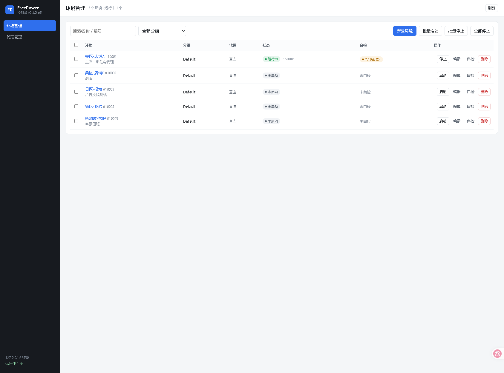

# FreePower

独立实现的指纹浏览器（AdsPower 同类产品）：**多环境隔离 + 代理绑定 + 指纹一致 + 本地 API**。

内核用官方 Chrome for Testing（独立进程），指纹通过 CDP 注入与启动参数实现，不搬运 AdsPower 的私有代码、二进制、资源与商标。

> 当前阶段：**P9 完成**（媒体设备改成「真实枚举 + 只改 label」、语音按环境语言投影；字体只做探测与 `none` 标注，不写注入）。之前：P1 存储/校验/启停、P3 前置代理 fail-closed、P2 自检与四维确定性噪声、P4 本地 API 完整化 + 批量启停、P5 Web 管理控制台、P6 桌面壳、P8 外部检测对照。
> 阶段细节见 [P1](docs/02-P1-交付.md)、[P3 前置](docs/03-P3前置-代理与启动参数.md)、[P2](docs/04-P2-自检与注入补全.md)、[P4](docs/05-P4-本地API完整化.md)（附 [curl 实测记录](docs/05-P4-curl实测.md)）、[P5](docs/06-P5-Web控制台.md)、[P6](docs/07-P6-桌面壳.md)，技术路线见 [技术方案](docs/00-技术方案.md)。

## 一、范围（先看这个，避免后面被要求补）

### 做

- 环境（profile）增删改查、分组、指纹重生成；**运行中改配置可一键重启**（`POST /api/v1/browser/restart`，stop → 落库 → start 一个请求内完成，控制台里运行态保存按钮变「保存并重启」）
- 启动/关闭浏览器实例：独立 `--user-data-dir`、独立进程、随机 CDP 端口、进程树回收
- 指纹：UA / UA-CH / 语言 / 时区 / 屏幕与 DPR / WebGL vendor+renderer / Canvas 种子化噪声 / Audio 噪声 / WebGL 图像噪声 / client rects 噪声 / hardwareConcurrency / deviceMemory / media devices（**真实枚举 + 只改名字**）/ 语音（按环境语言投影 `getVoices()`）/ platform / 字体声明（只声明，不注入）/ WebRTC 策略
- **隐私开关四项有真行为**（2026-11-12 第一批）：`disable_image` 内核层不请求图片、`disable_video` 按 `Media` 资源类型拦截、`blacklist` / `whitelist` 按域名（含子域、URL 通配、host:port）拦放行 —— 都有开/关对照判据，见第八节「隐私开关」
- **回收站**（2026-11-12 第一批 ②）：删除改成**软删除**（只置 `deleted_at`、**不删 user-data**），`list`/`detail`/`start`/`update` 一律看不到已删项；`recycle-bin/list`、`recycle-bin/restore` 两条路由按逆向切片的形状落地（item 严格 6 字段、恢复要显式选 `group_id`），见第八节「回收站」
- 自检：每个环境启动后自动跑一次真实页面探针，输出 19 项可读报告（覆盖度对齐字段表 full/partial/none），含「页面直接创建的三类 worker + 嵌套 worker」双 Realm 断言与 AudioWorklet 明确 `none`，支持 API 与本地 HTML 页。**worker 不是全覆盖**（OOPIF 子帧、启动前已在跑的 SW 仍是盲区），边界见已知限制第 6 条
- 代理：HTTP/HTTPS/SOCKS5 绑定、账号密码认证（HTTP 代理）、**fail-closed**；PAC 明确拒绝（不支持就报错，不静默降级）；代理管理页**单条 / 批量健康检查**（出口 IP / 国家 / 延迟 / 时间，失败区分超时、认证失败、代理拒绝 CONNECT、连接被拒、DNS、TLS；批量限并发 3、单条 10s 上限，超 24h 的结果标「结果过期」）
- 本地 API：`/status`、环境 CRUD、分组、标签、代理列表、浏览器启停、**批量启停（并发上限 + 失败清单 + 可中断）**、自检报告；返回值形状对齐 AdsPower（`ws.puppeteer` / `ws.selenium` / `debug_port` / `status: Active|Inactive` / `cookies` / `kernels`）
- **Web 管理控制台**（`node:http` 直接托管，浏览器打开 `127.0.0.1:<端口>/` 即用）：环境列表（启动/停止/自检状态/批量操作）、环境编辑（11 组分栏表单，值域与必填来自后端注册表）、代理管理、自检报告。四个页面全部只调自己的 Local API，没有私有通道
- 未实现的云端透传接口（分享、成员、内核下载…）**明确报「不支持」**（`code:-1` + `data.supported:false`），不假成功、不留未知码。**现在这条清单实际是 15 条**（`src/api/routes.js` 的 `placeholders` 数组，2026-11-12 逐个数过）：原来这类有 46 条，回收站两条已本地实现，其余云端依赖的同类项合并后剩 15 条 —— 数字按实际数组算，不按历史回执抄（旧回执里写过的 44 / 17 都不再作为当前值）。
- **桌面版**：Electron 壳（单实例 / 托盘 / 关窗不退出 / 开机自启开关 / 退出前必清残留内核）+ NSIS 安装包，不需要 VS 编译链

### 不做（已和 CEO 确认，写进范围外）

- **AI Agent 模块**、**云手机模块**：一律不做，不留 UI、路由、依赖、占位。本地 API 的「脚本驱动浏览器」是基础能力，与 AI 模块无关，保留。
- 账号 / 计费 / 团队协作 / 云端同步：不做。
- AdsPower 54 条路由里 46 条是往它自己云端透传的，我们没有云，这 46 条照做没有意义：只做本地能自洽的那部分。
- 自编译 Chromium 内核（见下面「已知限制」第 1 条）。

## 二、技术栈

| 层 | 选型 | 说明 |
|---|---|---|
| 运行时 | Node.js ≥ 22.5（ESM） | 当前验证于 v24.14.1 |
| 存储 | `node:sqlite`（内置） | 零原生依赖，单文件 `data/freepower.db` |
| 本地 API | `node:http` + 自写路由/限流/鉴权 | 零第三方依赖 |
| CDP 客户端 | 自写 WebSocket（`src/kernel/cdp.js`） | 只实现需要的帧类型，无 `ws` 依赖 |
| 内核 | 官方 Chrome for Testing | P0 用系统 Chrome 验链路，P1 接 CfT 版本矩阵 |
| 主程序 UI | 原生 JS + 自写极简视图层，`node:http` 托管静态页 | 不引前端框架、不建构建链 |
| 桌面壳 | Electron（主进程内起同一个服务，窗口 loadURL 到它） + electron-builder | 只做窗口/托盘/单实例/自启，**不重写服务**；无 native 模块，不需要 VS 编译链 |

刻意保持 **零运行时依赖**：一开始就装一堆包，后面每次改内核启动参数都要跟着升级，收益不抵成本。

## 三、快速开始

```powershell
cd C:\Users\1\.dsh\bot\workspace\freepower
npm start
```

启动后：

- API：`http://127.0.0.1:53380`（53380 起，被占用就往后找，最多 20 个端口）
- 发现文件：`data/local_api`，里面有实际地址和 `api_key`
- 数据目录：`data/`（库、每个环境的 user-data-dir、日志）

> 端口用 53380 起是为了避开本机已装的 AdsPower（50325）。

指定内核：

```powershell
$env:FREEPOWER_CHROME='C:\path\to\chrome.exe'; npm start
```

桌面版（Electron 壳，见第六节）：

```powershell
npm install            # 首次：装 electron / electron-builder（约 150MB，可用 ELECTRON_MIRROR 加速）
npm run desktop        # 开发态起桌面壳
npm run dist:win       # 打 Windows 安装包 → release\FreePower-<ver>-setup.exe
```

## 四、本地 API

鉴权：`api-key` 头（对齐对手）、`api_key` 查询参数 / 头、`Authorization: Bearer`。**本地校验，离线可用**（对手是远端校验，离线不可用，这是我们有意做的差异）。

限流：**四档**阈值 —— 默认 **1/s**、`x-freepower-client: mcp` **30/s**、控制台 `ui` **60/s**、`/api/v1/fbbird/user/list` 单独一桶 **10/s**（`src/config.js:21` DEFAULT / `:22` MCP / `:29` FBBIRD / `:35` UI，分别可用 `FREEPOWER_RATE_LIMIT` / `FREEPOWER_RATE_LIMIT_MCP` / `FREEPOWER_RATE_LIMIT_FBBIRD` / `FREEPOWER_RATE_LIMIT_UI` 覆写）。令牌桶在 `src/api/server.js:14-25`，**桶键是 `apiKey|<std|mcp|ui|fbbird>`**（`server.js:152-158`）—— 即「**一个 key × 一种档位 = 一个桶**」，**不是每端点一个桶**：同一把 key 下 `/user/list` 与 `/user/create` 共用 std 那份配额；`fbbird` 那条路由自己一桶（打 10 发不占 std 的额度，对手也是分开的两个桶）。档位判定：`mcp` / `ui` 头优先（升档照旧生效，带 mcp 头打 fbbird 走 30/s），否则看路由自己声明的 `rateTier`（`src/api/routes.js:234` 那条 fbbird 标了 `fbbird`），再否则 std。`/status` **完全不限流**：`src/api/routes.js:132` 把它标成 `{ auth: false }`，而 `server.js:139` 的 `if (route.auth !== false)` 把鉴权与限流整块跳过。

**超限不会返回 429**，一律 **HTTP 200 + `{"code":-1,"msg":"Too many request per second, please check"}`**（`server.js:155` 是 `send(res, 200, ...)`，报文逐字对齐对手，取自 `src/api/contract.js:41` 的 `TOO_MANY_MSG`）。所以调用方**必须看 `code` 字段**，只看 HTTP 状态会把「被限流」当成「成功」。

实测（2026-11-12 13:14，对本机 `127.0.0.1:53380` 的**只读**端点 `GET /api/v1/group/list`，原始响应）：

```
不带 mcp 头，1 秒内连发 3 次（三次共 22 ms）：
  #1  t=3..18 ms   HTTP=200  {"code":0,"msg":"success","data":{"list":[{"group_id":"0","group_name":"Default","sort":0}]}}
  #2  t=21..21 ms  HTTP=200  {"code":-1,"msg":"Too many request per second, please check"}
  #3  t=21..22 ms  HTTP=200  {"code":-1,"msg":"Too many request per second, please check"}
隔 2 秒再发 1 次：
  #4  HTTP=200  code=0 / msg=success，data.list 1 条
带 x-freepower-client: mcp，连发 10 次：成功 10 / 被限 0
带 x-adspower-client: mcp，连发 5 次：成功 5 / 被限 0
不带 key 连发 5 次 GET /status：5 次全 HTTP 200 {"code":0,"msg":"success"}（免鉴权 + 不限流）
```

**已对齐（2026-11-12，原先列在这里的 backlog 已做掉）**：`/api/v1/fbbird/user/list` 对手是 **10 次/秒**（对手侧读数，见 `docs/reverse/07-LocalAPI路由全量清单.md` 的限流分桶：54 条路由除 `/status` 外全 1/s，只有这一条 10/s）。我们原来走默认档 1/s，现在给它**单独一桶 10/s**（`RATE_LIMIT_FBBIRD`，桶键 `apiKey|fbbird`），**默认档仍是 1/s**，没有顺手把全局限流抬上去。判据（`test/api.test.mjs`）：同一把 key 一次性打 10 发全过、第 11 发被限，紧接两发 std 路由第二发必被限 —— 两条对照缺一就是假绿。

CORS：只放行 `127.0.0.1` / `localhost` 的 Origin，其他返回 `403` + 纯文本 `CORS ERROR`。

### 路由

| 方法 | 路径 | 说明 |
|---|---|---|
| GET | `/status` | 探活，`{"code":0,"msg":"success"}`，免鉴权、**不限流** |
| GET | `/api/v1/user/list` | 环境列表（`page` / `page_size` / `group_id` / `name`） |
| POST | `/api/v2/browser-profile/list` | 环境列表（v2：`limit` **不传只回 1 条**，照抄对手；显式给 `page_size` 时按它翻页） |
| GET | `/api/v1/user/detail` | 单个环境 |
| POST | `/api/v1/user/create` | 建环境 |
| POST | `/api/v1/user/update` | 改环境 |
| POST | `/api/v1/user/delete` | 删环境（运行中会先停） |
| POST | `/api/v1/user/regroup` | 改分组 |
| POST | `/api/v1/user/new-fingerprint` | 整组重生成指纹（≤10 个） |
| GET | `/api/v1/group/list` | 分组列表 |
| POST | `/api/v1/group/create` | 建分组 |
| POST | `/api/v1/group/update` / `delete` | 改 / 删分组（删组把环境挪回 Default，不连带删环境） |
| GET | `/api/v1/browser/start` | 起环境（支持 `launch_args` 覆盖、`force=1`） |
| GET | `/api/v1/browser/stop` | 关环境（没开 → `800002`；成功**没有 `data`**） |
| GET | `/api/v1/browser/active` | `{status:"Active",...}` 或 `{status:"Inactive"}`（缺 id → `100002`） |
| GET | `/api/v1/browser/local-active` | 本机已开环境 `{list:[...]}` |
| POST | `/api/v1/browser/cloud-active` | **明确报不支持**（云端能力，本地没有），不会假成功 |
| POST | `/api/v1/browser/batch-start` | 批量起（并发上限、失败清单、可中断）— FreePower 扩展 |
| POST | `/api/v1/browser/batch-stop` | 批量停 — FreePower 扩展 |
| POST | `/api/v2/browser-profile/stop-all` | 关掉本机全部 |
| GET | `/api/v2/browser-profile/cookies` | `{cookies:"<login_cookie 原文>"}` |
| POST | `/api/v1|v2/browser-profile/import` | **环境导入**：JSON 三种 body（`{list}` / `{data:{list}}` / 裸数组）都认，或 `{format:"txt", content:"..."}` 认 AdsPower `.txt` 块格式；未知字段进 `warnings`；`imported` / `failed` 顶层与 `data` 各一份（`code` 仍 0） |
| GET/POST | `/api/v1|v2/browser-profile/export` | **环境导出**：默认 `{list}`，同时带我方字段与 AdsPower 兼容键（`proxy_*`，代理密码原样）；`format:"txt"` → `data:{format,count,filename,content}`（AdsPower 块格式，**不含 list**）；`{profile_id:[...]}` 或 GET 多个 `profile_id` |
| POST | `/api/v1|v2/browser-profile/copy` | **复制环境**：指纹配置原样，`fp_seed` 与四个噪声种子**全部重生**，返回 `seeds_regenerated:true`；`copy_cookies` 默认关 |
| GET | `/api/v1|v2/browser-profile/cookie/export` | **cookie 导出**（`format=json|netscape`）；**要求环境在跑**，没跑报 `800002`，不会为了导出偷偷起内核 |
| POST | `/api/v1|v2/browser-profile/cookie/import` | **cookie 导入**：`cookies` 数组或 `{format:"netscape", content:"..."}`；要求环境在跑；`imported>0` 时回读校验 |
| GET | `/api/v2/browser-profile/kernels` | `{list:[{kernel_type,kernel,is_downloaded}]}`（`kernel_type` 非法 → `100002`） |
| POST | `/api/v2/browser-tags/list` / `create` / `update` / `delete` | 标签 CRUD（本地实现） |
| POST | `/api/v2/proxy-list/create` / `update` / `list` / `delete` | 代理列表 CRUD（本地实现；create 的 body 是**顶层数组**） |
| POST | `/api/v1/proxy/check` | 代理预检：先验一下代理再绑环境（`data.ok` 是检查结果，失败也 `code:0`） |
| GET | `/api/v1/browser/selfcheck` | 自检报告（`user_id`；`rerun=1` 重跑） |
| POST | `/api/v2/browser-profile/create` | 建环境（v2 形状：`launch_args` 出站数组、`password_filling` 单布尔） |
| POST | `/api/v2/proxy/check` | 代理预检 |
| GET | `/api/v2/browser-profile/selfcheck` | 自检报告（`profile_id`；`rerun=1` 重跑；`format=html` 出自检页） |
| POST | `/api/v2/browser-profile/selfcheck-summary` | 批量取自检摘要（列表页那一列用，`{list:{id:摘要}}`） |
| GET | `/api/v2/browser-profile/schema` | **编辑表单的 schema**：11 组 131 字段的类型/值域/必填/默认值，与后端注册表同一份 |
| POST | `/api/v2/browser-profile/validate` | 只校验不落库：与 create/update 同一个 `validateProfile`，返回 `{ok,errors[],warnings[]}` |
| GET | `/` | **Web 管理控制台**（静态页，注入本地 api_key；外站 Origin 403） |
| GET | `/ui/*` | 控制台资源（`app.js` / `style.css` / `pages/*.js`），越权路径一律 404 |

未实现的云端透传接口（分享、成员体系、内核下载、fb/*…）统一返回（**回收站两条已于 2026-11-12 本地实现，不在这个清单里**，见第八节「回收站」）：

```json
{"code":-1,"msg":"FreePower 不支持该接口（AdsPower 依赖其云端，本地没有对应能力）：/api/v2/browser-profile/share","data":{"supported":false,"path":"..."}}
```

错误码只有 6 个，脚本不会拿到未知码：`-1` 通用 / `100001` 环境不存在 / `100002` 参数非法 / `800002` 未在运行 / `800003` 启动失败 / `800005` 启动前一致性校验不通过。

批量启停（FreePower 扩展，响应形状）：

```json
{"code":0,"msg":"success","data":{
  "requested":3,"concurrency":3,"interrupted":false,"elapsed_ms":8120,
  "started":[{"profile_id":"a1","pid":123,"ws":{"puppeteer":"ws://..."},"debug_port":"60001","already_running":false}],
  "already_running":[],
  "failed":[{"profile_id":"a2","code":800003,"reason":"proxy_unreachable","message":"..."}],
  "skipped":["a3"]}}
```

`interrupted:true` 表示中途失败后**没有继续起剩下的**，剩下的原样在 `skipped` 里；起成功的不会回滚，用户能明确知道哪些成了。

`browser/start` 返回（形状按拆解手 05 号契约）：

```json
{"code":0,"msg":"success","data":{
  "profile_id":"kjkvcd","pid":1234,
  "ws":{"puppeteer":"ws://127.0.0.1:60328/devtools/browser/b742df5a-...",
        "selenium":"127.0.0.1:60328"},
  "debug_port":"60328","status":"running","already_running":false,
  "proxy":{"ok":true,"ip":"203.0.113.9","countryCode":"JP","timezone":"Asia/Tokyo"},
  "egress":{"ok":true,"ip":"203.0.113.9","countryCode":"JP"},
  "ua_aligned":null,
  "launch_args":{"applied":[],"rejected":[]},
  "selfcheck":{"ok":true,"score":79,"total":15,"pass":7,"warn":8,"fail":0,
               "full":7,"partial":7,"none":1,
               "hashes":{"canvas":"7eca175f","webgl_image":"3e6069c5","audio":"ada0a40f","client_rects":"1e14d3ce"},
               "report_url":"/api/v2/browser-profile/selfcheck?profile_id=..."},
  "warnings":[{"field":"proxy","message":"未绑定代理：出口即本机 IP…","severity":"soft"}]}}
```

三条硬规则：`ws.selenium` 只放 `host:port`；`debug_port` 是字符串；重复调用 `start` 幂等（返回同一 `pid`，`already_running:true`）。
新增字段都是超集（`proxy` / `egress` / `selfcheck` / `ua_aligned` / `launch_args` / `warnings`），旧字段一个没动。

代理不可用时 `start` 返回 `code:800003` + `data.reason:"proxy_unreachable"` + `data.proxy_check` 诊断，**内核进程根本不会启动**（fail-closed，详见 [P3 前置](docs/03-P3前置-代理与启动参数.md)）。

### 例子

```powershell
$key = (Select-String -Path data\local_api -Pattern 'api_key=(.*)').Matches[0].Groups[1].Value
$h = @{ api_key = $key; 'x-freepower-client' = 'mcp' }

Invoke-RestMethod -Uri 'http://127.0.0.1:53380/api/v1/user/create' -Method Post -Headers $h `
  -ContentType 'application/json' -Body '{"name":"env-a","country":"US","open_urls":["https://example.com"]}'

Invoke-RestMethod -Uri 'http://127.0.0.1:53380/api/v1/browser/start?user_id=<profile_id>' -Headers $h
```

## 五、Web 管理控制台

`npm start` 之后浏览器直接打开 `http://127.0.0.1:<端口>/`（端口看 `data/local_api`）。不用装任何东西，也没有第二套进程。

四个页面，范围就这些（CEO 定的，不扩）：

| 页面 | 做什么 |
|---|---|
| 环境列表 | 启动/停止/批量启停/全部停止、运行态与端口、自检摘要、搜索与分组筛选、删除；工具条「导入」（JSON 三种形状，或 AdsPower `.txt`，按扩展名/首字符自动识别）、「导出 txt」（当前勾选或筛选结果 → AdsPower 块格式，值里的换行会替换并提示），每行「导出」JSON（保真备份）、「复制」（复制=配置原样、四个指纹种子重生） |
| 环境编辑 | 11 组分栏表单（基本信息 / 浏览器与内核 / UA 与语言 / 噪声四维 / 字体 / 屏幕与硬件 / 媒体设备 / 网络与代理 / 地理定位 / 隐私开关 / 启动与缓存），保存前实时校验；Cookie 一栏带「导出 cookie（JSON / netscape）」「导入 cookie 文件」（**需要环境运行中**：cookie 在内核里，和这一栏的登录 cookie 文本不是一份数据） |
| 代理管理 | 代理列表增删改、按 `proxy/check` 预检出口、显示最近一次出口 IP 与国家 |
| 自检报告 | 评分、通过/告警/失败、覆盖度、四个噪声维度哈希与跨重启一致性、19 项逐条「声明值 vs 实测值」（含双 Realm 与 AudioWorklet） |

三条设计约束（都不是口号，代码里能对得上）：

1. **界面只调自己的 Local API**：`web/api.js` 里每个动作都是 `fetch` 到 `/api/v2/...`，没有任何私有通道。界面出问题时用 curl 一样能做，这也是对 API 契约的日常验证。
2. **校验只有一份**：表单的字段、值域、必填来自 `GET /api/v2/browser-profile/schema`（后端注册表生成的），错误文案来自 `POST /api/v2/browser-profile/validate`（和 create/update 同一个 `validateProfile`）。前端只做两件事：把 `errors[].field` 定位到输入框、把 `warnings[]`（含 `severity: hard|soft`）原样显示。**前端不自己编一句校验话**。
3. **删除是危险操作**：二次确认弹窗写明「本地硬删、不可恢复、连 user-data 一起删」；环境在运行会先停再删，删完连 `data/profiles/<no>_<id8>/` 一起清掉，不留孤儿进程也不留几个 G 的脏目录。

界面截图（真实环境，5 个环境 + 1 个在跑）：



更多：[编辑页](docs/shots/02-edit.png)、[后端校验原文回填](docs/shots/03-edit-invalid.png)、[噪声四维分栏](docs/shots/04-edit-noise.png)、[代理管理](docs/shots/05-proxies.png)、[自检报告](docs/shots/08-selfcheck.png)。完整操作清单见 [P5 文档](docs/06-P5-Web控制台.md)。

## 六、桌面壳与安装包（P6）

同一个服务，套了一层 Electron：主进程内起的就是上面那个 `node:http`，窗口 `loadURL` 到 `127.0.0.1:<port>/`。
**四页界面一个字节没改**，`web/` 仍然是零构建链。


桌面能力（都是壳的事，不碰服务）：

| 能力 | 行为 |
|---|---|
| 单实例 | 已经有实例在跑时，再点图标不会起第二个进程/第二个端口，而是把已有窗口拉到前台 |
| 托盘 | 常驻；菜单 = 打开控制台 / 运行中 N 个 / 停止全部环境 / 开机自启 / 退出 |
| 关窗不退出 | 点 × 只收进托盘，服务和内核都继续跑 |
| 托盘退出 | 先 `stopAll()`，再用命令行里的数据目录核对残留 chrome（`ensureNoChrome`：查 → taskkill → 再查），确认干净才退出；杀不掉就弹框默认留在托盘 |
| 开机自启 | `setLoginItemSettings`，默认关；开机进托盘不弹窗 |
| 安全 | `contextIsolation`/`sandbox` 开、`nodeIntegration` 关、**不挂 preload**；`window.open` 一律 deny，外链丢系统浏览器，导航出本地地址也拦 |

**诊断开关**（正式包里就有，不是后门；不改数据、不开新端口、不联网）：
`FreePower.exe --selftest` 跑一遍壳自检并写 `desktop-selftest.json`；
`--quit-after-ms=N` 到点走托盘「退出」的同一个函数（自动化验收用）；
`--show-tray-menu` 把托盘菜单弹出来（截图/演示用）。

装完：`%LOCALAPPDATA%\Programs\FreePower`，**357.4MB / 77 文件**，安装包 109.9MB；数据在 `%APPDATA%\FreePower\data`。

顺带收掉一个 P5 尾巴：HTML 自检报告不再把 master `api_key` 拼进 URL，改成 **120 秒、绑定 profile 的一次性票据**
（`POST /api/v2/browser-profile/selfcheck-ticket`）；`api_key` 走 query 的老用法保留，老脚本不受影响。

完整设计、打包踩的坑、验收记录与操作清单：[P6 文档](docs/07-P6-桌面壳.md)。

## 七、已知限制（必须如实告知用户，不藏着）

1. **Canvas / Audio / WebGL 标识 / 字体是 JS 注入，不是内核级。**
   拆解手 08 号报告实测：AdsPower 139 个指纹字段里走 CDP 注入的是 0 个，全在内核配置和启动命令行。
   所以我们这四项属于**降级实现**：能改返回值、能保证同种子可复现、能过一致性检查，
   但 `Function.prototype.toString` 痕迹、字体度量与真实字形交叉验证这些检测手段下**可被识别**。
   双 Realm 取证只补上了「页面直接创建的三类 worker + 嵌套 worker」这一层，**OOPIF 子帧、AudioWorklet、启动前已在跑的 SW 仍是盲区**（见第 6 条）。
   这是架构差距，不吹成 1:1。
2. **字体不伪装（P9-B 结论：不写注入，只探测 + 标 `none`）。** 只声明存在，不再伪造字形与宽度度量（自检里这一项叫「字体枚举面」、覆盖度 `none`、一律标黄）。
   根治要**自编译 Chromium**（把宿主字体集换成目标平台字体集）；JS 层做「字体投影」只能改 `measureText` / `document.fonts` 的返回值，改不了真实字形与宽度度量，**会造出新的不一致，风险大于收益**。
   **标 `none` 不等于字体指纹裸奔**：canvas 文本噪声已覆盖字形渲染这一类；裸的是「宿主装了哪些字体」这个**枚举面**（本机实测枚举到 `Microsoft YaHei` / `Microsoft YaHei UI` / `SimSun` / `SimHei` / `KaiTi` / `FangSong`）。
3. **内核配置类 42 条 + `--extended-parameters` 10 条不实现**，列入「不兼容项」。
4. **SOCKS5 的账号密码只有预检支持**（Chrome 的 `--proxy-server` 不接受 SOCKS5 凭据，内核限制）；HTTP/HTTPS 代理认证走 CDP `Fetch`，只对带账号密码的代理挂载，会给请求加一跳。
   AdsPower 形状的 `proxy_host` / `proxy_port` / `proxy_user` / `proxy_password` **全链路都认**（`checkProxy` 预检、`--proxy-server`、CDP `Fetch.authRequired`）；`buildArgs` 在「已绑定代理但 host/port 拼不出来」时**直接抛错**，绝不退回直连（fail-open 已修）。
5. **WebRTC 只做参数级**（`disable_non_proxied_udp`），不做 JS 层伪造 `RTCPeerConnection`。
6. **Worker 注入的覆盖范围：页面直接创建的三类 worker + 任意深度的嵌套 worker；OOPIF 子帧与启动前已在跑的 SW 不在内。**
   覆盖到的：专用 worker / SharedWorker / ServiceWorker 都能在**脚本首行之前**注入（`Target.setAutoAttach` + `waitForDebuggerOnStart`，实测三类 worker 的 `atTop` 均为 `worker`），module worker 实测同样覆盖，主帧与 worker 的 canvas 哈希同值。
   **worker 里再 `new Worker` 的嵌套层也覆盖**：每个 worker 会话自己再挂一次 `setAutoAttach`，递归下去，所以不设深度上限。实测页 → w4 → w3 → w2 → w1 → w0 共五层，五层 `atTop` 全是 `worker`、`hardwareConcurrency` 全等于主帧的伪装值，`injected` 精确为 5、`failed` 为空，整条链约 68ms（大头是 Chrome 起 worker 本身，每层只多一次本地 CDP 往返）。
   **没覆盖的：**
   ④ **OOPIF 子帧本轮不注入**（只计数不覆盖，子帧里取原生函数仍可能看到两套）。
   ⑤ **启动前就已经在运行的 SW**（只在它下次被激活时接入）。自检里那条只验证**新建 SW**，别读成「SW 已支持」。
   ⑥ **AudioWorkletGlobalScope 标 `none`**——它没有独立 target、没有干净注入通道，靠 Fetch 改源码会被 `import.meta.url` 和模块完整性检测抓；
   但**音频指纹本体不在那里**：本体是主帧 `OfflineAudioContext` 的浮点噪声，已由 `audio` 维度覆盖，`AudioWorklet` 里裸的只有 `sampleRate`/`currentTime`。
   → 换句话说：**音频指纹没有裸奔**，别把这条读成「audio 没做」。
   注：自检的 19 项里**不含**嵌套 worker 一项（自检只验证页面直接创建的三类），嵌套这条由 `test/workers.test.mjs` 的三条断言钉住。
7. **沙箱内起不了 Chrome**：Windows 沙箱禁止命名管道，Chrome 的 Mojo IPC 会以 `platform_channel.cc:112 Check failed: 0x5` 自终止。这不是产品缺陷，但**跑冒烟必须用普通终端（非沙箱）**。
8. **`https` 代理 + `https` 目标**（TLS in TLS）预检不支持，会明确报错，不静默降级。
9. **PAC 明确不支持（不是静默降级）**：`full_pac_url` 或 `proxy_type=pac` 直接报错 `100002`（建环境）/ `800003`（老数据启动，`reason=pac_unsupported`），**一个内核进程都不会起**。原因是 PAC 可能含 `DIRECT` 回退，无法保证 fail-closed。多级代理（`is_multi_level_proxy`）未实现，只对第一跳做预检。
10. **2D canvas 固定软件光栅化**（`--disable-accelerated-2d-canvas`）。GPU 2D 路径跨进程会产生不同像素，导致 canvas 哈希跨重启漂移；固定软件光栅化后四轮实测一致。代价：`chrome://gpu` 显示 Software only，canvas 密集页面略慢。
11. **远程代理下的自检有盲区**：自检页走 `http://127.0.0.1` 安全上下文；若代理强制 loopback 也走代理（非 `--proxy-bypass-list=<-loopback>` 的配置），会回落到 `about:blank`，此时报告里 UA-CH / 媒体设备明确标「本次未验证」，不标通过。
12. **轮换代理会把「出口 IP 与预检不一致」判为告警**（正常业务形态，只提示不阻断）；运行中没有代理健康检查，掉线时请求失败但不会回退直连。
13. **云端依赖的接口一律不支持**：`cloud-active`、分享、成员体系、内核下载、`fb/*`、应用/分类等 17 条（对手 54 条路由里剩下的云端透传）返回 `-1` + `data.supported:false`，**不假成功**。`cloud-active` 尤其明确：脚本若以为"环境已开"会直接下错单。**2026-11-12 更正**：原清单里的**回收站两条已本地实现**（`recycle-bin/list`、`recycle-bin/restore`，见第八节），所以这条实际剩 15 条；数字保留原文只为对得上旧回执。
14. **批量启停的并发默认 3**（`FREEPOWER_BATCH_CONCURRENCY` 可调，请求里 `concurrency` 覆盖，夹在 1..10）。批量启动**中途失败即中断**：已经起来的保留，剩下的不硬起，返回 `failed` + `skipped`。
15. **`kernels` 的版本号区分「实测」与「猜」**：系统 Chrome 的 `Application\` 下可能同时有几个版本目录（本机实测有 156/157），而启动器实际跑哪个由注册表决定。启动过就报 `Browser.getVersion` 的真值（`probed:true`），没启动过则按目录名猜。**不要拿目录名当真实版本用。** 出参形状按对手收口（2026-11-12）：核心只有 `kernel_type` / `kernel` / `is_downloaded` 三个键；可执行文件路径与来源（`_path` / `_source`）只在 `src/kernel/chrome.js` 内部用，**不序列化**，判据是 `test/api.test.mjs` 的字段白名单那条（多出 `path` / `source` 就是「API 形状不符」）。
16. **桌面壳没有代码签名、没有自动更新**：安装包和 exe 都未签名，SmartScreen 会提示「未知发布者」；要对外发版必须补证书。壳只做窗口/托盘/单实例/自启，不做增量更新与崩溃上报。
17. **控制台的信任边界就是本机**：首页由本地服务渲染，会把 `api_key` 注入页面（等价于「本机用户能看到自己的 key」）。外站 Origin 一律 403，但这挡不住本机上的其它程序 —— 本机多用户/共享机器上，要按「同一台机器互不设防」来理解。
18. **表单里 138 个字段的中文名只覆盖常用项**：其余（尤其启动与缓存、隐私开关里的脚本旋钮）直接显示 API 字段名，配注册表里的 `note` 说明。硬翻一遍反而会让「字段名 ↔ 文档」对不上。
19. **自检 HTML 报告用一次性票据**（120 秒、绑定 profile、只在内存）替掉 URL 里的 master `api_key`。票据泄露影响面只有一个环境的报告；`api_key` 老用法仍可用。
20. **托盘图标在受限会话里注册不上**：Agent 令牌下 Electron 的 Tray 对象/菜单/消息窗口都建好了，但 Win11 通知区域里看不到图标（裸 Electron 同样如此，而直接调 `Shell_NotifyIcon` 的探针成功）—— 判定为环境限制。**正常桌面双击安装后要确认一次托盘**；兜底是再点一次图标，单实例锁会把窗口拉回来，不会把用户锁在后台。
21. **在受限终端里验桌面版要加参数**：`--no-sandbox`（Chromium 沙箱起不来会秒退）且数据目录必须落在工作区内（`%APPDATA%` 之外的写入被拦）。**用户正常桌面双击不需要任何参数。**
22. **受限环境还可能挡住内核的沙箱**：`FREEPOWER_KERNEL_NO_SANDBOX=1` 会给内核加 `--no-sandbox`，并在启动结果 `warnings` 里标 `kernel_sandbox`。默认不开 —— 沙箱该开着。
23. **安装/卸载已验通，但要在普通目录里跑安装包**：本机工作区里的 exe 带 Low 完整性标签，从工作区直接执行安装器，进程会被降到 Low IL，写 `HKCU\Software` 和开始菜单一律被拒（文件照装、注册项和快捷方式静默丢失，`Uninstall /S` 于是「退出码 0、一个文件没删」）。
    拷到 `%TEMP%` 再跑就完全正常：注册表两个键齐全、快捷方式建了、`/S` 卸载把目录和键都清干净（实测记录见 [P6 文档](docs/07-P6-桌面壳.md)）。**用户从「下载」目录双击安装不受影响。**
    另：卸载器靠 `InstallLocation` 找目录，该键丢失时会退回到 `%APPDATA%\FreePower\install-dir.ini` 里安装时写下的路径（`desktop/build/installer.nsh`），避免「删了个寂寞」。**这条兜底不是预防性代码**：本安装包装完注册表 9 个值里确实没有 `InstallLocation`，每次卸载都走 INI 兜底。
    空目录残留已修并在打包版实测：根因不是路径含空格，而是卸载器 `un.onInit` 里的 `SetOutPath $INSTDIR` 把进程当前目录压在安装目录上，Windows 不允许删任何进程的当前目录，于是 `RMDir /r $INSTDIR` 删光文件、留个空壳。修法是在删文件之前 `SetOutPath "$TEMP"`（`customUnInstall` 钩子）。两轮实测：含空格自定义路径（`%TEMP%\fp space test3\inst dir`）与默认路径（双击场景）都是 77 文件 / 注册表 9 值 / 两个快捷方式 → `/S` 卸载后文件 0、**目录消失**、注册项与快捷方式清空。
    （试过但已否掉：在 `un.onUninstSuccess` 里补一次非递归 `RMDir` —— 这个回调在 electron-builder 生成的卸载器里根本不会被调用，写了日志文件一次都没出现。）
24. **对手的远端运营黑名单不接**：`DynamicConfig` 里实测多出 `BlockList` / `StrongBlockList` 两个键，是**远端下发的国内站点名单 + 版本号**，跟指纹无关，属于对手自己的运营数据。接它等于同步对手的运营策略，还得养一条下发通道，没有产品价值。
    我们做的是**用户级**名单：字段表里 `blacklist` / `whitelist`（`privacy_switches` 组）。**2026-11-12 更正（`0ccdb7f` 之后）**：注入层**已经真的挂了**，机制不是 `Network.setBlockedURLs`，而是走 CDP `Fetch` 域 —— `src/kernel/net-rules.js` 的 `compileNetRules`/`decideRequest` 判定，`src/runtime/manager.js` 的 `installRequestGating` 在页面会话上 `Fetch.enable`，命中后 `Fetch.failRequest(errorReason: 'BlockedByClient')`。所以现在是「配了就生效」，判据是 `test/net-rules.test.mjs`（纯逻辑 38 项）与 `test/switches.test.mjs`（真机：被拦 host 服务器命中 0、同页其它请求照常）。旧的「存了但没生效」说法已过期，改掉而不是删掉。
25. **我们不落任何内核配置文件，所以没有 mtime 可盯**：对手的三份配置（StaticConfig / DynamicConfig / 命令行快照）实测「内容不变就不重写、mtime 不动」——这本来是他们的反检测优点（盯 mtime 抓不到改动），但对我们反而更简单：CDP 路线改时区/地理/指纹**一律不写文件**，磁盘上没有任何「指纹配置文件」可抓、也没有 mtime 侧信道。这条是我们比对手干净的地方，写在这里当依据，不当卖点吹。
26. **外部检测站对照：`like headless` 已压到与裸 Chrome 持平（25% vs 25%），但这只是「不比裸 Chrome 更像 headless」，不是「过了检测站」**：用 creepjs 在同一台机器跑两遍（`plain` = 同内核同参数零注入，`ours` = 走 FreePower 起环境）。P7 收尾时是 25% → **38%**，多出来的 13 个百分点全来自两条：`noTaskbar`（我们把 `screen.availHeight/availWidth` 设成等于屏幕，等于「没有任务栏」）和 `hasVvpScreenRes`（窗口/视口尺寸等于屏幕，那是 headless 的默认形态）。P8-C 修掉这两条（`avail*` 留出任务栏、窗口比屏幕小一圈），复跑 25% → **25%**，逐项标志位与 plain 完全一致。
    - **P8-D**：`navigator.deviceMemory` 现在默认取真实内存档位（这台机器 96G → Chrome 报 32，我们报 32），与 `performance.memory.jsHeapSizeLimit`（4.09GB，跟真实内存走、我们不碰）不再打脸；单环境仍可显式改 `device_memory`（值域已扩到 16/32，因为 Chrome 157 实测会返回 32）。
    - 复跑：`node tools\detector-compare.mjs`（出对照表，落 `artifacts/detector-compare.json`），两轮实测记录见 [docs/11](docs/11-外部检测对照.md)。
    - 另有两条**不是注入造成**、属这台中文 Windows 的固有泄漏：creepjs 的 `platform hints` 暴露 `Microsoft YaHei UI`（字体枚举面，P9-B 只标注不注入），以及 `speechSynthesis` 的中文声音。**语音已处理（P9-A）**：按环境 `language` 投影 `getVoices()`，实测 ours 从 25 条（首条 `Microsoft Huihui - Chinese (Simplified, PRC)` / zh-CN）降到 6 条（首条 `Microsoft Mark - English (United States)` / en-US），宿主中文声音被挡掉；边界见已知限制第 31 条。字体那条仍是机器属性，`plain` 与 `ours` 一致。
    - **别把自检的 `pass 10 / warn 9 / fail 0` 读成「过了检测站」**：自检只证明我们注入的东西自己一致，五处 canvas 哈希相同也只证明噪声同源。唯一的对外证据是上面那张对照表。
27. **运行中不做「热改注入参数」，只做重启**：`POST /api/v1/browser/restart`（v2 同名）语义是 stop → 落库 → start，一个请求内完成；apply 或 start 任一步失败都保持 **stopped**，绝不会留下一个「还在跑旧代理/旧指纹」的内核。**为什么不热改**：CDP override 确实能热改时区/地理/语言，但注入脚本（`addScriptToEvaluateOnNewDocument`）已经在页面里跑过一轮，热改只会让主帧与 worker 出现两套值 —— 那正是我们自己的双 Realm 漏洞，宁可让用户短暂离线。
28. **代理检测的边界**：批量检查限并发 **3**、单条上限 **10s**（超时记 fail，不拖住整批），上限是常量 `src/proxy/health.js`（`HEALTH_CONCURRENCY` / `HEALTH_TIMEOUT_MS`），没有做成可调参数；`https` 代理的 TLS-in-TLS 预检不支持（见第 8 条）。**失败结果只存在当前页面会话里**（库里只有 `rememberProxyCheck` 落下的「上次成功出口」），刷新控制台后失败原因就没了 —— 这是故意的：检测是只读操作，不为它加表。列表里超过 24 小时的结果按「结果过期」显示，不当成现状。
29. **代理凭据与指纹参数不进命令行（这一点我们和对手相反）**：逆向 08/09 号报告实测 AdsPower 把噪声种子、时区、出口 IP、地理坐标、配置文件路径、`UserId` 以 `--protected-*` **明文**挂在每个子进程命令行上，本机任何进程读一次 `Win32_Process.CommandLine` 就能拿全。我们的 `--proxy-server` 只带 `http://host:port`，HTTP/HTTPS 认证走 CDP `Fetch.authRequired`（第 4 条），指纹参数走 CDP + 注入。**这不是读码结论**：`npm run test:cmdline` 用 `Win32_Process.CommandLine` 读该环境全部 chrome 进程实测（见第八节）。
30. **媒体设备改成「真实枚举 + 只改名字」（P9-C），不再伪造设备列表。** 逆向我们的人用自己的探针实测过旧做法三条破绽：跨 origin `deviceId` 恒定、未授权就返回非空 label、报得出摄像头但 `getUserMedia({video:true})` 抛 `NotFoundError`。
    现在的做法：`enumerateDevices()` 先调内核真值，**未授权原样返回**（label 天然空串）；授权后只按 kind 的第 i 个设备改名，`deviceId` / `groupId` / `kind` 原样保留 —— 跨 origin 加盐由内核负责。命名池不够用时用 Windows 自己的 `2- ` 前缀去重，**不让两个 deviceId 挂同一个 label**。`media_devices_num` 只作「授权后的命名池」，**不再决定列表长度**。
    依据：**「造一整套假设备」不如「给真实设备改名」隐蔽**（AdsPower 走的也是这条路）。实测未授权 `{audioinput:1, videoinput:0, audiooutput:1}`、id/label 全空；授权后枚举与 `getUserMedia` 一致，`track.label` 等于枚举里对应设备的名字；跨 origin `deviceId` 不同。复跑：`npm run test:media-devices`。
    两处复验后补的坑（P9-C 第二轮）：
    - **不能自造 `MediaDeviceInfo` 对象**：`Object.create(MediaDeviceInfo.prototype)` 没有内核内部槽位，页面一 `JSON.stringify(设备列表)` 就抛 `Illegal invocation`；而原生 `toJSON` 又按槽位取宿主真名，绕过我们的改名。现在直接在**真实对象**上 `defineProperty('label')`，并覆盖 `MediaDeviceInfo.prototype.toJSON`（先用原生 toJSON 拿全字段，再换 label）。残留：`Object.getOwnPropertyDescriptor(d,'label')` 是 own property，原生是原型上的 accessor —— 比抛异常轻得多，但仍是可观测差异（我们把 own label 定义成 **non-enumerable**，`Object.keys(d)` 与展开运算符的行为仍和原生一致）。
    - **权限按 kind 判**：Chrome 只给摄像头时，音频 label 仍是空串。原来的 `camera || microphone` 一把梭会让音频也改名。现在分别查 camera / microphone，`videoinput` 看 camera、`audioinput`/`audiooutput` 看 microphone；授权撤销时把打过补丁的对象还原。

31. **语音投影的边界（P9-A）**：只从内核真实列表里**保留环境语言（含同语种变体）**，其余原样丢弃；不新建 voice 对象，只覆盖 `default`（正好一条），所以 `speak` / `cancel` / `SpeechSynthesisUtterance` 行为不受影响。**宿主连一条该语言的声音都没有时保持原生、不凭空造**（本机实测缺 `vi-VN` / `th-TH`，造出来的名字 `speak` 点不着，反而多一层破绽）；声音未加载时照原生返回空数组，`onvoiceschanged` 由内核触发一次、我们不补造。`speech_switch` 默认开（关掉要显式写 `'0'`）。
32. **CDP 直建带 URL 的标签要补一次重载（P9-C 复验第三轮）**：外部自动化常用 `Target.createTarget({ url })`，attach 时首个文档已在加载，`addScriptToEvaluateOnNewDocument` 只对下一个文档生效 —— 首帧是裸指纹（实测 `hardwareConcurrency` 是宿主 32，配置是 6）。现在 attach 后对**非空白页**统一等文档就绪、确认 `window.__fpApplied`，没有就补一次 `Page.reload`（比按 URL 猜可靠，也不会多刷已注入好的页面）。真机断言：`npm run test:cdp-page`。**代价**：这张页面会多一次加载，页面里若有「首屏就上报」的埋点会看到两次 load；残留一条 `performance.getEntriesByType('navigation')[0].type === 'reload'` —— 页面读自己的性能时间线就能知道刚被刷过一次（逆向实测）。
     **P13（2026-11-11 已改）：兜底那一次从 `Page.reload` 换成「重新导航到同一 URL」，`reload` 这条残留消失。** 现在 `navigation.type` 是 `navigate`（修前实测 `reload`）。改动只对 `http(s)/file` 生效，空白页与内部页仍走 reload；顺带修掉一个既有问题：同一张页面被两个会话各判一次、补加载做两遍（实测文档请求 3 次），现在按 targetId 去重，回到 2 次。真机断言：`npm run test:nav-type`。
     **代价没变，别把它读成「无痕迹」**：仍然是**两次文档加载**（首文档 + 补的那一次），服务器日志/前端埋点照样数得到 2 次 —— 变的只是 `reload` 这个标记（测试里 `文档请求 2 次` 是判据，不是打印）。为什么「零额外加载」做不到：`Target.setAutoAttach + waitForDebuggerOnStart` 确实能把新页面停在首文档之前（裸内核单会话实测能覆盖首文档），但**第二个会话一 attach，暂停就被放掉**（谁都不发 `Runtime.runIfWaitingForDebugger`，页面照样加载完），而外部自动化建页后必然紧跟一次 `Target.attachToTarget`。

33. **环境导入/导出是「搬运」，复制是「克隆配置换指纹」（P10）**：导出里**包含代理密码明文**（这是本机用户自己的数据，本地 API 已鉴权 —— 但别把导出文件当可公开分享的文件）。导入会**重新生成 id / profile_no / 时间戳**，其余字段（含 `fp_seed` 与 `canvas_id` / `webgl_image_id` / `audio_id` / `client_rects_id`）原样落库，所以导出 → 删掉 → 再导入，四个噪点哈希不变（`npm run test:fileio` 实测 0 字段差异、四个哈希完全一致）。未知字段只进 `warnings`（不报错、不影响其它条）。
     **导出的 JSON 里 7 个列是「认识但不导入」，不再报未知（2026-11-11）**：`created_at` / `updated_at`（按上句重新生成）、`status` / `last_launch_at`（运行时状态）、`kernel_version`（跟本机内核矩阵走，导入不锁源机器版本）、`fingerprint_config_raw`（兼容回显）、`fp_seed`（真值走 `fingerprint_config.seed`，顶层那个是导出带出来的冗余别名）。修法是把它们写进 `STRUCTURAL`，**不收窄导出** —— 快照剪字段省下的告警，下次恢复就少东西。**真正不认识的字段仍然点名**：`test:fileio` 里一条正向（自家导出再导入 0 条告警）+ 一条反向（手塞 `foo` 与 `fingerprint_config.bar` 必须被点名）。
     `fp_seed` 与 `fingerprint_config.seed` 的**类型不同**（逆向实测 4 条记录：`number` vs `string`，值逐字相等、`===` 为 false）。所以永远**只从嵌套 `seed` 取值**（导入侧原本就是这样，保持 `string`）；直接拿顶层 `fp_seed` 赋给嵌套 `seed` 会把类型从 `string` 变成 `number`，导出/导入就不一致了 —— 这不是风格问题，是数据形状问题。
    复制**必须**换掉全部四个种子：只换 canvas 会在 WebGL 图像噪声那条上仍然同源，等于把两个账号主动关联起来。实测复制体 `canvas / webgl_image / audio / client_rects` 四个哈希全不同，UA / 时区 / 屏幕 / 核数与源一致。
    两种导入格式：**我们的 JSON**（保真备份，含指纹配置）与 **AdsPower `.txt` 块格式**（`format:"txt"`，单文件、每块 18 字段 + 18 个 `*` 收尾；逆向实测形状）。`.txt` 是「账号 + 代理 + cookie + UA」的**搬运单，不是环境全量备份** —— 四个种子、字体、媒体、时区、屏幕、`open_urls` 一个都不在里面，别以为导出了 txt 就备份完了。导出 txt 时值里的 `\r`/`\n` 会替换成一个空格（一行一字段），并在 `data.warnings` 里报数；写出后**立刻按同一解析器读回自校验**（块数 / 18 键 / cookie 可 JSON.parse / proxy 四段），失败就报非 0，不输出半坏文件。
    边界：AdsPower 的代理是**一个字符串** `host:port:user:pass`（已认，密码可含 `:`，切不出来就进 `warnings` 并写明「代理为空」，不静默丢）；cookie 是**对象数组**（落库原样保留，`JSON.parse` 回来仍是对象，不会变成 `["[object Object]"]`）；`sameSite` 用对方四值 `no_restriction/lax/strict/unspecified`，**内核没声明就写 `unspecified`，绝不补默认 `lax`**；分区 cookie（CHIPS）的 `partitionKey` / `CookiePartitionKey` 双向都认。我们自己的 cookie 导出仍是 `json` / `netscape` 两种，`expires` 对外 unix 秒（导入兼容毫秒；session 在 json 里 `-1`、netscape 里 `0`）。
    **txt 与 JSON 是两套规则，不合并（2026-11-11，按逆向 `8.9.23/14` 核对改）**：对手真实导出 150/150 块里代理**恒 4 段**、`group` **恒空**、`countrycode` **全小写**，txt 侧照做；JSON 侧保持原样保真（`group_id` 保留、`ip_country` 原大小写、密码里的 `:` 不编码）。同一字段两套规则的说明写在代码注释里（`src/store/adspower-txt.js` 的 `proxyLineOf(p,{forTxt})`），以前定过「前 3 段定宽、其余全归密码」——**那条对 JSON 往返是对的，对「写成对手格式」是错的**（对方按 4 段切会截断密码 → 导入成功但认证失败）。
    三条「不许静默」：① 代理密码含 `:` 时 txt 里写成 `%3A`（仍是 4 段），并在 `warnings` 点名「AdsPower 导出格式无法表示，导入后代理认证可能失败」，我们自己读回时把 `%3A` 还原成 `:`（所以「我们导出 → 我们导入」仍无损）；② cookie 的 `sameSite` 是未知**数值码**时仍写 `unspecified`，但进 `warnings` 点名（数值码是对手内部镜像形状，**不做映射**）；③ `name` 超过 100 字符时导入截断要点名（带 `原长 N`），导出时 `name` 已达 100 也点名（存储层写过截断值，导出看不出来）。告警一律带「第 N 块：」，用户能拿着它去文件里定位。
34. **cookie 导入/导出只走运行中内核（P10）**：用 CDP `Storage.getCookies` / `Storage.setCookies`，**不读 user-data-dir 里的 SQLite**（值用 DPAPI 加密，跨机器解不开），也**不为了导出偷偷起内核**。环境没在跑时两条路由都明确报 `800002`（文案写清「请先启动该环境」）。`imported > 0` 时会立刻回读，缺条目进 `warnings`，不假装成功。
    边界：`copy_cookies` 打开时要求源环境在跑，读到的 cookie 以**登录 cookie 文本**回写到新环境（`/api/v2/browser-profile/cookies` 可读），**不是**把内核实时读到的 SQLite 复制过去（那份数据既加锁又不完整）。需要「副本启动后原样带登录态」的场景，请在副本启动后用 `cookie/import` 再导入一次。
35. **注入函数的源码会被 `Function.prototype.toString.call` 读到（P9-C 复验发现，P11 已修）**：原来 `native()` 只给每个包装函数挂了一个 own `toString` 属性，于是 `String(fn)` 是 `[native code]`，但 `Function.prototype.toString.call(fn)` 对任何 JS 函数都返回真源码 —— 逆向实测 9 个入口泄漏（`enumerateDevices` / `MediaDeviceInfo.toJSON` / `hardwareConcurrency` getter / `toDataURL` / `getImageData` / `getBoundingClientRect` / `WebGL.getParameter` / `AudioBuffer.getChannelData` / `getVoices`），连 `CFG` / `seedForCanvas` 这些内部名字一起交给页面。**这是 JS 注入路线相对内核/DLL 替换的结构性差距**（AdsPower 在内核层替换，天然没有这条）。
    **P11 修法与实测（2026-11-11）**：① `hardwareConcurrency` 挪到 CDP（`Emulation.setHardwareConcurrencyOverride`），JS 层不再覆盖，页面里的 getter 就是内核真身；② `native()` 不再挂 own `toString`，改成**一次性接管 `Function.prototype.toString`** + `WeakSet` 白名单，命中登记表才返回 `function NAME() { [native code] }`，未命中一律交回原生实现 —— 所以页面自定义函数、箭头、class、`document.createElement` 的源码逐字不变，`fn.toString === Function.prototype.toString` 与 `hasOwnProperty(fn,'toString') === false` 同时成立；③ 补 `getImageData.length = 4` / `getChannelData.length = 1`（原生源码里**括号永远是空的**，形参个数只在 `.length` 上体现，补形参名反而更显眼）；④ `toString` 自己：`[native code]`、`name='toString'`、`length=0`、descriptor `writable:true/enumerable:false/configurable:true`、非函数 `this` 仍抛 `TypeError`。
    hc 走 CDP 的三个实测约束（内核 157.0.8103.40，别简化成「CDP 有覆写」）：**清不掉**（传 0 → `HardwareConcurrency must be a positive number`，不传 → `Invalid parameters`，「还原」只能设回真值或换 session）；**新 target 不继承**（每张页装配时都要重设，漏一张就是同环境两个页面报不同核数）；**不传播给专用 worker**（page=2 时 worker 仍 32，所以在 worker session 上另设一次，且必须早于 evaluate）。
    泄漏清单用集合相等锁在 `npm run test:native-tostring`（**主世界 + worker realm 都测**，不要改成计数断言）；逆向裁判 `npm run test:p9c-judge`（恒红是现状，L1 就是这条；不放进默认 `npm test`）。
    **同一类「值对了、形状不对」的另一处（P14，2026-11-11 已修）**：设备改名原来往**实例**上写 own property `label`，而原生设备对象上一个 own 属性都没有 —— 页面一行 `Object.getOwnPropertyNames(device)` 就能读出这个环境被改过（逆向裁判 R1）。现在 `label` 由 `MediaDeviceInfo.prototype` 的 getter 从 `WeakMap` 投影（`InputDeviceInfo` 子类走同一条链），getter 用访问器语法取出再过 `native()` 掩码，own 形状与原生 getter 一致（都是 `length` + `name`）。真机断言 `npm run test:media-label`（16 项，含「未授权时也没有 own 属性」与「撤销后回空」）。**已知降级**：原型 accessor 若不是 `configurable`，实现退回实例 own property，那时 R1 会重新出现 —— 别读成「任何内核都成立」；iframe 是另一个 realm，仍走原生（见 35b）。
35b. **同一个补丁只在它所在的 realm 生效（P11 已知边界，未修）**：iframe / worker 里取一份**原生** `Function.prototype.toString`，再拿回来调用我们的包装函数，仍能读到真源码（逆向实测复现）。JS 侧堵不住：换成 bound function 能堵，但源码会变成无名的 `function () { [native code] }`，与裸内核不一致，等于换一个更明显的 tell。**所以按已知限制交，不要写成「已完全伪装」**。`npm run test:native-tostring` 里有一条专门钉死这个现状（跨 realm 断言），它哪天变绿说明真堵住了，届时改这条文档和那条断言。
36. **新建环境首次启动后，cookie 罐里会有一条内核自己写的 `NID@.google.com`（P10 验收实测，不是我们干的）**：主门 K1 里一个刚建、什么都没访问的环境，`cookie/export` 读出 3 条，其中一条是 `NID@.google.com`。用我们自己的 `buildArgs` 起一个全新 `user-data-dir` 的**裸内核**、不做任何导航、等 10 秒后直接读 cookie 罐，实测 `cookie 条数 = 1 | 清单 = ["NID@.google.com"]`、`page targets = ["chrome://newtab/"]`、`chrome 残留 = 0`：`--no-first-run` 挡不住新标签页后台那一次 google 请求，裸 Chrome 同样有。
    所以：新建环境首次启动后「导出全部 cookie」会带上它，跨环境搬运也会连它一起搬 —— 无害但是噪音。**不要**为它加过滤：裸 Chrome 有、我们没有，反而成了能被动检测的特征。同理，「刚建的环境导出 cookie 不是 0 条」不是 bug，别当异常去修。
37. **导航被我们自己掐掉（`net::ERR_ABORTED`，P12 已修；同时推翻了一条旧结论）**：现象是「环境自己那张既有页导航正常，CDP 新建空白目标导航非 HTML 地址（JSON/API）却停在 `about:blank`」，出口探测因此长期报「没有内容」。
    **旧判断（两周前，错）**：把「认证代理下启动期出口探测读到空 body」判成 HSTS 预载 → 升 https → 假代理不支持 CONNECT，并据此说「不用修竞态」。**2026-11-11 复核推翻了它**：真根因不是 HSTS、不是代理、不是网络 —— 是我们自己把导航顶掉了。旧判断只解释了当时的症状，`example.com` 这类快页面碰巧能过，才让「换个域名就好了」看起来像结论。
    **根因**：新建标签的首个文档早于 `Page.addScriptToEvaluateOnNewDocument`，所以要补一次 `Page.reload`（否则首帧裸指纹，`bff86c6` 就是干这个的）。旧写法是「400ms 后读 `location.href`，还是 `about:blank` 就 reload」——慢导航在 400ms 时**还没 commit**，href 仍是 `about:blank`，reload 把在飞的导航顶掉。
    **修法**：改用 CDP 事件判「这张页有人在导航」（`Page.frameRequestedNavigation` / `Page.frameStartedLoading` → 打标记；`Page.frameNavigated` 落到非 `about:blank` 才清），带标记就跳过 reload、改登记「导航落地后再确认一次注入」；出口探测页这类**我们自己建、自己关**的目标走显式豁免，不靠「看起来是空白」去推断；这条路径上**永不用 `Page.stopLoading`**。回归测试 `npm run test:nav-race`（本地延迟 800ms 的 JSON 服务，不依赖外网）：修前 9/13（出口探测空 body、`href=about:blank`、`navType=reload` 三条红），修后 13/13。
38. **AdsPower `.txt` 里，含冒号的代理密码只能写成 `%3A`，对对方而言密码已失真（P12 定案，三条代价都要说清）**：对手导出实测 150/150 块恒 4 段（`host:port:user:pass`），而我们的密码允许含 `:`。为了仍是 4 段，txt 里把密码的 `:` 写成 `%3A`（例：`198.51.100.10:1080:proxyuser:pa%3Ass%3Aword`）。
    - **对对方已失真（固有代价，不是 bug）**：AdsPower 会不会把 `%3A` 还原成 `:` **没人验过**。没有还原就是**导入成功但认证失败**——最难查的一类。所以**不能**写成「我们导出的 txt 拿去 AdsPower 是安全的」。
    - **我们自己的往返无损**：`blockToItem` 读回时把第 4 段里的 `%3A` 还原成 `:`，实测 `ours → ours` 逐字回到 `pa:ss:word`。
    - **反向失真（真实存在）**：别人的文件里密码**本来就有**字面量 `%3A`（密码真值是 `a%3Ab`）时，我们读回会变成 `a:b`。代码路径没有条件区分「是我们写的」还是「对方本来就有」。
    - 结论：**`.txt` 只适合「人看 + 对方能吃」的搬运，不是保真备份**；要保真用 JSON（JSON 侧不编码，密码里的 `:` 原样保留）。这一条与已知限制 33 里「txt 不是环境全量备份」是同一件事的两面。
39. **`/S` 装包不会弹「应用正在运行」的对话框 —— 它会直接杀掉应用（2026-11-12 复核，推翻旧判断）**：旧判断是「静默装会挂在隐藏的『应用正在运行』对话框上，所以必须先停应用」，当时标的是**推断、未实测**。**今天复核推翻了它**，依据是装这个包的那套 NSIS 模板源码（`node_modules\app-builder-lib@26.0.12\templates\nsis\`，仓库 `devDependencies` 是 `^26.0.12`、装的就是 26.0.12）：
    - `include\allowOnlyOneInstallerInstance.nsh:65` 是 `MessageBox MB_OKCANCEL|MB_ICONEXCLAMATION "$(appRunning)" /SD IDOK IDOK doStopProcess`。NSIS 的 `/SD` 就是「静默模式下取这个默认值、**且不显示窗口**」，所以 `/S` 下**根本不会有 `#32770`** —— 那次「枚举窗口没看到对话框」不是这次没抓到，而是**方法上永远抓不到**。
      **（2026-11-12 12:47 复核：这句只在 `:65` 这一条 MessageBox 上成立，推广到整个安装器是错的 —— 推翻。）** `/SD` 只对**自己写了 `/SD` 的那几条**生效：实测在 `/S` 下抓到过两个 `#32770`（见第 40 条），其中 `installUtil.nsh:129` 的 `MessageBox MB_OK|MB_ICONEXCLAMATION "$(uninstallFailed): $R0"` **没有 `/SD`**，所以静默模式照样弹出来等人点。**「`/S` 下方法上永远抓不到对话框」这个结论作废**；旧判断保留在上面，不改。
    - 静默默认 `IDOK` 会跳到 `doStopProcess`，即 `taskkill /im "FreePower.exe" /fi "PID ne $pid" /fi "USERNAME eq %USERNAME%"`（`:76` 先软、`:94` 加 `/f`）。**结论：`/S` 装包会把用户正在跑的 FreePower.exe 直接硬杀，不弹窗、不问。**「装包必须先停应用」因此仍然成立，但理由换了：不是「有对话框在等」，而是「不停就被 `taskkill`」。
    - `installSection.nsh:33`（oneClick 分支）先 `CHECK_APP_RUNNING` 再 `uninstallOldVersion`，顺序与上面两条对得上。
    - 「无窗口、永不返回」的真实机制在 `include\extractAppPackage.nsh:116`：`MessageBox MB_RETRYCANCEL|MB_ICONEXCLAMATION ... /SD IDRETRY IDCANCEL AbortExtract7za` —— 静默默认 `IDRETRY` ⇒ `CopyFiles` 连败 5 次后**无限重试**。所以判「卡住」的判据只能是 **pid + 看门狗**，**用窗口枚举判这个问题在方法上无效**（静默模式下安装器没有窗口可看）。对照：`installUtil.nsh:219` 是 `/SD IDCANCEL`，会返回，不是死循环。
      **（2026-11-12 12:47 复核：上面「静默下无限重试」这句也错了 —— 修正。）** `/SD IDRETRY` 是「静默时取 IDRETRY 这个按钮、且不显示窗口」，而 `IDRETRY` 在这条 `MessageBox` 上**没有对应标签**，于是**顺落**到 `:125-128` 的兜底：`RMDir /r "$PLUGINSDIR\7z-out"` → 直接 `Nsis7z::Extract` → `Goto DoneExtract7za`，安装**继续往下走并正常退出**。实测：一次 `/S` **7.2 秒、退出码 0、零文件写入**（详见第 40 条）。真正会「一直等」的是**交互模式**下没人点（我们那次 180 秒不动）。**「pid + 看门狗」这条判据不变，但理由要换成「静默下它会『成功』退出，靠退出码根本发现不了失败」。**
    - 证据等级如实标：这是**模板源码事实 + 版本一致**，**不是二进制里验过** —— 115,330,938 B 的 `setup.exe` 全读一遍，utf8/utf16 搜 `appRunning` 风格串 **0 命中**，负载是压缩的。
    - 另记一条当天实测（与上面分开，不混进「对话框」那个结论）：本机用 `Start-Process -FilePath setup.exe -ArgumentList '/S' -PassThru` 起安装器，**6 分钟没返回**，20 秒的窗口枚举循环一次都没跑到；同一 exe 用 `CreateProcessW(CREATE_SUSPENDED)` 直接起是 **ok、532 ms**，收尾安装目录一字未变。即进程创建本身通得过，差别在 ShellExecute 那条路。**本地安装脚本因此改用 `Process.Start(UseShellExecute=$false)` + 180 s 看门狗 + 按 pid 收尾**（`.tmp\install-032.ps1`，gitignored，不进版本库）。
40. **本机装不上 0.3.2 的真根因：安装器进程被降到低完整性（Low IL），不是它误判「应用正在运行」（2026-11-12，实测）**。这一条替换掉「安装器以为应用还在跑」的旧说法，并推翻第 39 条里那句推广过头的「`/S` 下永远没有 `#32770`」。
    **两张对话框原文（CEO 12:47 一手记录）**：
    - 静默那次：标题 `FreePower 安装`，正文 `Failed to uninstall old application files. Please try running the installer again.: 2`，按钮「确定」。对应 `installUtil.nsh:128-133` 的 `MessageBox MB_OK|MB_ICONEXCLAMATION "$(uninstallFailed): $R0"` —— **这一条没有 `/SD`**；`$(uninstallFailed)` 的 en 串（`messages.yml:206`）与正文前缀逐字相同，`: 2` 是 `$R0`，即**旧卸载器的退出码**。
    - 非静默那次：`FreePower 无法关闭。请手动关闭它，然后单击重试以继续。` = `$(appCannotBeClosed)` 的 zh_CN 译文（`messages.yml:83`）。用到它的分支全模板只有三处：`allowOnlyOneInstallerInstance.nsh:110`（`/SD IDCANCEL`）、`extractAppPackage.nsh:116`（`/SD IDRETRY`）、`installUtil.nsh:219`（`/SD IDCANCEL`）。
    **分支定位（排除法，逐条带读数）**：
    | 候选 | 需要的条件 | 读数 / 结论 |
    |---|---|---|
    | `allowOnlyOneInstallerInstance.nsh:65`（`$(appRunning)`，确定/取消） | — | **不是它**：那个文案（「…正在运行。点击“确定”关闭」）全程没出现过 |
    | `installUtil.nsh:219`（`$(appCannotBeClosed)`） | `UninstallString` 非空 | **排除**：`:156-164` 读不到 `UninstallString` 就直接 `Return`；12:47 时 `UninstallString` 为空（四个注册表视图无 FreePower 项，CEO 12:47 量），所以这一条根本走不到 |
    | `allowOnlyOneInstallerInstance.nsh:110`（`$(appCannotBeClosed)`） | `FIND_PROCESS` 报「应用在跑」两轮 | **排除**：那条原命令单独跑 **exit 1**（无输出）；现在应用在跑时同一条命令 **exit 0 + 4 行 CSV**，反向 `NoSuchApp.exe` **exit 1** —— 命令本身没坏，exit 1 就是「真没在跑」 |
    | `extractAppPackage.nsh:116`（`$(appCannotBeClosed)`） | `CopyFiles` 连败 5 次 | **落在这一条**（三条排除后唯一剩下的，且与「文件一个都进不去」的现象吻合） |
    **根因（实测，不是猜）**：
    - **根因不在单个 exe 上，在工作区目录本身**：`C:\Users\1\.dsh\bot\workspace` 就挂着 `Mandatory Label\Low Mandatory Level:(OI)(CI)(NW)`（`OI`/`CI` = 容器与对象都继承，`NW` = 禁止向上写），于是一路继承下来。我自己量的六行（`icacls`，12:56:56）：
      ```
      ...\.dsh\bot\workspace                              Mandatory Label\Low Mandatory Level:(OI)(CI)(NW)
      ...\workspace\freepower                             Mandatory Label\Low Mandatory Level:(I)(OI)(CI)(NW)
      ...\freepower\release                               Mandatory Label\Low Mandatory Level:(I)(OI)(CI)(NW)
      ...\freepower\release\win-unpacked                  Mandatory Label\Low Mandatory Level:(I)(OI)(CI)(NW)
      ...\freepower\README.md                             Mandatory Label\Low Mandatory Level:(I)(NW)
      ...\freepower\release\FreePower-0.3.2-setup.exe     Mandatory Label\Low Mandatory Level:(I)(NW)
      对照（Medium）：%LOCALAPPDATA%\Programs\FreePower 与 %TEMP% 都**没有** Mandatory Label 行
      ```
      即「**工作区目录带低标签、产物继承**」，不是这个 exe 偶然带的（连本仓这份 README 也是 Low）。**带低标签的 exe 起进程，进程就是 Low IL**；装机目录里那份 `FreePower.exe` 则没有低标签（它是 Medium 进程写进去的）。
    - 于是 `$PLUGINSDIR` 落在 `%TEMP%\Low\nsXXXX.tmp`（`icacls` 同一个低标签）。**`Nsis7z::Extract` 在那里是成功的**：09:52:43 那次留下的 `%LOCALAPPDATA%\Temp\Low\nsm5F6D.tmp\7z-out` 里有 **82 个文件 / 490,216,832 B**，`FreePower.exe` 249,831,936 B 整个都在。也就是说**解包没问题，问题全在「往装机目录复制」这一步**。
    - 目标 `%LOCALAPPDATA%\Programs\FreePower` 是 Medium（ACL 三行 `SYSTEM/Administrators/用户` 全控，`icacls` 无低标签）。**低完整性进程对任何 Medium 对象（`%LOCALAPPDATA%\Programs\FreePower`、`%TEMP%` 根）的写/重命名一律 `Access is denied.`，只有低标签目录（`%TEMP%\Low`）可写；NSIS 的 `$PLUGINSDIR` 恰好落在 `%TEMP%\Low`，所以解包成功、复制失败。** 这是 Mandatory Integrity Control 的 **no-write-up** 一般行为，**不是装机目录的特例**。
      我的复现（拷一份 `cmd.exe` 到 `%TEMP%` → `icacls /setintegritylevel Low`，原始输出）：
      ```
      icacls → Mandatory Label\Low Mandatory Level:(NW)
      & ilprobe-fp.exe /c "whoami /groups | findstr /i Mandatory"
        → Mandatory Label\Low Mandatory Level Label  S-1-16-4096     ← 进程 token 自报 Low，不是推断
      写 %LOCALAPPDATA%\Programs\FreePower → Access is denied.  exit 1  exists=False
      写 %TEMP% 根（Medium）              → Access is denied.  exit 1  exists=False
      写 %TEMP%\Low（低标签）             → exit 0  exists=True       ← 唯一可写处
      对装机目录里的文件 ren（= un.atomicRMDir）→ Access is denied.  exit 1
      读装机目录里的文件                   → exit 0（只读不被拦）
      ```
      三条结论因此自动连起来：① `7z-out` 82 个文件全在（解包写的是 `%TEMP%\Low`，那里可写）；② `CopyFiles` 必然连败 5 次（目标 Medium）；③ 装前 `icacls <exe> /setintegritylevel Medium` 是正解（exe 变 Medium ⇒ 进程不再受 no-write-up 约束）。
    - 所以 `CopyFiles "$PLUGINSDIR\7z-out\*" $OUTDIR` 连败 5 次 → `:116`：**交互模式**弹「应用无法关闭」等人点（我们那次 180 秒不动）；**静默模式**按 `/SD IDRETRY` 顺落到兜底，安装继续 → **退出码 0、零文件**。**「退出码 0」在这种场景下完全不可信，这是本次最该记住的一条。**
    - 旧卸载器退出码 2 是同一条链：它被拷成 `$PLUGINSDIR\old-uninstaller.exe`（同样在 `%TEMP%\Low` 里）运行，`--updated` 走 `un.atomicRMDir` → `Rename` 被拒（上面那条实测）→ `un.restoreFiles` → `uninstaller.nsh:167` `Abort`。**「`Abort` ⇒ 进程退出码 2」这半步我没能复现**（本机没有 makensis，且不许再跑安装器/卸载器），标**推断**；能证的只有：对话框里的 `2` 是旧卸载器的退出码，而模板里**没有任何一处**给卸载器 `SetErrorLevel 2`（grep `SetErrorLevel` 全部命中：`installUtil.nsh:131` 安装器、`common.nsh:80` 成功=0、`assistedInstaller.nsh:91`）。
    - 残留旁证（`%TEMP%\Low` 下今天三个目录）：`nszAA4.tmp`（09:45:48）与 `nsm3EB5.tmp`（09:49:18）里只有 `old-uninstaller.exe` 138,745 B + `nsExec/StdUtils/System.dll` —— 那两次停在「跑旧卸载器」；`nsm5F6D.tmp`（09:52:43）里是完整 `7z-out` —— 那一次已经过了卸载，卡/落在「复制进装机目录」。
    **已排除项（每条带我自己的读数）**：
    - 磁盘不足：`C:` 剩 **506.25 GB**。
    - `%TEMP%` 不可写：Medium 进程写 20 MB **成功**（20,971,520 B，已删）。
    - 安装包损坏：`7za t release\FreePower-0.3.2-setup.exe` → **exit 0**，76 文件 / 374,828,265 B，无 CRC 错。
    - 杀软拦截：Defender 操作日志近 6 小时**无 1116/1117**（检出/拦截）；只有 09:45:59 的 8 条 2010（云保护查询，正常）与 08:30 的扫描事件。**没有证据支持「被杀软拦」，别这么写。**
    - ACL 权限：装机目录 ACL 正常（`SYSTEM`/`Administrators`/用户 全控）。**拦它的是完整性级别，不是 ACL** —— 这两件事必须分开说，否则会去改 ACL 而白改。
    - 应用没关：`FIND_PROCESS` 原命令 exit 1（上面）。
    - 旧卸载器自身坏了：单独跑 `Uninstall FreePower.exe /S /KEEP_APP_DATA /currentuser --updated _?=<appDir>` → **exit 0 / 0.6 s**，`appDir` 77→1 文件、数据目录 1673 文件不变（**CEO 12:47 的读数；我没跑** —— 跑它会删注册表项）。
    **只读判据（下次复现不用装）**：
    ```powershell
    icacls 'release\FreePower-0.3.2-setup.exe'            # 期望看到 Mandatory Label\Low Mandatory Level
    icacls "$env:LOCALAPPDATA\Temp\Low"                   # 同一个低标签，(OI)(CI)(NW)
    Get-ChildItem "$env:LOCALAPPDATA\Temp\Low" -Directory  # 装失败会留下 ns*.tmp；里面有 7z-out 的那次已过卸载
    ```
    一句话：**`7z-out` 解出来了、`$INSTDIR` 一个文件没进去、退出码还是 0** ⇒ 就是 Low IL 写 Medium 被拒这条路；再补一条 `icacls` 看安装器 exe 的低标签即可闭环。
    **处置（CEO 执行，降级路径）**：安装器两次失败后，把 `release\win-unpacked`（与安装包内 payload 逐字节相同）覆盖进 `C:\Users\1\AppData\Local\Programs\FreePower`，`app.asar` 复核 = `A9FEB33B…1157825`；随后手写卸载注册项（`HKCU\...\Uninstall\cfc06f39-cb32-5a00-9ce5-55cf1e15d011`：`DisplayName=FreePower 0.3.2`、`DisplayVersion=0.3.2`、`UninstallString="<appDir>\Uninstall FreePower.exe" /currentuser`、`EstimatedSize=366179`、`NoModify/NoRepair=1`），已读回核对（我复量：该键存在，值如上；HKLM 两个视图仍无项）。
    **代价如实标**：程序与功能里的卸载器**仍是 0.3.1 那份二进制**（`Uninstall FreePower.exe` 138,745 B、mtime 11-11 22:44:46，自报 0.3.1），只有文件层面是逐字节 0.3.2；下次走正常安装器时要重新生成卸载器。
    **（2026-11-12 13:03 起，上面这段是历史；装机已被正常安装取代。）** 现在这份是**正常 NSIS 安装**、不是降级覆盖：卸载器重生成 **0.3.2**（138,746 B / `865F409F…DAC97`），我手写的 `EstimatedSize=366179` 已被 NSIS 写的 **366043** 取代，`UninstallString` 也由 NSIS 写成小写目录名 `…\Programs\freepower\…`。旧段落保留，不改。
    **还没验的事（别写成已验）**：去掉 exe 的低标签（例如 `icacls <exe> /setintegritylevel Medium`，或从没有低标签的位置复制一份再跑）之后安装器能否装成功 —— 本机没有 makensis，且本轮不许跑 `setup.exe`，所以这一条只有机制、没有实测。
    **（2026-11-12 13:03 实测推翻「未验」：能装成功。）** CEO 把 `release\FreePower-0.3.2-setup.exe` **复制到 `%TEMP%\fp-relabel\`（Medium 目录）**后跑 `/S` —— 副本 `icacls` **无 Low 标签**、sha256 与原件**逐字相同** `61FE401F…F224` —— 结果 **`exit 0 / 4.3 s`、payload 落盘、卸载器重生成 0.3.2、注册项由 NSIS 自己写**。所以「副本有效」也从机制变成实测：**不是复制动作洗掉了标签，而是新文件继承目标目录的标签**（`%TEMP%` 是 Medium）。
      我只读复核（13:04，没重跑安装器，应用在跑）：
      ```
      appdir_files = 77
      resources\app.asar   673,488 B   sha = A9FEB33B…1157825（= 验收过的 0.3.2 payload）
      Uninstall FreePower.exe  138,746 B  mtime 2026/11/12 00:00:04
                               FileVersion 0.3.2  ProductVersion 0.3.2  sha 865F409F…DAC97
                               （降级路径留下的 0.3.1 那份 138,745 B 已被取代）
      HKCU\…\Uninstall\cfc06f39-…  DisplayName=FreePower 0.3.2   DisplayVersion=0.3.2
                                   EstimatedSize=366043（NSIS 写；手写的 366179 已不在）
                                   UninstallString="C:\Users\1\AppData\Local\Programs\freepower\Uninstall FreePower.exe" /currentuser
                                   InstallLocation=（空）
      %APPDATA%\FreePower\install-dir.ini → [install] dir=C:\Users\1\AppData\Local\Programs\freepower
      %APPDATA%\FreePower\data\profiles   1673 文件 / 334,999,431 B（与装前一字不差）
      装机 77 vs release\win-unpacked 76 → SAME=76 / DIFF=0，唯一单边仍只有 Uninstall FreePower.exe
      ```
    **假成功与真成功的区别不在退出码**：失败那次 **`exit 0 / 7.2 s / 零文件`**；成功这次 **`exit 0 / 4.3 s / 77 文件`**。**判断安装器是否成功只看 payload（`resources\app.asar` 的 sha256 + 文件数），不看退出码** —— 两次退出码都是 0。
    **NSIS 不写卸载项的 `InstallLocation`，但会写应用键的**：卸载器（`un.onInit` 经 `desktop/build/installer.nsh` 的 `customUnInit`）**优先读 `HKCU\Software\cfc06f39-cb32-5a00-9ce5-55cf1e15d011`（应用键）的 `InstallLocation`** —— 本次**有值** `C:\Users\1\AppData\Local\Programs\freepower`（小写；Windows 大小写不敏感，与 `…\Programs\FreePower` 是同一目录）。`%APPDATA%\FreePower\install-dir.ini`（内容 `[install] dir=…\freepower`）是**读不到它时的兜底，本次未触发** —— 它的存在只能证明 `customInstall` 执行过，**不能**证明卸载器用了它。这个值由安装器自己写：模板 `node_modules\app-builder-lib\templates\nsis\include\installer.nsh:104` 是 `WriteRegStr SHELL_CONTEXT "${INSTALL_REGISTRY_KEY}" InstallLocation "$INSTDIR"`，写的是 `${INSTALL_REGISTRY_KEY}`（应用键），不是 `${UNINSTALL_REGISTRY_KEY}`；`un.onInit` 末尾 `!insertmacro customUnInit`（`uninstaller.nsh:26-27`）才是我们那条兜底的位置。而 `Uninstall` 键的 `InstallLocation` 确实是空的（我 13:07 量：应用键有值、Uninstall 键 `[]`）。两个键别混：`Uninstall` 键里 `InstallLocation` 空、`NoModify/NoRepair=1`；应用键里 `InstallLocation`/`KeepShortcuts`/`ShortcutName` 是快捷方式记录。
    **这不是一次性事故（重要）**：在这台机器上，**下一次构建（0.3.3 及以后）出的 `setup.exe` 照样是 Low**（写进 `release\` 就继承），装进 Medium 的 `%LOCALAPPDATA%\Programs\FreePower` 会以同样方式失败。安装前必须二选一：① `icacls '<setup.exe>' /setintegritylevel Medium` 再跑；② 把 exe 复制到 Medium 位置（如 `%TEMP%`）再跑。**「为什么副本有效」要写对**：不是复制动作洗掉了标签，而是**新文件继承目标目录的标签** —— `%TEMP%` 是 Medium，所以副本是 Medium；反过来从 `%TEMP%` 往工作区里复制没用（会重新继承 Low），这正是「复制了还是失败」的常见误判。**现状：② 已被 2026-11-12 13:03 实测证实（复制到 `%TEMP%\fp-relabel\` 后 `/S` 装成功）；① `setintegritylevel Medium` 仍未实测**，别把两条写成同等证据。
    **证据保留**：`%TEMP%\Low` 下三个 `ns*.tmp`（09:45:48 / 09:49:18 / 09:52:43）是本次根因的现场证据，**留着别清** —— 等 0.3.3 安装成功后再一起删。（那里另有一个 `~nsu.tmp`，`2026/11/10 18:10:52`，是更早一次卸载留下的，不属于本次证据。）


## 八、验证

```powershell
# 不需要 Chrome：schema + 单元 + 本地 API 契约 + 控制台契约 + 桌面壳契约 + 代理链纯逻辑
npm run test

# 需要真实 Chrome + 完整权限（沙箱挡命名管道和进程查询）；含两跳代理链判据
npm run smoke
```

当前实测：`npm run test` = schema **10** + net-rules **38** + chain-rules **31** + recycle **44** + unit **71** + api **100** + ui **29** + desktop **54**（`package.json` 里那条脚本就是这八组，缺一组都不算跑完）；`npm run smoke` = **152/152**（`test/smoke.mjs`）+ **37/37**（`test/proxy-chain.test.mjs`，两跳代理链）+ **24/24**（`test/workers.test.mjs`），真 Chrome `157.0.8103.40`。另有 `npm run test:nav-race` **13/13**、`npm run test:native-tostring` **11/11**。**代理链两套判据都已入口**：纯逻辑那套在 `npm test` 的八组里，起 5 次内核的那套在 `npm run smoke` 里 —— 别再单独跑就算完，脱门就会像 `api.test.mjs:363` 那样静默过期。桌面壳的人工验收记录见 [P6 文档](docs/07-P6-桌面壳.md)。
> 若本机同时开着**已安装的** FreePower 应用，`smoke` 最后那条「无残留 chrome 进程」会因为那批进程（`--user-data-dir` 指向 `%APPDATA%\FreePower\data\profiles\...`）而红 —— 那是用户自己的内核，不属于测试残留，按规矩不要杀；关掉应用再跑即是 152/152。

**外部检测对照**（不属于 `npm run test`，需要外网，约 2 分钟）：

```powershell
node tools\detector-compare.mjs   # plain（零注入基线）与 ours 各跑一遍 creepjs，直接出对照表
```

结果落 `artifacts/detector-compare.json`，实测结论与限制见 [docs/11](docs/11-外部检测对照.md) 与已知限制第 26 条 —— **这份表是唯一能对外说「检测方怎么看我们」的证据**，自检数字不算。

**运行中重配（restart）真机验证**（需要真实 Chrome，约 40 秒，独立于 `npm run smoke`）：

```powershell
npm run test:restart   # 12 项：停旧内核 → 落库 → 按新配置起；断言旧 pid 已退出、只剩一个主进程、页面真的读到新时区
```

**命令行泄漏自查**（需要真实 Chrome，约 20 秒，独立于 `npm run smoke`）：

```powershell
npm run test:cmdline   # 8 项：起一个绑了代理账号密码的环境，用 Win32_Process.CommandLine 读它全部 chrome 进程
```

断言命令行里没有代理密码、没有代理用户名、没有时区值、没有 `--protected-*`，代理只以 `--proxy-server=http://127.0.0.1:PORT` 出现；同时断言读到的命令行非空、`--user-data-dir` 确实含本环境 id 的前 8 位 —— 这两条是**防假阴性**用的：过滤条件写错时会读到空串，那样所有「不含密码」的断言都会假通过。依据与对手的对照见已知限制第 29 条。

**媒体设备 / 语音投影真机验证**（需要真实 Chrome，约 40 秒，独立于 `npm run smoke`）：

```powershell
npm run test:media-speech   # media-devices 12 项（枚举/改名/JSON.stringify/按 kind 授权）+ speech 8 项
npm run test:cdp-page       # 3 项：CDP 直建带 URL 的页面，注入必须生效、hc/语言是配置值
```

**环境导入/导出/复制与 cookie 真机验证（P10，需要真实 Chrome，约 90 秒）**：

```powershell
npm run test:fileio   # 19 项：导出→删→导入逐字段+四个哈希一致；同一环境重启对照；复制体四个哈希全不同；
                      #       cookie json/netscape 两种格式、跨环境搬运、环境没在跑报 800002（不偷偷起内核）
```

**注入函数源码一致性（已知限制 35 的回归监视，需要真实 Chrome，约 20 秒）**：

```powershell
npm run test:native-tostring   # 11 项：主世界 9 个入口的泄漏集合（集合相等，不是计数）+ worker realm 同一套
                               #       （OffscreenCanvas / WebGL / hc getter / toString 自己 / 自定义函数仍真源码）
                               #       + 一条跨 realm 已知限制断言（README 35b，钉死现状）
npm run test:p9c-judge         # 逆向拆解师的独立裁判（两套环境约 2 分钟）。恒红是现状：L1 = toString 泄漏，
                               #       不放进默认 npm test —— 红出来的正是这一条，别让它被习惯性忽略
```

**导航自掐回归（已知限制 37，需要真实 Chrome，约 30 秒；全离线，不依赖外网）**：

```powershell
npm run test:nav-race   # 13 项：open_urls 指向慢 JSON / 出口探测页 / CDP 新建空白目标导航慢 JSON
                        #       （断言 href、body 正文、navigation type ≠ reload）+ 两条反面对照
                        #       （纯空白页仍补注入、CDP 直建带 URL 的快页面仍注入成功）
npm run test:nav-type   # 5 项（已知限制 32 的 P13 回归）：CDP 直建带 URL 的页面 navigation.type=navigate、
                        #       注入生效、hc 是配置值、最终 URL 对得上、**文档请求恰好 2 次**
                        #       （判 2 而不是打印 2：多补一次会变 3，真做到零额外加载会变 1，两种都要有人看见）
```

**代理健康检查真机验证**（需要真实 Chrome + 本机起 HTTP 服务，约 20 秒）：

```powershell
npm run test:proxy-health   # 15 项：好代理/密码错/死端口/黑洞四态、批量并发与超时、脏 id、只读、控制台点击
```

**在产物 `app.asar` 上跑门（验的是「打进去的那份代码」，不是工作区；全离线，只读安装包，不执行安装器）**：

```powershell
# 1) 从安装包里取 asar。解到仓库 .tmp\（gitignored）：7za 往 %TEMP% 解会报「拒绝访问」。
#    取 'resources\*' 而不是只取 app.asar —— 旁边的 app.asar.unpacked 少文件时 extractAll 会 ENOENT。
node_modules\7zip-bin\win\x64\7za.exe x 'release\FreePower-0.3.2-setup.exe' '-o.tmp\p16-asar' 'resources\*'

# 2) 整包解开，并把判据原样拷到同一个根：测试用自身位置算 ROOT（../../src），
#    所以路径自然指向包内那份 src\，判据一个字都不用改。
node -e "require('@electron/asar').extractAll('.tmp/p16-asar/resources/app.asar','.tmp/p16-run')"
# 成功时无输出；用 Get-ChildItem .tmp\p16-run 确认（应看到 desktop / packages / src / web / package.json）
New-Item -ItemType Directory -Force .tmp\p16-run\test\helpers | Out-Null
Copy-Item test\helpers\profile-probe.mjs .tmp\p16-run\test\helpers\
Copy-Item test\media-label.test.mjs,test\nav-type.test.mjs .tmp\p16-run\test\

# 3) 跑（需要真实 Chrome；包内代码热态实测 media-label 约 6 秒、nav-type 约 2 秒，冷机首次更久）
node --no-warnings .tmp\p16-run\test\media-label.test.mjs   # 16/16
node --no-warnings .tmp\p16-run\test\nav-type.test.mjs      # 5/5，含「文档请求 2 次」

# 4) 逐字节核对关键文件（参照物：包内 asar 解出的那份 vs 工作区文件；别拿 blob 比，见下）
$files = 'src/kernel/inject.js','src/runtime/manager.js','src/store/transfer.js','src/proxy/egress.js',
         'src/store/adspower-txt.js','src/api/routes.js','src/api/server.js','desktop/main.js'
foreach ($f in $files) {
  $a = (Get-FileHash (Join-Path '.tmp\p16-run' $f) -Algorithm SHA256).Hash
  $b = (Get-FileHash (Join-Path '.' $f) -Algorithm SHA256).Hash
  "{0} {1} {2}" -f $(if ($a -eq $b) { 'SAME' } else { 'DIFF' }), $a.Substring(0,12), $f
}
```

0.3.2 的实测读数（2026-11-12，纯只读，没执行安装器）。**每一层都带参照物，别混层**：

| 层 | 比的双方 | 读数 |
|---|---|---|
| ① 产物 ↔ 构建时工作区 | 包内 asar 解出的那份 vs **工作区文件** | **8/8 逐字节相同**：`inject.js a0fd1741…`、`manager.js 45856070…`、`transfer.js 085c4b2b…`、`egress.js 1719aecf…`、`adspower-txt.js 0ea1930b…`、`routes.js 308ad411…`、`server.js e9ec4a37…`、`desktop/main.js 0c217b69…`。另：安装包内的 asar 与 `release\win-unpacked\resources\app.asar` sha256 也相同 = `A9FEB33B72A93BCEBDE2C056D620D1D2551B286C4BA10A48CF3FCC6821157825`（673,488 B），`package.json` 语义版 `0.3.2` |
| ② 工作区 ↔ `HEAD` blob | `git cat-file blob HEAD:<path>` vs **工作区文件** | **2/8 逐字节相同**：`src/api/routes.js` 45,123 B、`desktop/main.js` 14,297 B（都是纯 LF）。**6/8 仅差行尾**（blob 是 LF、工作区是 CRLF）：`inject.js` 46,069→46,964（CRLF 895 条）、`manager.js` 44,843→45,750（907）、`transfer.js` 12,465→12,750（285）、`egress.js` 4,989→5,077（88）、`adspower-txt.js` 16,198→16,573（375）、`server.js` 7,618→7,806（188）。**每个字节差正好等于该文件的 CRLF 条数**，去掉 `CR` 后逐字节相同，**真差异 0** |
| ③ 根因 | — | 仓库 `core.autocrlf=true` 且**没有 `.gitattributes`**，checkout 时 LF→CRLF；**打包读的是工作区**，所以 asar 里存的是 CRLF |

所以「8 个文件与提交逐字节相同」这句**不能裸写** —— 它对 ① 成立、对 ② 只有 2/8 成立。**规矩：凡是写「逐字节」，必须注明参照物是 blob、工作区、还是哪两份 asar，不许裸写「与提交一致」。**

**这次不要加 `.gitattributes`**：它会把整棵树重新归一化，在「还没装 0.3.2、还在产物核对期」动它，等于自己制造一次全树大 diff —— 等装完、验完再单独立项。

**还有第三条口径：`git archive` 导出的副本不能当字节基线** —— 它按 `core.autocrlf` 转换，既会**造**假差异（LF→CRLF，上面那 6 个 `src/**/*.js` 就被误判成「仅换行」），也会**掩盖**真差异（两边都被转成 CRLF 后看着一样：0.3.1 的 `desktop/main.js` 就栽在这一面，曾判「仅换行」而实际逐字节相同）。**两个方向都真出现过**，所以比产物直接比工作区文件或 asar 解出的文件，不经过 `git archive`。

两条行为在**包内代码**上：`media-label` **16/16**、`nav-type` **5/5**（「文档请求 2 次」= 2）。装机里的 0.3.1 是另一份 asar（`CCBBBC62…FFAB`，666,084 B），**别拿它当 0.3.2**。

**收尾判「无残留」别用瞬时读数**：门刚结束那一刻 `chrome` 计数可能仍然偏高 —— 实测读到 **21**，**12 秒后回到 17**。所以要么等十来秒再数，要么按 `--user-data-dir` 归类：实测带 `.tmp` 路径的 **0 个**，17 个全是 `…\10002_f58f4ac4\userdata`（用户自己那份已安装应用的内核）。**瞬时读数会把正常的收尾当成残留。**

**为什么不给测试加 `--app-root=<dir>` 参数**：上面这套「解包 + 原样拷两个文件」已经做到两个前提同时成立 —— **判据零修改**、**代码来自包内**，读数就能当产物级证据用。给测试加参数等于动判据本身：一旦这条路径和源码路径行为不一致，红/绿到底是产品的问题还是参数的问题就分不清了。真要改，得配「同一份判据跑源码能绿、跑 asar 也能绿」的双向证明，那是另一个活。**顺手提醒**：比产物别用 `git archive` 导出再比 —— 本仓库 `core.autocrlf=true`，导出的 `src/**/*.js` 会变 CRLF，凭空造出「仅换行」的假差异（`src/api/routes.js` 工作区与 asar 都是 45,123 B 纯 LF）。


### 隐私开关：四个字段的真行为（2026-11-12 第一批）

`disable_image` / `disable_video` / `blacklist` / `whitelist` 之前只有 schema 里的名字、**没有任何生效路径**（配了什么都不会发生）。现在四个都有真行为，字段名与取值一个没改：

| 字段 | 取值 | 生效方式 | 落地位置 |
|---|---|---|---|
| `disable_image` | `'0'` / `'1'` | 内核开关 `--blink-settings=imagesEnabled=false`：**Blink 不请求图片**，服务器侧零请求，`img.complete` 恒为 `false` | `src/kernel/chrome.js`（`buildArgs`） |
| `disable_video` | `'0'` / `'1'` | CDP `Fetch` 拦截：`resourceType === 'Media'`，或 mime 是 `video/*` / `application/vnd.apple.mpegurl`（HLS 清单）/ `application/vnd.yt-ump`（YouTube），或 URL 以 `.m3u8` / `.ts` / `.m4s` 结尾（`failRequest` + `BlockedByClient`） | `src/kernel/net-rules.js` + `src/runtime/manager.js`（`installRequestGating`） |
| `blacklist` | `array<string>`（CSV 串也收） | 命中即拦；支持 `example.com`（含子域）、`*.example.com`（仅子域）、`http://a.com/p*`（URL 通配）、`host:8080`（精确端口） | 同上 |
| `whitelist` | 同上 | **只放行语义**：非空时不在名单里的一律拦（含顶层文档）；**此时完全忽略黑名单**（见下面「白名单为什么忽略黑名单」） | 同上 |

> **`disable_image` 走 `--blink-settings=imagesEnabled=false`，比对手更严**：对手新内核走 `NetFilters`（CDP `Fetch` 按 mimeType 拦 —— 浏览器会发出 HEAD 请求，只是 body 被拦掉），我们是 Blink 层**根本不请求**，服务端连 HEAD 都看不到。这是**有意差异**。副作用：做「有没有 image HEAD 请求」对比的脚本会判出差异，但「图不加载」是更接近用户直觉的那种。
>
> **`disable_video` 的 mime 分支与 request/response 两阶段**：`Fetch.requestPaused` 在 **request 阶段没有 Content-Type**，只有 response 阶段才有。所以「关视频」挂两个阶段：request 阶段按 `resourceType` + URL 扩展名兜底（HLS 走 hls.js/MSE 时清单与分片是 `XHR`，只按 `resourceType` 判会**静默漏拦**），response 阶段再按 `responseMimeType` 判一次（`yt-ump` 这类伪装成 XHR、URL 上又没扩展名的）。没有视频开关时**不加 response 阶段**，不给每个响应多一次暂停。

两条命令跑完就有结论（都不碰真数据目录，自己起一次性 `FREEPOWER_DATA` 与本机 http server）：

```powershell
npm run test:net-rules   # 纯判定逻辑单测，38 项，不需要 Chrome
npm run test:switches    # 真机开/关对照，19 项，需要真实 Chrome（本机 157.0.8103.78）
```

`test:switches` 的读数（2026-11-12，同一台机、同一个自起 http server；页面在 `127.0.0.1`，「被拦目标」故意用 `localhost` 以便只拦一个）：

| 环境 | img 请求命中 | img.complete | 媒体命中 | video readyState / networkState | allowed(=127.0.0.1) | blocked(=localhost) |
|---|---|---|---|---|---|---|
| 对照（全关） | **1** | true（naturalWidth 1） | **1** | **4 / 1** | ok | ok |
| `disable_image=1` | **0** | **false**（naturalWidth 0） | 1 | 4 / 1 | ok | ok |
| `disable_video=1` | 1 | true | **0** | **0 / 3**（NO_SOURCE） | ok | ok |
| `blacklist=localhost` | 1 | true | 1 | 4 / 1 | ok | **error:TypeError**（命中 0） |
| `whitelist=127.0.0.1` | 1 | true | 1 | 4 / 1 | ok（命中 1） | **error:TypeError**（命中 0） |

每组都有「同机对照」，所以**不会出现「页面根本没起来 → 全 0 → 误判通过」**：对照那行自己就是断言。

边界与代价，如实写：

- `disable_image` 是 Blink 级的「图片不请求」，所以 **CSS 背景图、favicon 也一起不加载**；它**不是** `launch_args` 白名单项（字段驱动，用户不能再用启动参数绕回去）。
- `disable_video` 按「`resourceType === 'Media'` **或** 视频 mime **或** HLS 扩展名」拦，**音频也属于 Media**，所以 `<audio>` 一并被拦。这是「按资源类型」的直接后果，不是漏判。
- **`kyclist`（KYC 名单）不实现**，非复刻范围（逆向 `21-` §3 第三支）。它不在 schema 里、也没有对应字段，别把它当 backlog 去造。
- 黑白名单只判 `http:` / `https:`；`about:` / `data:` / `blob:` / `chrome:` 不参与判定，否则会把内核自己的内部页拦死。
- 请求拦截是**有规则或绑定了代理认证时才开**（`Fetch.enable`），没规则时完全不开 —— 默认路径不额外加每请求一跳。
- **实测坑（我第一版就栽在这）**：`resourceType` 在 `Fetch.requestPaused` 的 **params 顶层**，不在 `params.request` 里；按 `request.resourceType` 读永远是 `undefined`，视频开关会**静默不生效**（图片和黑白名单都正常，只有视频这一条绿不了）。判据 `test:switches` 就是把这个坑抓出来的那条。

#### 白名单为什么忽略黑名单（2026-11-12 按逆向 `21-` §3 改的）

对手的实现里，白名单开关为真时**只走白名单分支**，环境黑名单的项根本不会进它的 `NetFilters` —— 两个模式**互斥、白名单优先**。我第一版是「先判白名单、再判黑名单」，于是「白名单内的域名同时命中黑名单 → 拦」，**与对手相反**；而且 `test/net-rules.test.mjs` 里正好有一条把这个错语义钉成了 PASS。

改动只有 `src/kernel/net-rules.js` 的 `decideRequest` 里那三行，语义对照：

| 场景 | 改前（错） | 改后（与对手同构） |
|---|---|---|
| 白名单非空、名单外 | 拦 `not_in_whitelist` | 拦 `not_in_whitelist` |
| 白名单非空、名单内 **且同时命中黑名单** | **拦 `blacklist`** | **放行** |
| 白名单非空 + `disable_video=1`、Media 请求 | 拦 `disable_video` | 拦 `disable_video`（互斥只针对两张名单，不针对视频开关） |
| 白名单为空 | 按黑名单判 | 按黑名单判（不变） |

判据同步改：`白名单：名单内但命中黑名单 → 拦` 改成 `白名单：名单内且同时命中黑名单 → 放行（互斥、白名单优先）`，并在测试文件里写清**为什么**改（不是只改断言让它变绿）；另加两条「黑名单整体不参与（子域也放行）」「白名单 + `disable_video` 时视频仍拦」。`node --no-warnings test/net-rules.test.mjs` → **29 passed / 0 failed**（原 26 项）。

#### 与对手的两处「有意差异」（不是复刻，别当一样）

1. **拦截的呈现不同**：对手命中后返回**它自己的拦截页 HTML**（`StaticConfig.BlockPage` 是 base64 的整页，页面脚本还用 `window.blockUrl` 再判一次子域）；我们走 `Fetch.failRequest` → 浏览器报 `net::ERR_BLOCKED_BY_CLIENT`。用户看到的东西不一样。**拦截页列 backlog，本轮不做。**
2. **关图的机制不同**：对手**新内核**（`>20220901`）是在内核网络层按 MIME `image/` + 尺寸上限拦（`StaticConfig.NetFilters` 里 `{mimeType:"image/", maxSize:…}`），**请求已经发出、服务器能看到**；`--blink-settings=imagesEnabled=false` 在对手那边只是**老内核兜底**。我们用的是 `blink-settings`，所以「服务器侧零请求」—— 这条差异**对我们更彻底**，但它仍是差异：别以为我们复刻了对手的新内核路径（`test:switches` 里「img 命中 0」正是这条差异的读数）。

### 多级代理链（2026-11-12 第二批）

**它是什么（先说实话）**：对手的「多级」不是我们能配一串代理，而是**两跳拼出来的产物** —— `hop0 = 本机 Windows 系统代理`（`HKCU\...\Internet Settings`）+ `hop1 = 环境自己的代理`。我们复刻的就是这个两跳产物：开关 `is_multi_level_proxy='1'`（对手拼写 `mutli_level_proxy` 同样当开关认，两个字段的类型一个字节没改，都是 enum `'0'|'1'`）。

> **这条必须直白写在最前面**：本功能**只有当用户本机确实配了系统代理时才产生额外一跳**。用户没配系统代理时，`is_multi_level_proxy=1` 与单跳**完全等价**（链塌成 1 跳，正常启动）。别把它读成「已实现多级代理」——字段打开后行为与 `0` 一致的经典空转，正是这轮要避免的东西。

**怎么实现的（与对手的差异）**：对手走内核 `--protected-staticconfig` 把整包配置交内核，我们用的是**系统 Chrome，没有这条通道**，所以链在浏览器外面搭：

```
内核 --(--proxy-server=http://127.0.0.1:<relayPort>)--> 本地一次性中继（只 bind 127.0.0.1，端口系统分配）
     --嵌套 CONNECT--> hop0（系统代理） --> hop1（环境代理） --> 目标
```

- 中继和实例同生命周期：`start` 前起、`stop` 与**任何启动失败路径**都 close（判据里有一条就是「`stop` 后 relayPort 查不到 LISTEN」，漏端口这种问题几轮之后才炸）。
- 嵌套 CONNECT：向当前跳发「CONNECT 下一跳」，到最深一跳再在它的隧道里发「CONNECT 目标」；**每一跳只带自己的 `Proxy-Authorization`**。系统代理在注册表里没有凭据，所以 hop0 那一段**不带任何凭据**，hop1 的账密不会漏到 hop0（判据里逐条查这个）。
- 明文 `http://` 目标也走同一条链（绝对 URI 改写成 origin-form 再从隧道发出），**转发层没有直连分支**。
- 只有**两跳**：对手代码里也只有两次 push。不做 N 跳。
- 因为 Chrome 看到的是一个**不需要认证的回环代理**，链式环境下 `Fetch.authRequired` 那条 CDP 认证路径**不启用**；黑/白名单与 `disable_video` 仍走 `Fetch`（互不影响）。**单跳照旧走 `Fetch.authRequired`** —— 别把老路径一起关掉（`test/proxy-chain.test.mjs` 的 E 组就是这条回归）。

**判据口径（这条是我们自己的，不是对手口径）**：`--proxy-server` 只指向 `127.0.0.1:<relayPort>`，**上游 host/port 与凭据都不进 argv**。我们没有 `--protected-staticconfig`，只能靠回环中继做到这一点 —— 它比对手**更严**（对手把第二跳写进内核配置），但它是我们的口径，不要拿它当「对手也这样」。

**hop 顺序**：下标 `0` = **离浏览器最近**的第一跳，最后一跳直连目标。这是**我们的语义**（数组即执行顺序，读代码不用在脑子里反转）；**对手的顺序无证据**，若日后取证相反，只在解析层改一次，不动转发层。

**三种显式行为（不是一刀切）**：

| 情形 | 行为 | 为什么 |
|---|---|---|
| 本机**没有**系统代理（`ProxyEnable=0`） | 链**塌成单跳**（只有环境代理），正常启动 | 报 800003 是误伤；对手的 `noProxy` 分支也是单跳 |
| 有系统代理但**连不上 / 认证失败 / 系统代理是 socks=** | `800003` + `reason=proxy_chain_hop_failed` + `failed_hop`（下标）+ **零内核进程** | fail-closed 的本义：不静默降级、不裸奔直连 |
| 系统代理是 **PAC**（`AutoConfigURL` 非空） | 拒绝：`800003` + `pac_unsupported` | 与既有 PAC 政策一致；PAC 可能含 `DIRECT`，无法保证 fail-closed |

`ProxyServer` 的两种写法都解：`host:port` 与 `http=host:port;https=host:port`（有 `http=` 优先用它）。

**已知边界（都列 backlog，不假装有）**：

1. **系统代理需要认证本轮不支持**：`Internet Settings` 里没有凭据可读，链会在 hop0 拿 407 → fail-closed 报 `proxy_chain_hop_failed`、`failed_hop=0`。要支持得先有「系统代理账密」的配置入口，本轮不造字段。
2. **`ProxyOverride` 只读不用**：它被解出来备查，但**不做逐请求旁路** —— 旁路的终点就是直连，与 fail-closed 冲突（`<local>` 尤其常见，照它办等于把本机流量放出链外）。
3. **两个远端代理串起来不做**：对手靠「系统代理 + 环境代理」凑出来的那两跳我们做了；再叠第三跳/任意跳是我们的扩展、**非对手口径**，等真需要时再单独设计（不预留 API 字段）。
4. **两跳必须都是 http**：https 跳要在隧道里再套 TLS、socks5 跳要在隧道里再握手，本轮都没做，所以明确拒绝（`proxy_chain_invalid`），不出现「配了 socks 跳却静默只走一跳」。

**判据**（两个文件，都在入口里，不用单独跑）：

```
npm test                       → chain-rules 31 passed, 0 failed   （八组之一；纯逻辑：hop 解析、门控 '1'、塌单跳、PAC、协议限制、ProxyOverride 不旁路）
npm run smoke                  → proxy-chain 37 passed, 0 failed   （跑完 smoke.mjs 接着跑；真内核：两个记录型代理 + 目标 server，每条「0 命中」都成对给正例）
node --no-warnings test/proxy-chain.test.mjs   → 也行，单独跑同一套（调试用）
```

两个都在门里（2026-11-12 CEO 拍板）：`chain-rules` 进 `npm test`，`proxy-chain` 进 `npm run smoke`（和 `workers.test.mjs` 邻居）。理由不是「跑得动」，而是**判据脱门就会烂** —— `test/api.test.mjs:363` 那次就是这么静默过期的：不在被改的那几组里，谁也不跑。

`test/proxy-chain.test.mjs` 覆盖：两跳都有命中且「hop0 的上游 = hop1、hop1 的 client 源端口 = hop0 出站 socket 本地端口」；无系统代理时 hop0 命中 0 而 hop1 有命中；hop1 不可达 / 系统代理要认证时 fail-closed + 零内核（按 `--user-data-dir` 归类数进程）+ 目标命中 0；运行中关掉 hop0 后目标命中**不增加**（防回落直连）；凭据不串层；argv 只有本地中继；`stop` 后端口查不到 LISTEN；单跳认证回归。测试**不读也不写用户注册表**（`readSystemProxy(overrides)` 注入）。

### 回收站：软删除 + 两条路由（2026-11-12 第一批 ②）

**语义**：`browser-profile/delete` 从「停内核 + 删盘 + 删记录」改成**软删除** —— 只写 `deleted_at`，**user-data 目录原样留在盘上**。理由一句话：回收站里的环境恢复后必须是**能直接启动的原环境**，删了盘就恢复出一个空壳，「回收站」三个字也就成了骗人。彻底清理是另一套语义（`purge`），**本轮不实现、也不出现在这两条路由里**。

> **两件最容易误导用户的事，写在这最前面（2026-11-12）**
> 1. **`delete` 不释放磁盘**：它只是把环境挪进回收站，user-data 目录原样留着。想省空间的彻底清理（`purge`）**还没有入口**，已列 backlog、本轮不做。
> 2. **从回收站恢复必须选分组**：`recycle-bin/restore` 的 `group_id` **必填**（数字或数字串），不能"回原分组就不传"。控制台页面本轮没做，脚本/第三方接入时这是必填项，不是可选优化。
> 3. **错误码：参数校验走 `code:100002`**（FreePower 全局口径），对手是 `code:-1`（逆向 `22-` §1.1/§2.1）—— **有意差异**：这是我们对所有 API 的参数错统一码，不为这两条路由破例。

`delete` 的响应形状没变：`data = {deleted:[…], userdata_removed: 0}`。`userdata_removed` 恒为 0 是**实话**（这次一条都没删盘），保留这个键只是为了不动 54 条路由的契约形状。

**数据层**

| 位置 | 改了什么 |
|---|---|
| `packages/profile/src/schema.sql`（由 `tools/gen-schema.mjs` 生成） | profiles 表加 `"deleted_at" TEXT`（NULL = 在用）+ `idx_profiles_deleted` |
| `src/store/db.js` `migrate()` | 老库用 `ensureColumns` 补列。**顺序有坑**：DDL 里有 `CREATE INDEX … ON profiles("deleted_at")`，必须先补列再 `d.exec(DDL)`，否则老库直接 `no such column: deleted_at` |
| `packages/profile/src/repo.js` | `deleteProfile` 改 `UPDATE … SET deleted_at`（已删的不重复计数）；新增 `restoreProfile` / `listDeletedProfiles`；`getProfile` / `listProfiles` 默认带 `deleted_at IS NULL` |
| `src/store/profiles.js` | `listRecycleBin` / `restoreProfiles` / `getRecycledProfile` / `toRecycleBinItem` / `deleteTimeOf`；`listProfiles` 加 `include_deleted`；`regroupProfiles` 跳过已删；`deleteGroup` 把回收站里的也挪回 Default（否则恢复出来挂在不存在的分组上），但 `moved` 只数在用的 |

`deleted_at` **刻意不进** `repo.js` 的 `EXT_COLS`：它是存储状态、不是环境属性，进了 `fromRow` 就会顺着 `toV2` / `toApi` 的展开漏进每条响应，凭空给 54 条路由多一个键。回收站 item 由 `toRecycleBinItem` **逐字段挑**，不 `...profile`。

**已删项的行为（一律一致，不许半死不活）**

| 入口 | 行为 |
|---|---|
| `list`（v1 `user/list`、v2 `browser-profile/list`） | 不出现 |
| `detail` / `start` / `update` / 按 `profile_no` 解析 | 一律 `100001 Profile does not exist` |
| `regroup` | 跳过，`changed: 0` |
| `delete` 已删项 | `deleted: []`（不重复计数） |
| `recycle-bin/list` | 出现 |

**`recycle-bin/list`**（形状照逆向 `22-回收站响应形状.md`）

- 入参只认 `page`（≥1）、`limit`（1–100），本地改写成 `page_size`。出参 `data` 是**恒定三键** `{list, page, limit}` —— 对手的整形函数里这两个字段永远存在（`l(e&&e.page)` / `l(e&&e.page_size)`），不是「传了才给」。不传时取 `page=1` / `limit=50`：**这两个默认值是我们取的，对手云端默认值无证据**。
- 出参 `data = {list, page, limit}` —— **没有** `total` / `total_count` / `total_pages`（对手整形函数里这三个词零出现；普通 `/browser-profile/list` 才有 `total`）。
- **item 严格 6 字段**：`profile_id`、`profile_no`、`name`、`group_name`、`remark`、`delete_time`。代理、指纹、标签、状态一个都不带（对手是新建对象，不是 merge）。
- `delete_time` 口径（照抄）：空 → `""`；数字 → `String(Math.trunc)`（**毫秒不除 1000**）；纯数字串 → 原样；`YYYY-MM-DD HH:mm:ss`（严格、写死 Asia/Shanghai）→ **秒级 unix 时间戳字符串**；其它 → 原串。我们库里存的就是第 4 种格式（`repo.js` 的 `deleteStamp`），所以正常读数是 10 位数字串，例如 `1794463738`。
- 校验文案逐字：`page must be greater than or equal to 1`、`limit must be between 1 and 100`、`page must be a number` / `limit must be a number`。

**`recycle-bin/restore`**

- 参数是**单个** `profile_id`（或 `profile_no`），**不是** `user_ids` 数组；两个都给就按 `profile_id` 走。
- **`group_id` 必填**（数字或数字串 `/^\d+$/`）—— 不能"回原分组就不传"。**控制台/脚本恢复时必须选分组**，这条改变了原来「删了再恢复」的用法。
- 五条文案逐字：`profile_id or profile_no is required`、`profile_id must be a string`、`profile_no must be a string`、`group_id is required`、`group_id must be a number`（文案说 string，实现也收 number，与对手同）。
- 恢复后 **id / profile_no / 指纹身份逐字不变**（判据里跟删除前的快照逐字段比过），user-data 目录一直在，所以恢复即可启动（启动路径本身由冒烟覆盖，这里不重复起内核）。
- **成功响应体没有对手证据**（它是原样透传、客户端零整形；`toRecycleBinProfile` 是死代码，不能当证据），所以我们返回**没有 `data`**（取最小形状）。目标不在回收站里 → `100001`，这个选择也没有证据。

**判据**：`node --no-warnings test/recycle.test.mjs` → **44 passed / 0 failed**，已并入 `npm test`。四段：

1. **迁移**：用**改造前的 DDL**（把 `deleted_at` 两行摘掉）造一个 0.3.2 形状的库 + 3 条环境 → 跑真迁移后列补上、3 条一条不少、`profile_no` 没重排、全部算在用；再开一次验幂等。
2. **删除**：`userdata_removed=0` 且目录与文件都还在；v1/v2 两个 list 都不出现；`detail`/`start`/`update` 都是 `100001`；重复删除不重复计数。
3. **`recycle-bin/list`**：`data` 是**恒定三键** `list,page,limit`（不传参数也一样，且没有 total 三兄弟）、item **键集合全等那 6 个**（多一个就算失败）、`delete_time` 是 10 位秒级时间戳、三条校验文案逐字。
4. **`recycle-bin/restore`**：五条校验文案逐字、不在回收站报 `100001`、成功后 `data` 不出现、id/no/指纹不变、user-data 还在、**重启（真起一个新进程读库）**删除态与恢复态都保持。

**判据现状**：这条原本是红的 —— `test/smoke.mjs` 里那条断言把 `recycle-bin/list` 钉成「占位：明确不支持」（`code:-1` + `data.supported:false`）。功能真做出来之后，**是判据过期、不是产品坏了**；我按「冻结判据不许动」先报不动手，等 CEO 拍。

**2026-11-12 授权改动（`df10446`）**：只改那一行，`git show --stat` = **1 file / 1 insertion / 1 deletion**。

| | 期望值 |
|---|---|
| 改前 | `ph.json.code === -1 && ph.json.data?.supported === false`（验"占位明确不支持"） |
| 改后 | `code === 0` + `list` 是数组 + `data` 键**全等** `limit,list,page`（多一个键就红）+ `total === undefined` |
| 后续收窄 | 三键改成**恒定**后（本轮），断言里的键集合从 `list,page` 变成 `limit,list,page` —— 同样是改严 |

**这条规矩写在这里，防止以后有人拿它当先例**：冻结判据（`test/smoke.mjs`、`tools/p9c-judge.mjs`、`test/nav-type.test.mjs`、`test/media-label.test.mjs`）**正常一律不动**；只有「功能真做出来了、旧断言确实过期」时，由 CEO **明确授权**，**且只能改严、不许改松**，并在提交说明里写明授权与行数。`node --no-warnings test/smoke.mjs` 现为 **152/152**。

**两条「不是从对手代码里读来的」要标清**：

- 「软删除**保留 userdata**」是我们的语义。对手是否也保留**没有证据**，只有【推断】：同表有成对的 recycle/recovery 接口、`restore` 还要 `group_id`，看起来像软删。
- **backlog：`purge`（彻底清理）没有入口**。现在 `delete` = 进回收站、**不释放磁盘** —— 用户预期的「删了就省空间」目前落空，这是已知的产品缺口，不是 bug。做的时候要另立语义（单环境清理 / 回收站清空 / 保留天数），并且**只允许删 `PROFILES_DIR` 之下的目录**（原来那套防越界逻辑在 `0cd3270` 里删掉了，`git log -S removeProfileDataDir` 能找到）。

冒烟覆盖（152 项，双 Realm 的 24 项在 `test/workers.test.mjs` 里单独列）：

- `/status` 形状、鉴权、跨站 Origin 403 纯文本、限流报文
- 建环境 → 起真 Chrome → 探针读回 UA / UA-CH / 时区 / 语言 / platform / hardwareConcurrency / WebGL / `navigator.webdriver`
- Canvas 同页连读两次一致、重启后不变、换环境后必变
- **四维噪声确定性**：canvas / webgl_image / audio / client_rects 各自种子入库，重启后哈希与种子都不漂移
- **自检**：启动后自动跑 19 项、覆盖度 7/10/2、四个哈希齐全、`rerun=1` 重跑、HTML 页可读且无外链
- **双 Realm**（`test/workers.test.mjs`，已进 `npm run smoke`）：同一张页里起专用 worker / SharedWorker / ServiceWorker（**页面直接创建的**，嵌套 worker 另有三条断言，见已知限制第 6 条），断言三者的脚本首行已注入（`atTop === 'worker'`）、五处 canvas 哈希完全一致、硬件/语言/时区/UA 与主帧同值、`workerStats.injected === 3`；另断言 AudioWorklet 未被注入且可测表面只有 `sampleRate`/`currentTime`
- **嵌套 worker**（同文件）：页面里起的 worker 再 `new Worker`，断言外层与嵌套层首行都已注入、主帧/外层/嵌套三者的 `hardwareConcurrency` 一致、两层都进注入计数 —— 防的是「同一台机器同时暴露伪装值与真实核数」
- **本地 API 完整化**：`active` 的 Active/Inactive 形状、`local-active`、`cookies`、`kernels`、标签/代理列表 CRUD、占位接口明确不支持（`share` 之类）；**回收站两条已从占位变成真实现**，断言改成验「`code:0` + `data` 键全等 `limit,list,page` + 无 `total`」
- **批量启停**：一次起 3 个、批量停、失败清单带 code/message、中途失败即中断、并发上限生效
- **cloud-active 明确报错**（`-1` + `supported:false`，不假成功）
- 停环境后进程树回收干净、重复 start 幂等、重复 stop 800002
- **代理 fail-closed**：死代理 `start` 失败且一个内核进程都不起；活代理下浏览器出口 IP = 预检 IP；连 `127.0.0.1` 也走代理（没有 loopback bypass）
- **PAC 明确拒绝**：建环境 `100002`；老数据启动 `800003` + 零内核进程
- **出口地理一致性**：声明时区/语言与出口不一致时会出现在 `warnings` 里
- **launch_args 白名单**：从真实 `CommandLine` 验证白名单参数生效、保护参数不在 argv 里
- **UA 跟版**：旧版本 UA 启动时对齐到真实内核版本并落库
- **控制台**：首页带 api_key、`/ui/app.js` 可加载、schema 11 组 131 字段、表单校验接口放行 UTC 与空 cookie

## 九、目录

```
src/
  main.js              CLI 入口：起 API、打印摘要、SIGINT 回收环境
  boot.js              启动引导（CLI 与 Electron 壳共用）：找端口、写发现文件、交句柄、停机收尾
  config.js            端口/路径/限流/批量并发配置
  api/server.js        传输层：鉴权、限流、CORS、静态托管、错误整形
  api/routes.js        路由表：A 类本地组装 / B 类自己实现 / 占位明确不支持
  api/contract.js      错误码、响应外壳、launch_args 与 password_filling 边界转换
  api/schema.js        编辑表单 schema（字段分组/值域/必填，来自 packages/profile 注册表）
  api/static.js        控制台静态托管（只放 web/，路径穿越一律 404）
  api/tickets.js       自检报告的一次性票据（120 秒、绑 profile、只在内存）
  store/db.js          node:sqlite 建表、迁移补列、API Key
  store/profiles.js    环境 CRUD、分组、cookie 规范化、一致性校验
  store/tags.js        标签 CRUD（本地实现）
  store/proxies.js     代理列表 CRUD（本地实现）+ proxy_id → 启动配置
  fingerprint/         指纹生成（种子化，保证自洽）+ seeds.js（四维噪点种子入库）
  kernel/chrome.js     内核定位/清单、启动参数、DevToolsActivePort、进程树回收
  kernel/launch-args.js launch_args 白名单合并（保护名单/feature 并集）
  kernel/version.js    UA / UA-CH / kernel_version 跟版
  kernel/cdp.js        CDP over WebSocket 客户端
  kernel/inject.js     页面注入脚本（canvas/webgl_image/audio/client_rects/navigator/media devices）
  proxy/probe.js       代理预检（HTTP/HTTPS/SOCKS5）、出口信息归一
  proxy/egress.js      浏览器内出口探测（验证流量真的走了代理）
  proxy/pac.js         PAC 检测与拒绝文案（fail-closed）
  selfcheck/           自检：页面探针 / 报告 / 落盘 / 本地安全上下文服务 / HTML 渲染
  runtime/manager.js   启停、校验/预检/跟版、自动 attach 新标签页、自检、代理认证
  runtime/batch.js     批量启停：并发池、失败清单、中断
desktop/
  main.js              Electron 主进程：起服务、开窗、托盘、单实例、自启、退出收尾
  residue.js           退出前的残留 chrome 检查（WMI 查命令行 → taskkill → 再查）
  assets/tray.png      托盘图标（自绘）+ tray@2x / icon.png
  build/icon.ico       安装包与 exe 图标（自绘）
web/
  index.html           控制台外壳（api_key 由服务端注入）
  style.css            全部样式（无预处理器、无主题）
  ui.js                极简视图层：h() / mount() / toast / confirm / drawer
  api.js               Local API 客户端（界面只走这一条路）
  app.js               hash 路由 + 侧栏 + 运行态角标
  pages/profiles.js    环境列表：启停、批量、自检摘要、删除
  pages/edit.js        环境编辑：11 组分栏、实时校验（文案来自后端）
  pages/proxies.js     代理管理
  pages/selfcheck.js   自检报告
test/smoke.mjs         端到端冒烟（152 项，需真实 Chrome）
test/unit.test.mjs     零 Chrome 单元测试（71 项）
test/api.test.mjs      本地 API 契约测试（96 项，不需要 Chrome）
test/net-rules.test.mjs  网络规则匹配逻辑单测（38 项，不需要 Chrome）
test/recycle.test.mjs  回收站数据层 + 两条路由（44 项，含重启读库）
test/chain-rules.test.mjs  多级代理链纯逻辑（31 项：hop 解析、塌单跳、PAC、协议限制）
test/proxy-chain.test.mjs  多级代理链真机判据（37 项：两跳、断链 fail-closed、凭据不串层、端口回收）
test/ui.test.mjs       控制台契约测试（29 项：静态托管、schema、校验、删除清目录、限流额度）
test/desktop.test.mjs  桌面壳契约测试（54 项：启动引导、票据、残留检查、安全姿势、打包配置）
test/workers.test.mjs  双 Realm 真机验证（24 项：三类 worker + 嵌套 + AudioWorklet）
test/proxy-health.test.mjs  代理健康检查真机验证（15 项：四态 / 批量 / 只读 / 控制台）
test/media-devices.test.mjs 媒体设备真机验证（P9-C，12 项：真实枚举 + 只改 label + toJSON + 按 kind 授权）
test/speech.test.mjs   语音投影真机验证（P9-A，8 项）
test/cdp-target.test.mjs  CDP 直建带 URL 页面的注入兜底（3 项）
test/helpers/profile-probe.mjs  真机探针脚手架（起环境 + 两个 origin，不含断言）
test/fake-proxy.mjs    假代理 / 假出口端点（冒烟不依赖公网）
tools/make-icons.py    自绘图标生成（Pillow，不引用第三方素材）
tools/run-desktop.mjs  开发态起桌面壳（会剥掉 ELECTRON_RUN_AS_NODE 再起）
electron-builder.yml   打包配置（win-unpacked + NSIS）
docs/                  技术方案、阶段交付、curl 实测、截图（docs/shots/）
```