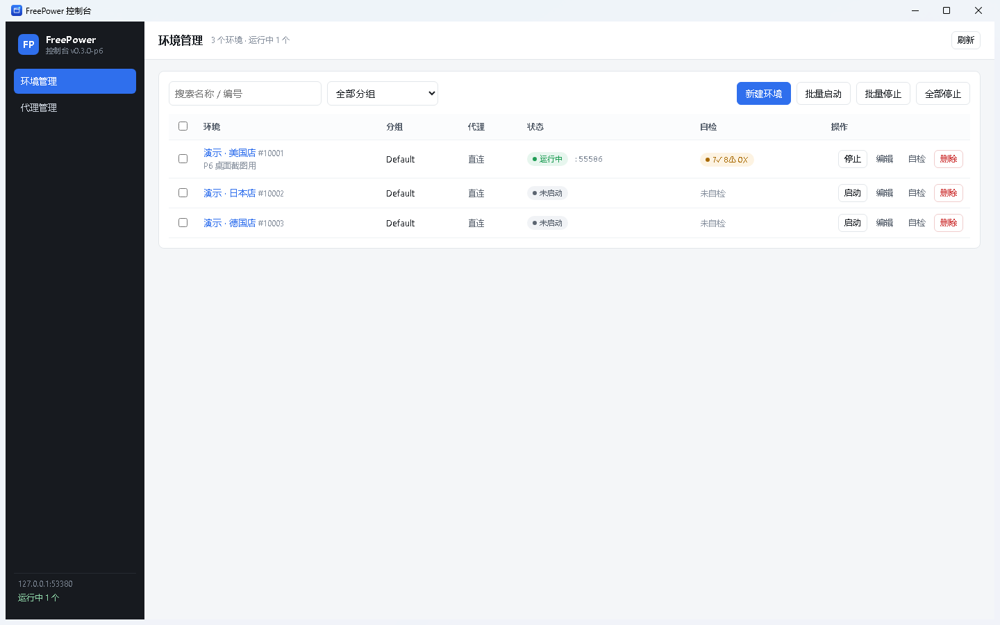

# P6：Electron 桌面壳 + 可分发安装包

目标：从「开终结器 + 开浏览器」变成一个能双击安装、常驻托盘、关窗不退出的桌面 app。
范围就六件事：壳不重写服务、单实例、托盘、关窗不退、开机自启、安全姿势；外加打包。

---

## 一、壳长什么样（为什么这么搭）

```
FreePower.exe (Electron 主进程)
 ├─ 进程内起同一个 node:http 服务（src/boot.js → src/api/server.js）
 │    └─ 127.0.0.1:53380 起，被占则顺延；写 data/local_api
 ├─ BrowserWindow.loadURL('http://127.0.0.1:<port>/')
 │    └─ 还是那四个页面，web/ 一个字节没改
 └─ Tray（打开控制台 / 运行中 N 个 / 停止全部 / 开机自启 / 退出）
```

三条硬约束，落地方式：

1. **壳不重写服务。** `src/boot.js` 是从原来的 `src/main.js` 里抽出来的启动引导：
   找端口、写发现文件、交出 `{server, port, apiKey, url, close}`。CLI 和壳共用这一份，
   所以「CLI 能跑通的东西壳里一定能跑通」，不存在两套服务。
2. **renderer 没有任何 Node 能力。** `contextIsolation:true` / `nodeIntegration:false` /
   `sandbox:true`、**不挂 preload**。页面就是普通网页，所有能力来自同源 Local API ——
   壳塌了，用户还能用 curl 干活。
3. **不引构建链。** `web/` 还是原生 JS，Electron 只管「起服务 + 开窗 + 托盘」。

---

## 二、六条验收项怎么实现的

| 需求 | 实现 | 代码位置 |
|---|---|---|
| 单实例 | `app.requestSingleInstanceLock()`，第二个实例直接 `app.quit()`；已有实例在 `second-instance` 里 `showWindow()`（窗口被收进托盘时会重新弹出来） | `desktop/main.js` |
| 托盘常驻 | Tray + 菜单五项；每 2 秒查一次运行数，数字变了重建菜单并更新 tooltip | `createTray/refreshMenu` |
| 关窗不退出 | `win.on('close')` 里 `preventDefault()` + `hide()`；`window-all-closed` 不退出 | `createWindow` |
| 退出前 stop-all + 零残留 | 托盘「退出」→ `quitApp()`：`shutdownRuntime()`（`stopAll`）→ `ensureNoChrome(DATA_DIR)`（查 WMI → taskkill → 再查）→ 才 `app.exit`。杀不掉就弹框让用户选，**默认留在托盘**，不假装干净退出 | `quitApp` / `desktop/residue.js` |
| 开机自启 | `app.setLoginItemSettings({openAtLogin, path: process.execPath, args:['--hidden']})`，默认关；`--hidden` 启动直接进托盘 | `setLoginItem` |
| 安全 | 见上；另加：`setWindowOpenHandler` 一律 deny、`will-navigate`/`will-redirect` 出本地地址就 `shell.openExternal`、`will-attach-webview` 拒绝、权限请求一律拒 | `createWindow` / `main()` |

### 托盘菜单（实际内容）

```
打开控制台
运行中：N 个环境          ← 灰色，只读
停止全部环境              ← 运行数为 0 时禁用
────────
开机自启                  ← checkbox，打包后才可用（开发态显示「打包后可用」）
────────
退出 FreePower
```

「运行中：N 个环境」的数字来自 `runtime.listRunning()`，和 GUI 列表页是同一个数据源。

### 退出路径的两次核对

```
[10:06:45] quit begin (tray|arg|selftest|before-quit)
[10:06:45] quit: stopAll → 1 个
[10:06:45] quit: chrome residue before=0 killed=0 remaining=0
[10:06:45] quit: done
```

`before=1` 就说明 stopAll 漏了进程，此时 `ensureNoChrome` 会用命令行里的数据目录做匹配再 `taskkill /T /F` 一遍；
`remaining` 非空则不退出（弹框），因为「带着孤儿内核退出」比「退不干净」更糟。

---

## 三、顺带收掉的 P5 尾巴：HTML 报告不再把 api_key 放 URL

P5 里自检报告的链接是 `...&format=html&api_key=<master key>`。本机控制台无所谓，
但打包成桌面版后这条 URL 会进浏览器历史/日志，等于把整个 Local API 的钥匙写在那儿。

现在改成**一次性票据**：

```powershell
POST /api/v2/browser-profile/selfcheck-ticket   {"profile_id": "..."}
→ {"ticket":"fp_xxx","expires_in":120,"profile_id":"...",
   "url":"/api/v2/browser-profile/selfcheck?profile_id=...&format=html&ticket=fp_xxx"}
```

- 只在内存里，120 秒过期（`FREEPOWER_TICKET_TTL` 可调），最多 200 张。
- **绑定 profile_id**：拿 A 的票据读不了 B 的报告（401）。
- 有效期内可重复用（用户刷新报告页不该 401）。
- `api_key` 走 query 的老用法**完全保留**，老脚本不受影响。

界面上的「HTML 报告」按钮改成先换票据再 `window.open`，地址里不再出现 api_key。

---

## 四、打包

配置在根目录 `electron-builder.yml`（`npm run dist:win`）：

- 目标：`win-unpacked` + NSIS 安装包（x64）。
- `oneClick:true` / `perMachine:false` / `runAfterFinish:true` —— 双击装、不要管理员、装完直接起。
- `asar:true`，但 `desktop/assets/**` 解出来（托盘图标走原生层，读不了 asar 内的路径）。
- 进包的只有 `package.json / src / web / packages / desktop`；`test/ docs/ data*/ tools/` 都不进。
- 图标：`tools/make-icons.py`（Pillow 画的几何图形，自绘，不引用任何第三方素材）生成
  `desktop/assets/tray.png(32/64)` 与 `desktop/build/icon.ico(16..256)`。

**不要求 VS 编译链**：Electron 和 NSIS 都是预编译二进制，本机没有 native 模块要编译。
Linux/mac 的构建没做（当前只验证 Windows）。

### 构建时踩到的三个坑（写下来，换机器别再踩）

1. **`winCodeSign` 解包要建 macOS 符号链接**：普通用户没有 `SeCreateSymbolicLinkPrivilege`，
   7z 解包失败 → `electron-builder` 反复重试后报错。
   绕法：`--config.win.signAndEditExecutable=false` 跳过签名工具包，改用 rcedit 单独打图标/版本号。
2. **NSIS 在 `compression=maximum` 下报 `Internal compiler error #12345: error creating mmap`**：
   本机 32 位 makensis 映射 130MB 载荷失败。改成 `--config.compression=normal` 后正常，
   代价是安装包从 ~105MB 变 ~110MB。
3. **rcedit 打在「正在运行的 exe」上会静默失败**（退出码还是 0，但版本资源没写进去）。
   顺序必须是：先停掉所有实例 → rcedit → 再用 `--prepackaged` 出安装包。

---

## 五、装完是什么样

| 项 | 值 |
|---|---|
| 安装包 | `release/FreePower-0.3.0-setup.exe`（115,278,064 字节 ≈ 109.9 MiB） |
| 默认安装目录 | `%LOCALAPPDATA%\Programs\FreePower`（当前用户，不要管理员） |
| 装完体积 | **357.4 MB / 77 个文件**（Electron 本体占绝大部分：`FreePower.exe` 249.8MB） |
| 数据目录 | `%APPDATA%\FreePower\data`（库、每个环境的 user-data、`desktop.log`、`local_api`） |
| exe 元信息 | 产品名 FreePower、描述「FreePower 多环境指纹浏览器」、版本 0.3.0.0、公司 FreePower |
| 快捷方式 | 桌面 + 开始菜单（NSIS 建的，名字 FreePower） |
| 卸载 | `Uninstall FreePower.exe`，卸载默认**保留**数据目录（`deleteAppDataOnUninstall:false`） |

装完的窗口（1440×900，环境列表页有一个环境在跑）：



---

## 六、验收：做了什么、怎么核

### ① 自检链路（`--selftest`，走的是托盘「退出」同一个函数）

```powershell
FreePower.exe --selftest        # 需要普通桌面会话；受限环境见已知限制
```

它把整条链走一遍并写 `%APPDATA%\FreePower\data\desktop-selftest.json`：

```json
{
  "packaged": true,
  "server_url": "http://127.0.0.1:53380/",
  "window_visible_initial": true,
  "window_title": "FreePower 控制台",
  "tray_alive": true,
  "tray_menu": ["打开控制台","运行中：0 个环境","停止全部环境","separator","开机自启","separator","退出 FreePower"],
  "window_visible_after_close": false,
  "window_destroyed_after_close": false,
  "tray_alive_after_close": true,
  "server_alive_after_close": true,
  "running_before_quit": 0,
  "stopped": 0,
  "residue_before": [], "residue_killed": [], "residue_remaining": [],
  "quit_reason": "selftest",
  "ok": true
}
```

判据就是 `ok`：窗口关了、进程还在、服务还在、托盘对象还在、退出后零残留。

### ② 带真内核的完整一遍（本机实测，时间戳见 `desktop.log`）

```
18:04:15  装好的 FreePower.exe 启动（packaged=true）
18:04:15  tray bounds {0,0,0,0}  ← 图标进了系统折叠区/本机环境限制，见已知限制 20
18:05:14  关窗（WM_CLOSE）→ hidden；FreePower 进程 4 个仍在；chrome 12 个仍在；/status 仍 code=0
18:06:45  到点走 quitApp：stopAll → 1 个 → residue before=0 killed=0 remaining=0 → done
18:06:45  查进程：FreePower 0 个、带本数据目录的 chrome 0 个
```

### ③ 安装

- `FreePower-0.3.0-setup.exe /S /D=<目录>` 静默安装退出码 0，3.6 秒装完。
- 装完 77 个文件、357.4MB；exe 版本信息、图标都在；`resources/app.asar` + `app.asar.unpacked/desktop/assets` 齐全。
- **卸载没能在本机验完**：静默 `/S` 会拉起 `old-uninstaller.exe` 后停住不动（目录里的文件一个没删）。
  这是 NSIS 卸载器在本机受限会话里的行为，不是安装包构造错误；**卸载要在普通桌面点「设置 → 应用 → FreePower → 卸载」验一次**。
  安装包本身的构造（`Uninstall FreePower.exe` 存在、注册表项、`deleteAppDataOnUninstall:false`）是对的。

### ④ 测试

`npm run test` 五段：schema **10** + unit **35** + api **61** + ui **29** + desktop **44**。
`test/desktop.test.mjs` 是新加的壳契约测试（44 项），不需要 GUI：

- `boot.startApiServer` 起/停、写 `local_api`、url 就是壳 loadURL 的地址
- 票据：签发/跨 profile 拒/伪造拒/过期语义/api_key 老用法不变
- 残留检查：空目录返回 []、`ensureNoChrome` 三段结构、不误杀
- **安全姿势不许被改回去**：源码级断言 `nodeIntegration:false`、`contextIsolation:true`、
  不挂 preload、`action:'deny'`、`shell.openExternal`、`requestSingleInstanceLock`、
  `win.hide()`、`shutdownRuntime`+`ensureNoChrome`
- 打包配置：`appId/productName`、`!test/**`、`asarUnpack desktop/assets`、`oneClick`、`perMachine:false`

---

## 七、操作清单（给用户看的）

1. **安装**：双击 `FreePower-0.3.0-setup.exe` → 自动装到当前用户目录 → 装完自动启动，
   控制台窗口打开，托盘出现 FreePower 图标（Windows 11 默认收在「显示隐藏的图标」里）。
2. **启动**：以后从桌面/开始菜单点 FreePower；已经有一个实例在跑时不会起第二个，
   而是把已有窗口拉到前台（数据目录、端口都不变）。
3. **关窗**：点右上角 × → 窗口收起，**app 不退出**。内核和 Local API 都继续跑，
   正在跑的环境不会因为你关了窗口就断。
4. **托盘退出**：右键托盘图标 →「退出 FreePower」→ 会先停掉所有运行中的环境，
   再核对没有残留 chrome 进程，然后退出。若真杀不掉，会弹框让你选（默认留在托盘）。
5. **开机自启**：托盘右键 → 勾「开机自启」。开机后自动进托盘，不弹窗打断你。
   再点一次取消。这一项只在安装版里可点（开发态灰着）。
6. **卸载**：设置 → 应用 → FreePower → 卸载（或运行安装目录下的 `Uninstall FreePower.exe`）。
   卸载不会删 `%APPDATA%\FreePower`，环境数据还在。

---

## 八、已知限制（这轮新增，按诚实程度写）

19. **壳只做壳**：没有自动更新、没有多窗口、没有崩溃上报服务端。`app.asar` 里的前端仍是同一个 `web/`。
20. **托盘图标在本机（Agent 受限令牌下）没有出现在通知区域**：Electron 的 Tray 对象、菜单、消息窗口
   都创建成功（`desktop.log` 有记录、selftest 里 `tray_alive:true`），但 Win11 的溢出面板里看不到；
    同样条件下裸 Electron 的托盘也一样、而直接调 `Shell_NotifyIcon` 的探针是成功的 ——
    判定为「Electron 在这个受限会话里注册图标失败」，不是壳逻辑问题。
    **正常桌面双击安装后需要在系统托盘里确认一次**（关窗后能否从托盘唤回）。
    兜底路径：即使托盘不可见，再点一次桌面图标会通过单实例锁把窗口拉回来，不会把用户锁死在后台。
21. **本机验证必须带 `--no-sandbox` / 数据目录落在工作区内**：Agent 会话的令牌是受限的，
    Chromium 自己的沙箱起不来（秒退 `STATUS_BREAKPOINT`），且 `%APPDATA%` 之外的目录写入被沙箱拦。
    这不是产品行为，是「在受限终端里验 GUI」的代价。**用户正常桌面双击不需要任何参数。**
22. **受限环境还可能挡住内核的沙箱**：`FREEPOWER_KERNEL_NO_SANDBOX=1` 会给内核加 `--no-sandbox`
    并在启动结果 `warnings` 里标出来（`field: kernel_sandbox`）。默认不开 —— 沙箱该开着。
23. **没有代码签名**：安装包和 exe 都未签名，SmartScreen 会提示「未知发布者」。
    签名要证书，不属于本轮范围；要发版必须补。
24. **`--show-tray-menu` / `--quit-after-ms=N` / `--selftest` 是诊断入口**，不是给最终用户的功能：
    前者把托盘菜单弹出来（截图/演示用），中者到点走退出流程（自动化验收用），后者跑完整自检。
25. **本机没能截到托盘菜单**：`--show-tray-menu` 的日志确认菜单已弹出（`tray menu popped`），
    但图标没注册进通知区域，菜单也就没有可见的原生窗口可截。窗口截图是真实的，托盘部分只有
    `desktop-selftest.json` 里的 `tray_menu` 结构作证。**托盘图标与菜单要在正常桌面复验一次**。